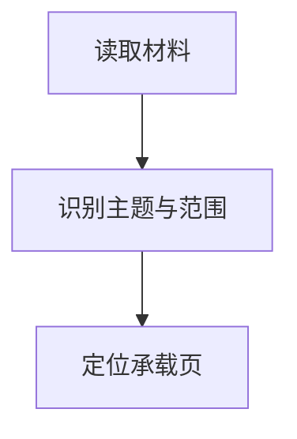

# Craft 共用块格式与能力核验

使用原生样式、结构化块或复杂嵌套时读取。Archive、XV、Car 共用实现方法；连接与凭据仍由各自 skill 的 `craft-api.md` 管理，空间与授权取自执行入口。执行与恢复遵守 [写入协议](write-protocol.md)。

## 能力与写入方式

当前工具 schema/只读帮助优先，其次是当前官方 API 输入契约，最后才是本文示例。截图证明界面功能，不证明当前连接支持写入；读取响应里出现某字段，也不能单独证明更新支持该字段。

普通段落可用 Markdown；要求原生属性时选支持的 Craft Markdown 扩展或结构化 JSON，不能以加粗标题、emoji 方框或图片冒充原生块。批量块使用一次数组提交并保留返回 ID，避免逐块调用。

使用命令式 Craft connector 时，可先读取 `blocks add --help; blocks update --help`，以执行时帮助为准。已核实的入口包括 `--markdown` 和 `--json`；命令参数与 HTTP JSON 字段不是同一套语法，不可互抄。

## 标题、强调、颜色与折叠

- 原生标题/说明通过当前工具的 `textStyle` 或 Markdown/`<caption>` 表达；页面标题由建页操作设置后，正文不重复添加同名大标题。
- 块强调可用 `<callout>...</callout>`；需要精确颜色等属性时再用结构化块。焦点样式的实际 decoration 枚举需从当前 schema/可核验数据确认，不能猜 `focus` 字段，也不能把焦点与 callout 当作完全相同效果。无法实现时选可用强调并说明差异。
- 局部高亮与整块颜色用途不同：如 `<highlight color="gray">待确认术语</highlight>` 只强调短语。颜色应配合文字含义，继承目标页配色。
- 引述内容保留出处；`> 引文` 用于真实引用，不假装是原生来源证明。
- 折叠先验证标题和下属内容的归属。命令式 connector 当前可用如下 Markdown；实际换行、缩进与子项结构必须保留，不能传字面量反斜杠 n：

```markdown
+ 补充示例与来源
  - 第一条补充说明
  - 第二条补充说明
```

折叠下普通齐左文本可能落成同级块而产生空折叠；复杂内容优先用已支持的结构化层级。写后核对 `listStyle` 和下属块/缩进关系。不要把必要风险、关键条件或必做步骤折叠隐藏。

## 页面、卡片与原生块

嵌套页面可使用：

```markdown
<page textStyle="card" cardLayout="small">
<pageTitle>子主题</pageTitle>
<content>
这里是有独立阅读价值的正文。
</content>
</page>
```

small/square 适合并列入口，regular/large 适合全宽入口，按目标设备与现有风格选择。创建后立即读取返回的 page 块，确认正文在该页自己的非空 `content` 中，父页同级文本不算成功。卡片不是装普通段落的装饰盒。

结构化块示例（仍需核对当前写入 schema）：

```json
{
  "blocks": [
    {"type":"text","textStyle":"h2","markdown":"检查方法"},
    {"type":"text","decorations":["callout"],"color":"#2563EB","markdown":"**方法：** 按下列步骤核对原始资料。"},
    {"type":"line","lineStyle":"light","markdown":".--"}
  ],
  "position":{"position":"end","pageId":"verified-page-id"}
}
```

相对定位用已核实的 sibling ID。向 text 块添加子内容可能使其转为 page，不能为缩进或装饰无意改变层级。表格用于对照，Collection 的字段、记录和视图应通过对应工具创建；读回的 `<collection>` 等输出标记不能直接作为创建输入。

## Mermaid、公式与代码

Mermaid 优先使用原生可编辑图表。支持时用 Mermaid 围栏；结构化形式按实时输入契约选择 code 块及 `language: mermaid`、`rawCode`。不要把整个带围栏字符串再次塞进 `rawCode`。



这是归档流程示例，不是汽车项目事实。Craft 仅支持 Mermaid 的部分图形类型；2026-09-27 官方文档列出流程、时序、状态、类、ER、XY，未支持的 mindmap/Gantt 等不能凭通用 Mermaid 经验写入。遇到语法或类型不兼容，先简化到受支持表达；需要自由布局时读取已安装的白板 skill。

公式使用原生 TeX；API Markdown 扩展记载 `$...$` / `$$...$$`，结构化入口可能使用 code/math_formula。编辑器键盘快捷输入与 API Markdown 解析不是同一接口，须核实最终是行内还是独立公式。保留符号、单位、上下标和条件；不能仅靠公式美化猜补项目参数。

代码块为真实代码、命令或报文选择适当语言，行内代码用于标识符。图表、公式、代码回读时验证类型、语言和源内容；可用时在页面上确认渲染。只核对源文本不能宣称图表已正确显示。

## 页面级样式

默认继承既有风格。有实际视觉用途且属于当前授权时才调整封面、背景、字体或主题；不扩大成整个空间改版。

2026-09-27 的命令式连接帮助提供页面主题、字体、文字/背景色、封面、backdrop 和分隔样式入口；其他连接可能不同，先查当前帮助。可通过只读的 `blocks explore-themes` / `blocks explore-washi` 查实际可用选项，不编造主题 ID。块字体枚举与页面样式的字体参数应分别核实。

样式更新应只提交需要修改的字段；应用整套主题可能替换或清除主题管理的背景/卡片属性，先保存现状。不要沿用“Craft API 一律不能设置背景封面”的旧结论，也不要从界面推断所有连接都支持它们。

## 更新、附件与验证

- 更新前保存原文和必要属性。当前 `blocks update --markdown` 的多段输入会用第一段替换目标块、把其余段落插成同级块；不能把整篇正文传给一个标题块而期待原层级自动保留。
- 样式更新优先采用受支持的局部字段。仅当实时 schema 要求时连同原 markdown 提交；不得为了改样式意外重写、清空或复制正文。
- 图片传真实 MIME 字节并回读为 image；附件应可追溯且实际存在，原图与图注顺序正确。上传位置、嵌套页和返回块 ID 均按当前连接契约核实。
- 写后回读目标内容，检查文字、单位、来源、层级、颜色、强调、折叠归属、卡片子内容、图表类型、媒体顺序与重复项。核对实际路径，处理超时与恢复按共用协议。
- 可用时打开目标页确认重要视觉效果；只有结构回读时，明确未验证渲染。样式降级必须说明，不能把保存成功等同于达到排版要求。

## 依据

2026-09-27 核对 [Craft Space API](https://connect.craft.do/api-docs/space)、[Mermaid 文档](https://support.craft.do/en/write-and-edit/mermaid-diagrams)、[公式文档](https://support.craft.do/en/write-and-edit/math-formulas) 及本次可用 Craft connector 的 `blocks add/update --help`。这些是功能依据；本文的内容选择与视觉取舍是本地规范。执行时仍核实实时接口。
