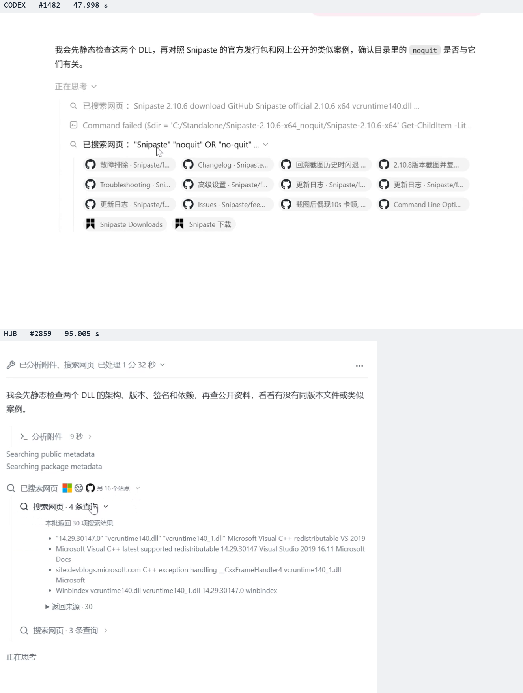
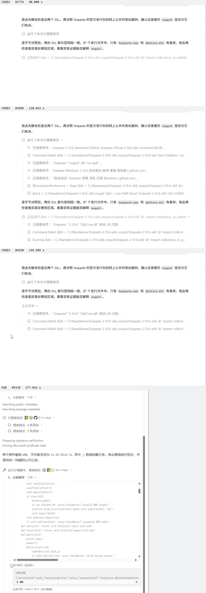
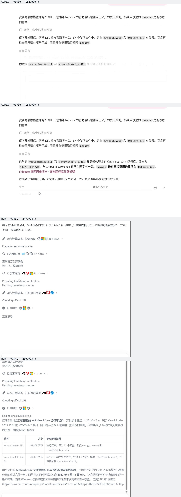
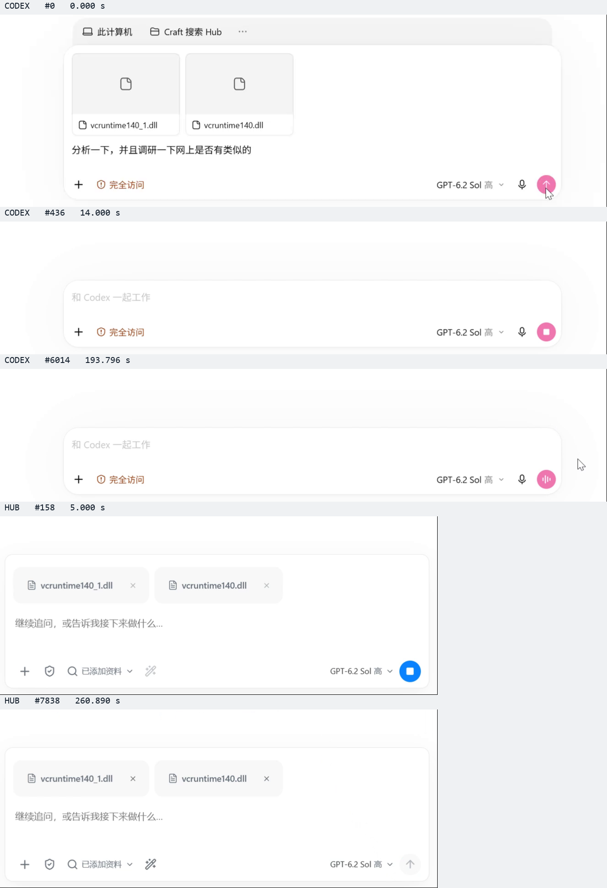
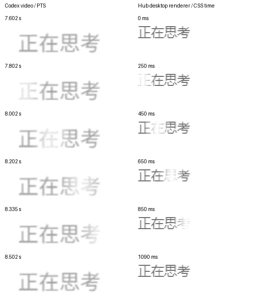

# Hub Agents 工作过程如何对齐 Codex

2026-11-20 · 桌面浅色模式 · [Agents 工作过程升级 #56](https://github.com/VondeSong/hub-search/issues/56)

**优先调整时间线的组织方式，再调整动效。** Codex 把每段公开进度放进对话正文，在它下面用一行表示当前工作。用户可以就地展开工具、回看上一段，再接着读答案。Hub 在同一次运行中同时展示总览、计时、步骤和多条公开摘要，用户需要在几处文字之间判断当前进度。另一个可定位的差异是 Hub 的独立“正在思考”行没有使用工具标题已有的文字动效。下文的图均取自这两次真实运行。

## 01　发送后，视线应该落在哪里

Codex 的两份附件和用户问题靠右，助手从左侧正文栏起笔。2.005 秒先出现“正在创建聊天”，4.004 秒同一栏出现“正在思考”。14 秒时进度说明占据正文位置，低强调度的活动行在其下。Hub 在正文之前先展示带用时、横线和更多菜单的总览，然后另起一行显示“正在思考”。两个视口宽度分别为 1326 和 956 个视频像素，直接照搬两侧留白会让窄窗口正文过窄。

**复刻与验收**　在新聊天、已发送但尚无工具、已产生首段进度三个时点截屏。新聊天有真实创建事件才显示创建文案；等待时只显示当前活动行；收到进度后将公开说明放在活动行上方。窄窗口验收对照图中的阅读顺序、左右归属和正文对齐线；菜单留在可回看的历史入口。附件、状态、正文三者不能互相遮挡。

## 02　白色光晕在字形里移动

观察下图左列。7.602 秒的“正在思考”可作起始参照，7.802 秒左端笔画变浅，8.002 秒亮部移向中间，8.202 至 8.335 秒经过右侧，8.502 秒右端恢复。原图文字约在 x=140–219、y=263–281；裁切上方四行像素在该窗口保持灰度 255。右列是 Hub 自己录屏同时间的六帧，文字没有出现相应的扫亮。两列只用于比较动效，不代表两次请求同步执行。

**复刻与验收**　给当前状态的文字本身做横向渐变，用字形裁剪让窄亮带从左向右穿过灰色笔画。背景、行宽和基线保持稳定。分别截取左、中、右亮起及回落四个时点，再看一遍连续播放。整行同时变淡、背景出现色块或文字左右移动，都属于可见偏差。当前实现的渐变只匹配活动工具组的标题，使用品牌色混合，2.1 秒一次、最多三次；独立思考行走另一条样式。实施时共用活动文字样式，仅给仍在运行的标签加动效。建议在持续等待时循环，结束即停；减少动态和强制颜色模式使用可读静态文字。循环间隔、缓动曲线和辅助模式属于实现选择，录像只确定这一次扫动的方向和亮度顺序。[现有样式](../src/AgentInvestigation.css)

[播放真实帧裁切动图，按原时间间隔近似回放，末尾循环便于观察](process-video-20261120/glow.gif)

## 03　当前工具占一行，步骤按需展开

Codex 在 21.997 秒用终端图标和单行命令表示正在执行的工作。45.998 秒展开后，子步骤缩进，浅色细线把搜索和失败命令连在同一组内。Hub 在 68.013 秒的总览和步骤都出现“分析附件”，到 73.012 秒，工具行已显示 9 秒耗时，下面又出现独立思考行。

**复刻与验收**　用当前真实工具的图标和短标题替换空闲思考行；工具结束而回答仍在生成时才恢复“正在思考”。摘要、展开箭头及可点击范围属于同一行。工具名、历史耗时、错误详情放在对应层级。以图中单步和多步分别复验，顶层只读一次就能知道此刻在做什么，展开后仍能定位每一步。

## 04　网页搜索按查询呈现来源

Codex 47.998 秒显示查询文本及其下的网站胶囊。胶囊由站点小图标和短标题组成，横向排列，空间不足自然换行。Hub 95.005 秒同时显示搜索组、站点计数、“搜索网页 · 4 条查询”及结果数量。两种组织方式的区别在于，展开后能否一眼看出哪些来源回答了哪条查询。

**复刻与验收**　收起时显示搜索动作与来源预览；展开后按实际查询顺序列来源。长标题截断，较窄宽度优先换行，缺图标的来源仍显示站名。仅在数据提供查询与来源的对应关系时分组，否则按该次搜索列出。以图中多来源的行复验图标、标题、换行与折叠后的占高。链接目标、键盘焦点与无图标回退需在原型中另测。

## 05　命令和输出在原位阅读

Codex 把 Shell 标签、等宽命令与输出放进展开行下面的浅色面板，长内容有内层滚动区域，退出码靠右下。Hub 已能展示 Python 正文；77.010 秒与 84.008 秒的内容位置发生变化。复用这个查看器可以保留已有的真实执行记录。

**复刻与验收**　保留原语言、换行、错误和退出码。默认限制长输出面板高度，给面板内滚动独立空间；从同一行关闭。对照长脚本滚动前后的外层标题和相邻步骤位置。用既有成功与失败记录分别检验展示，不从一段文本猜测退出码。复制、键盘滚动及焦点恢复属于交互验收项，截图只能证明可见外观。

## 06　子项折叠与整组折叠是两次操作

Codex 49.997 秒同组下能看到执行详情；53.007 秒详情已收起，组内其他行仍在；54.984 秒整组收成一行。三帧之间的差异可以直接用来验收点击影响的范围。

**复刻与验收**　行标题控制本项，组标题控制整组，箭头方向跟随展开状态。新增事件、计时刷新时保留已有选择。以运行、段落和事件的稳定标识记录状态；沿用 Hub 已有的 disclosure 状态管理。用同一段记录复走“展开组 → 展开工具 → 收起工具 → 收起组”，逐步比对三张实帧。键盘操作后焦点回到相应标题是建议验收项。[现有折叠入口](../src/AgentActivity.tsx)

## 07　第二段进度到达后，上一段还能单独回看

Codex 90.000 秒第一段工具已收成短摘要，下一段进度正文和新活动行在其下面。120.014 秒可以回看较早的步骤；139.989 秒可单独展开第二段。Hub 177.014 秒仍在一条长时间线上交替展示英文公开摘要、进度正文和工具，回答前的阅读距离更长。

**复刻与验收**　按公开进度消息在事件序列中的位置划分段落，每段绑定后续工具，直到下一条正文。历史段默认以短摘要收束；用户已主动展开并阅读的段保留选择。将重复的英文公开摘要收进对应段的详情，保留原文。旧会话缺少段落边界时沿用原始顺序。以两段录屏为基准，逐次展开第一段、第二段，再让新事件到达，检查步骤归属、展开状态与阅读位置。这里只使用客户端已经获得的公开事件。

## 08　答案开始出现时，过程仍可回看

Codex 182 秒可见首段回答，约 185 秒表格开始出现。Hub 247.994 秒仍显示过程，到约 251 秒正文和表格已经可见，上方还能读到公开过程。这两帧给出 Hub 转场的时间区间。

**复刻与验收**　首个答案片段就位时撤下“正在思考”，在最后一段历史摘要下直接绘制正文；段落、链接和表格随接收内容更新。用户停在底部时跟随正文；正在回看历史时保留阅读位置，允许手动返回底部。两种滚动策略是建议，截图中可直接核对的是内容顺序、表格出现和历史是否仍可读。

## 09　完成态要区分工具失败与回答结果

Codex 最后样本保留两条历史摘要、用时 2 分 58 秒及答案。早先的 Shell 失败仍可回查。Hub 最后样本以“部分未完成 用时 4 分 18 秒”收束，下面已经显示回答、来源和带边框的表格。现有 runOverview 会把失败、中断或 errorCount 汇总成“部分未完成”；用户仅看总览很难判断故障影响了哪部分交付。

**复刻与验收**　以运行终态决定运行标题及总耗时；个别工具的失败留在对应步骤，确实影响用户要求时在回答或摘要点明缺少什么。总用时来自运行记录，不能用视频总长代替。正文主次、链接、表头、分隔线、答案下方的操作区按图检查；先比对相同宽度下的字重和列间距。分别回放“有失败步骤且有答案”和真正中断的历史会话；后者是额外测试场景。

## 10　输入区是整个转场的固定参照

发送前 Codex 输入区有两个附件预览；运行中右端圆形控件显示停止符号，结束后恢复输入态。Hub 在发送后和完成态的输入区仍能看到附件芯片。两端工具区配色与排列也有区别。此处要同时核对“历史消息带了什么附件”和“下一条消息将发送什么附件”。

**复刻与验收**　提交成功后把已发送附件归到对应用户消息，清除已消费的输入草稿附件；发送失败则保留草稿以便重试。运行中与完成后的右端操作分别取决于当前请求和草稿是否可发送。检查停止按钮、禁用态、模型选择入口与输入区边界；在窄窗口展开长输出，底部控件仍可触达。录像覆盖按钮外观，停止请求后的服务端行为需另行验证。

## 实施顺序与复测

1. **现有 Hub 工作台原型先复现三个连续状态**。以图 1、2、3 为验收基准，走完发送、等待、首个工具。白色扫光另录原速短片，以图 2 的字形放大带检查亮部方向、背景和回落。
2. **接上同题的完整过程**。按图 4–8 复走查询展开、长输出滚动、子项与整组收起、回看第一段、第二段到达、答案进入。每个动作保留操作前后的同尺寸截图，用同一处可见文本作滚动位置参照。
3. **核对收尾，再进入桌面实现验收**。按图 9、10 比对总耗时、失败步骤、表格及输入区；单独复验减少动态、键盘操作、停止及历史回读。桌面侧优先复用 AgentActivity、ActivityTimeline、OperationPhase、WebActivity、RecordedToolActivity 和现有输出查看器。原型截图与真实运行验收分别记录，桌面阶段使用已有真实资料。
4. **视觉对齐的测量条件**。同一浅色模式、窗口宽度和缩放分别录制参考与候选；在正文首字、活动文字基线、展开行左边界、工具面板边缘、输入框顶边设置对照点。先对齐几何位置，再比较字重、对比度、留白和动效。视频像素包含应用缩放和编码影响，字体名称、CSS 像素、精确曲线、悬停提示及未点击控件行为须在实机复核。

## 帧索引与取证方法

全量解码了 Codex 的 6,022 帧和 Hub 的 7,846 帧。为每一帧记录视频 PTS，并对缩小后的灰度图计算与前帧的平均绝对差、差值超过 5 和 20 的像素数；借助按时间采样的拼图定位交互，再目视复核关键帧。文字动效另取原分辨率裁切比较。变化检测覆盖 13,868 帧，人工复核集中于关键状态。图中帧号从 0 开始，时间取视频流 PTS，单位为秒。截图为原帧局部，少数横向有浅灰补边；图 2 特意放大。GIF 的循环仅为对照播放。

| 录屏 | 分辨率 | 时长 | 逐帧索引 | 原文件 SHA-256 |
| --- | --- | --- | --- | --- |
| Codex | 1326 × 1920 | 194.062 秒 | [CSV.GZ](process-video-20261120/codex-frames.csv.gz) | 5609d2ede9ed2f723dcf2e9fe464e5e4f51aa9db1504bee457cf4a68a91621f0 |
| Hub | 956 × 1920 | 261.157 秒 | [CSV.GZ](process-video-20261120/hub-frames.csv.gz) | 7b2bec2217130ce2dfbdc14db4f93c90a05fdb9dcbf906bf0c48ab003df205b2 |

## 桌面实现复核

同题历史的 24 条公开流事件在桌面组件内回放，两个阶段可独立展开。下图左列为 Codex 视频原帧，右列为桌面组件在 Chromium 中按动画时间截取的六帧。将字形划为四个等宽区，四区亮度峰值分别出现在 250、450、650、850 毫秒的采样帧；减少动态模式下无此动画。两列保留各自的字形尺寸，右列时标从一次 CSS 动画开始计算。

