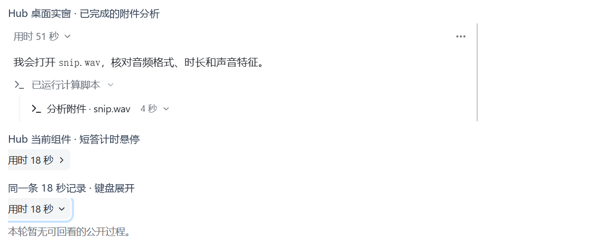
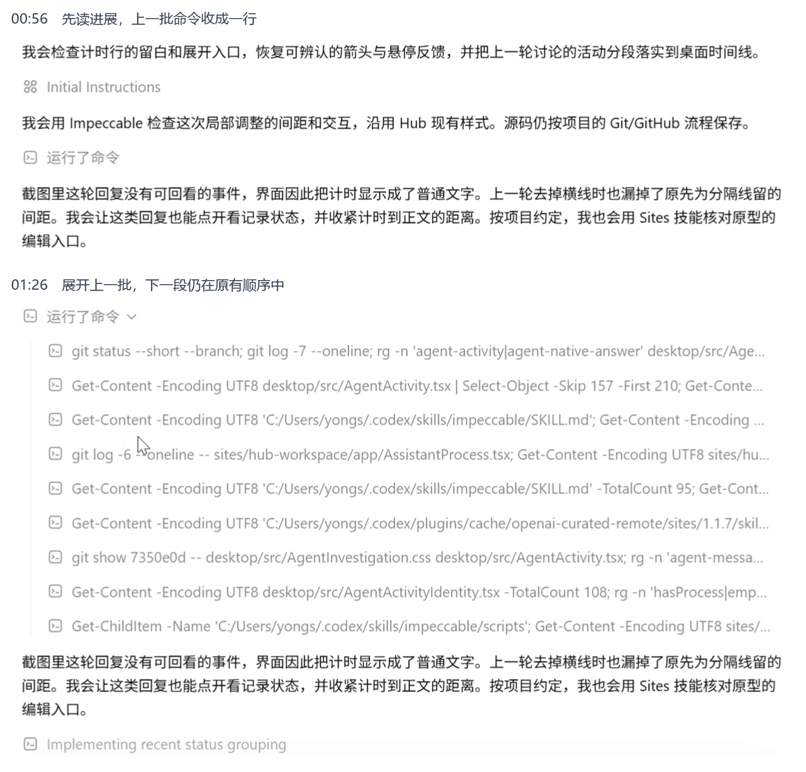
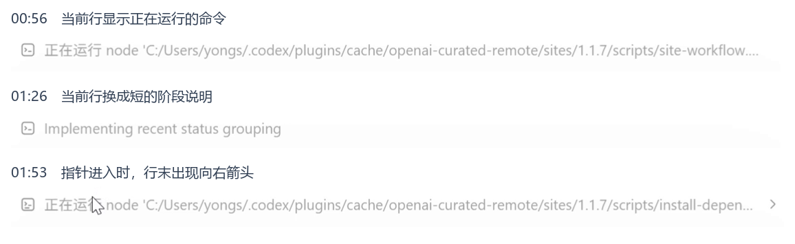
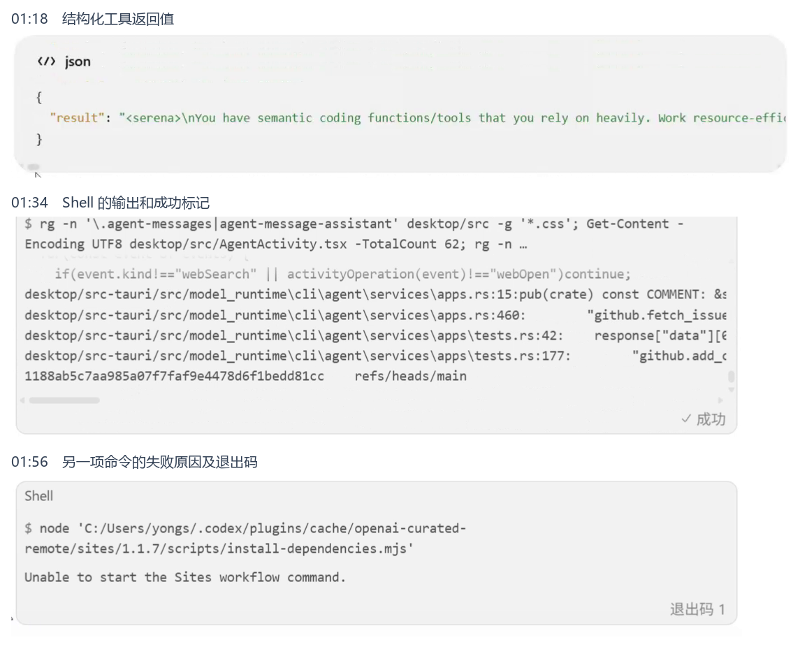
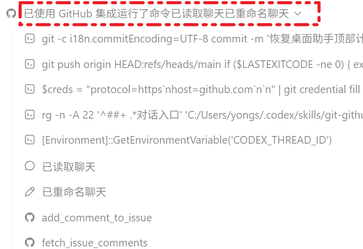
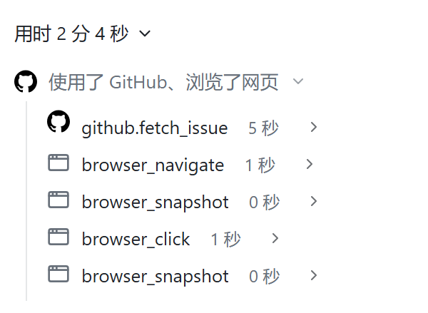
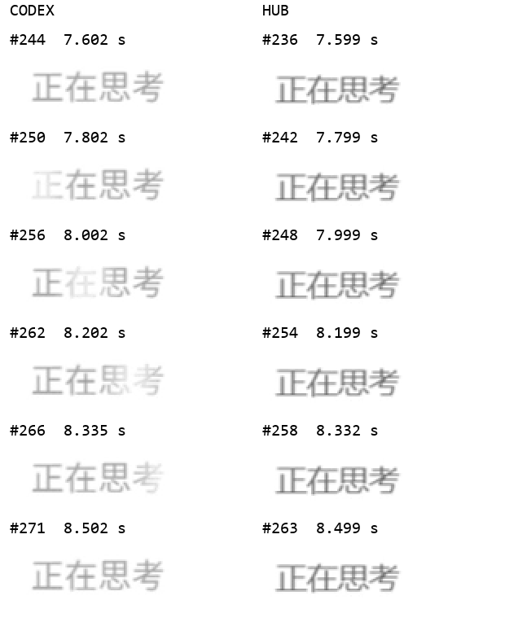
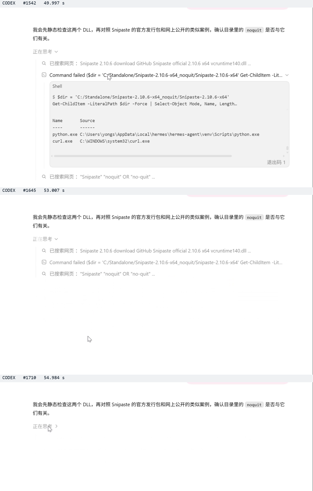

# Hub 思维链展示方案

**本页是 Hub 助手公开工作过程的长期方案入口。** 桌面以 2026-11-20 的 `ce9c411` 为基线，后续已更新计时行悬停、活动图标和混合组标题。布局、交互、对照图和取舍都在这里原位更新。开发进度归 #56。本文中的“思维链”指用户能看到的进展说明、提供方公开摘要、实际工具步骤、执行回执和回答。[桌面基线](https://github.com/VondeSong/hub-search/commit/ce9c411624722e061c617cd15217758a742edb75) · [工作过程升级 #56](https://github.com/VondeSong/hub-search/issues/56)

**结论。** Hub 应保留顶部计时、清晰的流式正文和可核验的工具回执。最值得继续复刻 Codex 的有两处。一是让人扫一眼就知道每条搜索在查什么，点开该行就看到对应来源。二是让长任务进入回答时自然收短，同时保住用户正在看的历史步骤。两项都能直接减少找信息和来回展开的次数。

[当前 Hub 怎么展示](#hub-now) · [计时与活动行悬停](#timer-hover) · [录像一：开发工具](#video-one) · [录像二：网页研究](#video-two) · [图标与混合组标题](#icons-and-group-title) · [逐项取舍与验收](#decisions) · [实施差异复查](#implementation-review) · [较早录像与原始证据](#archive)

## 当前 Hub 怎么展示

**计时和展开入口。** 每轮顶部先显示计时，最新工具动作留在所属段落。处理期间显示“已处理”，开始回答后显示“用时”。时长优先取运行结束时间，其次取首段答案到达时间，等待时按秒刷新。暂停、待确认、未完成有各自的后缀。常显箭头收起朝右、展开朝下。悬停显示反馈与操作提示，点击或通过键盘激活才改变展开状态。右侧“…”单独查看本轮工具与权限。这里的“固定在顶部”指本轮内容的排列位置。

计时行最小高度 28 CSS 像素，箭头 13 像素。相邻的工作过程与最终回答之间设置 6 像素外边距，计时到展开内容也是 6 像素。计时下面没有横线。步骤左侧的细竖线表示父子关系。具有运行元数据的直接回答也能展开查看空态；较早的纯答案记录缺少过程元数据时沿用文本计时。[布局样式](../src/AgentInvestigation.css)

### 计时与活动行悬停

图 1 的 Hub 计时按钮原先和工具活动行共用悬停样式。指针进入后，控件填充色让它看起来像被选中了。图 2 是 Codex 计时行的透明背景参考，字色切换已用本机 Codex 样式核实。[Hub 计时按钮样式](../src/AgentInvestigation.css)

Hub 的计时按钮、活动组、网页批次、公开摘要和可展开工具步骤都使用透明的悬停背景。鼠标移入提高文字和箭头的对比度，移出恢复默认字色。Tab 聚焦时有可见的焦点轮廓。点击、Enter 和空格控制展开及收起，箭头随展开状态转向。

上一轮只验证了计时，还留着活动行独立的背景填充规则。本轮回放了截图中同一轮「用时 33 秒」的真实记录，分别检查浅色、深色的网页组头和搜索子项。移入、移出、键盘焦点和展开均已通过。工作台原型从 v120 起采用同样的悬停样式。

**从等待到回答。** 下表是当前桌面行为。原生分段、旧记录以及用户已经手动展开的状态各有不同，回放时应使用同类记录比较。[时间线组件](../src/AgentActivity.tsx) · [消息与正式交付](../src/AgentDelivery.tsx)

| 时点 | 用户会看到什么 | 展开后和下一步 |
| --- | --- | --- |
| 等待首个公开事件 | 运行中的本轮过程默认展开。没有活动工具或正在显示的运行状态时，尾部显示“正在思考” | 等到实际进展再显示内容。占位文案去重，减少动态或强制颜色模式下保留静态文字 |
| 收到公开进展 | 进展用正文主色，接在实际发生的位置。进展之间相邻的工具和 Codex 公开摘要组成一段 | 工具段通常收成一行。组内有工具时，公开摘要另设可展开入口。纯摘要、计划、上下文事件各按类型呈现 |
| 工具执行与连续更新 | 当前段优先显示正在执行的动作，其次是等待的动作；一批连续操作结束时可显示最近动作。图标对应操作或服务 | 打开组可逐项看记录。历史长组起始展示 8 项，每次再看 8 项；已经打开的活动组追加新步骤，包括第 9 项。用户可以同时回看多个段 |
| 网页搜索 | 阶段行可显示步数、站点标识和剩余站点数。批次行显示“搜索网页 · N 条查询” | 批次内有搜索词、返回数和来源胶囊，正常搜索有来源时默认打开来源列表。按记录区分搜索、打开页面、页内查找、零匹配和失败 |
| 首段答案到达 | “正在思考”退出。答案在折叠区外按 Markdown 流式绘制，完成后由正式回答接替 | 正文、粗体、表头与单元格保持正文主色；长表格可横向查看。历史过程仍可回看 |
| 回看与异常 | 局部失败可在收起的阶段显示“部分未完成”。本轮中断、工具失败、来源失效、过程截断各有提示 | 本轮具备相应记录时能继续看具体原因、范围、退出码或未发布答复。离开底部回看时有“回到最新内容”入口 |

下图是 Hub 当前桌面组件回放一轮真实附件分析。第一段展开了某一批搜索，第二段保持收起。可以直接看到一个具体问题：相邻几行都叫“搜索网页 · 4 条查询”，展开后才能判别其调查方向。来源标题中还出现了 `<table id="e1">`，虽有链接，读者仍难判断该页是什么。图中地球为该回放环境的站点图标回退样式。

下图取自日常 Windows Hub 的真实对话。一轮共用时 51 秒，其中附件步骤为 4 秒。脚本在组内展开，执行结果写明退出码，结构化输出可继续查看。**这两种耗时和结果分别回答三个问题：这轮等了多久、哪一步花了多久、那一步是否成功。** [工具回执查看器](../src/AgentToolResult.tsx) · [阅读位置与返回最新](../src/useAgentConversationScroll.ts)

流式配色用同一轮已保存的 DLL 分析答复在当前组件内回放。浅色模式下，段落、表头、单元格的计算颜色均为 `rgb(32, 36, 42)`。后续调整等待动效时，应以这三个位置作为回归检查点。

## 录像一 · 开发工具如何跟着进展展开

`codex1.mp4`，1348 × 914，2 分 43.21 秒。录像从一轮开发任务的中途开始，片末仍可见执行中的命令。它适合比较多段进展、命令和回执。没有拍到该轮最终交付。

**正文给操作分段。** 00:56 的“运行了命令”夹在两段清晰的进展正文之间。到 01:26，较早的同一行展开成多条终端命令，后一段进展仍接在它下面。缩进和细竖线已经足够表明归属。Hub 当前也按进展分组，这项应保留。可继续借鉴的是历史组标题的长度：收起后留下动作概括，长命令在子项里读。

**当前动作原位变化。** 00:56 是命令，01:26 同一阶段的当前行显示短的工作说明，01:53 指针位于活动行，行末可见展开箭头。浅灰文字把正在做的事留在视线中，长路径也会挤掉真正有用的对象。Hub 已对部分 GitHub 动作提供中文短标题；下一步适合把常见附件、浏览和命令行摘要写成“动作＋对象”。缺少对象时用可信的操作名。

**单条回执就地阅读。** 01:18 有独立的 JSON 面板，01:34 的命令面板右下标“成功”，01:56 的另一项命令则保留失败原因与退出码 1。用户可以跳过技术细节，也可以追到具体操作。Hub 的脚本语言、持续时间、退出码和结构化输出已经有对应能力。可改进之处是让用户在第一屏先读到结果，较长的源码和原始输出再按需查看。

**新动作与旧记录同时可见。** 用户此前给的两张补充截图拍到了更直接的前后变化：组标题从 `add_comment_to_issue` 换到 `fetch_issue_comments`，已有回执仍在，新的读取回执追加在下面。Hub 已有覆盖第 9 步到达、旧回执保持展开的回归用例。这里值得复刻的是列表的稳定性；用户可读的标题仍可使用“准备评论草稿”“读取 GitHub 评论”。[稳定展开用例](../src/AgentActivity.test.tsx)

## 录像二 · 网页研究如何从等待过渡到答复

`codex2.mp4`，1308 × 1628，1 分 19.77 秒。这一段覆盖发送、等待、多批搜索、收起和首段答案。下列画面仅用于观察界面，录像中的新闻内容未作事实核查。

**从等待切到有对象的动作。** 00:08 的正常颜色正文交代了核查范围，下面只有“正在思考”。00:22 同一段出现 Working 和第一条实际搜索词。指针所在查询行加深，右侧可见箭头。Hub 已能把正文和状态分色，也应保留自己常显的顶层计时箭头。搜索行最值得借鉴的是把查询主题直接写在动作之后。

**点开一个查询，就看这一行的来源。** 00:26 第一行已展开，下面是站标和截短标题组成的多列胶囊；第二行查询紧随其后，仍可独立展开。图中能看到 AP、Axios 等站标，同一站点也会返回多篇文章。Hub 已有来源链接与缺图回退。主要差距在入口层级和条目命名。当前事件常提供“本批查询数组＋本批来源数组”，只能在实际记录带有匹配关系时细分到单条查询。

**整组收起和单项收起解决不同问题。** 00:55 整组只占 Working 一行；01:13 展开后已有七条查询，早先的仍在上面。用户可以先扫搜索方向，仅打开感兴趣的一批。Hub 的阶段、批次、来源都有展开能力，但若每一层只写步数或数量，反复点击才知道自己该看哪里。把具体查询提前，保留两级独立控制，就能减少一次试探。

**答案出现前，先给正文腾出位置。** 01:15 还能看到查询与来源，01:16 只剩用时和右箭头，01:17 出现标题，01:19 正文继续增长，已经输出的文字清晰可读。此时用时仍从 1 分 13 秒变为 1 分 16 秒，画面不能证明已经结束。Hub 目前具备独立流式正文，但有分段的原生历史可能保持展开。建议只在用户跟随底部、也没有主动展开回看时，让首次回答到达收束过程。正在看某条来源的人应继续停在那里。

## Codex 的图标与混合组标题从哪里来

下图是用户截图的原尺寸局部。Hub 针对同一类动作使用自己的图标组合。终端使用带外框的终端图标，编辑和重命名使用带文件轮廓的笔形图标，独立浏览器使用窗口图标，读取聊天使用双气泡。内置网页搜索、页内查找和来源站标各沿用自己的映射。GitHub、Notion 使用现有品牌资源。[当前图标映射](../src/AgentActivityIdentity.tsx) · [品牌资源来源](../src/assets/agent-services/README.md)

| 类型 | 应覆盖的图标与状态 | 对齐办法 |
| --- | --- | --- |
| 工作步骤 | 终端、文件编辑、读取聊天、重命名聊天，以及录像中的网页搜索与浏览 | 分别对照轮廓、线宽、留白和基线；终端看外框，读取聊天看气泡，网页搜索看放大镜。相同铅笔可以用于两种动作，文字仍须说明改了什么 |
| 集成与来源 | 截图中 Serena 行的四瓣图形、GitHub 品牌标、浏览器地球、各网站 favicon | 按真实服务身份或网页域名选择。四瓣图形目前可确认出现在 Serena 行，截图本身不足以判定它是 Serena 专属品牌标。对缺少站标和未知服务保留可辨认的回退 |
| 交互与运行状态 | 收起向右、展开向下的箭头，悬停、键盘焦点、活动中、完成和失败 | 在相同主题和缩放下比较控件的位置、反馈和可辨认性。不同系统缩放及未采样图标仍待逐项核验 |

**图 2 的长组标题由 Codex 桌面客户端组装。** 本机 Windows 桌面版 `26.1117.3838.0` 的活动组件先生成多个摘要片段，再用本地语言模板格式化。集成名可去重并按语言组合；命令有单复数模板；聊天动作依据执行状态选择“正在读取”“已读取”或失败文案。已完成的混合组还会按首个摘要片段寻找可代表它的条目作为组图标。这解释了截图中前五个子项都是命令，组头却显示 GitHub 的现象。

| 截图中的文字 | 可以直接获得的输入 | Hub 负责的展示 |
| --- | --- | --- |
| 已使用 GitHub 集成 | MCP 调用的服务、工具、状态；部分调用还提供 `appContext.appName`、`actionName` 或连接器 ID | 从本组真实调用识别 GitHub，同组重复使用只写一次。已授权某服务本身不表示本轮调用过它 |
| 运行了命令 | `commandExecution` 的命令、状态、命令分类及可用的退出码 | 把多条命令概括为一段，原命令保留在各自子行 |
| 已读取聊天、已重命名聊天 | 对应工具身份、执行结果或单项展示名，取决于宿主提供的事件 | 只有拿到相应事件，才按完成或失败状态生成该片段。Hub 没收到这些桌面专属动作时就省略 |
| 展开后的 GitHub 工具原名 | 调用的 `tool` 字段，例如 `fetch_issue_comments` | 在详情保留原名，组头采用可读动作和服务名。区分准备评论草稿、发布成功和回读核验 |

Hub 已按同组事件生成中文标题。集成名去重并优先显示。浏览网页、命令、文件和聊天等动作各占一个片段。完成措辞依赖实际状态，例如一次重命名失败会保留动作名称及未完成提示。组头使用与首个片段对应的图标，已作组头或子行主图标的品牌标识只显示一次。执行中优先显示当前动作，新回执到达时保留已有步骤顺序和展开状态。[Hub 分组实现](../src/AgentActivity.tsx) · [OpenAI App Server 事件说明](https://developers.openai.com/codex/app-server/)

下图用真实保存的 GitHub 和浏览器回执在当前桌面组件回放。一个 GitHub 标识代表整组，展开后五个回执仍按执行顺序列出。工作台 v119 的「浏览器与应用」示例另外呈现命令、编辑、读聊天及重命名的组合。桌面聊天图标和命名已有组件测试，实际 Hub 历史尚缺这两类回执供实窗验证。[工作台示例](https://hub-workspace-von11.song02211368537057.chatgpt.site/?assistant=activity-demo)

本轮通过 293 项桌面定向测试与前端生产构建。工作台原型通过类型检查、生产构建和 21 项助手状态检查。发布后的示例在 1100 和 420 像素视口核对了标题、图标、子项顺序和计时行键盘交互。

Codex 参考依据为两张用户截图、本机桌面活动组件与中文语言资源，以及桌面包自带的 `codex-cli 0.171.0-alpha.13` 生成的 `ThreadItem` 和 `McpToolCallAppContext` 类型。

## 逐项取舍与验收

| 细节 | Hub 做得好或做得差在哪里 | 后续做法和可观察的验收结果 |
| --- | --- | --- |
| 顶部计时与活动行悬停 | 顶部位置和箭头稳定，悬停时文字和箭头提高对比度，背景透明 | **已实现。** 验收分别覆盖顶部计时、活动组头和组内步骤。详见[计时与活动行悬停](#timer-hover) |
| 公开进展与等待 | 正文主色让人能连续阅读；等待和当前工具都有反馈。两处同时写同一动作会显得重复 | **保留已有分段。** 用“等待 → 实际工具 → 再等待”三帧核对；阶段标题归工具，整轮标题归计时。见录像一当前行、录像二等待图 |
| 在组内识别最新动作 | 新步骤能追加到当前打开组；尚有长路径、原始工具名、只写“查询某服务”的泛称 | **完善常用中文动词和对象。** 多步进行中只更新当前阶段标题，工具原名留在详情；已展开的上一段、旧回执与阅读位置保持。见录像一两组前后图 |
| 快速判断搜索方向 | Hub 有精确批次数量。多行相同的“N 条查询”遮住每批差别 | **优先复刻查询行。** 有搜索词就展示首条或简短主题和余下数量；四批连续搜索收起时可区分，长词截断后可读全。见两端搜索图 |
| 查询与来源归属 | 返回数、未展开来源数、零匹配与失败原因有助核验；查询词与链接目前分别列出，坏标题也可能直接露出 | **优先复刻就地来源。** 单查询或有明确映射时直接列对应来源；其余明确标“本批来源”。标题为标签片段或为空时回退可识别的域名，保留原链接。用多查询、同站多文、缺站标、窄窗四种情况验收 |
| 长组与多层展开 | 旧记录限量展示可控制高度；活跃长组能追加，旧回执可保留 | **保留。** 展开第 1 条后到达第 9 条，早先记录仍打开。收起一批来源时保持兄弟条目状态。见录像一补充截图、录像二整组图 |
| 运行回执、失败、权限 | Hub 把脚本耗时、退出码、原始返回和本轮权限分开。长脚本有时先占满详情首屏 | **保留证据，缩短找到结果的距离。** 优先显示成功或失败及受影响对象；详细源码可就地滚动。某步失败但仍有回答时，两件事都读得出来。见两端回执图 |
| 回答出现时的视觉重心 | Hub 流式正文、表头和单元格使用主色；长过程可能继续占着首屏 | **优先复刻有条件收束。** 分别用跟随底部、手动展开、向上回看三种姿势验收。前者让出答案位置，后两者保留用户选中内容和滚动位置。点计时可再次回看 |
| 字色、动效和图标密度 | Hub 有语义图标、站标和键盘焦点；阶段名、站点数、工具状态挤在窄行时阅读负担增加。Codex 浅灰长命令也较难辨认 | **保留正文主色与减少动态支持。** 优先保留动作和对象，其余数量后置；悬停或聚焦时文字清晰。至少比较浅色、深色、窄窗、系统缩放。扫光逐帧样本见本页历史图 2 和桌面复核图 |

### 实施差异复查

上轮交付围绕图标、混合组标题和计时悬停，验收用例只对计时按钮测悬停。网页组头和工具行用另一条 CSS 规则，因此整行灰底漏到了交付后。后续同类改动按具体控件记录证据，分别检查鼠标移入、移出、键盘聚焦、收起和展开。下表记录其余方案与当前实现的差距。

| 原方案 | 当前核对结果 |
| --- | --- |
| 同题分段、步骤顺序和保留展开 | **已实现。** 公开进展划分阶段，新步骤追加到原组。回归用例覆盖第 9 步到达时旧回执仍展开 |
| 悬停只强调文字与箭头 | **本轮补齐。** 上轮已改计时，网页组和步骤的灰底本轮移除 |
| 活动图标和组头摘要 | **部分覆盖。** 终端、编辑、网页、GitHub 和浏览器混合组已落地。组摘要只用实收事件。聊天读取、重命名仅有前端映射和组件用例，暂缺真实 Hub 回执。Codex 的集成图形和不同缩放下的细节仍有视觉差异 |
| 用动作和对象命名 | **部分覆盖。** 常见 GitHub 动作已有中文。浏览器子项仍会显示 `browser_navigate` 等工具原名，命令和未知工具缺少统一的对象摘要 |
| 搜索行直接露出查询主题 | **未实现。** 收起的批次行仍主要显示“搜索网页 · N 条查询”。查询词要展开后才看得到 |
| 每条查询就地看来源 | **部分覆盖。** 已有可展开的批次来源列表。搜索词和来源仍分开显示，缺少“本批来源”的明确说明与异常标题回退。多查询只有收到明确映射时才能逐条归属 |
| 首段答案到达时智能收束 | **未实现。** 已有独立流式正文、回到底部与保留阅读位置的能力。答案到达时尚未根据用户是否在回看过往步骤决定是否收起过程 |
| 长回执先显示结果 | **部分覆盖。** 状态、退出码和历史输出可核验。当前展开后仍先显示脚本或输出，状态在下方 |
| 窄窗密度、缩放、辅助功能 | **未完成验收。** 浅色、深色及键盘已抽查。长组名、站点数、工具状态在窄窗组合时，以及显示缩放、触摸、屏幕阅读器，仍需各自的实测 |

**证据与更新方式。** 两段 MP4 按时间抽帧总览，再对展开、失败和交付切换加密取帧。图注时间是原视频播放时刻。当前 Hub 图注明了 Windows 实窗或真实保存事件的组件回放；回放中的输入只在浏览器内使用。录屏像素受窗口大小与缩放影响，文中的 CSS 数值取自实现。后续直接更新本页对应段落和图，将最新已核对的提交放到页首，下方保留必要的历史对照。工作台交互演示可从原站打开。[工作台演示](https://hub-workspace-von11.song02211368537057.chatgpt.site/?assistant=activity-demo)

用于辨认原始录像的 SHA-256 为 `dfa60d726f0c4304109fcf14b7ebe2e94cda3103e2d51c16e8d754ce18095509`（codex1）和 `b58a8c820759b33ba9e3fbfb303d8f2a385dead1956b63c7248305e0fd936595`（codex2）。

## 较早录像与原始证据

展开首轮 Codex 与 Hub 录像的十组对照、逐帧索引及桌面动效复核

以下保留首轮记录的时态、截图与验收建议。当时出现的计时横线、顶部混入工具标题和流式配色等问题已有后续修复；现行规则见页首。这里的 Codex、Hub 两段录像与本次新增的 codex1、codex2 为不同样本。

2026-11-20 · 桌面浅色模式 · [Agents 工作过程升级 #56](https://github.com/VondeSong/hub-search/issues/56)

**优先调整时间线的组织方式，再调整动效。** Codex 把每段公开进度放进对话正文，在它下面用一行表示当前工作。用户可以就地展开工具、回看上一段，再接着读答案。Hub 在同一次运行中同时展示总览、计时、步骤和多条公开摘要，用户需要在几处文字之间判断当前进度。另一个可定位的差异是 Hub 的独立“正在思考”行没有使用工具标题已有的文字动效。下文的图均取自这两次真实运行。

## 01　发送后，视线应该落在哪里

Codex 的两份附件和用户问题靠右，助手从左侧正文栏起笔。2.005 秒先出现“正在创建聊天”，4.004 秒同一栏出现“正在思考”。14 秒时进度说明占据正文位置，低强调度的活动行在其下。Hub 在正文之前先展示带用时、横线和更多菜单的总览，然后另起一行显示“正在思考”。两个视口宽度分别为 1326 和 956 个视频像素，直接照搬两侧留白会让窄窗口正文过窄。

**复刻与验收**　在新聊天、已发送但尚无工具、已产生首段进度三个时点截屏。新聊天有真实创建事件才显示创建文案；等待时只显示当前活动行；收到进度后将公开说明放在活动行上方。窄窗口验收对照图中的阅读顺序、左右归属和正文对齐线；菜单留在可回看的历史入口。附件、状态、正文三者不能互相遮挡。

## 02　白色光晕在字形里移动

观察下图左列。7.602 秒的“正在思考”可作起始参照，7.802 秒左端笔画变浅，8.002 秒亮部移向中间，8.202 至 8.335 秒经过右侧，8.502 秒右端恢复。原图文字约在 x=140–219、y=263–281；裁切上方四行像素在该窗口保持灰度 255。右列是 Hub 自己录屏同时间的六帧，文字没有出现相应的扫亮。两列只用于比较动效，不代表两次请求同步执行。

**复刻与验收**　给当前状态的文字本身做横向渐变，用字形裁剪让窄亮带从左向右穿过灰色笔画。背景、行宽和基线保持稳定。分别截取左、中、右亮起及回落四个时点，再看一遍连续播放。整行同时变淡、背景出现色块或文字左右移动，都属于可见偏差。当前实现的渐变只匹配活动工具组的标题，使用品牌色混合，2.1 秒一次、最多三次；独立思考行走另一条样式。实施时共用活动文字样式，仅给仍在运行的标签加动效。建议在持续等待时循环，结束即停；减少动态和强制颜色模式使用可读静态文字。循环间隔、缓动曲线和辅助模式属于实现选择，录像只确定这一次扫动的方向和亮度顺序。[现有样式](../src/AgentInvestigation.css)

[播放真实帧裁切动图，按原时间间隔近似回放，末尾循环便于观察](process-video-20261120/glow.gif)

## 03　当前工具占一行，步骤按需展开

Codex 在 21.997 秒用终端图标和单行命令表示正在执行的工作。45.998 秒展开后，子步骤缩进，浅色细线把搜索和失败命令连在同一组内。Hub 在 68.013 秒的总览和步骤都出现“分析附件”，到 73.012 秒，工具行已显示 9 秒耗时，下面又出现独立思考行。

**复刻与验收**　用当前真实工具的图标和短标题替换空闲思考行；工具结束而回答仍在生成时才恢复“正在思考”。摘要、展开箭头及可点击范围属于同一行。工具名、历史耗时、错误详情放在对应层级。以图中单步和多步分别复验，顶层只读一次就能知道此刻在做什么，展开后仍能定位每一步。

## 04　网页搜索按查询呈现来源

Codex 47.998 秒显示查询文本及其下的网站胶囊。胶囊由站点小图标和短标题组成，横向排列，空间不足自然换行。Hub 95.005 秒同时显示搜索组、站点计数、“搜索网页 · 4 条查询”及结果数量。两种组织方式的区别在于，展开后能否一眼看出哪些来源回答了哪条查询。

**复刻与验收**　收起时显示搜索动作与来源预览；展开后按实际查询顺序列来源。长标题截断，较窄宽度优先换行，缺图标的来源仍显示站名。仅在数据提供查询与来源的对应关系时分组，否则按该次搜索列出。以图中多来源的行复验图标、标题、换行与折叠后的占高。链接目标、键盘焦点与无图标回退需在原型中另测。

## 05　命令和输出在原位阅读

Codex 把 Shell 标签、等宽命令与输出放进展开行下面的浅色面板，长内容有内层滚动区域，退出码靠右下。Hub 已能展示 Python 正文；77.010 秒与 84.008 秒的内容位置发生变化。复用这个查看器可以保留已有的真实执行记录。

**复刻与验收**　保留原语言、换行、错误和退出码。默认限制长输出面板高度，给面板内滚动独立空间；从同一行关闭。对照长脚本滚动前后的外层标题和相邻步骤位置。用既有成功与失败记录分别检验展示，不从一段文本猜测退出码。复制、键盘滚动及焦点恢复属于交互验收项，截图只能证明可见外观。

## 06　子项折叠与整组折叠是两次操作

Codex 49.997 秒同组下能看到执行详情；53.007 秒详情已收起，组内其他行仍在；54.984 秒整组收成一行。三帧之间的差异可以直接用来验收点击影响的范围。

**复刻与验收**　行标题控制本项，组标题控制整组，箭头方向跟随展开状态。新增事件、计时刷新时保留已有选择。以运行、段落和事件的稳定标识记录状态；沿用 Hub 已有的 disclosure 状态管理。用同一段记录复走“展开组 → 展开工具 → 收起工具 → 收起组”，逐步比对三张实帧。键盘操作后焦点回到相应标题是建议验收项。[现有折叠入口](../src/AgentActivity.tsx)

## 07　第二段进度到达后，上一段还能单独回看

Codex 90.000 秒第一段工具已收成短摘要，下一段进度正文和新活动行在其下面。120.014 秒可以回看较早的步骤；139.989 秒可单独展开第二段。Hub 177.014 秒仍在一条长时间线上交替展示英文公开摘要、进度正文和工具，回答前的阅读距离更长。

**复刻与验收**　按公开进度消息在事件序列中的位置划分段落，每段绑定后续工具，直到下一条正文。历史段默认以短摘要收束；用户已主动展开并阅读的段保留选择。将重复的英文公开摘要收进对应段的详情，保留原文。旧会话缺少段落边界时沿用原始顺序。以两段录屏为基准，逐次展开第一段、第二段，再让新事件到达，检查步骤归属、展开状态与阅读位置。这里只使用客户端已经获得的公开事件。

## 08　答案开始出现时，过程仍可回看

Codex 182 秒可见首段回答，约 185 秒表格开始出现。Hub 247.994 秒仍显示过程，到约 251 秒正文和表格已经可见，上方还能读到公开过程。这两帧给出 Hub 转场的时间区间。

**复刻与验收**　首个答案片段就位时撤下“正在思考”，在最后一段历史摘要下直接绘制正文；段落、链接和表格随接收内容更新。用户停在底部时跟随正文；正在回看历史时保留阅读位置，允许手动返回底部。两种滚动策略是建议，截图中可直接核对的是内容顺序、表格出现和历史是否仍可读。

## 09　完成态要区分工具失败与回答结果

Codex 最后样本保留两条历史摘要、用时 2 分 58 秒及答案。早先的 Shell 失败仍可回查。Hub 最后样本以“部分未完成 用时 4 分 18 秒”收束，下面已经显示回答、来源和带边框的表格。现有 runOverview 会把失败、中断或 errorCount 汇总成“部分未完成”；用户仅看总览很难判断故障影响了哪部分交付。

**复刻与验收**　以运行终态决定运行标题及总耗时；个别工具的失败留在对应步骤，确实影响用户要求时在回答或摘要点明缺少什么。总用时来自运行记录，不能用视频总长代替。正文主次、链接、表头、分隔线、答案下方的操作区按图检查；先比对相同宽度下的字重和列间距。分别回放“有失败步骤且有答案”和真正中断的历史会话；后者是额外测试场景。

## 10　输入区是整个转场的固定参照

发送前 Codex 输入区有两个附件预览；运行中右端圆形控件显示停止符号，结束后恢复输入态。Hub 在发送后和完成态的输入区仍能看到附件芯片。两端工具区配色与排列也有区别。此处要同时核对“历史消息带了什么附件”和“下一条消息将发送什么附件”。

**复刻与验收**　提交成功后把已发送附件归到对应用户消息，清除已消费的输入草稿附件；发送失败则保留草稿以便重试。运行中与完成后的右端操作分别取决于当前请求和草稿是否可发送。检查停止按钮、禁用态、模型选择入口与输入区边界；在窄窗口展开长输出，底部控件仍可触达。录像覆盖按钮外观，停止请求后的服务端行为需另行验证。

## 实施顺序与复测

1. **现有 Hub 工作台原型先复现三个连续状态**。以图 1、2、3 为验收基准，走完发送、等待、首个工具。白色扫光另录原速短片，以图 2 的字形放大带检查亮部方向、背景和回落。
2. **接上同题的完整过程**。按图 4–8 复走查询展开、长输出滚动、子项与整组收起、回看第一段、第二段到达、答案进入。每个动作保留操作前后的同尺寸截图，用同一处可见文本作滚动位置参照。
3. **核对收尾，再进入桌面实现验收**。按图 9、10 比对总耗时、失败步骤、表格及输入区；单独复验减少动态、键盘操作、停止及历史回读。桌面侧优先复用 AgentActivity、ActivityTimeline、OperationPhase、WebActivity、RecordedToolActivity 和现有输出查看器。原型截图与真实运行验收分别记录，桌面阶段使用已有真实资料。
4. **视觉对齐的测量条件**。同一浅色模式、窗口宽度和缩放分别录制参考与候选；在正文首字、活动文字基线、展开行左边界、工具面板边缘、输入框顶边设置对照点。先对齐几何位置，再比较字重、对比度、留白和动效。视频像素包含应用缩放和编码影响，字体名称、CSS 像素、精确曲线、悬停提示及未点击控件行为须在实机复核。

## 帧索引与取证方法

全量解码了 Codex 的 6,022 帧和 Hub 的 7,846 帧。为每一帧记录视频 PTS，并对缩小后的灰度图计算与前帧的平均绝对差、差值超过 5 和 20 的像素数；借助按时间采样的拼图定位交互，再目视复核关键帧。文字动效另取原分辨率裁切比较。变化检测覆盖 13,868 帧，人工复核集中于关键状态。图中帧号从 0 开始，时间取视频流 PTS，单位为秒。截图为原帧局部，少数横向有浅灰补边；图 2 特意放大。GIF 的循环仅为对照播放。

| 录屏 | 分辨率 | 时长 | 逐帧索引 | 原文件 SHA-256 |
| --- | --- | --- | --- | --- |
| Codex | 1326 × 1920 | 194.062 秒 | [CSV.GZ](process-video-20261120/codex-frames.csv.gz) | 5609d2ede9ed2f723dcf2e9fe464e5e4f51aa9db1504bee457cf4a68a91621f0 |
| Hub | 956 × 1920 | 261.157 秒 | [CSV.GZ](process-video-20261120/hub-frames.csv.gz) | 7b2bec2217130ce2dfbdc14db4f93c90a05fdb9dcbf906bf0c48ab003df205b2 |

## 桌面实现复核

同题历史的 24 条公开流事件在桌面组件内回放，两个阶段可独立展开。下图左列为 Codex 视频原帧，右列为桌面组件在 Chromium 中按动画时间截取的六帧。将字形划为四个等宽区，四区亮度峰值分别出现在 250、450、650、850 毫秒的采样帧；减少动态模式下无此动画。两列保留各自的字形尺寸，右列时标从一次 CSS 动画开始计算。

