# Hub 思维链展示方案

**本页是 Hub 助手公开工作过程的长期方案入口。** 桌面以 2026-11-20 的 `ce9c411` 为基线，后续已更新计时行悬停、活动图标和混合组标题。布局、交互、对照图和取舍都在这里原位更新。开发进度归 #56。本文中的“思维链”指用户能看到的进展说明、提供方公开摘要、实际工具步骤、执行回执和回答。[桌面基线](https://github.com/VondeSong/hub-search/commit/ce9c411624722e061c617cd15217758a742edb75) · [工作过程升级 #56](https://github.com/VondeSong/hub-search/issues/56)

Hub 的搜索批次收起时露出首条查询及其余数量。展开后，单查询及带明确归属的来源紧跟对应查询，其余来源统一标明归属本批。首段答复到达时，正在跟随最新内容的用户会看到工作过程收起。已上翻或手动打开步骤的用户继续停在原处。 [实施与验收记录](#implementation-review)

[当前 Hub 怎么展示](#hub-now) · [公开进展、摘要与工具顺序](#public-progress-order) · [回到最新内容](#jump-latest) · [计时与活动行悬停](#timer-hover) · [录像一：开发工具](#video-one) · [录像二：网页研究](#video-two) · [图标与混合组标题](#icons-and-group-title) · [录像三：文件、图像和多级回看](#video-three) · [网页版 25 分钟长任务对照](#chatgpt-web-long-run) · [日常库长任务实测](#hub-live-long-run) · [上翻位置复测](#hub-live-scroll-rerun) · [逐项取舍与验收](#decisions) · [实施差异复查](#implementation-review) · [较早录像与原始证据](#archive)

## 当前 Hub 怎么展示

**计时和展开入口。** 每轮顶部先显示计时，最新工具动作留在所属段落。处理期间显示“已处理”，开始回答后显示“用时”。时长优先取运行结束时间，其次取首段答案到达时间，等待时按秒刷新。暂停、待确认、未完成有各自的后缀。常显箭头收起朝右、展开朝下。悬停显示反馈与操作提示，点击或通过键盘激活才改变展开状态。右侧“…”单独查看本轮工具与权限。这里的“固定在顶部”指本轮内容的排列位置。

计时行最小高度 28 CSS 像素，箭头 13 像素。相邻的工作过程与最终回答之间设置 6 像素外边距，计时到展开内容也是 6 像素。计时下面没有横线。展开的活动组通过缩进表示步骤归属。具有运行元数据的直接回答也能展开查看空态，较早的纯答案记录缺少过程元数据时沿用文本计时。[布局样式](../src/AgentInvestigation.css)

### 回答里的代码块

日常库原回复已经保存带 `powershell` 上下围栏的 Markdown。旧版把其代码元素直接放在正文里显示，缺少独立容器。桌面版给流式回答、完成答复和历史回看使用同一个代码块，顶部标明语言，提供复制和自动换行。默认保留原始行宽，超出时在块内滚动。编号引用仅在正文中转换成入口，代码里的数组下标、缩进和空行按原文显示和复制。[桌面代码组件](../src/AgentMarkdownCode.tsx)

Windows 开发版打开截图中的真实历史回答，核对到独立的 PowerShell 容器、语言栏与两个操作，自动换行可切换。自动回归包含流式围栏尚未结束、复制原始字符及编号引用的场景。

### 公开进展、摘要与工具顺序

**截图中的两种文字来自同一轮的不同事件。** ①「我会核对图标按钮……」由 Codex 模型发给用户，经 `agentMessage` 的公开进展进入 Hub，使用正文主色。②「我正查阅三份公开资料」等六条是提供方发来的 `reasoning` 公开摘要，使用次要文字色。工具回执单独记录执行内容和结果。例如摘要写「正在测试」表示模型当时描述的工作，本轮实收回执只有两次网页操作。 [Codex App Server 事件定义](https://learn.chatgpt.com/docs/app-server#item-deltas) · [Hub 事件接入](../src-tauri/src/model_runtime/cli/agent.rs)

**Codex 的做法。** 本机 Windows 版 `26.1117.4957.0` 的活动列表按事件接收顺序处理摘要与工具，公开进展会划开工作阶段。浏览探索组可以吸收相邻的摘要，部分紧凑视图会省略短摘要或用当前摘要更新组头。ChatGPT 网页版的 25 分钟样本中，也能看到公开进展、灰色短状态和工具行交替出现。 [网页版对照](#chatgpt-web-long-run)

**Hub 的展示规则。** 公开进展决定阶段边界。同一段里，网页操作与相邻知识库等工具分别成组。组内按记录顺序呈现摘要与回执，工具步数只统计实际操作。独立的短摘要只有一条时，在原位置直接显示浅色原文。连续多条且只有摘要时，收起行显示第一条摘要和剩余条数，展开后继续读其余原文。较长摘要仍可展开全文。较早的 Hub 界面先列全部工具、再把摘要移到组尾，随后也曾给纯摘要阶段加通用标题。 [桌面时间线](../src/AgentActivity.tsx)

| 截图对应的日常库记录 | 本轮开始后的时间 | 展开时的位置 |
| --- | --- | --- |
| ① 公开进展 | 10.50 秒 | 正文，位于网页组上方 |
| ② 的前四条 | 21.28、24.18、30.38、39.64 秒 | 网页组内，第一条回执之前 |
| 打开网页 · www.w3.org | 39.78 秒 | 第一条回执，返回 9 项 |
| ② 的后两条 | 52.09、64.04 秒 | 两条回执之间 |
| 网页操作 | 64.13 秒 | 第二条回执，返回 2 项 |

2026-11-21 复查原记录，网页组收起时仍显示「网页检索 · 2 步」。重开后时序正确，两份原先展开的回执也恢复。工作台 v130 的「网页检索」例通过键盘收起和重开，确认摘要与回执顺序及子项展开状态。桌面 350 项相关测试和前端生产构建通过。 [工作台回放](https://hub-workspace-von11.song02211368537057.chatgpt.site/?assistant=activity-demo)

#### 原图回执与单条摘要

日常库的 19 秒看图记录中，授权原图先进入请求并收到发送回执，随后模型在 15.32 秒发出「Assessing screenshot evidence」，15.44 秒开始输出答复。图像回执在时间线上独立占一行，这条短摘要随其后直接用浅色显示。旧版给它套的「公开思考摘要」标题由 Hub 生成。

活动组、图像回执和可展开的资料行在鼠标悬停或键盘聚焦时显示箭头，鼠标移开后继续保留箭头占位。触屏和顶部计时行保持可见箭头。点击原图回执可查看授权缩略图。 [桌面样式](../src/AgentInvestigation.css)

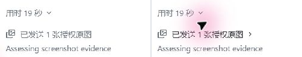

Windows 实窗回读了这条记录，核对鼠标移开、悬停及点击展开缩略图。工作台 v131 的「文件与图像」例在 1100 CSS 像素核对悬停、移开及键盘打开，在 360 CSS 像素的触屏模拟中核对箭头常显和点按展开。单条、纯摘要多条及与工具混排的回归覆盖通过，共 353 项桌面相关测试通过，桌面前端构建及工作台 21 项状态检查通过。 [工作台回放](https://hub-workspace-von11.song02211368537057.chatgpt.site/?assistant=activity-demo)

#### 日常库实时复测 · 2026-11-21

在当前 Windows 开发实窗新跑了两轮公开资料核对。首轮「展开控件与动态状态验收表」用时 2 分 59 秒，共收到 5 段公开进展、14 条网页回执和 1 条短摘要。首批搜索与 Android 原文回执在运行中分别打开，后续进展、短摘要、首段流式答复及整轮完成时均保持展开。第二轮「流式状态与工作过程证据复核」临时提高 GPT-6.2 Sol 的推理强度，补验同一组内的多条摘要和回执交替。第二轮实际用时 468.8 秒，界面显示 7 分 48 秒，收到 4 段公开进展、15 条网页回执和 52 条短摘要。

| 第二轮检查点 | 事件记录与实窗结果 |
| --- | --- |
| 11.03–41.06 秒 | 公开进展用正文色。两条浅色短摘要分别在 19.96、24.73 秒到达，其后依次出现搜索、打开 W3C、页内查找。运行中打开首批搜索回执，可看到 16 项搜索结果。 |
| 53.13–59.75 秒 | 三条浅色短摘要追加在页内查找之后，第四条网页工具接在三条摘要下面。组头由「3 步」变为「4 步」，先前展开的 16 项搜索结果没有收起。 |
| 75.04–82.00 秒 | 继续追加三条短摘要，81.92 秒的公开进展独立成段，下一次检索进入新组。两个阶段的内容保持各自原位。 |
| 首段流式答复到完成 | 398.29 秒收到首段答复，首批 16 项搜索结果和第九行 4 项网页结果仍展开，直到整轮完成。 |
| 修复前折叠重开 | 运行中和完成后都复现了长组重开只显示前八行。原先展开的第九行回执被藏进「显示更多」，再点一次才看到仍展开的 4 项结果。运行中还观察到首条回执下原本收起的来源列表自行展开。 |

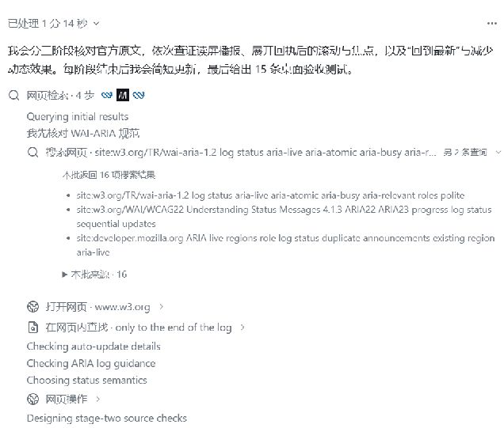

与 Codex 录像对照，公开进展都在段落间划出边界，新工具在当前组中向后追加。录像一里组头切换后，较早的命令仍可读。录像二重开当前检索组时可回看既有查询。Hub 的浅色短摘要可在展开后与回执照次序一起查看，工作台 v130 的原型也确认整段收起再展开会恢复工具及来源的选择。 [录像一](#video-one) · [录像二](#video-two)

**修复与复验。** 桌面把已显示的行数和网页来源列表的状态保存在当前对话的展开记录里。修复热更新后，用刚完成的实测记录分别折叠网页组和整轮，再重开。第一组的 12 行恢复原顺序，首批 16 项搜索结果和第九行 4 项网页结果仍展开，两条来源列表仍收起；第九行直接可见。两个回归用例在旧代码上均失败，修复后 351 项相关测试和前端生产构建通过。 [桌面时间线](../src/AgentActivity.tsx) · [回归用例](../src/AgentActivity.test.tsx)

### 运行中的底部阅读留白

跟随最新内容时，实时进展停在输入框上方。运行期间在对话滚动区尾部留出可视高度的 22%，范围为 24–144 CSS 像素。留白属于滚动内容，矮窗口按比例缩小。开始流式回答时保留，本轮结束或暂停时收回。离开底部超过 2 CSS 像素即暂停跟随。内容刷新或缩短时保留阅读状态，向下滚到实际底部或激活「回到最新内容」可恢复跟随。按按钮跳转后焦点回到对话滚动区，可继续用 Page Up 或 Page Down 翻页。

2026-11-21 用 Windows 日常库里的既有截图对话实跑，核对「正在思考」上移及回答结束后的布局。在 275 和 620 CSS 像素高的滚动区回放真实记录，核对留白高度、上翻停留、回到最新和完成后收回。原工作台 v125 在 1100 和 412 CSS 像素宽度核对演示请求开始和结束。[原工作台](https://hub-workspace-von11.song02211368537057.chatgpt.site)

### 回到最新内容的圆形按钮与三点动效

录像三 01:04.803 可见对话区底部居中的运行提示。Hub 用自己的主题颜色绘制同位置的圆形回跳按钮，桌面鼠标场景直径 40 CSS 像素，粗指针场景为 44 CSS 像素。三点和箭头使用同一个点击区域，按钮的可访问名称为「回到最新内容」。

| 对话状态 | 按钮表现 |
| --- | --- |
| 位于底部 | 按钮隐藏，持续跟随新增内容。 |
| 上翻且任务运行中 | 三点错峰上下跳动，表示本轮仍在进行。鼠标悬停、键盘聚焦或按下时切换为下箭头。减少动态效果模式显示静态三点。 |
| 上翻且任务已经完成或暂停 | 显示下箭头。点击、触摸或键盘激活后回到最新内容，焦点落在对话滚动区。 |

旧版右下角文字按钮可见于早期验收图。滚动暂停和恢复按[上翻位置复测](#hub-live-scroll-rerun)的规则执行。Windows 日常库实跑 1 分 19 秒，确认运行时三点、运行时键盘焦点箭头、Enter 回到底部，以及完成后按 Page Up 上翻显示静态箭头。工作台 v129 在 1100 CSS 像素下验证悬停、键盘与完成态，在 412 CSS 像素下验证触摸和减少动态效果。350 项相关桌面测试及生产构建通过。[工作台回放](https://hub-workspace-von11.song02211368537057.chatgpt.site/?assistant=activity-demo)

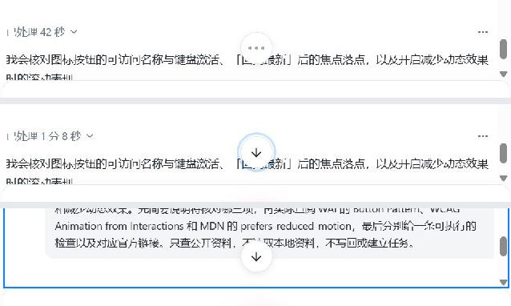

### 计时与活动行悬停

图 1 的 Hub 计时按钮原先和工具活动行共用悬停样式。指针进入后，控件填充色让它看起来像被选中了。图 2 是 Codex 计时行的透明背景参考，字色切换已用本机 Codex 样式核实。[Hub 计时按钮样式](../src/AgentInvestigation.css)

Hub 的计时按钮、活动组、网页批次、可展开摘要和工具步骤都使用透明的悬停背景。鼠标移入提高可交互行的文字对比度，移出恢复默认字色。活动组、图像回执和可展开资料行的箭头在鼠标悬停或键盘聚焦时显示，保留占位。触屏和顶部计时行保留可见箭头。Tab 聚焦时有可见的焦点轮廓。点击、Enter 和空格控制展开及收起，箭头随展开状态转向。组内「已载入材料」回执的图标和文字都用次要色，公开进展和回答用正文色。

上一轮只验证了计时，还留着活动行独立的背景填充规则。本轮回放了截图中同一轮「用时 33 秒」的真实记录，分别检查浅色、深色的网页组头和搜索子项。移入、移出、键盘焦点和展开均已通过。工作台原型从 v120 起采用同样的悬停样式。

2026-11-21 在 Windows 日常库回看截图中「用时 16 秒」的 Markdown 对话，已核对活动组收起、展开、鼠标移出，以及材料回执与正文的颜色层级。用同一轮记录做浅色、深色组件回放，核对箭头显隐、标题宽度和键盘聚焦。原工作台 v124 在 1100 CSS 像素下核对鼠标与键盘，在 412 CSS 像素触屏模拟下核对常显箭头及点按展开。[原工作台示例](https://hub-workspace-von11.song02211368537057.chatgpt.site/?assistant=activity-demo)

**从等待到回答。** 下表是当前桌面行为。原生分段、旧记录以及用户已经手动展开的状态各有不同，回放时应使用同类记录比较。[时间线组件](../src/AgentActivity.tsx) · [消息与正式交付](../src/AgentDelivery.tsx)

| 时点 | 用户会看到什么 | 展开后和下一步 |
| --- | --- | --- |
| 等待首个公开事件 | 运行中的本轮过程默认展开。没有活动工具或正在显示的运行状态时，尾部显示“正在思考” | 等到实际进展再显示内容。占位文案去重，减少动态或强制颜色模式下保留静态文字 |
| 收到公开进展 | 进展用正文主色，接在实际发生的位置。进展之间相邻的工具和 Codex 公开摘要组成一段 | 工具段通常收成一行；展开后按事件顺序穿插摘要与回执。纯摘要、计划、上下文事件各按类型呈现 |
| 工具执行与连续更新 | 当前段优先显示正在执行的动作，其次是等待的动作；一批连续操作结束时可显示最近动作。图标对应操作或服务 | 打开组可逐项看记录。历史长组起始展示 8 项，每次再看 8 项；已经打开的活动组追加新步骤，包括第 9 项。用户可以同时回看多个段 |
| 网页搜索 | 连续网页操作归在同一组，组头显示「网页检索 · N 步」、最多三个站点图标和展开箭头 | 批次行显示首条查询和「另 N 条查询」。单查询或明确归属的来源在对应查询下展示。其余标为「本批来源」。异常标题回退到域名，保留来源链接 |
| 首段答案到达 | “正在思考”退出。跟随最新内容时收起本轮过程，答案在折叠区外按 Markdown 流式绘制 | 已上翻或主动检查步骤时保留阅读位置和展开状态。可继续通过计时行回看 |
| 回看与异常 | 非网页工具组的局部失败可在收起的阶段显示“部分未完成”。本轮中断、工具失败、来源失效、过程截断各有提示 | 展开网页组后可在对应批次回执查看具体失败。其他工具可回看原因、范围、退出码或未发布答复。离开底部回看时有“回到最新内容”入口 |

Windows 桌面热开发版在计时行展开时使用左侧细线和 14 px 的缩进，保留各个步骤的原顺序。已有公开记录的结束轮次可从右侧「过程选项」复制摘要，只有真实回执带工具权限时才列出权限。摘要只取当前有效的公开过程，不含未核验草稿、回答正文或技术输出。已在日常开发窗用既有网页复核对话检查折叠与摘要入口，复制内容由前端测试校验。[Agents 主方案第 24.21 节](AGENTS_UI_INTERACTION_PLAN.md#2421-windows-桌面热开发版适配真实助手)

2026-11-22 按 `hub_ui (4).html` 校准。过程说明使用 12.5 px、主操作图标 14 px、展开箭头 12 px。网页组头去掉「另 N 个站点」与「部分未完成」，两项此前用于概括整组搜索，现按需打开批次查看来源与具体失败。阶段步数、回执顺序和来源归属继续按实际运行记录计算。[Agents 主方案第 24.23 节](AGENTS_UI_INTERACTION_PLAN.md#2423-按-hub_ui-4-对齐对话详情来源与文字层级)

下图保留改动前的一轮真实附件分析。相邻几行都叫“搜索网页 · 4 条查询”，来源标题还出现过 `<table id="e1">`。同轮记录的新版显示见[实施与验收记录](#implementation-review)。

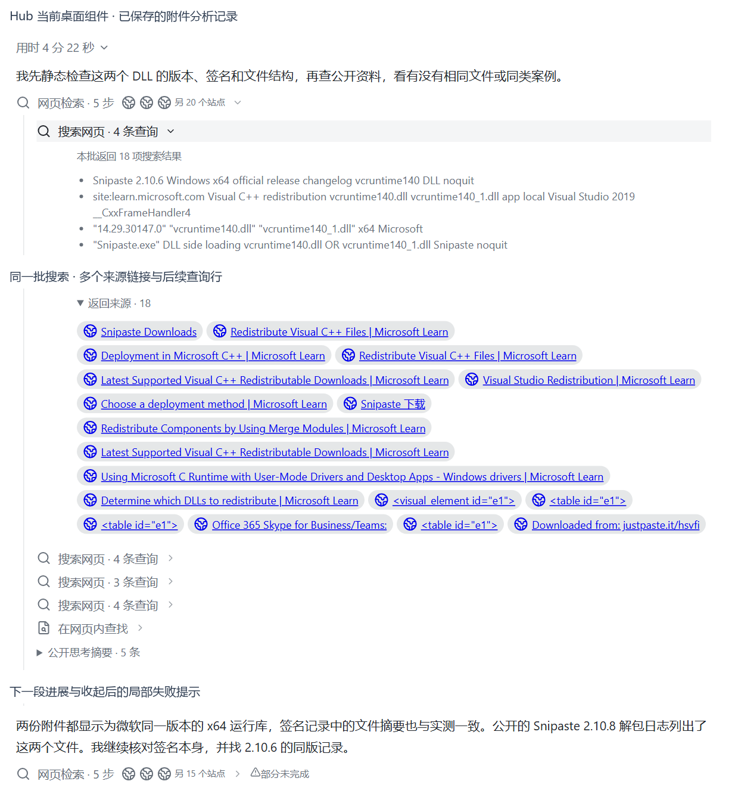

下图取自日常 Windows Hub 的真实对话。一轮共用时 51 秒，其中附件步骤为 4 秒。脚本在组内展开，执行结果写明退出码，结构化输出可继续查看。**这两种耗时和结果分别回答三个问题：这轮等了多久、哪一步花了多久、那一步是否成功。** [工具回执查看器](../src/AgentToolResult.tsx) · [阅读位置与返回最新](../src/useAgentConversationScroll.ts)

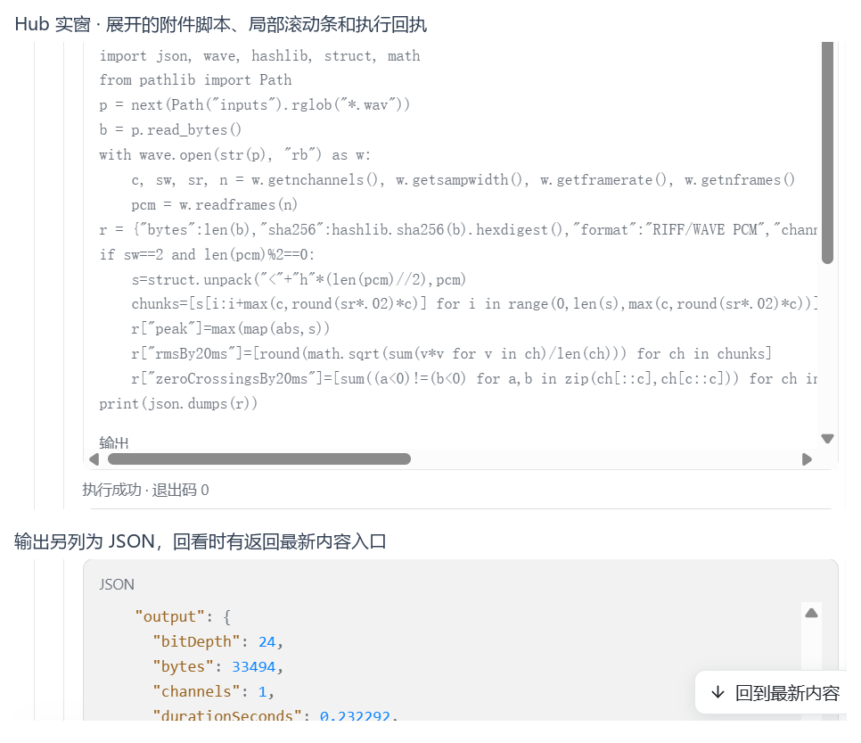

流式配色用同一轮已保存的 DLL 分析答复在当前组件内回放。浅色模式下，段落、表头、单元格的计算颜色均为 `rgb(32, 36, 42)`。后续调整等待动效时，应以这三个位置作为回归检查点。

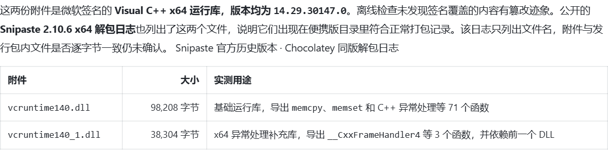

## 录像一 · 开发工具如何跟着进展展开

`codex1.mp4`，1348 × 914，2 分 43.21 秒。录像从一轮开发任务的中途开始，片末仍可见执行中的命令。它适合比较多段进展、命令和回执。没有拍到该轮最终交付。

**正文给操作分段。** 00:56 的“运行了命令”夹在两段清晰的进展正文之间。到 01:26，较早的同一行展开成多条终端命令，后一段进展仍接在它下面。缩进和细竖线已经足够表明归属。Hub 当前也按进展分组，这项应保留。可继续借鉴的是历史组标题的长度：收起后留下动作概括，长命令在子项里读。

**当前动作原位变化。** 00:56 是命令，01:26 同一阶段的当前行显示短的工作说明，01:53 指针位于活动行，行末可见展开箭头。浅灰文字把正在做的事留在视线中，长路径也会挤掉真正有用的对象。Hub 已对部分 GitHub 动作提供中文短标题；下一步适合把常见附件、浏览和命令行摘要写成“动作＋对象”。缺少对象时用可信的操作名。

**单条回执就地阅读。** 01:18 有独立的 JSON 面板，01:34 的命令面板右下标“成功”，01:56 的另一项命令则保留失败原因与退出码 1。用户可以跳过技术细节，也可以追到具体操作。Hub 的脚本语言、持续时间、退出码和结构化输出已经有对应能力。可改进之处是让用户在第一屏先读到结果，较长的源码和原始输出再按需查看。

**新动作与旧记录同时可见。** 用户此前给的两张补充截图拍到了更直接的前后变化：组标题从 `add_comment_to_issue` 换到 `fetch_issue_comments`，已有回执仍在，新的读取回执追加在下面。Hub 已有覆盖第 9 步到达、旧回执保持展开的回归用例。这里值得复刻的是列表的稳定性；用户可读的标题仍可使用“准备评论草稿”“读取 GitHub 评论”。[稳定展开用例](../src/AgentActivity.test.tsx)

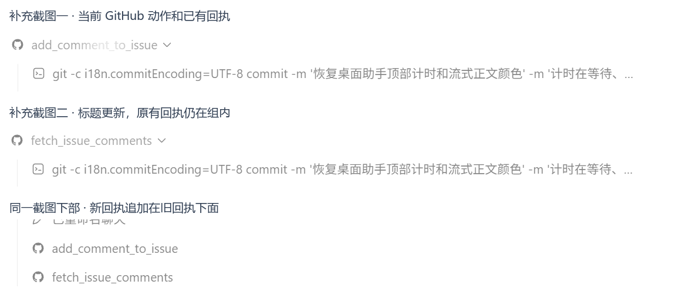

## 录像二 · 网页研究如何从等待过渡到答复

`codex2.mp4`，1308 × 1628，1 分 19.77 秒。这一段覆盖发送、等待、多批搜索、收起和首段答案。下列画面仅用于观察界面，录像中的新闻内容未作事实核查。

**从等待切到有对象的动作。** 00:08 的正常颜色正文交代了核查范围，下面只有“正在思考”。00:22 同一段出现 Working 和第一条实际搜索词。指针所在查询行加深，右侧可见箭头。Hub 已能把正文和状态分色，也应保留自己常显的顶层计时箭头。搜索行最值得借鉴的是把查询主题直接写在动作之后。

**点开一个查询，就看这一行的来源。** 00:26 第一行已展开，下面是站标和截短标题组成的多列胶囊；第二行查询紧随其后，仍可独立展开。图中能看到 AP、Axios 等站标，同一站点也会返回多篇文章。Hub 已有来源链接与缺图回退。主要差距在入口层级和条目命名。当前事件常提供“本批查询数组＋本批来源数组”，只能在实际记录带有匹配关系时细分到单条查询。

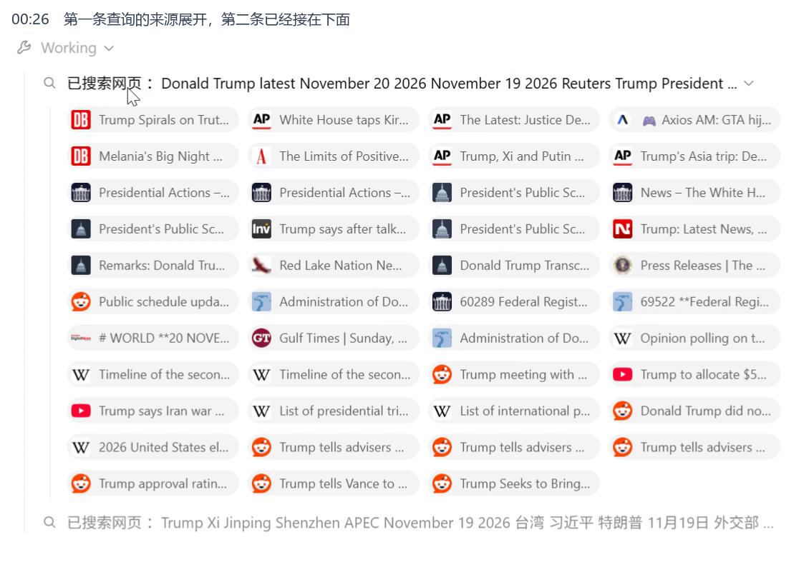

**整组收起和单项收起解决不同问题。** 00:55 整组只占 Working 一行；01:13 展开后已有七条查询，早先的仍在上面。用户可以先扫搜索方向，仅打开感兴趣的一批。Hub 的阶段、批次、来源都有展开能力，但若每一层只写步数或数量，反复点击才知道自己该看哪里。把具体查询提前，保留两级独立控制，就能减少一次试探。

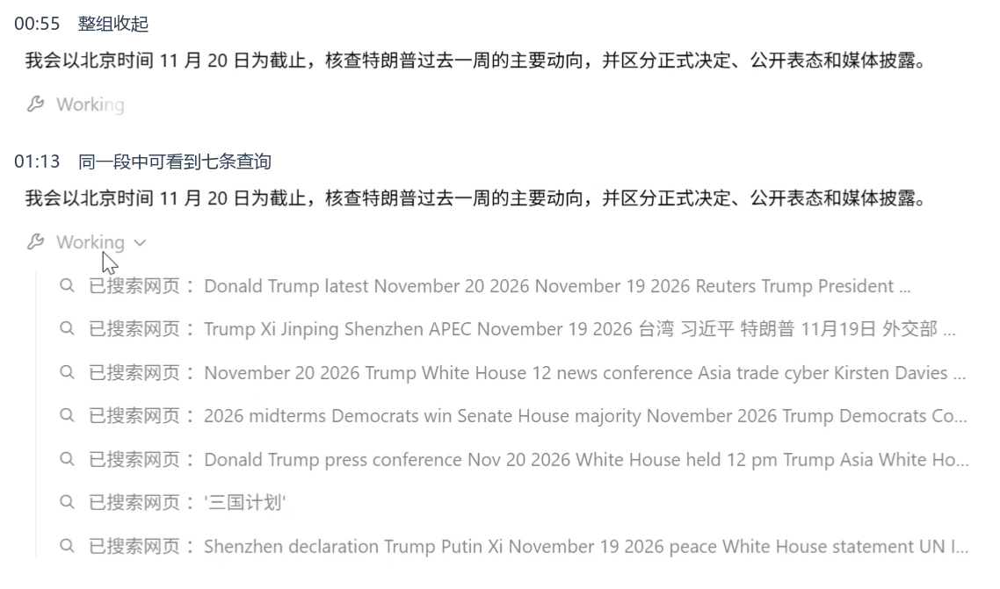

**答案出现前，先给正文腾出位置。** 01:15 还能看到查询与来源，01:16 只剩用时和右箭头，01:17 出现标题，01:19 正文继续增长，已经输出的文字清晰可读。此时用时仍从 1 分 13 秒变为 1 分 16 秒，画面不能证明已经结束。Hub 目前具备独立流式正文，但有分段的原生历史可能保持展开。建议只在用户跟随底部、也没有主动展开回看时，让首次回答到达收束过程。正在看某条来源的人应继续停在那里。

## Codex 的图标与混合组标题从哪里来

桌面「已读取资料」和「读取原文」使用用户提供的圆角文档 SVG。保留原路径，在 16 像素图标位将可见轮廓调到约 13 像素高，和相邻操作图标对齐。颜色随行文字变化，适配浅色、深色和悬停。读取语义同样适用于单项标题和展开步骤，失败回执继续显示警告图标。[桌面图标映射](../src/AgentActivityIdentity.tsx)

下图是用户截图的原尺寸局部。Hub 针对同一类动作使用自己的图标组合。终端使用带外框的终端图标，编辑和重命名使用带文件轮廓的笔形图标，独立浏览器使用窗口图标，读取聊天使用双气泡。内置网页搜索、页内查找和来源站标各沿用自己的映射。GitHub、Notion 使用现有品牌资源。[当前图标映射](../src/AgentActivityIdentity.tsx) · [品牌资源来源](../src/assets/agent-services/README.md)

| 类型 | 应覆盖的图标与状态 | 对齐办法 |
| --- | --- | --- |
| 工作步骤 | 终端、文件编辑、读取聊天、重命名聊天，以及录像中的网页搜索与浏览 | 分别对照轮廓、线宽、留白和基线；终端看外框，读取聊天看气泡，网页搜索看放大镜。相同铅笔可以用于两种动作，文字仍须说明改了什么 |
| 集成与来源 | 截图中 Serena 行的四瓣图形、GitHub 品牌标、浏览器地球、各网站 favicon | 按真实服务身份或网页域名选择。四瓣图形目前可确认出现在 Serena 行，截图本身不足以判定它是 Serena 专属品牌标。对缺少站标和未知服务保留可辨认的回退 |
| 交互与运行状态 | 收起向右、展开向下的箭头，悬停、键盘焦点、活动中、完成和失败 | 在相同主题和缩放下比较控件的位置、反馈和可辨认性。不同系统缩放及未采样图标仍待逐项核验 |

**图 2 的长组标题由 Codex 桌面客户端组装。** 本机 Windows 桌面版 `26.1117.3838.0` 的活动组件先生成多个摘要片段，再用本地语言模板格式化。集成名可去重并按语言组合；命令有单复数模板；聊天动作依据执行状态选择“正在读取”“已读取”或失败文案。已完成的混合组还会按首个摘要片段寻找可代表它的条目作为组图标。这解释了截图中前五个子项都是命令，组头却显示 GitHub 的现象。

| 截图中的文字 | 可以直接获得的输入 | Hub 负责的展示 |
| --- | --- | --- |
| 已使用 GitHub 集成 | MCP 调用的服务、工具、状态；部分调用还提供 `appContext.appName`、`actionName` 或连接器 ID | 从本组真实调用识别 GitHub，同组重复使用只写一次。已授权某服务本身不表示本轮调用过它 |
| 运行了命令 | `commandExecution` 的命令、状态、命令分类及可用的退出码 | 把多条命令概括为一段，原命令保留在各自子行 |
| 已读取聊天、已重命名聊天 | 对应工具身份、执行结果或单项展示名，取决于宿主提供的事件 | 只有拿到相应事件，才按完成或失败状态生成该片段。Hub 没收到这些桌面专属动作时就省略 |
| 展开后的 GitHub 工具原名 | 调用的 `tool` 字段，例如 `fetch_issue_comments` | 在详情保留原名，组头采用可读动作和服务名。区分准备评论草稿、发布成功和回读核验 |

Hub 已按同组事件生成中文标题。集成名去重并优先显示。浏览网页、命令、文件和聊天等动作各占一个片段。完成措辞依赖实际状态，例如一次重命名失败会保留动作名称及未完成提示。组头使用与首个片段对应的图标，已作组头或子行主图标的品牌标识只显示一次。执行中优先显示当前动作，新回执到达时保留已有步骤顺序和展开状态。[Hub 分组实现](../src/AgentActivity.tsx) · [OpenAI App Server 事件说明](https://developers.openai.com/codex/app-server/)

下图用真实保存的 GitHub 和浏览器回执在当前桌面组件回放。一个 GitHub 标识代表整组，展开后五个回执仍按执行顺序列出。工作台 v119 的「浏览器与应用」示例另外呈现命令、编辑、读聊天及重命名的组合。桌面聊天图标和命名已有组件测试，实际 Hub 历史尚缺这两类回执供实窗验证。[工作台示例](https://hub-workspace-von11.song02211368537057.chatgpt.site/?assistant=activity-demo)

本轮通过 293 项桌面定向测试与前端生产构建。工作台原型通过类型检查、生产构建和 21 项助手状态检查。发布后的示例在 1100 和 420 像素视口核对了标题、图标、子项顺序和计时行键盘交互。

Codex 参考依据为两张用户截图、本机桌面活动组件与中文语言资源，以及桌面包自带的 `codex-cli 0.171.0-alpha.13` 生成的 `ThreadItem` 和 `McpToolCallAppContext` 类型。

### 录像三 · 文件、图像和多级回看

`codex3.mp4`，1344 × 1448，2 分 35.944 秒。按视频播放时间解码全部 4,834 帧，用灰度相邻帧差按区域定位变化，查看 53 个等间隔或片末总览帧，并加取 89 个原分辨率帧核对展开、悬停、预览及正文切换。下表时间取视频帧的时间戳，帧号从 0 开始。开头已经有历史答复和一轮在途任务，最后一帧仍有命令在运行。

| 时间与帧号 | 画面里发生了什么 |
| --- | --- |
| 00:04.685–00:04.785，`#141 → #144` | 「编辑了文件运行了命令」由一行变成文件与命令列表。同一个 `AgentActivityIdentity.tsx` 出现在前后两条编辑记录，分别为 `+18 −8` 和 `+1 −1` |
| 00:08.217–00:08.450，`#247 → #254` 00:10.416，`#313` | 指针位于文件名附近后，右侧打开代码区域，对话列变窄，已展开的混合组仍在。录像可确认结果，文件名、计数和箭头各自的热区还需要单独核对 |
| 00:12.115–00:13.282，`#364 → #399` | 先在文件名上方看到完整路径提示。文件项展开后就地出现文件名及 `+2 −2`，随后可见带行号、增删标记与横向滚动条的差异 |
| 00:17.880–00:23.978，`#537 → #720` | 文件差异与多个 Shell 面板可以同时打开。「Running」那条命令已有部分输出，另外两条有独立的「成功」回执。详情展开只影响各自面板 |
| 00:29.010–00:30.778，`#871 → #924` | 点击前指针位于「已查看 1 张图像」的缩略图上。下一帧出现遮罩大图，返回时原缩略图、上方 Shell 面板和下方当前动作仍在 |
| 01:03.803–01:05.703，`#1915 → #1972` | 上一轮「用时 3 分钟 52 秒」展开时显示进展、命令及图像。收起后只隐藏工作过程，答复和下方文件变更卡仍可读。再次展开时图像缩略图重新可见。这一组画面只证明重开后可继续回看，手动关掉的每一层是否恢复仍需另外验证 |
| 01:27.864–01:30.297，`#2637 → #2710` | 在途区先显示运行中的命令，随后按顺序显示「已查看 1 张图像 → 运行了命令 → 已查看 1 张图像」。第二个图像展开，第一个保持收起 |
| 01:37.165–01:37.315，`#2942 → #2946` 02:02.491，`#3789` | 「正在思考」之后同一位置出现运行中的命令，后续又显示「正在编辑文件」。底部文件数保持 6，增删统计从 `+136 −28` 变成 `+142 −30` |
| 02:16.330–02:17.097，`#4211 → #4234` 02:27.106–02:35.907，`#4561 → #4833` | 混合组从当前动作过渡到历史标题，已展开的子项留在上方。一段主色进展正文随后流出，接着又出现运行中的命令。录像结束时这轮还在继续 |

#### 文件编辑与命令回执

对照录像时，Hub 已能按动作和文件名生成摘要，原生 `fileChange` 只保存了文件路径与动作状态。单次编辑回执有经授权的实际变更记录时，在该步展开文件名、路径、增删行数及局部差异。早期回执用可用的文件名和状态回看。重复编辑按发生顺序各留一条。长行横向滚动限定在差异面板内，文件路径也须可由键盘或触摸访问。打开当前文件与展开行内差异各有可辨认的入口。验收时打开一条文件差异和两条命令，追加同一文件的新编辑，再分别只关闭其中一个面板。[原生文件与命令活动投影](../src-tauri/src/model_runtime/cli/agent/capabilities.rs) · [Hub 工具行](../src/AgentActivity.tsx)

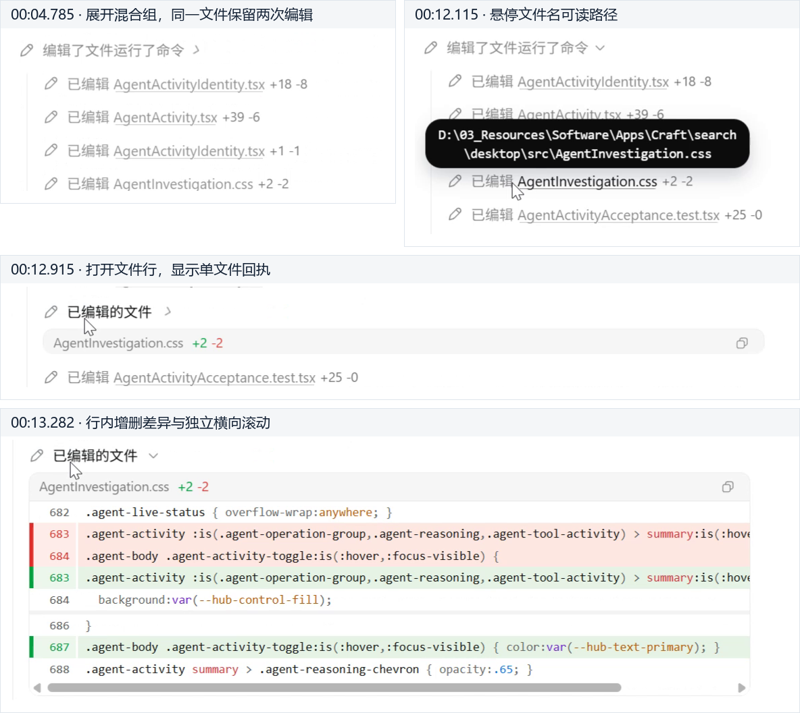

命令详情继续采用 Hub 已定的结果优先。补充区分「已有部分输出」「进程终止并报告退出码」「输出不可用或被截断」。原生命令和 Hub 受控计算的数据来源分别校验。早期原生命令记录保存执行状态、命令文本和可用的数值退出码。原始输出可取时才提供局部滚动并保留已展开位置。并行回放检查仍在执行的一条和已完成的多条同时可读，分别关闭其中一条。[命令详情](../src/AgentActivity.tsx) · [受控计算回执](../src/AgentToolResult.tsx)

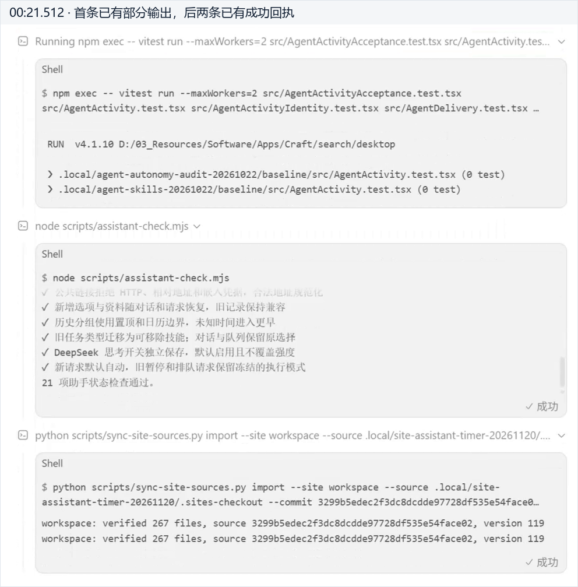

#### 图像、总展开与回到原处

Hub 已有待发送图片缩略图和「本轮已准备 N 张授权原图」记录。图像步骤还要区分素材已准备、已随请求交给提供方，以及事件明确记录实际查看。只有收到实际查看回执才显示「已查看 N 张图像」，并在有授权的可回读资源引用时显示缩略图。图像使用独立的叠图语义图标，夹在命令之间的两次查看保持各自位置和开合。大图从缩略图开启，关闭后回到原缩略图焦点，保留外层活动组和相邻详情展开状态。旧记录或授权失效时显示可用状态说明。[Hub 图片资料卡](../src/AgentFileInputs.tsx) · [授权原图活动投影](../src-tauri/src/agent_work/activity.rs)

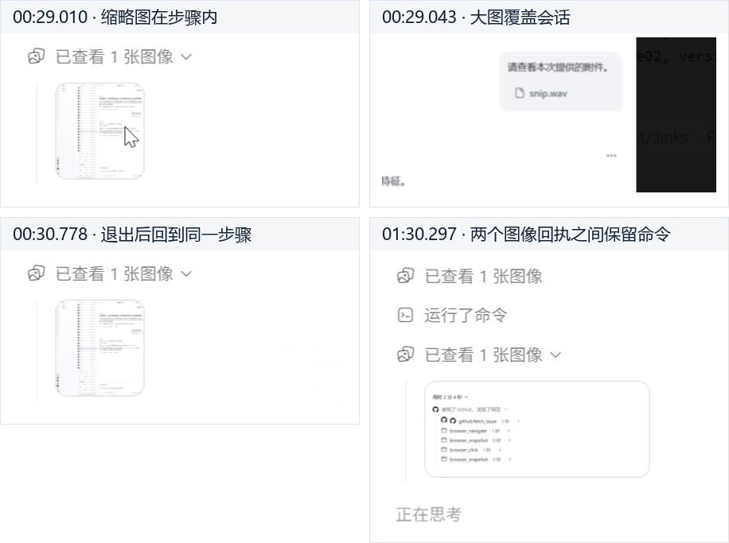

把计时、活动组、单步详情和预览分别纳入状态保留验收。先开旧轮计时和一张图，关闭旧轮计时再重开。再主动关闭该图并重复父级操作，验证打开和关闭两种选择都能按稳定的轮次及事件身份恢复。回看旧轮时保留原有答复、文件变更卡和阅读位置，新轮可继续流入。Hub 已有「回到最新内容」及外层展开记忆，下钻到文件差异、命令面板和大图时继续逐层检查。[工作过程展开](../src/AgentActivity.tsx) · [对话滚动](../src/useAgentConversationScroll.ts)

#### 阶段收束与文件统计

给「操作中 → 阶段结束 → 进展正文 → 下一段操作」补一条带真实事件的回归。只在第一段正式答复到达时应用现有自动收起条件。普通进展正文继续按正文主色落在阶段之间，已打开的历史组可继续回看。当前动作需要简洁到一眼可读，网页检索继续使用已定的稳定组头。录像中进展入场的尾端短暂变浅，Hub 保留正文主色。验收同时检查计时仍在走、旧组开合保持、后续动作位于新正文之后，以及随后正式答复按跟随状态只触发一次收束。[公开进展和时间线](../src/AgentActivity.tsx) · [原生正式答复判别](../src-tauri/src/model_runtime/cli/agent/output.rs)

单步增删、旧轮的变更卡、当前工作区文件汇总分别说明不同范围。录像里的「6 个文件已更改」随当前工作区变化，旧轮「已编辑 2 个文件」卡按该轮列文件。文件汇总可留作启用工作区编辑时的审查入口，数据来自对应版本的实际变更集。同一个文件多次修改时保留所有步骤，汇总按文件去重。Hub 日常知识任务继续使用已有成果入口。录像拍到 Codex 的「查看变更」「撤销」按钮，实际撤销流程需要另行验收。

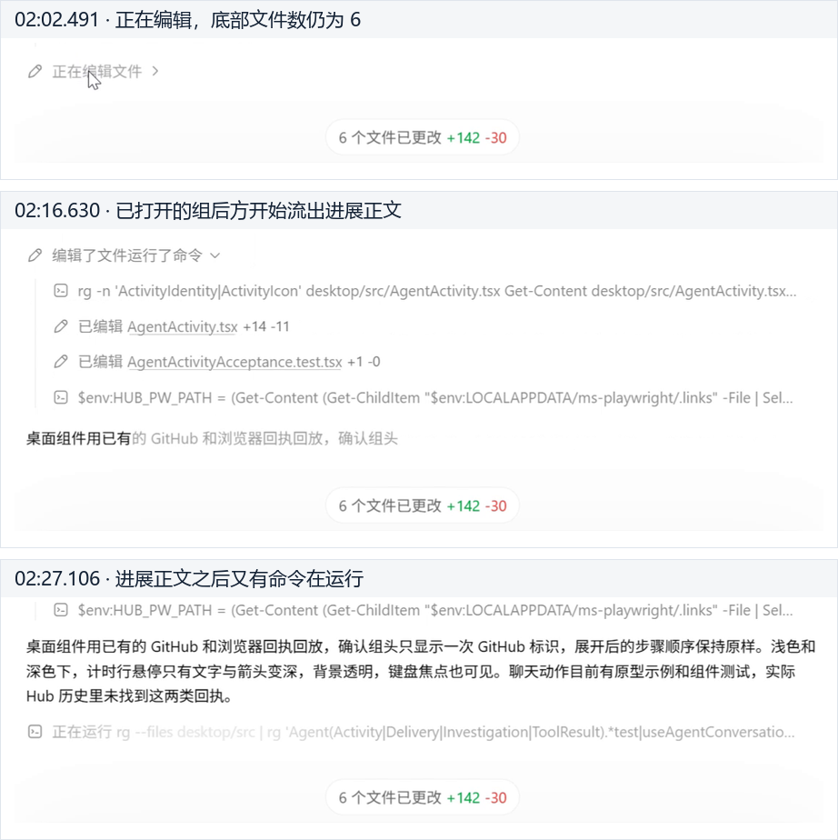

#### 录像三补项的桌面实现

| 补项 | Hub 当前行为 |
| --- | --- |
| 文件差异与统计 | 原生工作区的每次编辑独立成一条回执。展开显示有行号的差异及增删数，并可打开已授权的当前文件文本。桌面以独立预览面板显示文本，窄窗用较小的预览面板。本轮文件汇总使用 Codex 返回的整轮差异，同文件多次编辑由整轮变更集归并。旧记录可继续查看已保存的文件名 |
| 命令输出 | 运行期间就地显示已收到的部分输出，完成后优先显示结果及实际退出码。有完整聚合输出时替换预览，超过保留范围时明确标记。每条命令可独立展开和滚动 |
| 图像回执 | 保留已准备状态，收到对应原生轮次的接收记录后显示已发送。实际查看只有在收到图像查看事件后出现。可回读的授权图像显示缩略图，放大后按 Escape 或关闭按钮回到这轮。工作区图片的回读另外核对记录中的内容哈希 |
| 展开与阶段 | 图像按事件顺序占独立一行。整轮折叠重开后，已打开及手动关闭的命令、文件差异和图像项按轮次及事件恢复。流式进展和后续工具继续分段，仅正式答复触发跟随状态下的收束 |

上一轮在 Windows 日常库的已完成对话回读了授权原图，复核缩略图、大图、Escape 关闭及整轮重开。309 项相关前端测试、5 项 Rust 回归、桌面生产构建通过。工作台 v123 的「文件与图像」示例在 1100 和 360 像素宽度复核了文件差异、命令状态、原图预览、返回焦点及净变更统计。[工作台示例](https://hub-workspace-von11.song02211368537057.chatgpt.site/?assistant=activity-demo)

### 日常库实测与附件发送（2026-11-21）

使用日常 Windows 开发版里的既有会话附件，核对真实 Codex 下拉入口截图，并在该验收对话的独立工作区整理说明。原图来自已发送的历史附件，放进工作区的副本与原始字节一致。验收对话没有产生来源写回动作。

| 项目 | 日常 Windows 实测与修复 |
| --- | --- |
| 已发送图片 | 上传时在输入框显示一张待发卡。提交后只生成一条用户消息，卡片随该条消息展示，输入区清空图片。可点缩略图放大，按 Escape 返回对话。追加纯文字时，已发送图片仍属于首条消息。截图里 14 秒的旧对话也已回读，原图出现在有附件的那条消息里。 |
| Markdown 附件 | 把实跑生成的截图说明作为 Markdown 附件发送。文件名出现在已发消息的资料卡里，输入区的待发卡随即清空。 |
| 原生命令 | 展开用时 → 「已运行命令」 → 「运行工作区命令」，看到两行 PowerShell 输出和退出码 0。另一次只读校验按要求退出 7，命令回执保留原因和非零退出码，答复仍可完整交付。 |
| 同一文件多次编辑 | 三次操作分别创建文件、替换一行、追加两行，历史各留一条，轮次净差异汇总为「1 个文件 · +5 −0」。首次发现新建文件直接返回正文，计数漏掉；按变更类型修复后，再实跑两次编辑，新建一步显示 `+3 −0`，整轮仍归为一个文件 `+5 −0`。展开标题显示文件名，悬停提示和「完整路径」可核对实际位置。 |
| 工作区看图 | 首次实跑没有获得 `view_image`。在已授权的独立工作区开启该工具后，真实运行产生独立的「已查看 1 张图像」，展开可看 `original.png` 缩略图、放大及 Escape 关闭。原图发送回执与工作区查看回执分别记录；回读沿用当前授权、路径与内容哈希校验。 |
| 折叠恢复 | 同一轮展开图像及文件差异，收起计时行后两者隐藏。重新展开整轮，两处按原选择恢复。命令详情状态和完整路径同样纳入自动回归。 |

图片草稿只展示这条消息要发送的图片。发送失败保留草稿，重试沿用同一消息身份。后端按消息记录的原图绑定恢复历史缩略图，当前仍授权的图片和文件可以在「对话详情 → 资料范围」管理。首条未绑定页面的问答将初次资料绑定合并到同一条用户消息；用户主动发送同文追问仍保留为独立消息。

回归覆盖六组前端 309 项、Rust 24 项及桌面生产构建。发送失败重试、图片撤回后的历史授权、命令逐次更新及路径折叠有自动回归。原工作台已有发送后清理草稿及在消息显示附件的行为，本轮修的是 Windows 客户端。

#### 图片附在发送它的那条消息

Codex 的同一对话可以从仍可用的历史参考旧图，新一轮只提交它自己的文字与附件。Hub 曾在纯文字追问里把仍有对话授权的旧原图重新编码并附上，即使续用了同一个 Codex 会话。现在只向新轮次附上这条消息选中的原图或 PDF 页图。纯文字追问可以继续引用同一对话的历史。历史图片仍在原消息，旧授权继续用于核对有效性。需要在新轮次明确带图时，可再次添加同一文件，其他授权保持原样。

当前消息的图随发送失败重试和排队保留。运行结束边缘补交的追加消息只带尚待送达的附图。时间线仅在本轮实际附图时产生原图发送回执。 [Codex 续轮与图片输入](https://learn.chatgpt.com/docs/app-server#turns) · [Hub 原图输入](../src-tauri/src/agent_work/runner/native.rs)

Windows 日常库用现有 Hub 工作台公开预览图实跑三轮。首轮附图、纯文字追问、手动重附同一张图，三次实际提交的原图数量依次为 **1 → 0 → 1**。后两轮续用同一个 Codex 会话。文字追问的原图请求用量为 0，时间线无原图发送回执，答复仍指出图里的双栏导航和列表布局。发送后缩略图位于各自的用户消息下，输入框清空待发卡。PDF 页图、排队和重试由本轮自动回归覆盖。

开发版换用重新编译的程序后，Hub 按既有兼容性规则重建了底层 Codex 会话。旧图仍可在 Hub 历史打开，文字追问提交 0 张图，模型提示需要重附。手动重附提交 1 张图，模型准确读出预览中的文章标题。

相关前端回归 338 项通过。原图授权与排队的 Rust 回归 30 项通过，3 项需显式配置的外部验收按原设置跳过。前端生产构建和 Rust 格式检查通过。

## ChatGPT 网页版的 25 分钟长任务对照

2026-11-21 在 Vivaldi 中从「移动端设计分析」的「思考了 25m 16s」开头逐段读到最终交付。抽查了并行工作、命令和 Sites 三类展开项，实测整轮收起和重开。Hub 实窗对照了日常库中同轮看图、两次编辑、命令和文件变更汇总的 51 秒记录，并参考上一张 Excel 附件分析截图中的资料载入和规则回执。网页版对话列更宽，两端任务长度不同，以下对照可见的层级、语义与操作路径。

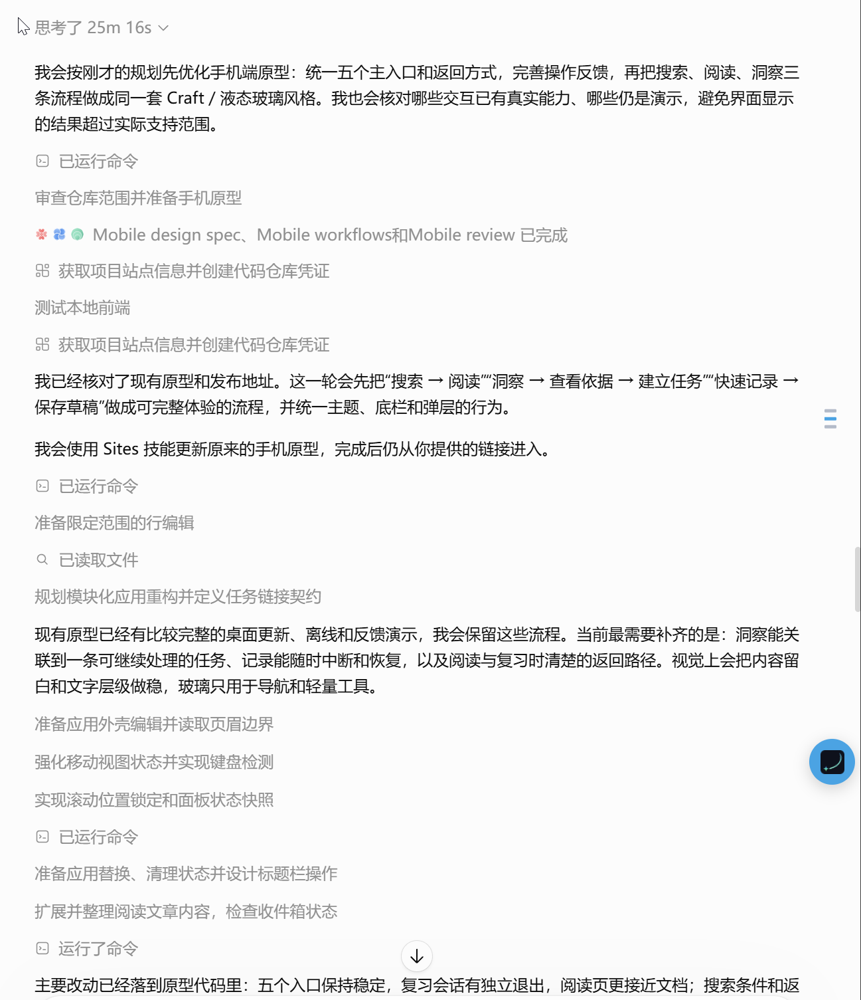

| 阶段或细节 | 网页版实测 | Hub 差异与取舍 |
| --- | --- | --- |
| 开头与进展 | 首段正文直接交代任务范围。随后灰色短状态和动作行同列排列，下一段深色正文说明三个流程要怎样接起来。到后半程，仍可沿正文读出三条流程接通、窄屏与草稿复测、发布及上线核对 | Hub 同样有正文主色，不过授权、载入、工具组和阶段汇总逐层出现，进展段容易被一串回执隔开。短任务优先保住第一段公开说明，长任务每段仍让正文成为主要阅读入口 |
| 一行状态与展开 | 「审查仓库范围」「测试本地前端」这类短状态是平铺文字。部分「已运行命令」也只是摘要；抽查可展开的「运行了命令」，下面多一行后台终端状态。不同信息的交互深度有区别 | Hub 在原生记录中把相邻操作及部分提供方公开摘要收入组内。一眼能知道有工具，但不容易分辨哪些是阶段进展，哪些只是明细。普通状态平铺，有实际回执时再提供展开入口 |
| 并行任务与外部工具 | 三个并行项用三枚小图标合占一行，展开后就地按顺序列开始、发消息、完成。Sites 组以一条摘要占位，展开后可见命令与部署步骤的先后 | Hub 有运行、来源和授权边界，适合核查。吸收稳定的对象名、少量已确认的身份标识，以及一层可扫读的子项。真实存在并行任务时才显示各自身份 |
| 图标、颜色和间距 | 深色段落、浅色操作行和少量带身份的颜色反复出现，正文始终回到同一左边界。命令、文件和浏览器有不同轮廓，部分简短进展纯文字 | Hub 的灰色文字层级已基础齐备，但顶部图标、组标题、子行图标、缩进、竖线、耗时和状态一起占据窄列。用户最先看到的是几套控件的边界，后来才找到能顺读的正文。先减少第一层的视觉重量，让操作行间距更紧凑，段落前后留出明确间隔 |
| 冗余和标题质量 | 后半段仍多次重复「运行了命令」。也观察到「已读取文件运行了命令」等拼接标题，以及含义难懂的短状态 | Hub 可以合并连续、同类、足以安全归组的操作。折叠标题优先写可核验的对象、结果或数量。缺少对象时沿用短的动作和数量，保留完整回执及顺序 |
| 查看证据与完成态 | 点击总计时收起本轮后，正式答复直接接在下面。此次抽开的命令例仅露出状态，完整命令输出和退出码未在该例出现 | Hub 可查看退出码、输出、每次差异、文件净变更、图像及来源。实窗中退出码 7 的子项显示未完成，而本轮已给出答复。保留证据深度，同时让第一层能读清本轮结论与真正影响交付的异常 |

### 展开后先读公开进展

- 公开进展沿同一左边界用正文主色显示。相邻的资料载入、数据预览和知识库规则收为「资料准备 · N 项」，数字对应回执条数。单条资料直接显示，详情包括实际记录的文件名、来源和版本。附件分析仍在原时序作为独立动作显示。
- 简短状态和可展开回执使用次要文字色。活动组之间收紧，正文段落保留间距。组内步骤仅用缩进表示归属，移除活动组明细左侧竖线。连续命令完成后以「已运行命令 · N 条」概括，运行时显示当前动作。逐步耗时收进明细，有异常的组收起时仍提示「部分未完成」。
- 原工作台 v126 先验证了这套顺序。切到「同题回放」，资料准备组可查看两条文件回执，版本检查行可直接打开输出和退出码。360 和 1100 CSS 像素下均核对了键盘操作、内容宽度，以及手动展开后继续看到最终答复。[工作台回放](https://hub-workspace-von11.song02211368537057.chatgpt.site/?assistant=activity-demo)
- Windows 开发实窗用日常库的 52 秒 Excel 记录核对了「资料准备 · 5 项」、实际预览与规则版本，以及公开进展和附件分析的顺序。51 秒文件记录确认混合组收起提示「部分未完成」，展开后仍显示两次编辑、两次运行和实际退出码 7 与输出。同一组真实事件以 360 和 650 CSS 像素分别回放，检查了键盘展开、整轮收起后明细状态恢复，以及文件变更汇总。实际窗口复查使用已有记录。
- 99 项工作过程、工具明细及滚动相关测试通过，桌面生产构建通过。前端全量测试有 45 项失败。在相同超时和并发设置下复跑这七个测试文件，两条闪卡超时消失，剩余 43 项与修改前提交的失败用例完全一致。

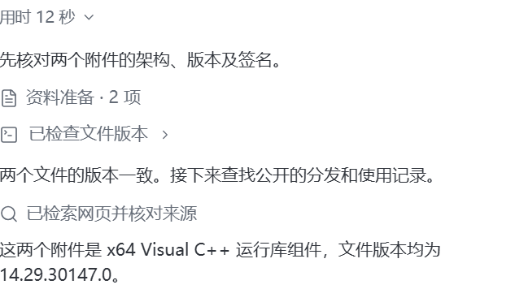

### 日常库长任务实测

2026-11-21 在 Windows Hub 日常库现有开发实例新发起「Hub 移动端无障碍审查与验收清单」，用 GPT‑6.2 Sol 最大推理投入搜索和核对公开资料。本轮自然完成，界面和运行记录均显示 **14 分 13 秒**。先后显示 7 段公开消息和 25 条网页工具回执，包含 10 次搜索、6 次打开网页及 9 次页内查找。正式答复出现于 **11 分 01 秒**，交付包含 38 条验收用例。网页版 **25 分 16 秒**的样本提供了长任务完成态的层级与折叠对照，下表的实时观察来自这次 Hub 运行。

| 检查项 | Hub 实况及与网页版的差异 |
| --- | --- |
| 在运行中读进展 | 初始公开说明约 9 秒出现，随后六个阶段的正文与网页批次交替排列。和网页版完成态一样，公开进展可以沿同一列通读。Hub 运行中还会显示批次步数和已核验的网站标识。跟随最新时，最后一行上移，输入框上方留出阅读空间。首次流式答复出现时，计时改为「用时 11 分 1 秒」，正式完成时显示整轮耗时。 |
| 上翻和返回最新 | 约 2 分 15 秒上翻，后续一组网页回执从 3 步增到 4 步时，先前段落仍在原处。点右下的「回到最新内容」立刻看到第二阶段，随后第三组网页活动继续跟随。网页版参照的回跳入口在底部中间，Hub 用右下方带文字的入口。7 分 30 秒附近有一次自动回到底部，原因未确认。8 分 33 秒再次上翻后，同一处早期回执保留到正式答复流式生成及本轮结束。 |
| 完成后折叠和重开 | 完成时打开首组「网页检索」下的 W3C 打开网页回执，再收起整轮。和网页版一样，正式答复紧跟在用时下面。重开后，网页组和该条回执恢复展开，原链接与「返回来源 · 6」仍可查看。 |
| 键盘回跳 | 实跑时用 Shift+Tab 聚焦回跳按钮、按 Enter，视口回到底部，随后按 Page Up 无法翻动对话。工作台 v127 和桌面均把按钮激活后的焦点移到对话滚动区。修改后用同一条 14 分钟记录复验，Enter 回到底部并出现对话焦点轮廓，Page Up 翻回前文，Page Down 又能回到底部。 |

检查覆盖 349 项相关桌面测试与桌面生产构建。工作台 v127 通过类型检查、21 项助手状态检查、生产构建和线上键盘回跳实测。[工作台回放](https://hub-workspace-von11.song02211368537057.chatgpt.site/?assistant=activity-demo)

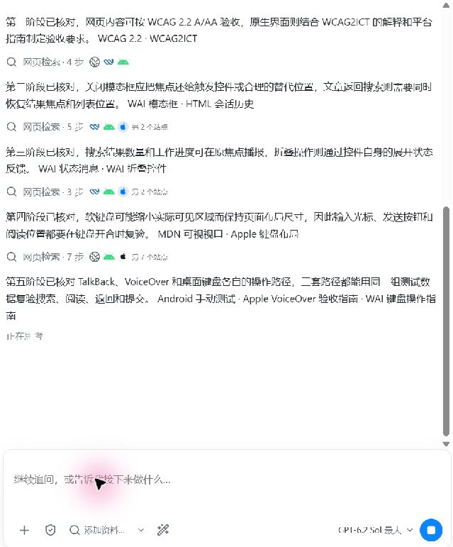

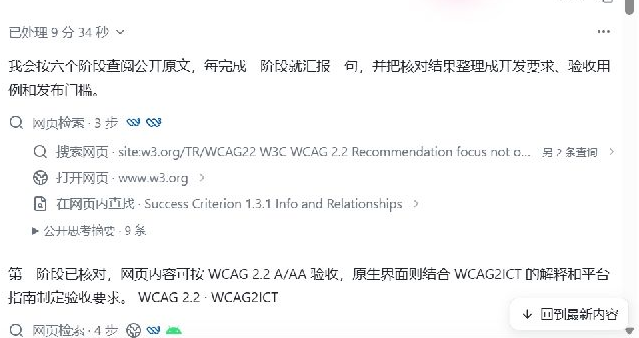

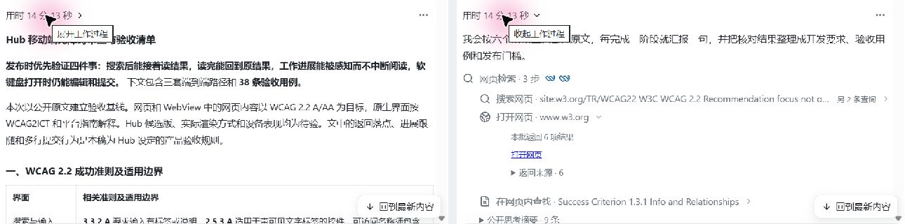

### 上翻后遇到流式答复和任务完成

2026-11-21 在同一个 Windows 日常库对话续跑「流式助手阅读位置专项复核」。这一轮自然完成，界面显示 **9 分 3 秒**，包含四阶段公开进展、14 条网页工具回执和 16 条专项验收用例。在原浮窗上临时记录滚动坐标、可见行、跟随状态和状态快照，复测后移除了诊断代码。

旧版在约 **1 分 50 秒**明确复现一次回到底部。在最新处上翻约 50 CSS 像素后，界面仍把离底 80 像素以内判为跟随中。约 3 秒后，下一次状态快照将 `scrollTop` 从 9697.3 移至 9746。旧版也会在内容缩短到阈值时自动重新开启跟随，已用回归用例覆盖。上一轮 7 分半的截图确认当时曾显示「回到最新内容」，确切触发仍待确认。

桌面修复后，用同一运行再向上滚 50 CSS 像素，从约 **6 分 51 秒**一直留在原位。2 像素的底部容差用于容纳 WebView 的小数取整误差，缩短布局也不会主动重新开启跟随。正常向下滚到底部和显式点击入口均可恢复。工作台 v128 同步收紧底部判断，在发布版本复测了 50 像素上翻、正式答复出现及键盘回跳。[工作台回放](https://hub-workspace-von11.song02211368537057.chatgpt.site/?assistant=activity-demo)

| 新变化 | 同轮修复后的实测 |
| --- | --- |
| 公开摘要与状态继续刷新 | `scrollTop` 保持在 10110，顶部可见计时行保持在视口内相同位置。 |
| 7 分 38 秒首次显示流式答复 | 答复在工作过程下方增长，计时行、展开状态及滚动坐标均保留，「回到最新内容」仍可用。 |
| 9 分 3 秒任务完成 | `scrollTop` 仍为 10110。同一计时行在视口内下移约 16 像素，仍能看到同一段早期进展。点「回到最新内容」后才进入答复末尾。 |

新增的两条滚动回归在旧版上均失败。修复并移除诊断后，350 项相关桌面测试及桌面生产构建通过。工作台 v128 通过类型检查、21 项助手状态检查、生产构建和线上回放实测。

## 选中文字与侧边聊天

鼠标拖选单条消息的正文、代码或公开进展后，在选区旁显示操作条。正文仍可直接选中和复制。选区清除或滚出对话视口后收起操作条。

| 操作 | Hub 桌面行为 |
| --- | --- |
| 添加到对话 | 把选中的片段作为可查看、可移除的摘录放进当前草稿，保留原有问题和资料，等用户发送。 |
| 在侧边聊天中提问 | 打开第二个 Hub 助手面板并带入选中文字。两个面板各自管理对话、草稿、浮窗或侧栏模式与尺寸。关闭原面板或切换原聊天后，第二个仍可继续使用。重复打开时把新摘录加入第二个面板的草稿。 |
| 发送与回看 | 新侧聊按独立对话保存。消息正文和摘录卡显示在同一条气泡中。选中文本按当时的内容提交，包括代码的换行，不追加原对话的附件、资料授权或完整记录。 |

2026-11-21 在 Windows Hub 日常库用现有 PowerShell 回答实测。拖选正文后，当前输入框出现可移除的摘录；拖选多行代码后，侧聊与原对话并排，提交的摘录保留原有换行。真实侧聊 13 秒完成，答复识别出 72、91 和 60，提问和摘录在同一条消息内，关闭侧聊后能回到原代码块。

初版曾在空间不足时让侧聊覆盖原对话，并跟随原面板开关。当前实现把两个面板并列管理。两者都打开时横向分配宽度，只有停靠面板占用工作区，单个面板打开时可用自己的宽度。浮窗沿用各自保存的高度。

再次在 Windows 日常库选取工作过程复核回答的正文。两个面板都浮动、都停靠及两种混合模式均可操作，同时浮动时实测高度分别为 851 和 699 像素。关闭原窗口后，第二个仍有摘录和输入；重开原窗口后，关闭第二个，原对话继续显示。没有发送用于检查布局的草稿。

工作台原型 v135 采用同样的两个面板布局，侧聊使用演示回复。桌面相关 350 项前端测试与生产构建通过。

## 逐项取舍与验收

| 细节 | Hub 做得好或做得差在哪里 | 后续做法和可观察的验收结果 |
| --- | --- | --- |
| 顶部计时与活动行悬停 | 顶部位置和箭头稳定，悬停时文字和箭头提高对比度，背景透明 | **已实现。** 验收分别覆盖顶部计时、活动组头和组内步骤。详见[计时与活动行悬停](#timer-hover) |
| 公开进展与等待 | 正文主色让人能连续阅读；等待和当前工具都有反馈。两处同时写同一动作会显得重复 | **保留已有分段。** 用“等待 → 实际工具 → 再等待”三帧核对；阶段标题归工具，整轮标题归计时。见录像一当前行、录像二等待图 |
| 在组内识别最新动作 | 新步骤能追加到当前打开组；尚有长路径、原始工具名、只写“查询某服务”的泛称 | **完善常用中文动词和对象。** 多步进行中只更新当前阶段标题，工具原名留在详情；已展开的上一段、旧回执与阅读位置保持。见录像一两组前后图 |
| 快速判断搜索方向 | Hub 有精确批次数量。多行相同的“N 条查询”遮住每批差别 | **优先复刻查询行。** 有搜索词就展示首条或简短主题和余下数量；四批连续搜索收起时可区分，长词截断后可读全。见两端搜索图 |
| 查询与来源归属 | 返回数、未展开来源数、零匹配与失败原因有助核验；查询词与链接目前分别列出，坏标题也可能直接露出 | **优先复刻就地来源。** 单查询或有明确映射时直接列对应来源；其余明确标“本批来源”。标题为标签片段或为空时回退可识别的域名，保留原链接。用多查询、同站多文、缺站标、窄窗四种情况验收 |
| 长组与多层展开 | 旧记录限量展示可控制高度；活跃长组能追加，旧回执可保留 | **保留。** 展开第 1 条后到达第 9 条，早先记录仍打开。收起一批来源时保持兄弟条目状态。见录像一补充截图、录像二整组图 |
| 运行回执、失败、权限 | Hub 把脚本耗时、退出码、原始返回和本轮权限分开。长脚本有时先占满详情首屏 | **保留证据，缩短找到结果的距离。** 优先显示成功或失败及受影响对象；详细源码可就地滚动。某步失败但仍有回答时，两件事都读得出来。见两端回执图 |
| 回答出现时的视觉重心 | Hub 流式正文、表头和单元格使用主色；长过程可能继续占着首屏 | **优先复刻有条件收束。** 分别用跟随底部、手动展开、向上回看三种姿势验收。前者让出答案位置，后两者保留用户选中内容和滚动位置。点计时可再次回看 |
| 字色、动效和图标密度 | Hub 有语义图标、站标和键盘焦点；阶段名、站点数、工具状态挤在窄行时阅读负担增加。Codex 浅灰长命令也较难辨认 | **保留正文主色与减少动态支持。** 优先保留动作和对象，其余数量后置；悬停或聚焦时文字清晰。至少比较浅色、深色、窄窗、系统缩放。扫光逐帧样本见本页历史图 2 和桌面复核图 |

### 实施差异复查

上轮交付围绕图标、混合组标题和计时悬停，验收用例只对计时按钮测悬停。网页组头和工具行用另一条 CSS 规则，因此整行灰底漏到了交付后。后续同类改动按具体控件记录证据，分别检查鼠标移入、移出、键盘聚焦、收起和展开。下表记录其余方案与当前实现的差距。

| 原方案 | 当前核对结果 |
| --- | --- |
| 同题分段、步骤顺序和保留展开 | **已实现。** 公开进展划分阶段，新步骤追加到原组。回归用例覆盖第 9 步到达时旧回执仍展开 |
| 悬停只强调文字与箭头 | **本轮补齐。** 上轮已改计时，网页组和步骤的灰底本轮移除 |
| 活动图标和组头摘要 | **部分覆盖。** 终端、编辑、网页、GitHub 和浏览器混合组已落地。组摘要只用实收事件。聊天读取、重命名仅有前端映射和组件用例，暂缺真实 Hub 回执。Codex 的集成图形和不同缩放下的细节仍有视觉差异 |
| 用动作和对象命名 | **已实现。** 常见 GitHub 与浏览器动作使用中文名，浏览器有唯一目标域名时附在动作后。命令用可识别的命令名，文件变更用首个文件名。工具原名或完整命令在展开详情查看 |
| 搜索行直接露出查询主题 | **已实现。** 收起行显示首条查询与其余数量。展开后保有所有完整查询。长标题省略时仍可通过原生提示、展开和辅助功能读取 |
| 连续搜索的组头与状态 | **历史版本。** 本轮组头改用步数概括，逐批短标题与来源留在组内，阶段结束后曾显示累计站点数。2026-11-22 依据最新版 HTML 删除累计站点数和网页组的失败概括。本轮当时使用同一条真实网页研究的六批事件在 360 和 752 像素视口回放，组头高度在追加过程中保持 40 和 28 像素 |
| 每条查询就地看来源 | **已实现。** 单查询的来源在同一条下展示。多查询依据提供者返回且能与本批精确匹配的查询字段归属，其余标为“本批来源”。标题为空或是标签片段时回退域名 |
| 首段答案到达时收束 | **已实现。** 跟随最新内容时自动收起一次。向上滚动或在本轮过程里手动交互时保留展开。首段之后的增量遵循用户的开合选择 |
| 长回执先显示结果 | **已实现。** 脚本先显示状态和退出码，再显示输出，脚本和技术记录按需展开。原生命令的新记录在详情顶部显示已记录的数值退出码，旧记录仍能回看完整详情 |
| 窄窗密度、缩放、辅助功能 | **通过本轮能复验的范围。** 窄窗让站标下移，避免挤住标题和箭头。已测 360 像素深色与 1000 像素浅色组件回放，使用 200% 和 125% 的浏览器像素比例。已核对键盘、窄窗触摸、Windows UI Automation 语义和网页无障碍树。独立读屏器语音与各系统显示设置仍需实机覆盖 |

Windows 开发版重编译后，回看了真实的 W3C 网页研究和音频分析。网页记录的查询名称在展开前已可读，展开后来源链接归入该查询。音频回执先给执行状态和退出码，再提供输出、Python 脚本和技术记录。另用真实的多查询附件分析记录回放，检查批次归属、异常标题、窄窗布局，以及跟随最新、上翻回看和手动展开三种首段答复行为。工作台 v121 的示例通过宽屏、窄屏触摸、展开和来源图文检查。[工作台 v121 演示](https://hub-workspace-von11.song02211368537057.chatgpt.site/?assistant=activity-demo)

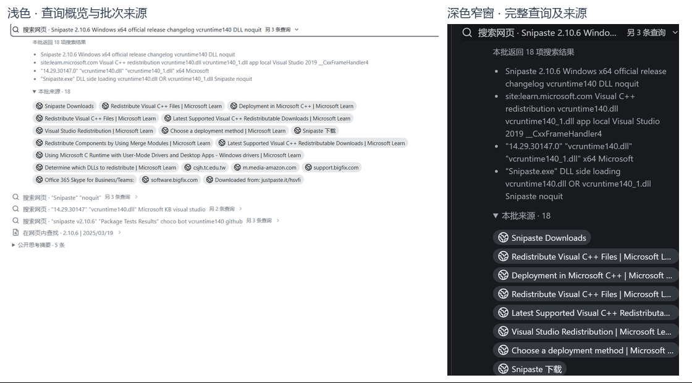

桌面相关前端测试 298 项、Rust 测试 10 项通过，生产构建通过。工作台 v121 的 21 项状态检查和线上宽窄窗验证通过。

**证据与更新方式。** MP4 按时间抽帧总览，再对展开、失败和交付切换加密取帧。图注时间是原视频播放时刻。当前 Hub 图注明了 Windows 实窗或真实保存事件的组件回放；回放中的输入只在浏览器内使用。录屏像素受窗口大小与缩放影响，文中的 CSS 数值取自实现。后续直接更新本页对应段落和图，将最新已核对的提交放到页首，下方保留必要的历史对照。工作台交互演示可从原站打开。[工作台演示](https://hub-workspace-von11.song02211368537057.chatgpt.site/?assistant=activity-demo)

用于辨认原始录像的 SHA-256 为 `dfa60d726f0c4304109fcf14b7ebe2e94cda3103e2d51c16e8d754ce18095509`（codex1）、`b58a8c820759b33ba9e3fbfb303d8f2a385dead1956b63c7248305e0fd936595`（codex2）和 `35cee439cc14522f97fe539706d07d61a632bce3887c089062b405f097ea062a`（codex3）。

## 较早录像与原始证据

展开首轮 Codex 与 Hub 录像的十组对照、逐帧索引及桌面动效复核

以下保留首轮记录的时态、截图与验收建议。当时出现的计时横线、顶部混入工具标题和流式配色等问题已有后续修复；现行规则见页首。这里的 Codex、Hub 两段录像与本次新增的 codex1、codex2 为不同样本。

2026-11-20 · 桌面浅色模式 · [Agents 工作过程升级 #56](https://github.com/VondeSong/hub-search/issues/56)

**优先调整时间线的组织方式，再调整动效。** Codex 把每段公开进度放进对话正文，在它下面用一行表示当前工作。用户可以就地展开工具、回看上一段，再接着读答案。Hub 在同一次运行中同时展示总览、计时、步骤和多条公开摘要，用户需要在几处文字之间判断当前进度。另一个可定位的差异是 Hub 的独立“正在思考”行没有使用工具标题已有的文字动效。下文的图均取自这两次真实运行。

## 01　发送后，视线应该落在哪里

Codex 的两份附件和用户问题靠右，助手从左侧正文栏起笔。2.005 秒先出现“正在创建聊天”，4.004 秒同一栏出现“正在思考”。14 秒时进度说明占据正文位置，低强调度的活动行在其下。Hub 在正文之前先展示带用时、横线和更多菜单的总览，然后另起一行显示“正在思考”。两个视口宽度分别为 1326 和 956 个视频像素，直接照搬两侧留白会让窄窗口正文过窄。

**复刻与验收**　在新聊天、已发送但尚无工具、已产生首段进度三个时点截屏。新聊天有真实创建事件才显示创建文案；等待时只显示当前活动行；收到进度后将公开说明放在活动行上方。窄窗口验收对照图中的阅读顺序、左右归属和正文对齐线；菜单留在可回看的历史入口。附件、状态、正文三者不能互相遮挡。

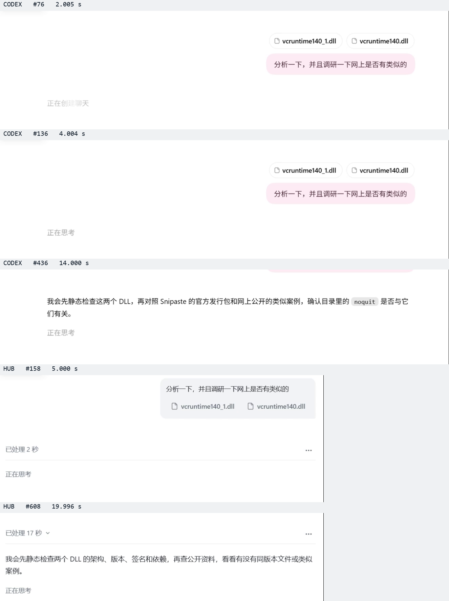

## 02　白色光晕在字形里移动

观察下图左列。7.602 秒的“正在思考”可作起始参照，7.802 秒左端笔画变浅，8.002 秒亮部移向中间，8.202 至 8.335 秒经过右侧，8.502 秒右端恢复。原图文字约在 x=140–219、y=263–281；裁切上方四行像素在该窗口保持灰度 255。右列是 Hub 自己录屏同时间的六帧，文字没有出现相应的扫亮。两列只用于比较动效，不代表两次请求同步执行。

**复刻与验收**　给当前状态的文字本身做横向渐变，用字形裁剪让窄亮带从左向右穿过灰色笔画。背景、行宽和基线保持稳定。分别截取左、中、右亮起及回落四个时点，再看一遍连续播放。整行同时变淡、背景出现色块或文字左右移动，都属于可见偏差。当前实现的渐变只匹配活动工具组的标题，使用品牌色混合，2.1 秒一次、最多三次；独立思考行走另一条样式。实施时共用活动文字样式，仅给仍在运行的标签加动效。建议在持续等待时循环，结束即停；减少动态和强制颜色模式使用可读静态文字。循环间隔、缓动曲线和辅助模式属于实现选择，录像只确定这一次扫动的方向和亮度顺序。[现有样式](../src/AgentInvestigation.css)

[播放真实帧裁切动图，按原时间间隔近似回放，末尾循环便于观察](process-video-20261120/glow.gif)

## 03　当前工具占一行，步骤按需展开

Codex 在 21.997 秒用终端图标和单行命令表示正在执行的工作。45.998 秒展开后，子步骤缩进，浅色细线把搜索和失败命令连在同一组内。Hub 在 68.013 秒的总览和步骤都出现“分析附件”，到 73.012 秒，工具行已显示 9 秒耗时，下面又出现独立思考行。

**复刻与验收**　用当前真实工具的图标和短标题替换空闲思考行；工具结束而回答仍在生成时才恢复“正在思考”。摘要、展开箭头及可点击范围属于同一行。工具名、历史耗时、错误详情放在对应层级。以图中单步和多步分别复验，顶层只读一次就能知道此刻在做什么，展开后仍能定位每一步。

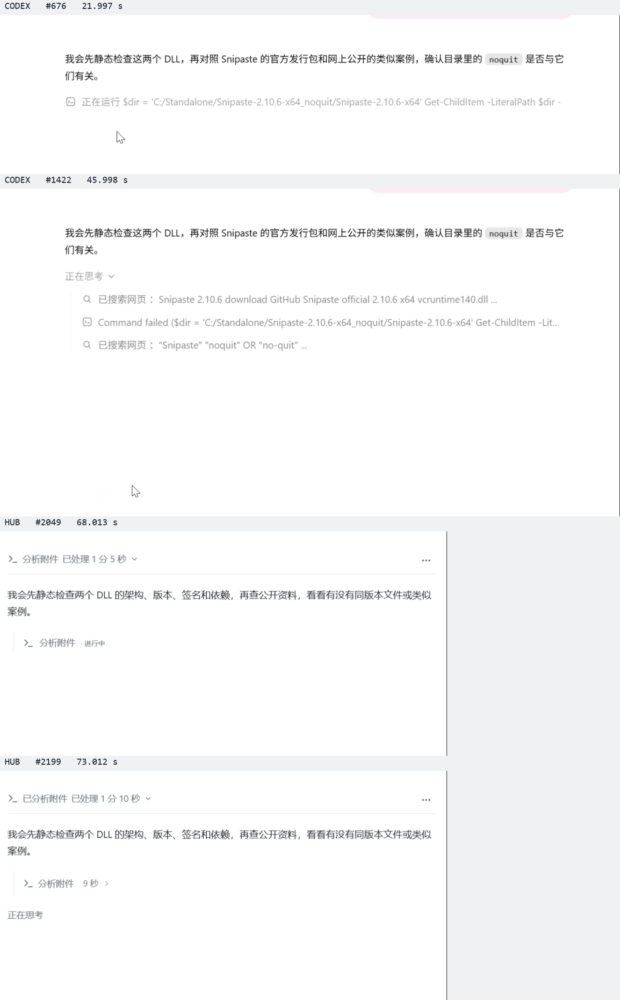

## 04　网页搜索按查询呈现来源

Codex 47.998 秒显示查询文本及其下的网站胶囊。胶囊由站点小图标和短标题组成，横向排列，空间不足自然换行。Hub 95.005 秒同时显示搜索组、站点计数、“搜索网页 · 4 条查询”及结果数量。两种组织方式的区别在于，展开后能否一眼看出哪些来源回答了哪条查询。

**复刻与验收**　收起时显示搜索动作与来源预览；展开后按实际查询顺序列来源。长标题截断，较窄宽度优先换行，缺图标的来源仍显示站名。仅在数据提供查询与来源的对应关系时分组，否则按该次搜索列出。以图中多来源的行复验图标、标题、换行与折叠后的占高。链接目标、键盘焦点与无图标回退需在原型中另测。

## 05　命令和输出在原位阅读

Codex 把 Shell 标签、等宽命令与输出放进展开行下面的浅色面板，长内容有内层滚动区域，退出码靠右下。Hub 已能展示 Python 正文；77.010 秒与 84.008 秒的内容位置发生变化。复用这个查看器可以保留已有的真实执行记录。

**复刻与验收**　保留原语言、换行、错误和退出码。默认限制长输出面板高度，给面板内滚动独立空间；从同一行关闭。对照长脚本滚动前后的外层标题和相邻步骤位置。用既有成功与失败记录分别检验展示，不从一段文本猜测退出码。复制、键盘滚动及焦点恢复属于交互验收项，截图只能证明可见外观。

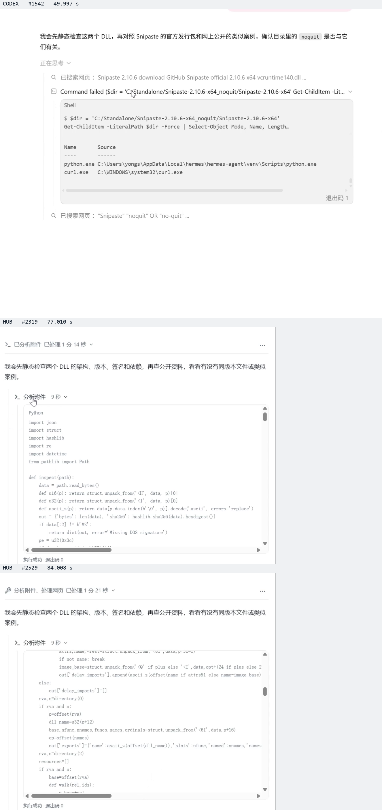

## 06　子项折叠与整组折叠是两次操作

Codex 49.997 秒同组下能看到执行详情；53.007 秒详情已收起，组内其他行仍在；54.984 秒整组收成一行。三帧之间的差异可以直接用来验收点击影响的范围。

**复刻与验收**　行标题控制本项，组标题控制整组，箭头方向跟随展开状态。新增事件、计时刷新时保留已有选择。以运行、段落和事件的稳定标识记录状态；沿用 Hub 已有的 disclosure 状态管理。用同一段记录复走“展开组 → 展开工具 → 收起工具 → 收起组”，逐步比对三张实帧。键盘操作后焦点回到相应标题是建议验收项。[现有折叠入口](../src/AgentActivity.tsx)

## 07　第二段进度到达后，上一段还能单独回看

Codex 90.000 秒第一段工具已收成短摘要，下一段进度正文和新活动行在其下面。120.014 秒可以回看较早的步骤；139.989 秒可单独展开第二段。Hub 177.014 秒仍在一条长时间线上交替展示英文公开摘要、进度正文和工具，回答前的阅读距离更长。

**复刻与验收**　按公开进度消息在事件序列中的位置划分段落，每段绑定后续工具，直到下一条正文。历史段默认以短摘要收束；用户已主动展开并阅读的段保留选择。将重复的英文公开摘要收进对应段的详情，保留原文。旧会话缺少段落边界时沿用原始顺序。以两段录屏为基准，逐次展开第一段、第二段，再让新事件到达，检查步骤归属、展开状态与阅读位置。这里只使用客户端已经获得的公开事件。

## 08　答案开始出现时，过程仍可回看

Codex 182 秒可见首段回答，约 185 秒表格开始出现。Hub 247.994 秒仍显示过程，到约 251 秒正文和表格已经可见，上方还能读到公开过程。这两帧给出 Hub 转场的时间区间。

**复刻与验收**　首个答案片段就位时撤下“正在思考”，在最后一段历史摘要下直接绘制正文；段落、链接和表格随接收内容更新。用户停在底部时跟随正文；正在回看历史时保留阅读位置，允许手动返回底部。两种滚动策略是建议，截图中可直接核对的是内容顺序、表格出现和历史是否仍可读。

## 09　完成态要区分工具失败与回答结果

Codex 最后样本保留两条历史摘要、用时 2 分 58 秒及答案。早先的 Shell 失败仍可回查。Hub 最后样本以“部分未完成 用时 4 分 18 秒”收束，下面已经显示回答、来源和带边框的表格。现有 runOverview 会把失败、中断或 errorCount 汇总成“部分未完成”；用户仅看总览很难判断故障影响了哪部分交付。

**复刻与验收**　以运行终态决定运行标题及总耗时；个别工具的失败留在对应步骤，确实影响用户要求时在回答或摘要点明缺少什么。总用时来自运行记录，不能用视频总长代替。正文主次、链接、表头、分隔线、答案下方的操作区按图检查；先比对相同宽度下的字重和列间距。分别回放“有失败步骤且有答案”和真正中断的历史会话；后者是额外测试场景。

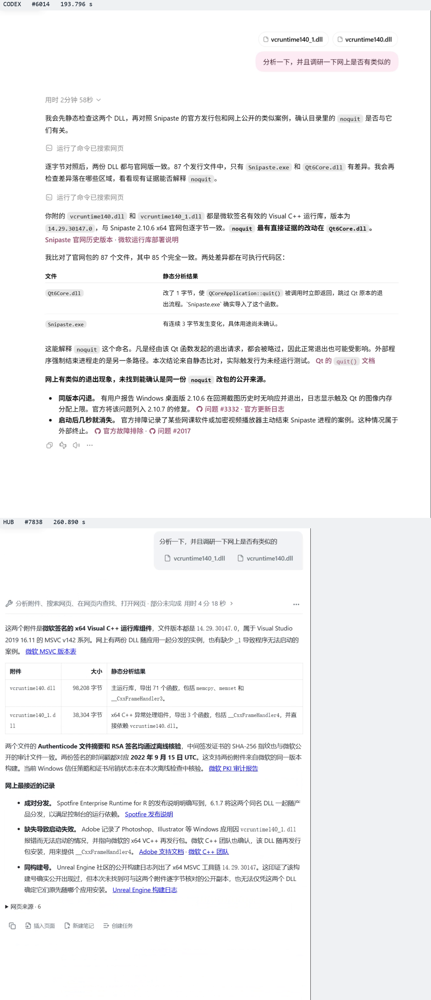

## 10　输入区是整个转场的固定参照

发送前 Codex 输入区有两个附件预览；运行中右端圆形控件显示停止符号，结束后恢复输入态。Hub 在发送后和完成态的输入区仍能看到附件芯片。两端工具区配色与排列也有区别。此处要同时核对“历史消息带了什么附件”和“下一条消息将发送什么附件”。

**复刻与验收**　提交成功后把已发送附件归到对应用户消息，清除已消费的输入草稿附件；发送失败则保留草稿以便重试。运行中与完成后的右端操作分别取决于当前请求和草稿是否可发送。检查停止按钮、禁用态、模型选择入口与输入区边界；在窄窗口展开长输出，底部控件仍可触达。录像覆盖按钮外观，停止请求后的服务端行为需另行验证。

## 实施顺序与复测

1. **现有 Hub 工作台原型先复现三个连续状态**。以图 1、2、3 为验收基准，走完发送、等待、首个工具。白色扫光另录原速短片，以图 2 的字形放大带检查亮部方向、背景和回落。
2. **接上同题的完整过程**。按图 4–8 复走查询展开、长输出滚动、子项与整组收起、回看第一段、第二段到达、答案进入。每个动作保留操作前后的同尺寸截图，用同一处可见文本作滚动位置参照。
3. **核对收尾，再进入桌面实现验收**。按图 9、10 比对总耗时、失败步骤、表格及输入区；单独复验减少动态、键盘操作、停止及历史回读。桌面侧优先复用 AgentActivity、ActivityTimeline、OperationPhase、WebActivity、RecordedToolActivity 和现有输出查看器。原型截图与真实运行验收分别记录，桌面阶段使用已有真实资料。
4. **视觉对齐的测量条件**。同一浅色模式、窗口宽度和缩放分别录制参考与候选；在正文首字、活动文字基线、展开行左边界、工具面板边缘、输入框顶边设置对照点。先对齐几何位置，再比较字重、对比度、留白和动效。视频像素包含应用缩放和编码影响，字体名称、CSS 像素、精确曲线、悬停提示及未点击控件行为须在实机复核。

## 帧索引与取证方法

全量解码了 Codex 的 6,022 帧和 Hub 的 7,846 帧。为每一帧记录视频 PTS，并对缩小后的灰度图计算与前帧的平均绝对差、差值超过 5 和 20 的像素数；借助按时间采样的拼图定位交互，再目视复核关键帧。文字动效另取原分辨率裁切比较。变化检测覆盖 13,868 帧，人工复核集中于关键状态。图中帧号从 0 开始，时间取视频流 PTS，单位为秒。截图为原帧局部，少数横向有浅灰补边；图 2 特意放大。GIF 的循环仅为对照播放。

| 录屏 | 分辨率 | 时长 | 逐帧索引 | 原文件 SHA-256 |
| --- | --- | --- | --- | --- |
| Codex | 1326 × 1920 | 194.062 秒 | [CSV.GZ](process-video-20261120/codex-frames.csv.gz) | 5609d2ede9ed2f723dcf2e9fe464e5e4f51aa9db1504bee457cf4a68a91621f0 |
| Hub | 956 × 1920 | 261.157 秒 | [CSV.GZ](process-video-20261120/hub-frames.csv.gz) | 7b2bec2217130ce2dfbdc14db4f93c90a05fdb9dcbf906bf0c48ab003df205b2 |

## 桌面实现复核

同题历史的 24 条公开流事件在桌面组件内回放，两个阶段可独立展开。下图左列为 Codex 视频原帧，右列为桌面组件在 Chromium 中按动画时间截取的六帧。将字形划为四个等宽区，四区亮度峰值分别出现在 250、450、650、850 毫秒的采样帧；减少动态模式下无此动画。两列保留各自的字形尺寸，右列时标从一次 CSS 动画开始计算。

## Windows 桌面恢复卡与分组

原型的案例 1、案例 2 用于对照两种公开工作过程。真实助手按本轮实际公开记录显示用时、状态、材料回执与规则、公开说明和工具分组。材料与规则用不同图标区分，折叠内层沿细竖线缩进。需要展开的分组保留本对话里的选择。

明确暂停和历史失败分别保留「已暂停」与「未完成」状态。当前失败或中断回合有未发布草稿时，恢复卡把失败原因、继续操作、资料范围和草稿预览放在一处。草稿展开后显示未核验标记。已完成发布、授权失效或历史上无可用草稿的回合仍按各自的状态和授权显示。实际续跑沿用原有准入与请求方式。

Windows 热开发实窗使用已有的 38 秒同题回合，验证工具组展开后显示实际工具记录、草稿可展开和收起、资料范围可由恢复卡打开。续跑路径由前端回归覆盖。

## 2026-11-22 · hub_ui (5) 的过程组合

| 组合 | 取舍与验收 |
| --- | --- |
| 材料／规则 → 公开说明 → 原文摘录 → 网页批次 → 回答 | 材料加载说明授权上下文，阅读回执显示实际读取到的内容。公开说明沿事件顺序，单独的网页组保留站标与步骤计数。原型实测可在摘录和回答两处打开对应段落；网页组收起时原文和技术记录仍可独立查看。 |
| 多批检索与摘要交替 | 网页组从只有一步起使用稳定组头。被打开的原文组在新网页组到达后保持原来的节点和展开状态。Codex 的公开摘要仍按原顺序留在所属阶段。原型「流式复核」演示三批历史结果；桌面自动回归覆盖相邻分组切换、首段答案、历史重开与焦点边界。 |
| 网页来源与正文引文 | 组内站标只帮助识别网站。搜索回包、成功打开的网页和正文采用的引文各取各自的记录。参考稿有组头标称 5 步、明细只列 4 步的情形；按可见的实际操作计算，摘要、页数和额外查询数量不重复计作步骤。 |
| 失败、草稿与续跑 | 折叠整轮后，原型仍呈现未核验草稿和恢复操作。模拟续跑完成后可回看前一次参数异常。桌面只根据实际运行状态显示完成或需处理的计时标记，局部工具失败仍由回执解释。 |

恢复时最容易混淆的是「这一轮先前失败过」和「当前是否可以使用最终回答」。历史失败应留在原批次，当失败影响交付时由恢复区持续说明。类似地，摘录适合快速核对，技术记录适合诊断，正文引用适合回到具体段落。这三个入口各有独立的展开状态，关闭其中一个应保留其余状态和键盘位置。

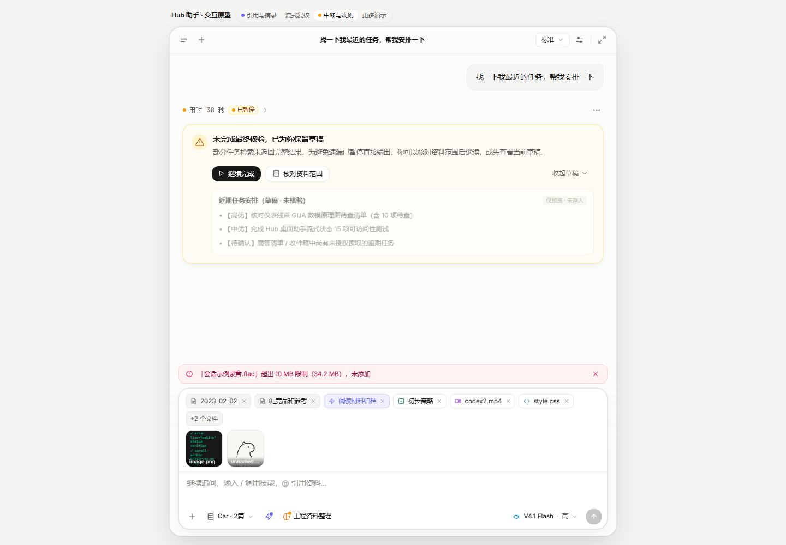

**证据范围。** 在 1440 px 和 390 px Chromium 实测场景切换、三级展开、Escape、焦点返回、减少动态、来源筛选及续跑。桌面复用已有授权与原文回读协议，专项 143 项通过、1 项既有跳过，开发 WebView 已连接新源码。日常库读到已有真实网页过程，本轮未完成新组合的 Windows 实窗重跑及屏幕阅读器实测。

### hub_agents (6) 逐组复核

原站 v152 恢复参考稿的左侧阅读区。引用数字与读取回执共用同一段落定位，宽窗口滚动到原文并高亮，窄窗口提供原文预览。生产浏览器分别检查了三个组合。

- **引用与摘录。** 读取原始数据展开后，关闭网页批次只隐藏网页步骤；关闭整轮后重开，读取记录的展开选择保留。第 14、17 段定位落在左边原文。摘录、网页访问记录和回答底部的来源入口可各自查看。
- **流式复核。** 三个网页批次按公开说明分开，页数与步数分开呈现。原型用于逐条读历史样例，时序与真实模型组合仍由桌面活动事件和前轮回归覆盖。
- **中断与规则。** 能先展开失败的参数记录，再关闭整轮查看未核验草稿。模拟续跑完成后，重新打开原组仍可看到前次异常。成功标记描述恢复后的结果，历史记录保留当时的状态。

[三组线上截图](assets/agents-ui/2026-11-22-html6/process.png) · [逐区验证与桌面边界](AGENTS_UI_INTERACTION_PLAN.md#html6-reference-audit)
