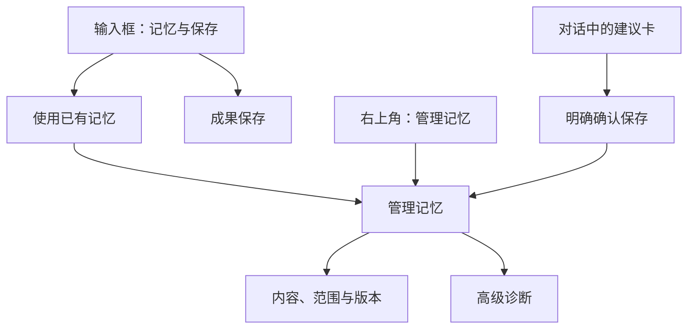
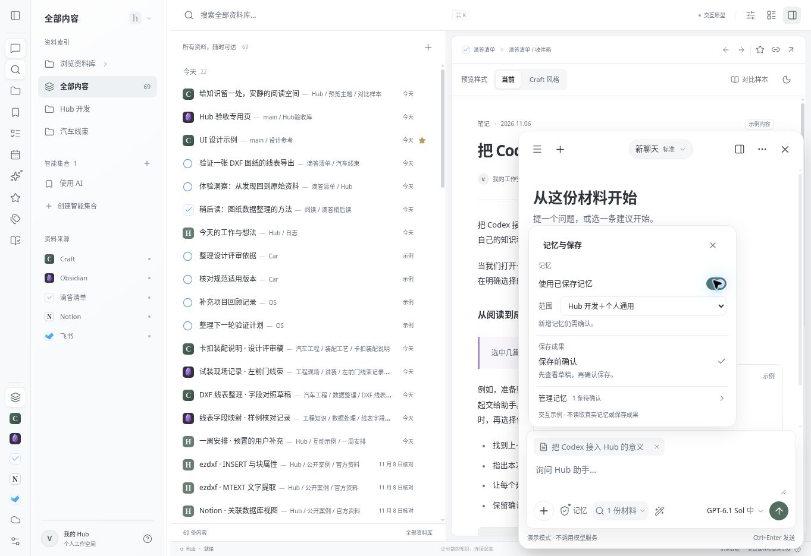
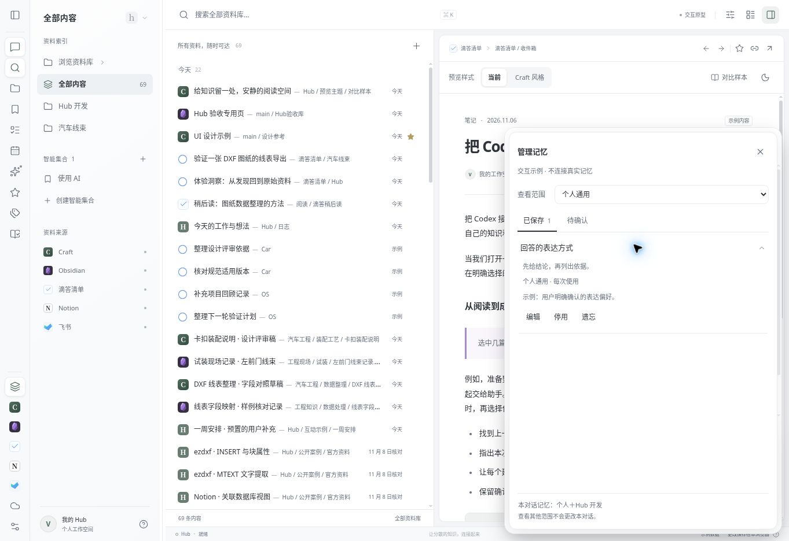
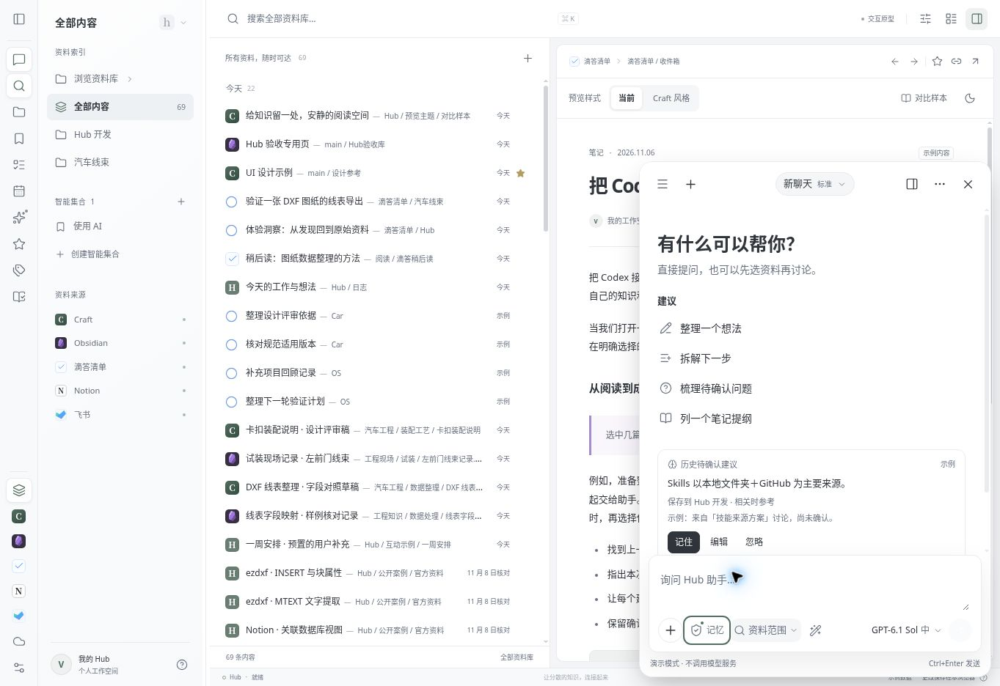
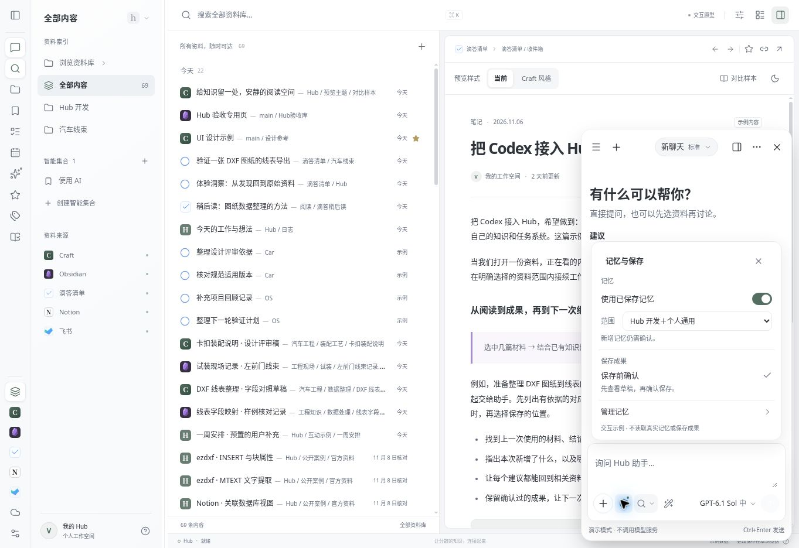
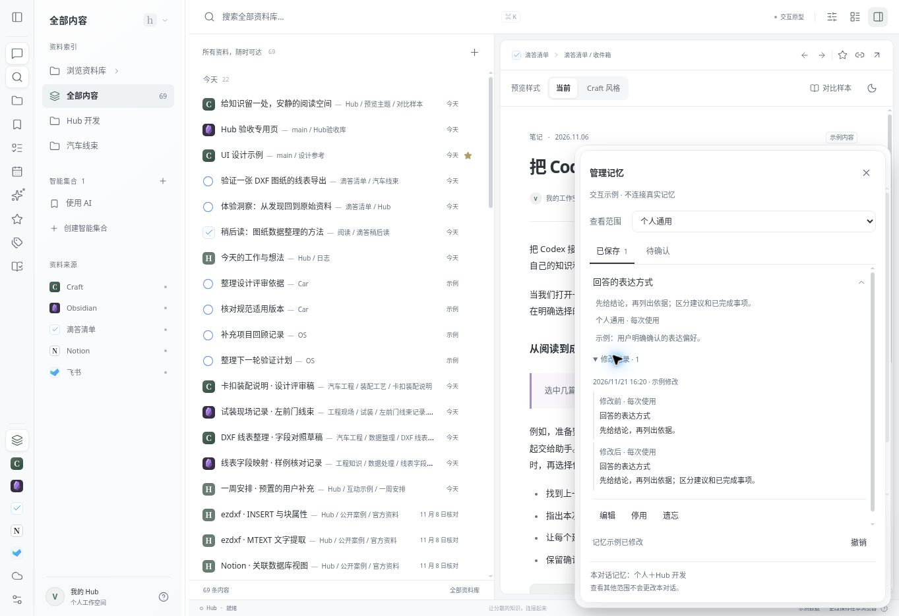
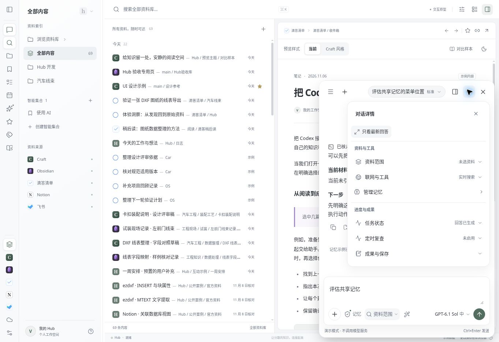

# Agents 共享记忆：交互简化、入口整合与实施方案

> 日期：2026-11-21（中国时间）
>
> 所属模块：[Agents #43](https://github.com/VondeSong/hub-search/issues/43)
>
> 相关既有事项：[共享记忆与跨模型衔接 #21](https://github.com/VondeSong/hub-search/issues/21)、[新聊天继承记忆选择 #23](https://github.com/VondeSong/hub-search/issues/23)
>
> 源码核对基线：[`4f2fb2a4740499c17171b9352d78f2d317cef41b`](https://github.com/VondeSong/hub-search/commit/4f2fb2a4740499c17171b9352d78f2d317cef41b)
>
> 原型设计起点：现有 Hub 工作台 v132。沿用原站点与项目，不新建替代站点。发布前发现其他工作已发布 v133，交付前须合并并保留其 `ecad880e6f5b9f24f451a34d86432a03149f87a8` 改动；最终来源与发布记录见第 17 节。
>
> 本次交付范围：详细方案、现有工作台交互原型、示例截图与对应 GitHub 源码同步。正式桌面实现、真实记忆数据迁移、后端接口拆分与安装包发布不由原型交付自动启动。最终发布版本、检查结果与提交记录见本文末尾的交付记录。

## 1. 结论与本次要解决的问题

把日常的记忆设置移到输入框下方现有盾牌按钮，弹层改名为 **“记忆与保存”**。弹层只保留两个短区块：**“使用已有记忆”** 和 **“成果保存”**。右上角保留 **“管理记忆”** 入口，完整的记忆列表、建议、编辑、项目管理与诊断进入独立管理界面。

这次简化的重点是让用户在发送前迅速知道“这次会用哪些记忆”，在值得保存的对话旁完成“记住这条”的操作。已有的个人与项目隔离、规则与决定、版本校验、明确确认、停用与遗忘都继续保留。

### 1.1 为什么用户觉得复杂

用户的原始截图把四类不同频率的事情放在同一面板：

1. 发送前的选择：是否用记忆、用哪个范围。
2. 内容维护：查看、编辑、新增、确认建议。
3. 组织维护：新建记忆项目。
4. 系统维护：刷新、准备与修复本地记忆。

这些功能各有用途，但同时展开会让日常聊天先遇到配置表单。用户还需要理解“本事项”“下一轮”“新聊天沿用”等多个时间范围，真正有价值的“建议记住”被推到面板下方。

用户第二张截图提出了很明确的方向：输入框下方已有“保存权限”盾牌按钮，可以承接这次发送的设置。这个位置适合“使用记忆”；但弹层标题和总说明必须随之调整，避免把读取记忆误解为允许自动保存。

### 1.2 本次确定的十条原则

1. **发送前设置靠近输入框。** 用户无需跑到右上角展开完整管理面板。
2. **弹层只保留两组短设置。** 完整内容、建项目、诊断不回塞进去。
3. **使用记忆、保存记忆、保存成果是三件独立的事。** 一个开关不连带授权其他动作。
4. **保留 #23 的继承规则。** 新聊天沿用上次主动选择的范围和开关；首次无偏好时关闭；已有聊天保留各自设置。
5. **查看其他范围不改变当前对话。** 管理筛选与使用范围独立。
6. **不新增自动项目推断。** 不根据聊天标题、模型猜测或管理页正在浏览的项目悄悄改范围。
7. **新记忆仍明确确认。** 原型中的“记住”和“保存修改”都展示将保存的内容与范围。
8. **规则与决定继续有区别。** 规则在范围启用后每轮提供；决定在相关时作为候选参考，受实际容量限制。
9. **状态说清实际阶段。** “已选择”“已保存”“已生效”“已向模型提供”“模型采纳”不能互相冒充。
10. **原型和正式客户端分别验收。** 原型展示交互，真实后端、跨模型调用、数据删除与设备效果另有证据。

## 2. 背景证据与当前源码核对

### 2.1 原始界面证据


图 1：用户提供的原始共享记忆截图。它证明的是可见的信息层级与布局，不据此推断运行错误或数据泄露。截图可能早于最新提交，当前行为以本节源码核对为准。


图 2：用户建议复用的盾牌入口。原弹层的“控制成果如何保存，不改变助手可读取的资料范围”只能解释成果保存区；加入记忆后，不应继续作为整个弹层的总说明。

### 2.2 已确认的现状

| 项目 | 基线事实 | 对方案的约束 |
| --- | --- | --- |
| 原有共享记忆组件 | `SharedMemory.tsx` 同时处理展开、状态读取、范围修改、建议、编辑、项目创建、使用记录和诊断 | 将视图拆分，不能复制第二套独立记忆状态 |
| 个人与项目范围 | 项目为空时是个人；选中项目时，使用个人加该项目 | 首期选项按现有语义显示“个人”“个人 + 项目名”，不假装已有“仅项目”隔离模式 |
| 新聊天继承 | `AgentPreferences.ts` 保存 `projectId` 与 `enabled`；缺失或非法时返回个人、关闭 | 复用现有偏好，不用 UI 改版重置用户选择 |
| 已有聊天 | 由事项自身的 `memory_work_scopes` 记录决定 | 打开旧聊天不得覆盖新聊天默认值 |
| 展开面板 | 当前 `status` 请求明确传入 `prepareRuntime:false` | 展开不自动初始化已经实现，不能再当成待修复缺陷 |
| 状态接口内容 | 后端 `status` 读取全库按更新时间排序的最近 200 条非 `forgotten` 记忆，并加载正文、来源、版本记录；前端再筛选个人与当前项目 | “不初始化运行环境”不等于“只读两项轻量字段”；未来管理分页与轻量设置接口可单独规划 |
| 候选列表 | 按项目读取 `awaitingConfirmation`，当前上限 50 条 | 全部待确认数量与跨项目视图不能靠一个范围的列表冒充 |
| 模型生成候选 | 当前生成路径要求有效的当前运行和已启用的记忆范围 | 关闭记忆时仍可管理过去的建议，但首期不新增关闭时自动生成建议的行为 |
| 规则 | 有效范围内的已确认规则每轮提供；序列化规则数组不超过 2,000 UTF-8 字节，超限报错 | 不得为简化界面把全部规则改成“相关时再检索” |
| 决定 | 先限定有效范围和版本，再检索候选；最多 5 条，序列化决定数组不超过 2,000 UTF-8 字节 | “已保存 30 条”不意味着本轮提供 30 条；遗漏须按真实记录展示 |
| 总记忆上下文 | 序列化 Context 不超过 4,000 UTF-8 字节，超过则报错 | 这些是当前 Hub 字节边界，包含 JSON 开销，不是模型 token 上限 |
| 保存保护 | 有明确确认、`expectedVersion`、请求身份与正文核验；中断重试不应重复创建版本 | 新建议卡直接接已有保存链，不能绕过校验 |
| 停用与遗忘 | 停用撤销后续使用资格；遗忘先停止使用再清除各版正文和相关派生内容，可能出现清理未完成 | 用不同文案和动作，不将两者合成含糊的“删除” |
| 成果保存 | 现有保存权限支持保存前确认；特定场景另有仅闪卡收件箱的自动导入选项 | 记忆开关不改变这些权限；自动闪卡选项不扩大为自动保存所有内容 |

证据：[共享记忆前端](https://github.com/VondeSong/hub-search/blob/4f2fb2a4740499c17171b9352d78f2d317cef41b/desktop/src/SharedMemory.tsx)、[偏好持久化](https://github.com/VondeSong/hub-search/blob/4f2fb2a4740499c17171b9352d78f2d317cef41b/desktop/src/AgentPreferences.ts)、[共享记忆后端](https://github.com/VondeSong/hub-search/blob/4f2fb2a4740499c17171b9352d78f2d317cef41b/desktop/src-tauri/src/shared_memory.rs)、[模型候选与确认](https://github.com/VondeSong/hub-search/blob/4f2fb2a4740499c17171b9352d78f2d317cef41b/desktop/src-tauri/src/shared_memory/proposals.rs)、[现有保存权限](https://github.com/VondeSong/hub-search/blob/4f2fb2a4740499c17171b9352d78f2d317cef41b/desktop/src/AgentAssistantOptions.tsx)。

### 2.3 已完成的工作继续保留

[#21 的 2026-11-21 更新](https://github.com/VondeSong/hub-search/issues/21)已经完成新对话查找旧工作、引用旧提问摘录、带草稿继续旧对话，以及记忆面板展开时不自动初始化。原型 v132 也已经包含相关交互。本轮应在它之上迭代，不能把旧问题重新当成本次发现。

历史推荐和共享记忆保持独立：关闭共享记忆时仍可查找旧聊天；引用旧聊天要经过用户选择，摘录不自动获得原图、原文件或工具授权。新原型不能因移动记忆入口而删掉这些能力。

[#23](https://github.com/VondeSong/hub-search/issues/23)明确要求新聊天沿用上次主动选择，且已经验收。此前“是否跟随当前项目”的一般建议不作为本方案默认行为，避免覆盖用户已经确定的习惯。

[#21 的 2026-11-15 后续记录](https://github.com/VondeSong/hub-search/issues/21#issuecomment-6891935224)已经完成限定真实工作的 Codex → DeepSeek → Codex 交接。不能再把先前的材料超限失败描述为当前未修复状态；也不能据此保证任意长度、任意资料量的聊天都能无损切换。

## 3. 用户真正需要完成的场景

| 场景 | 用户要做什么 | 目标体验 | 重要边界 |
| --- | --- | --- | --- |
| 第一次使用 | 不设置记忆，直接聊天 | 记忆默认关闭；聊天正常；需要时从盾牌打开 | 不自动初始化、不自动提炼并保存历史聊天 |
| 反复讨论 Hub | 昨天已选“个人 + Hub 开发”，今天新建聊天 | 默认沿用该范围和开关，发送前可一眼确认 | 继承主动选择，不依据标题重新猜项目 |
| 临时讨论别的事 | 只想这段聊天不用记忆 | 在同一弹层关闭；当前与后续新聊天按 #23 沿用关闭 | 不是只关一轮又悄悄开启 |
| 看其他项目记忆 | 当前聊 Hub，但想查线束项目中存过什么 | 管理页切换浏览范围；输入框仍显示原使用范围 | `browseScope` 不触发 `selectScope` |
| 保存个人偏好 | “以后先给结论，再解释” | 展示精确内容、保存到个人、类型为规则；明确点击记住 | 不把当前一次性回答格式自动升成永久规则 |
| 保存项目决定 | “本阶段先完成基础对话，再做复杂资料处理” | 在该条对话下显示简短建议卡；确认后进入所选项目 | 采用何种类型、适用范围在确认时可见 |
| 修改决定 | 原方案 A 已被 B 替代 | 打开原条目修改；明确“保存为新版本” | 旧版停止使用；保存失败不显示新版生效 |
| 暂时不用某条规则 | 不想删掉，但近期不适用 | 点击停用；列表保留内容和来源 | 不再召回，恢复时仍需明确确认 |
| 彻底遗忘 | 不再需要该条及其历史正文 | 显示影响说明并确认；展示真实清理阶段 | 已发给模型的文本和已有备份不能宣称被一起抹去 |
| 换模型继续 | 从 Codex 换 DeepSeek | 使用相同的 Hub 范围、有效版本和保存规则 | 各模型能力/容量不同，不能用界面一致冒充全部实测 |
| 打字想起旧工作 | 新草稿与旧提问相关 | 继续保留 v132 的旧聊天提示、引用和续聊 | 历史推荐不是长期记忆候选，不混在“建议记住”里 |

## 4. 信息架构与入口分工



### 4.1 日常层：输入框下方

入口沿用现有盾牌位置，名称与无障碍名称统一为“记忆与保存”。桌面有空间时可显示简短文字；窄布局保留图标和可靠的可访问名称。图标旁颜色只能辅助表达状态，不能作为唯一提示。

弹层包含：

1. 标题“记忆与保存”和关闭按钮。
2. “使用已有记忆”：开关、范围选择、一句状态说明、管理入口。
3. 分隔线。
4. “成果保存”：保存前确认；仅在已有条件满足时显示原先的闪卡收件箱选项。

不在这一层展示记忆正文列表、新建项目输入框、版本历史、技术标识、刷新和修复按钮。不要把一个长表单换个位置后继续完整塞入弹层。

### 4.2 管理层：独立抽屉或对话框

“管理记忆”可从日常弹层和右上角进入，两处打开同一个界面、同一组数据。管理内容包括范围筛选、搜索、已保存内容、待确认建议、停用内容、编辑和来源记录。

管理页是浏览与修改内容的地方，不是更换当前对话上下文的暗门。标题下如需要可显示“当前对话：个人 + Hub 开发”的只读信息；点击查看其他项目不得改动它。

### 4.3 就地层：对话建议卡

模型产生候选后，在关联回答附近展示建议。用户不必离开正在理解的上下文，再去右上角寻找候选列表。候选仍进入统一队列，管理页是同一条候选的另一入口，不创建副本。

### 4.4 高级层：诊断

运行准备、重建、修复、错误详情放在管理页“更多 → 诊断”。正常状态下不常驻“本地已就绪 + 修复”。真正无法使用时，日常层显示一行可理解的错误和入口，详细技术信息留在诊断中。

## 5. “记忆与保存”弹层详细规范

### 5.1 控件与行为

| 控件 | 显示内容 | 操作与提交时机 | 不产生的副作用 |
| --- | --- | --- | --- |
| 盾牌入口 | 名称“记忆与保存”；可选摘要“个人”“个人 + Hub 开发”或“记忆关闭” | 点击展开；再次点击或 Escape 关闭 | 打开不改变开关、不准备运行环境 |
| 使用已有记忆开关 | “使用已有记忆”及明确的开启/关闭状态 | 用户切换并成功提交后更新当前选择与最近主动偏好 | 不保存新记忆、不改变成果权限 |
| 范围选择 | “个人”“个人 + 项目名” | 主动选择成功后更新 `useScope` 与偏好 | 不改变管理筛选，不自动选择同名任务项目 |
| 关闭时的范围 | 继续展示上次范围，允许用户预先选择；辅助文字“开启后使用此范围” | 选择范围仍属于主动偏好；开关保持关闭 | 不因为选了项目自动开启 |
| 管理记忆 | 简短文字按钮，可附真实待确认数量 | 关闭小弹层后进入管理界面 | 不自动开启，不将浏览项目写入使用范围 |
| 保存前确认 | 原有选项及简短说明 | 沿用原成果保存提交链 | 不覆盖记忆开关，也不接受记忆候选 |
| 自动导入闪卡收件箱 | 仅在现有 `canAuto` 场景显示 | 沿用现有权限与本对话边界 | 不自动保存笔记、归档或长期记忆 |
| 关闭按钮 | 明确可访问名称“关闭记忆与保存” | 关闭并归还焦点 | 不撤销已成功提交的显式开关变化 |

开关与范围推荐即时提交，不为两项小设置再增加“应用”按钮。若现有保存权限仍使用草稿/确认提交，应在组件中明确区分已生效的记忆选项与未提交的成果设置；第一阶段可沿用原保存流程，不能把其中一个错误吞掉后统一提示“全部保存”。正式桌面实现时应优先统一为每项操作有独立反馈的轻量流程。

### 5.2 标准文案

| 状态 | 主文案 | 辅助文案或动作 |
| --- | --- | --- |
| 首次关闭 | 使用已有记忆 · 关闭 | 开启后，在对话中使用你确认过的规则和决定。 |
| 主动关闭 | 记忆已关闭 | 已保留所选范围；新聊天沿用这次选择。 |
| 开启个人 | 个人记忆 | 本对话后续发送时使用。新聊天沿用你上次主动选择。 |
| 开启项目 | 个人 + Hub 开发 | 使用个人记忆和该项目中已确认的规则与决定。 |
| 范围内暂无内容 | 此范围还没有已保存记忆 | 可以从对话建议或“管理记忆”中保存。 |
| 正在读取设置 | 正在读取记忆设置… | 不显示“正在启用”或“正在初始化”。 |
| 正在保存选择 | 正在更新… | 暂时禁用重复操作；失败后保留原有效状态。 |
| 首次需准备 | 需要准备本地记忆 | “准备并开启”或“前往准备”；不在单纯打开时执行。 |
| 已开启但运行环境暂不可用 | 记忆暂时不可用 | 保留原选择；提供重试/诊断，不静默关闭后直接发送。 |
| 项目已失效 | 原记忆项目已不可用，已关闭记忆 | 请重新选择范围。保留草稿。 |
| 正在回答 | 回答结束后可更改 | 当前轮继续使用发送时确定的范围。 |
| 保存设置失败 | 未能更新记忆设置 | 重试；保留输入与原设置。 |
| 新记忆保存前 | 新记忆仍需你确认 | 放在帮助或建议卡附近，不必常驻重复长说明。 |

“本对话使用”表达持久设置，“从下一次发送生效”表达切换时机。不要再用没有上下文的“下一轮使用”让用户误以为开关只管一次请求。

### 5.3 正常与异常的状态组织

应区分 **用户选择** 和 **运行可用性**：已经选择开启，不代表环境始终可用；环境暂时失败，也不应把用户偏好改成关闭。首次开启需要准备时，可在用户主动操作后准备，准备完成再确认可用；从历史恢复的开启状态遇到临时故障时，保留选择并解释阻塞。

当选定项目被删除或真正不可用时，继续沿用 #23 的已确定规则：退回个人、关闭，给出提示。发送时发现失效，应保留输入并让用户确认新的范围后再发送，不自动扩大范围。

## 6. 三类行为的独立关系

### 6.1 三类动作分别由什么控制

| 行为 | 作用对象 | 控制入口 | 是否需要逐条确认 | 与记忆开关的关系 |
| --- | --- | --- | --- | --- |
| 使用已有记忆 | 已确认、有效、属于选定范围的规则与决定 | “使用已有记忆”开关与范围 | 已启用范围内每轮不重复确认 | 开关决定后续是否由 Hub 提供这些记忆 |
| 保存新的记忆 | 一条具体规则或决定，以及明确保存范围 | 对话建议卡或管理编辑器 | 需要看到精确内容并明确确认 | 读取开关不构成写入授权；保存不自动开启 |
| 保存本次成果 | 笔记、报告、闪卡、归档等业务产物 | “成果保存”及对应业务预览 | 沿用业务确认流程；特定闪卡例外维持原边界 | 与记忆开关独立 |

### 6.2 常见组合的结果矩阵

| 使用已有记忆 | 用户明确确认新记忆 | 成果设置 | 应发生什么 |
| --- | --- | --- | --- |
| 关闭 | 无 | 保存前确认 | 后续请求不注入共享记忆；不写新记忆；成果先预览 |
| 开启 | 无 | 保存前确认 | 提供选定范围的有效记忆；候选不自动生效；成果先预览 |
| 关闭 | 有 | 保存前确认 | 可保存用户明确确认的条目；当前开关仍关闭；后续是否使用由开关决定 |
| 开启 | 有 | 保存前确认 | 新条目核验成功后生效；正在运行的旧轮次按既有版本变更保护处理 |
| 关闭或开启 | 无 | 允许自动导入闪卡收件箱 | 仅影响符合条件的闪卡收件箱动作；不自动确认记忆 |
| 开启但范围/环境无效 | 任意 | 任意 | 不静默跳过记忆继续；保留草稿和原有效设置，展示具体处理方式 |

关闭记忆后，管理旧候选、手动建立明确确认的条目与“本轮自动产生候选”是不同能力。当前后端自动提议路径要求记忆已启用；本次 UI 整合不放宽这一要求。历史候选可以继续在管理页展示，必须标清来源与待确认状态。

## 7. 管理记忆详细规范

### 7.1 管理页结构

顶部提供标题、关闭、新增记忆；其下提供范围筛选和搜索。列表支持已保存、待确认、已停用等状态筛选。项目创建收进范围选择器尾部或明确的项目管理入口。

建议的范围：

- 全部记忆：跨范围管理视图，不能作为对话使用范围。
- 个人记忆：只浏览个人条目。
- 某个项目：只浏览该项目条目；若合并展示个人条目，必须分组且标明“个人”，不能让用户误以为个人条目已移动到项目。

显示的数量必须反映真实查询范围与分页。如果接口当前只有最近 200 条，显示“已加载 N 条”，不能写成“全部 N 条”。后端改为范围过滤、分页与总数后再提供完整计数。

### 7.2 单条内容的优先级

每条默认显示标题、正文摘要、适用范围、类型、状态和更新时间；打开详情后才显示来源与版本记录。技术 ID 不放在列表主信息中。来源记录尽量显示可理解的对话标题与可打开入口；原始 work/run/record ID 留在详情或诊断。

条目动作按状态提供：

| 状态 | 常用动作 | 显示要求 |
| --- | --- | --- |
| 已生效 | 编辑、停用；更多中遗忘 | 类型与保存范围明确 |
| 待确认建议 | 记住、编辑、忽略 | 不能显示“已记住”；与正式条目视觉区分 |
| 待索引核验 | 重试核验、查看详情 | “内容已登记，正在核验”，不计入生效条数 |
| 已停用 | 查看、编辑后重新确认、遗忘 | 保留内容，不参与后续使用 |
| 恢复待确认 | 查看、重新确认、遗忘 | 明确“恢复的历史记忆，需要重新确认” |
| 正在清除/清除未完成 | 查看进度、重试遗忘 | 明确已经停止使用；不能假报彻底清除 |
| 正文无法核验 | 查看原因、重新编辑确认等受支持动作 | 不把未核验正文自动当成有效内容 |

### 7.3 使用范围、浏览范围和保存范围分离

| 状态 | 谁改变它 | 影响什么 | 不影响什么 |
| --- | --- | --- | --- |
| `useScope` | 用户在“使用已有记忆”中主动选范围 | 当前对话后续请求；成功后更新新聊天默认值 | 管理页当前筛选、正在编辑条目的保存位置 |
| `browseScope` | 用户在管理页切换筛选 | 列表、计数、搜索结果 | 当前对话调用范围、新聊天默认值 |
| `saveScope` | 新建/编辑器初始化及明确的保存位置选择 | 这次将保存的具体条目 | 对话的开关和范围 |

编辑现有条目时，`saveScope` 固定为该条目的原范围；单纯切换浏览范围不能移动条目。第一阶段不做隐式跨项目移动。

候选保存时，沿用该候选的项目与版本身份。当前后端将范围/主题纳入记忆身份，并校验候选归属与期望版本，因此不能只改前端下拉框就把候选迁移到其他项目。若后续增加“另存到个人/其他项目”，要作为明确的新建或迁移操作设计并验收，不能冒充接受原候选。

### 7.4 新建项目

在管理页选择“新建项目”后，显示轻量名称输入。创建成功后进入该项目的浏览范围，但不自动启用、不改变 `useScope`、不重写新聊天偏好。若用户想让当前对话使用它，必须回到日常层明确选择。

首期不把记忆项目自动映射到 Hub 任务项目、代码仓库或聊天标题。真正的统一项目模型需要另行核实 ID 与生命周期，不在这次入口调整中混入。

## 8. 候选建议、编辑、停用与遗忘

### 8.1 对话建议卡

建议卡示例内容为演示，不表示已经写入用户的真实记忆：

> **以后沿用这条约定？**
>
> Hub 移动端本阶段优先完成基础对话与图片处理。
>
> 保存到：Hub 开发 · 决定，相关时参考
>
> 记住 · 编辑 · 忽略

一张卡必须包含：精确内容或明确可展开的完整内容、保存范围、类型、三个动作。建议理由、来源、版本冲突等附属信息按需展开。不能为了极简把保存范围藏掉。

“记住”本身就是对卡上精确内容的明确确认；无需再次弹一模一样的确认框。内容过长、截断或需要修改时先打开编辑器，确认完整文字后保存。用户说“记住这段”也不能让助手静默保存一个未经展示、含义改变的自动摘要。

候选与来源绑定，不能随着管理页筛选或切模型变成另一条。对同一候选在聊天和管理页做出的处理立即同步，避免在两个入口分别保存。

### 8.2 编辑器

| 字段 | 首期规范 |
| --- | --- |
| 标题 | 简短、稳定；沿用现有长度验证；不把每次编辑标题当成新记忆身份 |
| 正文 | 展示完整待保存内容；空白不可提交；保留现有正文校验 |
| 保存位置 | 新建时明确；编辑已有/接受候选时固定来源范围，避免误移动 |
| 类型 | 保留“规则 · 每次使用”“决定 · 相关时参考” |
| 修改原因 | 修订时可填写，便于以后理解变更；不能以是否填写长解释阻碍普通修正 |
| 保存按钮 | 新建“确认并记住”；修改“保存新版本”；恢复“确认并恢复使用” |
| 取消 | 不写入；有未保存修改时防止误丢失，保留草稿或给出清晰选择 |

规则适合长期约束，例如“所有结论区分建议和已执行事实”；决定适合阶段方案，例如“本阶段先采用方案 B”。不要把类型只当列表标签：两者会影响后续使用方式。

### 8.3 真正的生命周期语义

| 动作 | 用户理解 | 系统要求 | 不应声称 |
| --- | --- | --- | --- |
| 生成建议 | 助手觉得可能值得记住 | 进入待确认队列，不参加召回 | “我已经记住了” |
| 忽略建议 | 这条提议本次不保存 | 标记/移出待确认；不改变已有正式记忆 | “已删除同主题的所有记忆” |
| 确认并记住 | 保存展示的精确内容 | 核对归属、版本、确认与请求身份，登记并核验 | 未核验成功就“以后一定会使用” |
| 编辑保存 | 用新内容替代旧内容 | 成为新版本，旧版失去有效资格；并发变化需冲突处理 | “直接覆盖，没有历史” |
| 停用 | 暂时不让它参与后续回答 | 撤销使用资格，保留条目与历史 | “已经清除正文” |
| 恢复使用 | 重新接受这条有效内容 | 当前后端没有独立一键激活入口时，走已有编辑/明确确认链；不可仅改前端状态 | “恢复只是打个勾”，或静默恢复外部备份记忆 |
| 遗忘 | 清除该记忆及其历史正文 | 先撤销资格，再核验清除结果；失败显示未完成并可重试 | “撤回了已经发送给模型的文本”“改写了已有备份” |

遗忘确认建议文案：“遗忘‘标题’及其历史正文？此后不再由 Hub 提供这条记忆。已有备份和已发送的聊天内容不会被改写。”这是用户主动选择彻底清理时的具体后果说明，不需要日常每次使用都重复警告。

不为真正的遗忘设计虚假的“撤销”，因为后台清除完成后可能没有可恢复正文。可逆的停用与不可逆的清除必须分别表达。

### 8.4 失败、中断和并发

- **重复点击或超时重试：**同一内容保留请求身份；按钮呈处理中，不能一重试就生成一条重复记忆。
- **内容变更后重试：**新的精确内容使用新的请求身份；保留 `expectedVersion` 校验。
- **版本冲突：**提示“这条记忆已有更新，请查看最新版后再保存”；保留用户草稿，不能强行覆盖。
- **候选已处理：**刷新真实状态并说明，不生成第二份。
- **切换聊天：**旧请求返回不得覆盖新聊天的范围、表单或提示；检查当前 work 身份和请求序号。
- **正文已登记但索引待核验：**显示待核验，允许幂等重试；不把其算作已生效。
- **遗忘清理未完成：**保留“已停止使用”，展示重试；错误与成功提示分开。
- **正在回答时内容变更：**沿用既有 epoch/版本保护；提示停止当前轮后继续，不能把旧上下文的结果当成已应用新记忆。

## 9. 记忆使用反馈

日常入口显示的是当前选择，回答后的用量显示的是本轮已发生的事实，两者分开。

推荐在回答的来源/上下文信息中提供“本轮提供 3 条记忆”，点开查看标题、范围、类型和版本。只在实际存在使用记录时显示数量；没有记录时可以显示“查看记忆”，不能用保存总数填充“本轮使用”。

| 状态 | 正确反馈 |
| --- | --- |
| 范围启用但无符合条目 | 本轮未提供已保存记忆 |
| 提供了规则和决定候选 | 本轮向模型提供 N 条；按实际版本列出 |
| 决定未被检索选中 | 在详情说明未选中数量，不能判断其永远不相关 |
| 决定受容量限制未提供 | 详情说明有 N 条因容量未提供，按真实 audit 展示 |
| 规则/总上下文超限 | 发送前报出整理范围或精简内容的具体下一步，不静默丢规则 |
| 关闭后回看旧回答 | 旧回答保留其当时的使用记录；当前入口仍显示关闭 |

“已提供”证明 Hub 发送了内容，不证明模型一定采纳或答案正确。详情保留这一边界即可，不需要给每条普通回答添加长免责声明。

## 10. 跨模型、旧聊天和授权范围

### 10.1 跨模型一致的部分

Codex 与 DeepSeek 使用同一份 Hub 记忆选择、已确认内容、版本与生命周期记录。更换模型不重置开关，不生成两套“Codex 记忆”“DeepSeek 记忆”，也不改变最近主动范围。候选可以记录由哪个模型提出，归属仍然是 Hub 的范围。

能力与材料容量差异仍按各执行路径反馈。本方案不宣称会访问外部 ChatGPT、独立 Codex、Claude 账号的私有记忆；外部共享方案不在这次 UI 实现中。

### 10.2 已有聊天与新聊天

严格沿用 #23：

1. 新聊天创建时读取最近主动偏好。
2. 已有聊天加载自己的选择。
3. 浏览已有聊天不写最近主动偏好。
4. 用户在当前聊天主动切换成功，才更新最近主动偏好。
5. 第一次没有偏好或偏好格式非法，默认个人、关闭。
6. 项目失效回退关闭并提示；临时运行不可用保留选择，按需重试。

### 10.3 已有的旧工作发现

保持 v132 的自动相关旧提问提示、手动历史搜索、继续旧聊天、引用摘录与移除引用。它们使用各自的授权核验，不能通过关闭记忆被一起关闭，也不能因为开启记忆自动把旧聊天全量提供给模型。

## 11. 视觉、窄屏与无障碍

### 11.1 视觉层次

采用现有 Hub 的字体、圆角、背景、描边和图标体系，减少突兀的原生按钮。日常弹层以标题、分组名、控件和值形成明确层次；弱化说明但不降低可读性。

设计目标可采用约 360–420 像素的桌面弹层宽度，边缘保留空间；实际随当前容器自适应。避免把这个建议尺寸当成必须在所有窗口固定的宽度。记忆范围的长项目名可以截断，但展开选项或详情应可读完整名称。

不引入多层嵌套卡片、大面积重阴影和持续闪动的记忆动画。正常空状态保持简洁，不用“0 条规则、0 条决定、0 条建议、0 个错误”占据屏幕。

### 11.2 窄屏

- 盾牌入口保留位置和意义，不能只剩一个无名称图标。
- 小弹层宽度限制为可用视口，距离边缘留白；高度受视口约束，内部可滚动。
- 管理界面在窄屏使用近全屏布局；范围筛选、搜索和列表上下排列。
- 编辑器按钮保持在可操作区域；软键盘出现时字段与操作可滚动到，不被固定底栏遮住。
- 候选卡按钮可以换行，正文正常换行；长项目名、中文标题、技术字符串不能撑出横向滚动。
- 关闭按钮、开关和行操作建议提供至少约 44 像素触控区域；图标本体可以更小。
- 原型的窄屏验证是浏览器响应式验证，不等于 Android APK 或手机真实后端已经完成。

### 11.3 键盘与焦点

| 场景 | 要求 |
| --- | --- |
| 打开弹层 | 焦点进入标题关联的可操作区域；读屏能获知“记忆与保存” |
| Tab 移动 | 按可见顺序经过开关、范围、管理入口、成果选项和关闭；不进入被遮挡的底层控件 |
| 开关 | 使用真实按钮/输入语义，提供 `aria-checked` 或原生状态；Space/Enter 可操作 |
| 范围选择 | 原生 select 或完整的 listbox 键盘行为；方向键、Enter、Escape 符合预期 |
| Escape | 先关闭最上层；若编辑器有未保存内容，按统一防误丢流程处理 |
| 关闭弹层 | 焦点返回盾牌按钮 |
| 从弹层打开管理页 | 关闭小弹层，焦点进入管理页；关闭后返回原入口，不叠两个焦点陷阱 |
| 对话建议编辑 | 保存/取消后焦点回到该建议卡或合理的后继元素 |
| 删除或忽略一行 | 焦点移到相邻条目或列表标题，不丢到页面顶部 |
| 状态反馈 | 读取与保存结果使用适当的 live/status；具体错误使用 alert，避免重复播报 |

包含表单的弹层应按 dialog/popover 的可访问模式实现，不仅给容器随意加 `role="menu"`。菜单语义适合纯动作列表；开关、选择器与说明混合时要按真实内容组织。

为高对比模式保留边界和文字状态；用 focus-visible 明确显示键盘焦点；减弱动效偏好下关闭非必要过渡。背景模糊或透明效果不能影响文字可读性。

## 12. 原型示例与阅读方式

图 3–4 在 **v134 发布后的原站点页面**重新截取；图 5–8 来自本次修改期间的受管预览实测。所有图片都是实际界面截图。发布前已合并并保留 v133 的选文操作与侧边聊天，合并后重新通过类型与状态检查；发布后再次核对菜单、开关、范围和独立管理页，发布来源见第 17 节。图中的记忆只用于交互演示，不连接真实记忆服务，不能据此声称已经写入真实桌面记忆或验证跨模型召回。窄布局截图取自工作台自身缩窄到 360 像素的助手面板，不将其描述为手机视口或真机验证。

### 12.1 桌面“记忆与保存”



图 3：v134 线上页面。记忆开关、使用范围和成果保存分组可见，新增记忆仍需确认；正常菜单中没有刷新、修复和新建项目表单。

### 12.2 独立记忆管理



图 4：v134 线上页面。管理器正在查看“个人通用”，底部仍明确显示本对话使用“个人＋Hub 开发”。浏览筛选和对话范围保持独立；关闭后返回原盾牌入口。

### 12.3 对话中的记忆建议



图 5：建议卡应清楚显示保存内容、范围、类型和待确认状态。点击记住才进入确认后的状态；忽略不修改已有正式记忆。

### 12.4 窄助手面板布局



图 6：检查缩窄助手面板后是否横向溢出、操作是否可到达、长项目名是否正常换行。它证明窄面板下的布局表现，不代替移动视口、软键盘或真实手机安装测试。

### 12.5 编辑后的实际前后记录



图 7：在原型中编辑“回答的表达方式”，将“先给结论，再列出依据”补充为“先给结论，再列出依据；区分建议和已完成事项”。保存后展开“修改记录”，可以同时看到操作时间、修改前与修改后的精确内容，而不是只显示一条固定的假历史。此时管理页查看“个人通用”，底部仍显示本对话使用“个人 + Hub 开发”，也佐证浏览与调用范围分离。记录和撤销均属于浏览器本地原型状态；不等同于真实后端的版本审计和不可逆遗忘。

### 12.6 右上角保留管理入口



图 8：右上角“对话详情”的资料与工具区保留“管理记忆”，输入框下方保留日常记忆设置。上下两个入口进入同一个管理器，不再各自维护一份完整设置面板。这个截图展示入口分工；在受管预览中也实际打开并核对了两处入口。

### 12.7 本次原型已实现的范围

| 项目 | 本次原型实现 | 与正式能力的边界 |
| --- | --- | --- |
| 日常入口 | 输入框下方复用盾牌位置，“记忆与保存”中分为使用已有记忆、成果保存 | 不改变正式桌面的 `SharedMemory.tsx` 或真实权限接口 |
| 记忆选择 | 个人与个人 + Hub 开发的演示范围、独立开关、关闭时仍可预选范围 | 没有新增自动项目推断或跨项目授权 |
| 新旧聊天 | 新聊天沿用最近主动选择；已有演示聊天保留自己的范围与开关；浏览旧聊天不改默认值 | 原型聊天沿用原有 `sessionStorage`，没有迁移成跨设备或永久会话系统 |
| 持久化 | 记忆示例、记忆选择与相关修改记录使用浏览器 `localStorage` | 属于当前浏览器原型数据，不是桌面数据库；不承诺跨设备同步 |
| 独立管理 | 上下入口打开同一个管理器；个人与项目浏览筛选独立于当前对话调用范围 | 未在本次实现项目创建、完整搜索、服务端分页和全部真实数据浏览 |
| 候选 | 对话中的记住、编辑、忽略；管理页与候选状态联动；空白内容禁止保存 | 本地演示既有候选，不代表模型真实生成候选或通过后台确认链 |
| 编辑历史 | 保存真实的修改前后示例内容，保留最近 20 条修改记录 | 这是原型本地记录上限，不改变正式后端的版本与审计保留策略 |
| 停用与恢复 | 停用后内容保留，可在原型中重新启用 | 不据此证明真实后端停用后的召回、恢复版本或运行中失效已实测 |
| 遗忘与撤销 | 遗忘前展示确认；原型中的撤销用于回退本地演示状态 | 本轮只浏览器实测了确认后取消；真实遗忘完成后不能承诺撤销 |
| 范围例外 | 仅材料模式显示本轮不使用共享记忆，同时保留用户原记忆偏好 | 不静默重置之后新聊天的偏好，也不扩大材料授权 |
| 原有功能 | 保留旧工作推荐、引用移除、带草稿继续旧聊 | 旧聊天引用仍与长期记忆分开，不传递额外原文件授权 |
| 窄布局与键盘 | 修复编辑返回焦点、管理器焦点循环与 Escape 返回入口；约 360 像素助手面板内布局可操作 | 未实测手机视口、手机软键盘或真实设备 |

当前原型为用户看布局和确认流程提供可操作示例。列表中的“已保存”、修改历史、撤销和候选计数反映实际本地演示操作；页面同时标明“交互示例，不连接真实记忆”。正式存储、检索、确认、权限和模型执行仍按后续桌面阶段实施与验收。

### 12.8 已执行的检查与浏览器观察

开发侧已完成本轮主路径 **25 项助手状态检查**、TypeScript 静态检查与 Git 差异检查。这里的 25 项是该组状态检查数量，不等于 25 次真实模型调用，也不与下表的浏览器操作重复计为额外自动化测试。合并其他工作的 v133 改动后重新执行上述检查，并完成生产构建、原站点 v134 发布和线上界面核对；精确命令与来源在第 17 节记录。

| 实测项 | 在受管预览中的实际操作/结果 | 结论边界 |
| --- | --- | --- |
| 首次默认 | 首次无记忆偏好时显示关闭 | 原型通过；未清理或改写桌面真实偏好 |
| 关闭时预选 | 关闭状态选择 Hub 范围，仍显示关闭 | 范围选择没有隐式开启 |
| 新聊天继承 | 新建聊天沿用最近主动范围与开关 | 原型通过 |
| 旧聊天独立 | 打开原有 Hub 开启的聊天，保留它自己的设置 | 原型通过 |
| 浏览不改默认 | 最新主动选择为个人、关闭；浏览旧 Hub 开启聊天后新建，仍为个人、关闭 | #23 的关键继承语义在原型通过 |
| 浏览/使用分离 | 当前使用 Hub；管理器切到个人；当前调用范围仍是 Hub | 原型通过，见图 7 |
| 候选编辑 | 清空内容后保存按钮禁用；取消编辑保留原候选 | 原型通过 |
| 忽略与撤销 | 忽略后候选状态更新，撤销回到本地原状态 | 仅本地演示状态；不是后端撤销协议 |
| 明确记住 | 点击记住后，Hub 已保存数量从 1 变 2，待确认归零 | 统一候选/列表状态通过；不表示写入真实记忆 |
| 编辑前后记录 | 保存修改后展开记录，实际显示修改前与修改后内容 | 原型通过；当前最多保留最近 20 条本地记录 |
| 停用与恢复 | 停用后条目内容仍在；重新启用后状态恢复 | 原型状态通过；未重新做真实模型召回验收 |
| 遗忘取消 | 打开遗忘确认并取消，原内容保留 | 取消路径通过；真实不可逆清理未实施/未实测 |
| 编辑焦点 | 编辑完成/取消后返回相应编辑入口 | 修复后浏览器通过 |
| 管理焦点 | Tab 在管理器内循环，Escape 关闭并返回入口 | 修复后浏览器通过 |
| 窄助手面板 | 将助手面板缩到约 360 像素，菜单与管理器无横向溢出 | 窄面板通过，不等于手机视口和软键盘通过 |
| 旧工作发现 | 关闭记忆时仍正常提示相关旧工作 | 保留 v132 行为 |
| 引用与续聊 | 添加引用后可移除；继续旧对话时保留草稿 | 原型通过 |
| 仅材料模式 | 显示本轮不使用记忆，原记忆偏好保持 | 原型通过 |
| 上下入口一致 | 输入框弹层与右上角详情都进入同一个管理器 | 原型通过，见图 8 |
| 中文输入法保护 | 对中文 IME composing/确认逻辑进行了源码检查 | **未实测真实中文输入法组合输入**，不记为浏览器 IME 验收通过 |

以上是完成本次原型设计判断所需的实测记录。第 16 节的 38 条完整验收仍包含后续桌面、后台和部署要求，不能据此整表宣布通过。

### 12.9 未实施或未完成实测的项目

- **管理完整度：**项目创建、管理搜索、服务端范围分页、真实全库计数不属于本次已实现原型主路径。
- **跨设备与会话迁移：**没有把原有聊天从 `sessionStorage` 迁移；没有跨设备同步或真实桌面数据导入。
- **真实后端：**没有用这批示例操作真实 Basic Memory、桌面数据库、索引或正式版本历史。
- **真实生命周期：**未实施或实测真实不可逆遗忘、后台清理失败、幂等重试、并发版本冲突和运行中记忆失效；原型撤销不构成这些能力的承诺。
- **完整模型调用：**未在本轮新做真实模型生成候选、读回新版、跨模型接续或本轮实际注入记忆的验收。#21 的已有证据保留，不重复计为本次成果。
- **成果权限：**自动导入闪卡的既有授权边界保留，但完整的自动闪卡授权与导入浏览器流程未在本轮实测；不把它写成新通过项。
- **设备和输入法：**手机视口、软键盘、真机触控与真实中文 IME 输入未完成实测；约 360 像素助手面板的通过只覆盖已观察布局。
- **验收适用范围：**线上 v134 的发布与源码一致性已单独核对；这不将上述未实施或未实测能力自动转为通过。

## 13. 正式桌面的组件与状态拆分方案

本节是后续桌面实施设计，**不表示本次已经修改 `desktop/` 业务代码**。新增文件名仅为建议，实施时遵循仓库现有组织方式。

### 13.1 建议组件边界

| 模块 | 职责 | 不承担的职责 |
| --- | --- | --- |
| `MemoryAndSavePopover` | 日常开关、范围、成果保存入口 | 全部条目正文、项目创建表单、修复流程 |
| `MemoryManager` | 浏览、筛选、搜索、列表、管理入口 | 默认修改当前对话调用范围 |
| `MemoryProposalCard` | 显示一条候选并触发明确确认/编辑/忽略 | 自行维护第二份候选数据库 |
| `MemoryEditor` | 完整内容、类型、范围、版本确认 | 静默推断项目、绕过后端保存校验 |
| `MemoryUsageDetails` | 展示实际 audit 的条目、版本与遗漏 | 根据列表总数估算本轮调用 |
| `MemoryDiagnostics` | 准备、修复、核验状态与错误详情 | 在每次展开时自动重建环境 |
| 统一控制器/store/hook | 关联 work、偏好、请求身份、缓存失效与错误 | 把模型私有记忆当成 Hub 已保存数据 |

现有 `SharedMemory` 可先保留为组合壳，逐步抽离上述视图与逻辑，避免一次重写所有后端。`AgentAssistantOptions` 中保存权限部分接入新的弹层框架，保留其业务语义。

### 13.2 建议状态模型

```ts
type MemorySelection = { projectId: string; enabled: boolean };

type MemoryUiState = {
  workId?: string;
  useSelection: MemorySelection;
  lastExplicitSelection: MemorySelection;
  browseScope: { kind: "all" | "personal" | "project"; projectId?: string };
  editor: null | {
    mode: "create" | "edit" | "proposal" | "restore";
    memoryId?: string;
    proposalId?: string;
    expectedVersion: number;
    saveProjectId: string;
    dirty: boolean;
  };
  runtime: { state: "unknown" | "needsSetup" | "ready" | "unavailable" };
  pendingOperation: null | { kind: string; requestId: string; workId?: string };
};
```

这是边界示意，不要求照抄成一个大对象。核心是独立字段、明确事件与统一事实来源。

### 13.3 事件与持久化规则

| 事件 | 允许写入 | 不允许写入 |
| --- | --- | --- |
| `OPEN_POPOVER` | 瞬时 UI 状态、只读缓存 | 用户偏好、记忆内容、运行环境初始化 |
| `LOAD_EXISTING_WORK` | 当前对话选择 | 最近主动偏好 |
| `CREATE_NEW_WORK` | 从有效偏好初始化新对话 | 改写旧聊天 |
| `USER_CHANGE_USE_SELECTION` 成功 | 当前对话选择、最近主动偏好 | 管理筛选、其他对话 |
| `CHANGE_BROWSE_SCOPE` | 管理页筛选、只读查询缓存 | 当前调用范围、新聊天默认值 |
| `OPEN_EDITOR` | 草稿与固定保存身份 | 已保存条目正文 |
| `CONFIRM_MEMORY` | 通过既有校验写新版本；核验后生效 | 自动启用当前对话 |
| `DISMISS_PROPOSAL` | 候选状态 | 已保存同主题条目 |
| `SWITCH_MODEL` | 模型选择 | 记忆范围与默认偏好 |

### 13.4 接口渐进拆分

第一阶段可继续调用现有接口，但调用者要明确 `prepareRuntime:false`，管理列表不能给出超过真实加载范围的承诺。

后续如实施接口优化，建议分为：轻量设置/准备状态、按范围分页的条目摘要、单条正文与历史、按范围分页的候选、运行使用记录、显式准备/修复。名称由实际 API 风格决定，不在本方案假装这些接口已经存在。

分页必须在服务端先应用范围与状态过滤，再排序和取页。否则“全库最近 200 条 → 客户端筛项目”会让较早更新的某项目条目不可见。这个风险是源码可推导的边界，不等于已经测得用户的库发生漏项。

保留 `expectedVersion`、请求幂等身份、精确正文、scope 校验、epoch 变化与遗忘流程。仅为加载快而跳过上述校验不属于本方案。

## 14. 迁移与兼容

### 14.1 UI 迁移

1. 保留现有 `hub.agent.memory-preferences.v1` 的语义，读取有效历史偏好。
2. 用同一控制器向新弹层和管理入口提供状态，移除重复的顶层开关。
3. 将管理页的筛选初始化为当前使用范围，仅作为首次展示；后续浏览独立。
4. 保留旧来源记录、候选身份、版本号和历史使用记录。
5. 不迁移或重写真实正文，不重新创建记忆项目，不改既有条目类型。
6. 本次原型记忆数据使用浏览器 `localStorage`，修改记录保留最近 20 条；聊天继续沿用原有 `sessionStorage`。这不构成正式桌面数据迁移或跨设备同步，后续不能把演示数据直接导入用户真实记忆库。

### 14.2 异常数据

| 情况 | 处理 |
| --- | --- |
| 没有历史偏好 | 个人、关闭 |
| 偏好格式非法 | 个人、关闭；避免抛错阻断普通聊天 |
| 保存的项目不存在 | 按 #23 关闭并提示重选；不自动匹配同名项目 |
| 本机偏好持久化失败 | 当前明确选择可按受支持能力继续；反馈下次可能无法沿用，不能显示已永久保存 |
| 数据恢复后的历史记忆 | 保留既有隔离/重新确认语义；不因 UI 更新自动激活 |
| 多窗口/并发修改 | 以版本与当前 work 校验为准；旧响应不覆盖新状态 |

### 14.3 回滚

原型保留上一发布版本和源码快照。正式桌面若仅做 UI 拆分，应尽量保持接口/数据格式兼容，便于回到旧视图而不丢数据。涉及后端分页或状态接口的后续阶段，单独记录兼容范围。

## 15. 按阶段实施清单

阶段用于区分实现依赖与验收边界，不替用户自动重排其他模块任务。

### 阶段 A：方案与现有站点原型（本次）

- [x] 盾牌弹层改为“记忆与保存”，形成两组短设置。
- [x] 移入当前记忆开关和范围，保留首次关闭、最近主动选择与已有聊天独立的演示逻辑。
- [x] 右上角入口变为管理，与输入框入口打开同一个管理器。
- [x] 独立管理界面；浏览范围不改变调用范围。
- [x] 就地建议卡与编辑/忽略/明确保存演示；空白禁止保存，取消保留内容。
- [x] 保留规则与决定语义；完成原型编辑历史、停用/恢复和遗忘确认取消的观察。
- [x] 保留 v132 的旧工作发现、引用移除与带草稿续聊。
- [x] 桌面与约 360 像素窄助手面板视觉检查，以及已列明的键盘焦点检查。
- [x] 本轮主路径 25 项助手状态检查、TypeScript 静态检查与 Git 差异检查；不冒充完整桌面/后台验收。
- [x] 保存两张原始截图、两张 v134 线上截图和四张受管预览截图，并补充准确图说。
- [x] 完成 v133 并行改动合并，核对最终完整可运行源码与来源快照。
- [x] 发布原站点；本方案的 GitHub 交付同时包含实际发布源码、文档与八张图片。

上述已勾选项仅表示第 12.8 节实际完成的原型检查。发布、源码镜像与真实桌面/后台事项分别记录；未勾选项不能因文档写完或截图存在而自动算通过。

### 阶段 B：正式桌面交互迁移（Windows 已实施）

- [x] 拆分记忆设置、保存权限和独立记忆管理，复用现有成果确认与闪卡权限。
- [x] 接入统一状态控制，隔离对话使用范围、管理查看范围和新条目保存范围。
- [x] 保留 #23 的主动偏好继承与已有聊天行为。
- [x] 将建议卡接到生成它的实际运行，保留候选核验、版本检查和幂等保存。
- [x] 回归设置读取失败、运行中锁定、确认或核验失败及版本冲突场景。
- [x] 用日常库核对宽窄布局、两个管理入口及键盘行为，并实测项目记忆的保存、继承、调用与项目隔离。见第 17.3 和 17.4 节。

### 阶段 C：管理查询和可观察性（后续优化规划）

- [ ] 轻量设置查询与完整管理查询分开。
- [ ] 管理列表服务端先按范围筛选再分页，提供真实总数/加载信息。
- [ ] 正文和修订详情按需读取，避免日常弹层读全量正文历史。
- [ ] 本轮使用详情严格基于 audit，而非列表计数。
- [ ] 对实际规模测量响应与数据量；有证据后决定缓存，不凭感觉扩大后端重构。

### 暂不纳入

外部软件记忆共享、Notion/OpenViking 迁移、自动读取所有历史聊天生成记忆、自动推断项目、自动保存全部候选、新增跨设备同步协议、修改模型额度或预算、安装包发布。它们不是完成本次入口与交互优化的前提。

## 16. 可执行验收矩阵

“原型”验证可见行为与本地演示状态；“桌面/后台”验证真实存储和模型调用。未执行的项目必须写“未验证”，不能以截图代替。

| 编号 | 层级 | 操作步骤 | 预期结果 | 必要证据 |
| --- | --- | --- | --- | --- |
| U01 | 原型/桌面 | 点击输入框下方盾牌 | 标题为记忆与保存；只有两组日常设置 | 桌面截图 |
| U02 | 原型/桌面 | 首次无偏好进入新聊天 | 记忆关闭；普通输入可用 | 清空原型偏好的演示记录；桌面按真实既有状态验证，不清真实数据 |
| U03 | 原型/桌面 | 选项目 A 并开启，再新建聊天 | 沿用项目 A 与开启 | 前后状态记录 |
| U04 | 原型/桌面 | 主动改项目 B，再新建聊天 | 沿用项目 B | 前后状态记录 |
| U05 | 原型/桌面 | 主动关闭，再新建聊天 | 仍关闭，范围保留 | 入口状态 |
| U06 | 原型/桌面 | 打开已有不同范围的聊天 | 显示该聊天自己的设置 | 对话身份与状态 |
| U07 | 原型/桌面 | 浏览旧聊天后新建聊天 | 最近主动偏好不被浏览覆盖 | 状态检查 |
| U08 | 原型/桌面 | 当前用 A；管理页浏览 B；关闭管理页 | 输入框仍使用 A | 管理页与入口对比截图 |
| U09 | 原型/桌面 | 管理页新建项目 | 仅新增/浏览该项目，不自动开启或切范围 | 状态检查 |
| U10 | 原型/桌面 | 关闭记忆后选择一个范围 | 范围可记住；开关仍关闭 | 状态检查 |
| U11 | 原型/桌面 | 查看同一候选的聊天卡与管理列表 | 指向同一候选；一处操作另一处同步 | 候选 ID/状态或演示记录 |
| U12 | 原型/桌面 | 直接点记住一张完整候选卡 | 仅保存显示的内容、类型和原范围 | 卡片与结果状态 |
| U13 | 原型/桌面 | 编辑候选后取消 | 不保存；原候选不变 | 前后对比 |
| U14 | 原型/桌面 | 忽略候选 | 待确认减少；已有正式条目不受影响 | 前后状态 |
| U15 | 原型/桌面 | 编辑既有条目时切管理筛选 | 保存身份与范围不漂移；草稿不被静默清空 | 交互记录 |
| U16 | 桌面/后台 | 连点保存或中断后同内容重试 | 不重复新增；保留幂等身份 | 请求/版本核对 |
| U17 | 桌面/后台 | 原条目被其他操作更新后保存旧草稿 | 冲突提示，保留草稿，不覆盖新版 | expectedVersion 回归 |
| U18 | 原型/桌面 | 停用一条记忆 | 显示已停用、内容保留 | 列表与状态 |
| U19 | 桌面/后台 | 停用后新轮次查询 | 不再提供已停用版本 | 真实使用记录/针对性回归 |
| U20 | 原型/桌面 | 打开遗忘确认，再取消 | 无写入、无状态变化 | 交互记录 |
| U21 | 桌面/后台 | 明确遗忘并模拟/遇到清理失败 | 停止使用但标清清理未完成，可重试 | 生命周期证据；不对真实库随意造故障 |
| U22 | 桌面/后台 | 仅展开弹层或管理入口 | 不初始化/重建运行环境 | 既有不初始化回归继续通过 |
| U23 | 桌面/后台 | 已开启而运行环境不可用时发送 | 保留输入和选择；提示具体错误，不静默绕过 | 实际错误路径或针对性回归 |
| U24 | 桌面/后台 | 保存的项目已失效 | 回退个人、关闭并提示；不误用其他项目 | 既有 #23 回归 |
| U25 | 原型/桌面 | 回答中尝试改范围 | 禁用或提示结束后修改；不改变正在运行的快照 | 运行状态检查 |
| U26 | 桌面/后台 | 提供 N 条记忆后打开本轮详情 | 数量、ID、版本来自 audit | 与记录逐项核对 |
| U27 | 桌面/后台 | 决定超过检索/容量可提供数量 | 详情显示真实遗漏；不把全部保存条目当全部提供 | 预算回归 |
| U28 | 桌面/后台 | 范围管理数据超过一页 | 先按范围过滤再分页，或明确只显示已加载项 | 接口/分页证据；待阶段 C |
| U29 | 原型/桌面 | 切换 Codex 与 DeepSeek | 记忆选择不重置；已有候选不消失 | 第 17.4 节记录真实调用；候选保留按状态检查 |
| U30 | 桌面/后台 | 切模型后使用修订后的记忆 | 提供有效新版；旧版本不回流 | 既有跨模型与生命周期证据、必要回归 |
| U31 | 原型/桌面 | 关闭记忆后输入命中旧提问的草稿 | 保留 v132 旧工作提示 | 新旧交互回归 |
| U32 | 原型/桌面 | 引用旧工作再移除，或带草稿续聊 | 原有引用/续聊逻辑不变 | 操作记录 |
| U33 | 原型/桌面 | 将成果设为保存前确认，反复开关记忆 | 成果权限不改变 | 设置矩阵检查 |
| U34 | 原型/桌面 | 允许闪卡自动导入后出现记忆候选 | 候选仍需明确确认 | 候选状态 |
| U35 | 原型/桌面 | 键盘打开、Tab、Escape、打开管理再关闭 | 无焦点丢失；返回合理入口 | 键盘操作记录 |
| U36 | 原型/桌面 | 窄屏打开弹层、管理和编辑 | 无横向溢出；正文与按钮可到达 | 窄屏截图 |
| U37 | 原型/桌面 | 长项目名、长中文正文、多条候选 | 布局换行/滚动正常，动作不遮挡 | 边界内容视觉检查 |
| U38 | 交付 | 打开线上原型并检查源快照 | 发布版本、源码提交、GitHub 快照对应 | URL、版本、提交与清单 |

## 17. 交付记录与边界

本轮完成方案、原型、八张配图与实际发布源码交付。下面分别记录发布、代码、检查和仍未覆盖的能力，不以计划完成代替事实。

| 交付项 | 记录 |
| --- | --- |
| 原站点 | [Hub · 工作与生活工作台](https://hub-workspace-von11.song02211368537057.chatgpt.site/) |
| 原型起点 | v132；保留既有旧工作发现与引用能力 |
| 发布前并行变化 | 已保留并合并 v133 的选文操作与侧边聊天，来源 `ecad880e6f5b9f24f451a34d86432a03149f87a8`；唯一文本冲突为 Assistant 导入区，双方模块均保留；合并后重新通过检查 |
| 本次发布版本 | **v134**；2026-11-21 16:33（中国时间）发布成功，随后实际打开原网址核对菜单与管理器 |
| Sites 实际发布源码提交 | `6d025add6e328b49e7f08c28d1065d91a7a24200` |
| Sites 发布回执 | `appgdep_6b015738764c81918c174ffaf2a58c08`，状态 `succeeded`；沿用原 project_id、地址与可见范围 |
| GitHub 源码路径 | `sites/hub-workspace/` |
| GitHub 方案路径 | `desktop/docs/AGENTS_SHARED_MEMORY_UX_PLAN_20261121.md` |
| 图片目录 | 本文相对路径 `assets/shared-memory-20261121/`；原始两图为 PNG，线上两图与受管预览四图为 JPEG，共八张 |
| GitHub 提交 | 方案、八张图、实际发布源码及来源快照随本文件同次提交；精确 GitHub 提交号在 [#21 本轮交付记录](https://github.com/VondeSong/hub-search/issues/21)中登记，区别于上面的 Sites 源码提交号 |
| 实际检查 | 合并后 TypeScript、25 项助手状态检查、Git 差异检查、生产构建均通过；源码导入后逐文件验证 271 个受管文件；浏览器步骤见第 12.8 节 |
| 截图来源 | 图 1–2 为用户原图；图 3–4 为 v134 线上实截；图 5–8 为本轮受管预览实截。图 7 修改历史来自浏览器实际编辑，不是固定展示文案 |
| 原型存储 | 记忆使用 `localStorage`、最近 20 条修改记录；原聊天沿用 `sessionStorage`，未做迁移或跨设备同步 |
| 原型未验收 | 完整项目管理/搜索、真实后端与遗忘、完整模型调用、自动闪卡流程、手机视口/软键盘、真实中文 IME；详见第 12.9 节 |
| 正式桌面业务代码 | v134 发布阶段仅交付原型。后续 Windows 迁移见第 17.3 节。 |
| 既有事项状态 | #21 维持已关闭/已完成，追加本轮方案与原型记录；#23 不重开，已完成的其他子项不因本轮评估退回待办 |
| 真实记忆与后端 | 本次截图不代表真实存储、召回、停用/遗忘或跨模型服务验收 |
| 安装包、Android 与 VPS | 未因浏览器原型交付自动发布或部署 |

### 17.1 如何直接体验

1. 打开原工作台，进入“Hub 助手”，点击输入框下方的盾牌。较宽面板显示“记忆”或“记忆与保存”，窄面板保留盾牌及可访问名称。
2. 在“记忆”区选择个人通用或“Hub 开发＋个人通用”，切换“使用已保存记忆”。关闭时也可以先选范围；这不会自动确认任何新记忆。
3. 点击“管理记忆”，切换顶部“查看范围”，观察底部“本对话记忆”保持原值。已保存条目可以展开、编辑并查看实际修改记录。
4. 首次演示包含一条标明来源的历史待确认建议，可以编辑、记住或忽略。已有浏览器本地状态时，以当前实际列表为准；无需清除真实资料或导入示例到桌面库。
5. 通过右上角“对话详情 → 管理记忆”进入同一界面。新建聊天与浏览旧聊天的继承行为见第 12.8 节。

### 17.2 实际执行的检查

在最终站点源码中，合并 v133 后执行：

```bash
node_modules/.bin/tsc --noEmit
node scripts/assistant-check.mjs
git diff HEAD --check
```

三项通过，助手状态脚本报告 25 项通过。生产构建通过 Sites 的构建入口执行 `node scripts/run-framework.mjs build`，生成并上传与提交 `6d025add6e328b49e7f08c28d1065d91a7a24200` 对应的部署归档。构建有现有分包体积与路由静态分类提示，没有被记录为“零警告”。

按照仓库同步工具导入实际发布来源，并验证文件内容与执行位：

```bash
python3 scripts/sync-site-sources.py import --site workspace \
  --source <原站点Git工作区> \
  --commit 6d025add6e328b49e7f08c28d1065d91a7a24200 \
  --version 134 --deployment-id appgdep_6b015738764c81918c174ffaf2a58c08
python3 scripts/sync-site-sources.py verify --site workspace
```

导入工具验证 271 个受管文件。`.source-snapshot.json` 由实际 Git 提交生成，未手改内容哈希。新方案的本地图片引用和基线源码链接路径也逐项核对；GitHub 推送、发布与真实客户端验收分别记录。

### 17.3 Windows 桌面迁移

2026-11-21 按正式桌面阶段接入。界面以工作台 v135 保留的共享记忆原型为参照。输入框下方的盾牌打开「记忆与保存」，复用原先的成果确认与闪卡权限。右上详情和盾牌弹层打开同一个「管理记忆」界面。

| 交互 | 桌面实现 |
| --- | --- |
| 对话选用的记忆 | 新聊天沿用最近一次主动选择，旧聊天读取自己的记录。管理页切换浏览范围、搜索或新增项目时，当前对话设置与新聊天默认值保持原值。 |
| 建议和版本 | 建议按真实事项及运行身份显示在对应回答下。管理页的候选和就地卡使用同一个候选 ID；确认沿用候选项目、主题、期望版本与幂等请求。修改记录按需读取已存版本，旧记录缺少标题或类型时原样留空。 |
| 维护 | 管理页保留新建、编辑、停用、重新确认、核验重试及遗忘，诊断与运行准备从「更多」进入。遗忘有单独确认，实际成功后反馈。 |
| 真实状态 | 日常设置打开时仅读取状态，不准备运行环境。已加载计数以实际返回范围为准；本轮用量取实际 audit。桌面显示真实记忆及确认结果，原型的演示标签和示例撤销属于演示界面。 |

范围分页、轻量设置接口及跨设备移植仍按阶段 C 规划。当前版本历史每次按需读取最近 21 个版本，最多形成 20 次修改对照。

**Windows 日常库实测**。在运行中的开发版核对了 358、478 和 666 像素宽度的助手面板。盾牌入口依次显示图标、「记忆」及「记忆与保存」，弹层位于输入框上方。盾牌和「对话详情」均能打开独立管理页。查看个人通用的已保存和待确认列表后，确认当前对话记忆仍为关闭。首次复测发现 WebView 把 Escape 交给外层时会同时收起助手，修复后再次确认仅关闭记忆弹层。用 Escape 离开管理页的焦点也回到了原入口。

实测时个人通用范围的已保存与待确认列表为空。保存、版本冲突、停用与遗忘使用针对性自动化覆盖，日常库未写入样例，也未在真实模型请求中验证记忆召回或跨模型衔接。

**代码检查**。助手、共享记忆及键盘行为相关的 12 个前端测试文件共 404 项通过。Rust 共享记忆测试 15 项通过，4 项需要外部运行条件的测试保持忽略。TypeScript、前端生产构建、Rust 格式和 Git 差异检查通过，Windows 开发版已重新编译启动。

### 17.4 日常库项目记忆与跨模型实测

2026-11-21 在 Windows 开发版 `4fba6d4` 的日常库实测。通过「管理记忆」创建实际的「Hub 开发」范围，新增并确认「助手工作过程方案归档规则」。内容来自现有项目约定，包含公开工作过程方案的唯一维护页、截图沿用已有图片目录，以及 README、Issue #56 和看板的链接规则。使用方式选「每次使用」，管理页回读「已记住 · Hub 开发」，本地记录中只有一条同名记忆，状态有效，版本为 1。

在空白对话主动选择「Hub 开发＋个人通用」并开启记忆，再点「新对话」。新对话自动继承开启状态和范围。验证任务是回答该项目真实的方案维护问题。提问只描述需要找出的约定，省去目标文件名，未附材料，并要求仅凭本轮记忆回答。

| 实测场景 | 本轮提供记录 | 实际答复 |
| --- | --- | --- |
| 新开 Codex 对话，继承「Hub 开发＋个人通用」 | 提供「助手工作过程方案归档规则」第 1 版，共 1 条 | GPT-6.2 Sol 正确给出 `AGENTS_PROCESS_VIDEO_REVIEW_20261120.md`、图片目录约定、README/Issue #56/看板的处理方式。运行 29.0 秒。 |
| 同一对话从 Codex 切换到 DeepSeek | 项目范围仍为「Hub 开发＋个人通用」，本轮仍提供同一条第 1 版记忆 | DeepSeek V4.1 Flash 在续聊中正确给出文件名与截图约定。运行 20.4 秒。 |
| 新对话主动换到「工程资料整理＋个人通用」，用 DeepSeek 问同一题 | 只提供该范围的 1 条记忆，目标条目未出现 | 答复为「此范围未提供该记忆」。运行 17.3 秒。 |
| 再新开 DeepSeek 对话，改回「Hub 开发＋个人通用」 | 提供目标条目的第 1 版，与前两次同一条 | 没有前文的新对话也准确给出文件名、截图约定及三处链接规则。运行 17.9 秒。 |

最后一轮在「管理记忆」展开「本轮提供 1 条记忆」，显示「助手工作过程方案归档规则 · 第 1 版 · 每次使用」，与本地运行记录一致。管理页改看「工程资料整理」时，底部仍显示本对话用「Hub 开发＋个人通用」。随后新开空白对话，仍继承最近一次主动选择的 Hub 项目。实测后恢复原先的个人通用、记忆关闭和 GPT-6.2 Sol 中档偏好，真实项目记忆和验收对话均保留。

本轮四次模型运行全部完成，未发现需要改源码的问题。项目隔离以新对话的实际答复与运行记录核定。同一聊天已显示的历史答复仍属于该聊天。本轮覆盖上述规则型记忆的使用，候选确认、规则停用或跨设备同步沿用各自的验收记录。

## 18. 接续开发时优先阅读

1. [本项目协作约定](https://github.com/VondeSong/hub-search/blob/4f2fb2a4740499c17171b9352d78f2d317cef41b/AGENTS.md)：原型优先、实际发布源码同步、真实资料库验收与交付边界。
2. [#23](https://github.com/VondeSong/hub-search/issues/23)：最近主动偏好、新旧聊天隔离与项目失效处理。
3. [#21](https://github.com/VondeSong/hub-search/issues/21)：跨模型、版本与遗忘保护，以及 11 月 21 日已完成的旧工作发现。
4. [SharedMemory.tsx](https://github.com/VondeSong/hub-search/blob/4f2fb2a4740499c17171b9352d78f2d317cef41b/desktop/src/SharedMemory.tsx)：现有界面与请求身份。
5. [AgentPreferences.ts](https://github.com/VondeSong/hub-search/blob/4f2fb2a4740499c17171b9352d78f2d317cef41b/desktop/src/AgentPreferences.ts)：本机偏好语义。
6. [AgentAssistantOptions.tsx](https://github.com/VondeSong/hub-search/blob/4f2fb2a4740499c17171b9352d78f2d317cef41b/desktop/src/AgentAssistantOptions.tsx)：成果保存和现有闪卡例外。
7. [shared_memory.rs](https://github.com/VondeSong/hub-search/blob/4f2fb2a4740499c17171b9352d78f2d317cef41b/desktop/src-tauri/src/shared_memory.rs)、[proposals.rs](https://github.com/VondeSong/hub-search/blob/4f2fb2a4740499c17171b9352d78f2d317cef41b/desktop/src-tauri/src/shared_memory/proposals.rs)：范围、版本、预算、候选、正文核验与生命周期。

后续实现开始前仍需重新核对当前主线与最新 Issue 讨论，保留其他并行工作。本文的基线是可追溯的设计依据，不是要求回退到旧提交。
