# Agents UI 与交互主方案

> **本页是 Hub Agents 的长期 UI 与交互方案入口。** 后续诊断、设计决策、组件规则、交互调整、原型截图和验收结论都在本文件基础上增删修改。新建任务和阶段评论链接本页，不另建一份内容重复的“最新版方案”。
>
> **本轮用户要求：** 先完整记录 2026-11-21 的界面诊断并同步 GitHub，建立新任务；随后优化现有工作台原型，优先材料选择器、回答排版和操作工具栏，再统一详情、技能、记忆等弹层。正式桌面实现、真实服务验收和安装包发布按各自授权及实际阶段单独记录。

| 项目 | 固定入口或当前记录 |
| --- | --- |
| 主任务 | [#64 · Agents UI 与交互主方案：统一视觉规范与持续优化](https://github.com/VondeSong/hub-search/issues/64)；原生父关系与看板字段以实际回读为准 |
| 所属模块 | [Agents / #43](https://github.com/VondeSong/hub-search/issues/43) |
| 方案固定路径 | <code>desktop/docs/AGENTS_UI_INTERACTION_PLAN.md</code> |
| 本方案配图根目录 | <code>desktop/docs/assets/agents-ui/</code>；各轮证据按日期建子目录，不改动旧证据 |
| 现有工作台 | [Hub · 工作与生活工作台](https://hub-workspace-von11.song02211368537057.chatgpt.site/) |
| 工作台源码 | [sites/hub-workspace](../../sites/hub-workspace/) |
| 初稿读取的 GitHub 主线 | [4fba6d4](https://github.com/VondeSong/hub-search/commit/4fba6d4aad1fc02ff5df816f38449107e3a51f2c) |
| 视觉诊断所引代码快照 | [3ef41f3](https://github.com/VondeSong/hub-search/commit/3ef41f3511c5b4bf29488cadc1319c289707168d)；本文件引用这些行时明确是该次审阅证据 |
| 本轮原型起点 | v135；Sites 源码 <code>2d0f0828aea367e127b0ba0cb23b8e526e73845d</code> |
| 本轮原型交付 | **v136**，2026-11-21 18:32（中国时间）发布；源码 <code>445d91cfb7ecd6f7b35d711e3bf911a7498c71ac</code>；[直接体验排版示例](https://hub-workspace-von11.song02211368537057.chatgpt.site/?assistant=ui-demo) |
| 本轮同步保留的并行主线 | [bd3157d](https://github.com/VondeSong/hub-search/commit/bd3157da07ae4b4e127ea343cffaa1f4c81ac962)，包含另一会话新增的共享记忆真实项目召回、模型切换与项目隔离验收 |
| 平台范围 | 当前阶段为桌面助手及原工作台原型；包含窄助手面板适配，不能据此宣称手机真机已验收 |
| 文档初版日期 | 2026-11-21，用户时间按 Asia/Shanghai 记录 |
| 当前原型 | **v149**，原工作台的对话详情、账号、来源与回答底栏按 `hub_ui (4).html` 校准。见第 24.23 节。 |
| 当前实施状态 | 工作台通用入口、随文讨论和业务入口见第 24.17 至 24.20 节。真实桌面助手的排版、来源和主面板适配见第 24.21 至 24.23 节。长期任务 #64 保持打开。 |

## 阅读导航

- [1. 维护规则与使用方法](#maintenance)
- [2. 目标、范围与既有专项方案](#scope)
- [3. 证据基线与诊断结论](#evidence)
- [4. 五张原界面截图逐项分析](#before-images)
- [5. 竞品依据与可借鉴机制](#references)
- [6. 设计原则与决策登记](#decisions)
- [7. 信息架构与区域职责](#architecture)
- [8. 字体、颜色、空间和尺寸规则](#tokens)
- [9. 材料选择器](#materials)
- [10. 消息正文、资料与历史兼容](#messages)
- [11. 回答排版与 Markdown](#reading)
- [12. 回答操作工具栏](#answer-actions)
- [13. 公开工作过程与阅读状态](#process)
- [14. 顶栏、输入框与模型设置](#composer)
- [15. 通用弹层与焦点规范](#overlays)
- [16. 详情、技能与记忆的统一方式](#panels)
- [17. 状态与事件契约](#state)
- [18. 响应式、无障碍和跨平台](#accessibility)
- [19. 组件与实现边界](#components)
- [20. 迁移、兼容与回滚](#migration)
- [21. 按阶段实施与依赖](#phases)
- [22. 可执行验收清单](#acceptance)
- [23. 配图与证据索引](#figures)
- [24. 阶段交付记录](#delivery)
- [25. 后续查询、增删改与评审模板](#future)
- [26. 变更记录与来源](#history)

<a id="maintenance"></a>

## 1. 维护规则与使用方法

### 1.1 一份主方案，持续修改

本页保存 Agents UI 的当前有效设计规则，Issue 保存需求身份、阶段进度和完成回执，Git 保存每次修改的历史。三者互相链接，但职责不同。不能只在一次聊天或一条评论里提出新规则，却让本页继续展示相反的旧结论；也不能为了保留历史把多套相互冲突的“当前规则”堆在正文里。

后续每次优化先检索本页相关标题和决策编号，核对现有原型与桌面版本，再决定是补充、修正、替代还是删除。可复用的规则直接更新原章节；实现范围只涉及某个组件时，仍需检查它与相邻组件是否共用同一规则。没有新证据时，不用新建一份带日期的总方案来替代本页。

主方案路径不随发布版本或日期更名。图片可以按日期新增，因为图片记录的是某时某版本的状态。旧截图保持原文件名和来源，正文明确标为历史；用新的图号或文件替换“当前效果”引用时，将旧引用留在变更记录或历史证据索引中。

### 1.2 四种维护操作

| 操作 | 什么时候使用 | 必须完成的记录 |
| --- | --- | --- |
| 新增 | 出现此前未覆盖的场景、状态、组件或可验证问题 | 放入正确章节，分配稳定编号，注明依据、范围、成功条件与实现阶段 |
| 修改 | 既有规则需要调整参数、文案、行为或适用范围 | 原位修订当前有效规则，记录修改原因、旧规则去向和需要回归的场景 |
| 删除或废弃 | 功能已移除、规则被证明不合适，或与另一条重复 | 从当前规范中移除；在决策/变更记录标记“已废弃/已替代”，保留原因与替代入口 |
| 查询 | 判断某个界面应该怎样表现，或接手新一轮工作 | 先查决策编号、组件章节、验收编号和最近交付，不只看旧截图或聊天摘录 |

“删除”不等于删除 Git 历史、原始截图、既有验收回执或用户资料。对于曾经实施的规则，需保留足够信息解释为什么变化，防止另一位协作者把已废弃方案重新实现。

### 1.3 状态必须分开

每项规则至少区分“提议”“已确定设计”“原型已实现”“桌面已实现”“真实服务已验证”“已废弃”。同一条规则可以在不同平台处于不同状态。例如一个材料选择器可以在浏览器原型中交互正常，但桌面尚未接入真实搜索和授权；此时不能把任务整体标为真实资料验证完成。

本页验收编号是应验证的条件，不代表每一项都已经执行。每轮只在交付记录填写实际检查的编号、环境、结果和证据。沿用旧验收时注明原记录，不把旧的测试数量重复计为本轮新增成果。

### 1.4 任务与协作边界

新主任务属于 Agents / #43；其作用是承接 Agents 的公共 UI 与交互规范以及当前优化批次。其他模块的任务管理、资料库结构、日志、阅读等界面仍归各自任务。助手引用这些模块内容时，本页只负责助手内的呈现、选择和操作入口，不借本任务改变对应业务模块的底层语义。

主任务作为持续维护入口保持可接续。某一轮原型完成时，更新该轮清单和交付记录，不把所有未来 UI 工作一起标为完成。若后续出现独立、需要单独排期或有真实客户端验收的实施任务，可新建相关子任务；链接本页相应章节，避免重新复制一整套规范。

<a id="scope"></a>

## 2. 目标、范围与既有专项方案

### 2.1 要解决的体验问题

用户的直接反馈是“当前 Agents 总感觉不好看，与 Craft、Raycast、Codex、Claude 相比不够精致，但说不清差在哪里”。本轮目标是把这种整体感受转成可以定位、实现和验收的规则。设计不能只换颜色、圆角或阴影，也不能用一张精美的空状态图代替真实的长对话、材料选择和运行过程。

目标可分为四项：

1. 用户进入一轮对话后，能够迅速识别问题、附带材料、当前状态和最终答案。
2. 简单问答保持轻量，复杂任务能继续查看过程、来源、权限和成果。
3. 相同用途的控件和弹层遵守相同的几何、文字、焦点和状态规则。
4. 原型、正式桌面、移动端与真实后端之间的实现和验收状态明确，后续协作者可以沿着证据继续工作。

### 2.2 本轮明确范围

本轮按照用户指定顺序执行：先记录主方案和新任务并同步 GitHub，再更新原工作台原型。首批重点是材料选择器、回答排版和操作工具栏；随后用共同组件规则整理详情、技能、记忆等弹层。原型应尽量包含短回答、长回答、资料引用、代码、过程和弹层的代表场景，以便实际比较。

本轮原型需保留已发布 v135 的能力，包括既有工作过程演示、旧工作发现、共享记忆交互、选文操作、侧边聊天及第二助手面板浮动/停靠。不能从较早快照重新做一版视觉稿后覆盖这些功能。

正式桌面业务实现不因原型改动自动开始。桌面数据读取、模型调用、真实保存、记忆召回和源文件修改仍按现有业务与授权规则执行。样式方案也不授权修改用户真实资料库、清理历史、创建模拟资料、重置账号或发布安装包。

### 2.3 既有文档的分工

| 入口 | 保留的职责 | 本主方案负责的公共部分 |
| --- | --- | --- |
| [公开工作过程方案](AGENTS_PROCESS_VIDEO_REVIEW_20261120.md) / [#56](https://github.com/VondeSong/hub-search/issues/56) | 公开进展、提供方摘要、工具回执的时序、归组、计时、滚动、展开恢复及录像/实机证据的唯一详细来源 | 定义过程相对答案的视觉层级、共用文字角色与操作样式；变更细节时同时接续专项方案 |
| [共享记忆方案](AGENTS_SHARED_MEMORY_UX_PLAN_20261121.md) / [#21](https://github.com/VondeSong/hub-search/issues/21) | 记忆读取、保存确认、使用/浏览/保存范围、候选和生命周期的详细来源；其后已有真实桌面迁移，见下方最新阶段说明 | 统一记忆入口、管理弹层、字段、按钮和焦点的公共组件规则 |
| [#23](https://github.com/VondeSong/hub-search/issues/23) | 既有记忆范围失效等保护的历史实现与验收 | 不因视觉调整重新开启或覆盖原完成结论 |
| [#31](https://github.com/VondeSong/hub-search/issues/31) | 既有助手相关工作与未完成边界 | 关联涉及的通用助手行为，保持原任务的真实进度 |
| [#43](https://github.com/VondeSong/hub-search/issues/43) | Agents 模块目录和原生子任务关系 | 仅维护归属与汇总入口，详细 UI 记录放新主任务和本页 |
| [Sites 协作约定](../../sites/AGENTS.md) | 原 Site 身份、源码回导和 GitHub 同步 | 每轮遵循它的来源核对、合并和双端交付流程 |

主方案提供公共基线，专项方案保存某个复杂领域的完整语义。出现冲突时先读取用户最新指令和两个文档的最近记录，明确修正原因后原位更新，不能任意宣布其中一页失效。公开工作过程的手动展开和阅读位置保护已经有真实验收，应作为本轮不能回退的约束。

**2026-11-21 最新阶段说明。** #21 的[后续交付记录](https://github.com/VondeSong/hub-search/issues/21#issuecomment-7060751711)表明，共享记忆 v134 交互已迁移到真实 Windows 桌面，提交为本轮基线 4fba6d4，接入真实记忆与修改历史，并记录 358/478/666px、上下两入口和 Escape 的实测，404 项前端检查及 15 项 Rust 检查通过。该迁移批次没有重新验证真实召回，但随后另一会话已在 Windows 日常库完成四次真实模型运行：新 Codex 对话召回项目规则、同一对话切换 DeepSeek、新对话切其他项目验证隔离、无前文的新 DeepSeek 对话独立召回。具体条目版本、本轮提供记录和边界记于 [bd3157d 下共享记忆专项第 17.4 节](https://github.com/VondeSong/hub-search/blob/bd3157da07ae4b4e127ea343cffaa1f4c81ac962/desktop/docs/AGENTS_SHARED_MEMORY_UX_PLAN_20261121.md#174-日常库项目记忆与跨模型实测)。这些是已有专项成果，不重复计入本轮原型检查。

本轮“桌面未实施”仅指当前整体 UI 优化批次，不能扩展成共享记忆专项仍未迁移或真实召回从未验证。#1 已关闭的旧 UI 阶段、#31 的现有后续和 #56 当前打开的过程专项均保留其真实状态。#48 中已暂停的技能包/同步重设计不因本轮技能选择器视觉统一而重新启动。

<a id="evidence"></a>

## 3. 证据基线与诊断结论

### 3.1 证据等级

| 等级 | 含义 | 本轮例子 | 允许得出的结论 |
| --- | --- | --- | --- |
| E1 截图可观察 | 用户图中直接可见的文字、位置、重复、空间、控件形态 | 材料 JSON、固定三项成果操作、材料面板大空白 | 可以描述观感和可见结构；不能据此断言动画、真实字体、焦点或运行逻辑 |
| E2 代码可核对 | 指定提交下的静态实现 | 正文 13px、过程 14px、后代 flex 规则 | 可以说明现有样式/状态逻辑；运行时级联、平台字体仍需实际核对 |
| E3 原型实际操作 | 在明确版本/宽度下亲自操作并记录结果 | 搜索、选择、取消、菜单关闭、焦点返回 | 只证明该原型及该场景，不自动等价于正式桌面和真实后端 |
| E4 客户端实机 | 当前正式或开发客户端、真实资料与实际运行回执 | Windows 日常库中的滚动和工具回执验收 | 可以支持指定客户端和真实样本的结论，需说明环境和边界 |
| E5 外部官方依据 | 竞品帮助、更新说明、设计系统文档 | Raycast Action Panel、Craft 轮次布局 | 支持对应机制，不支持未测量的精确字号、圆角和动画参数 |

最终方案应把“观察到什么”“为什么可能发生”“决定怎样改变”“用什么验证”连接起来。不能把审美判断包装成实测数据，也不能把从源码推断的布局原因写成已经复现修复。

### 3.2 总体诊断

Hub 已经具备中性浅色、线性图标、用户气泡、开放式回答区、资料范围与成果操作等基础。主要差距是这些元素尚未在完整对话中遵守同一套视觉优先级和组件规则。复杂能力直接常驻在默认视图，短回答显得沉重；局部过松与局部过密并存；长尾控件和历史材料格式暴露出不同完成度。

这次优先处理两类问题。第一类是能定位的完成度问题，如重复请求、内部 JSON、材料折叠项分走高度、原生按钮接缝。第二类是公共设计问题，如答案/过程级差、操作分级、消息节奏、弹层职责和键盘访问。先建立正确结构，再精修材质。

### 3.3 可核对的代码证据

以下链接固定于诊断快照 3ef41f3，不因主线后续推进而改变。实施前需查看新主线相关文件的实际差异。

| 编号 | 静态事实或推断 | 对 UI 的影响 | 证据与边界 |
| --- | --- | --- | --- |
| E-C01 | 回答正文为 13px / 1.8；h1、h2、h3 都为 14px | 正文与标题级差偏弱，长文缺少章节节奏 | [答案样式](https://github.com/VondeSong/hub-search/blob/3ef41f3511c5b4bf29488cadc1319c289707168d/desktop/src/AgentInvestigation.css#L216-L237)；属样式代码，不等于截图物理像素 |
| E-C02 | 公开过程说明为 14px / 1.7 | 过程文字可能比最终答案更显眼 | [过程样式](https://github.com/VondeSong/hub-search/blob/3ef41f3511c5b4bf29488cadc1319c289707168d/desktop/src/AgentInvestigation.css#L697-L715) |
| E-C03 | 文件选择 details 和外层共用 agent-add-section，材料后代同类元素被设置 flex:1 | 关闭的文件折叠项可能分走剩余高度 | [折叠项](https://github.com/VondeSong/hub-search/blob/3ef41f3511c5b4bf29488cadc1319c289707168d/desktop/src/AgentAnalysisInputs.tsx#L11)；[布局规则](https://github.com/VondeSong/hub-search/blob/3ef41f3511c5b4bf29488cadc1319c289707168d/desktop/src/AgentInvestigation.css#L420-L425)；与截图高度吻合，仍需运行复现 |
| E-C04 | 详情按钮样式未完整统一背景、圆角与 appearance | 定制弹层中保留近似原生方按钮的形态 | [详情样式](https://github.com/VondeSong/hub-search/blob/3ef41f3511c5b4bf29488cadc1319c289707168d/desktop/src/AgentInvestigation.css#L173-L176) |
| E-C05 | 材料快照兼容只识别合法数组且至少包含 selectedFromChat=true 的数据 | 未标记旧格式仍可能回退为原始请求 | [解析与回退](https://github.com/VondeSong/hub-search/blob/3ef41f3511c5b4bf29488cadc1319c289707168d/desktop/src/AgentRequestContent.tsx#L9-L34) |
| E-C06 | 保存组件固定渲染插入页面、新建笔记、创建任务 | 一句短回答也承担整排成果操作 | [保存组件](https://github.com/VondeSong/hub-search/blob/3ef41f3511c5b4bf29488cadc1319c289707168d/desktop/src/AgentAnswerSave.tsx#L29) |
| E-C07 | 会话标题与任务模式共用 summary；宽度上限约 240 CSS px | 标题容易长期截断，控件外观与实际动作语义混合 | [任务模式](https://github.com/VondeSong/hub-search/blob/3ef41f3511c5b4bf29488cadc1319c289707168d/desktop/src/AgentTaskMode.tsx#L18-L25)；[宽度规则](https://github.com/VondeSong/hub-search/blob/3ef41f3511c5b4bf29488cadc1319c289707168d/desktop/src/AgentAssistantRefinement.css#L150-L160) |
| E-C08 | 已有系统字体回退和语义颜色变量 | 可沿用基础，不需从零更换品牌色或字体 | [全局定义](https://github.com/VondeSong/hub-search/blob/3ef41f3511c5b4bf29488cadc1319c289707168d/desktop/src/App.css#L1-L30) |
| E-C09 | 代码块已实现语言栏、复制、换行与横向滚动 | 应完善整个 Markdown 系统，而不是重复新增代码块 | [代码块样式](https://github.com/VondeSong/hub-search/blob/3ef41f3511c5b4bf29488cadc1319c289707168d/desktop/src/AgentInvestigation.css#L220-L237)；[既有修复](https://github.com/VondeSong/hub-search/commit/61001292032011687053a56813bf038d66502292) |
| E-C10 | 输入框在基础与 refinement 中分别调整高度、边距与圆角 | 局部覆盖易让密度与其他组件脱节 | [输入区规则](https://github.com/VondeSong/hub-search/blob/3ef41f3511c5b4bf29488cadc1319c289707168d/desktop/src/AgentAssistantRefinement.css#L112-L131)；多次覆盖不自动等于缺陷 |

<a id="before-images"></a>

## 4. 五张原界面截图逐项分析

本节五图由用户于 2026-11-21 提供，属于桌面现状证据。图片边缘的蓝色/黄色线、截图裁切和悬停提示不默认视为产品常驻样式；不能从图片缩放反推出 CSS 像素。第一张高窗口的底部留白与第四张材料面板内部空白要分别判断。

### 4.1 两轮短问答：答案轻、配套界面重

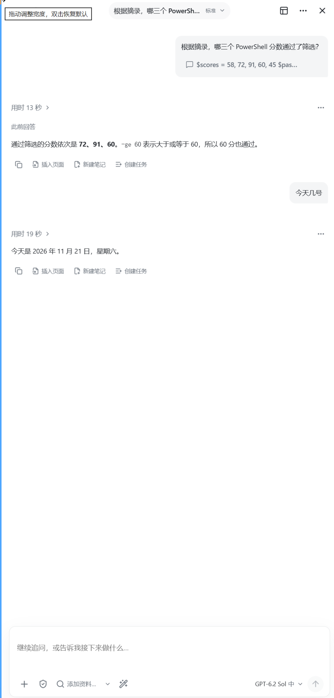

一行日期回答前有用时和展开入口，后有复制及三项成果操作。每一轮都重复相同框架，用户的注意力会被元信息与动作分走。“此前回答”在短回合中又占了一行，但其身份与当前答复的关系不够直观。顶栏标题截断，底部输入框高度与文本量并不相关，形成“上面零散、下面空”的整体感受。

应保留用户浅灰气泡和助手开放正文。需要改的是同一轮聚合程度、元信息层级和动作出现时机。短回答默认只保留最常用复制和稳定的更多入口；有明确目标页面时才显露插入动作。图中剩余窗口空白不应被无意义建议卡、占位内容或装饰填满。

验收比较应使用同一条短回答、相同窗口和缩放比例。看清答案的速度、首屏中的重复控件数、工具栏是否挤压正文，比简单比较“占满了多少面积”更有效。

### 4.2 材料 JSON：用户内容与系统封装没有完全分开

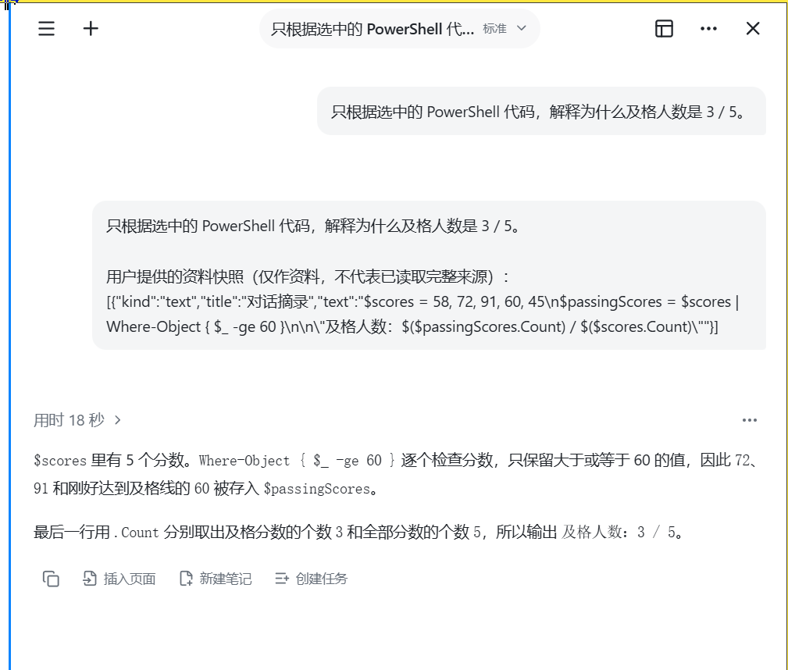

同一提问出现两次，材料封装包含 kind、title、text 和转义序列。这样既让消息显得很大，又要求用户辨认哪一块才是原始提问。材料本身应能追溯，但追溯入口不必把传输结构直接放进正文。

建议呈现一条用户消息，下面附“对话摘录 · 1 份”等来源条。展开显示原始可读摘录，必要时包含来源时间和可用性。系统发送给模型的封装仍可以保留在既有记录或诊断入口，不使用粗略正则删除原始文本。PowerShell 的美元符号、花括号、引号和代码中的反斜线都可能是合法内容，不能误判为需要清理的包装。

已有新格式识别必须继续保留，旧格式兼容单独测试。只有能可靠识别系统生成结构时才转换；无法确定的内容保留可读回退并标明边界，不能把用户自己写的一段 JSON 自动改成来源卡。

### 4.3 长回答与详情：多种信息竞争同一层级

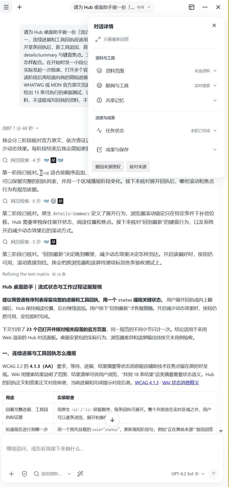

画面里同时存在公开进展、网页检索组、站点图标、英文摘要、最终正文、链接、表格和详情弹层。每一种内容都有意义，但它们的视觉分级不稳定。公开过程的文字比最终答案更大，标题级差又不足，用户需要自行判断最终交付从哪里开始。

当时的详情分为「资料与工具」和「进度与成果」。底部方形按钮与图标行外观不同，而设置、运行记录与成果动作也缺少清晰归属。当前重构评审见第 7.1.1 节和第 24.12 节。

过程收整必须遵循 #56：用户正在回看或已手动展开时，不能因为首段答案或完成事件突然收起。图中的滚动条宽度可能来自系统，不应先隐藏；应先确认主滚动区域与弹层滚动区域的职责。

### 4.4 材料选择器：主要任务没有占据主要空间

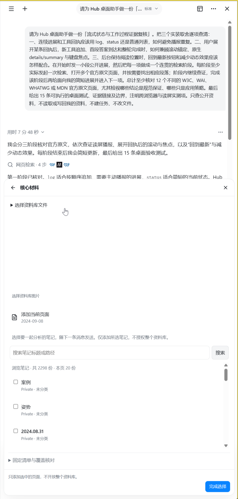

最突出的现象是折叠文件入口下面的大块无内容空间。用户要执行的搜索、查看标题、选择条目被推到下方，列表只能显示少量结果。面板里还同时存在文件、图片、当前页面、笔记检索和高级覆盖核对，展示顺序更接近功能接入顺序，而非选择资料的顺序。

建议让搜索和资料列表成为主体。当前页面和最近使用帮助快速选择，文件/图片保留为紧凑添加入口；高级范围核对放到解释明确的二级区。顶部固定标题和搜索，底部固定选择数量及完成动作，只有中间结果区承担主滚动。面板大小不应由关闭的折叠项或隐藏控件撑开。

“只添加所选页面，不开放整个资料库”的语义需要保留。文案可以集中到一处与选择相关的位置，避免在中部和底部反复重复。不能为了减少文字而扩大实际授权。

### 4.5 技能选择器：骨架成立，辅助动作需要退后

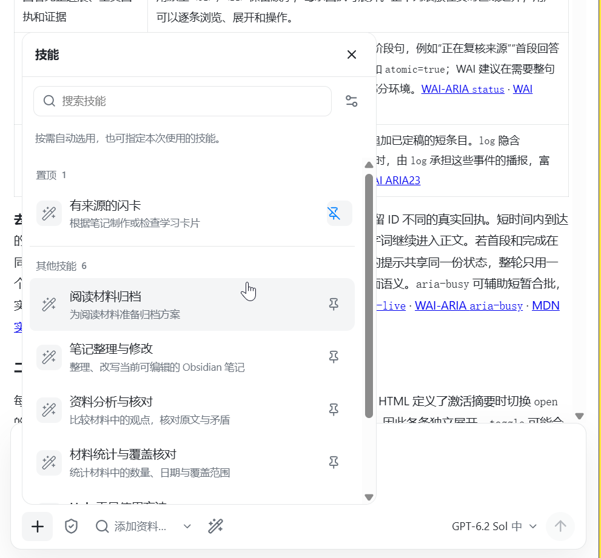

技能列表已具备清楚的搜索、置顶、标题和用途说明，是本组截图中相对完整的部分。主要问题是每行相同图标底座和常驻置顶动作占了较多注意力，置顶状态与“取消置顶”动作的视觉区分不够自然。用户首先要判断哪个技能适合当前工作，而不是先管理置顶。

保留标题与一句用途说明，统一行高、文本起点和右侧动作位置。相同技能类别可继续用统一图标，不为区分条目随意引入彩色装饰。置顶状态可以是低权重图标，管理操作通过明确菜单、悬停/焦点或常驻更多入口到达；触屏与键盘不能失去入口。

选择行为与置顶管理必须分离。点击图钉不应同时选中技能或关闭面板；选中技能后返回输入框，显示紧凑且可移除的技能引用，正文发送后使用同一视觉语言，不重新出现内部技能标记。

<a id="references"></a>

## 5. 竞品依据与可借鉴机制

### 5.1 比较方法

本次对照采用官方更新说明和帮助文档，重点解释复杂能力如何被组织。未逐像素测量竞品当前所有平台的字号、圆角、边距或动画时长；本方案后面的尺寸值是 Hub 的试做起点，不标成“Craft 参数”或“Claude 标准”。各产品仍会更新，后续引用新版时需记录访问日期和具体页面。

| 产品 | 官方证据 | 对 Hub 的借鉴 | 不直接照搬的部分 |
| --- | --- | --- | --- |
| Craft | [3.3.10 更新，2026-03-09](https://www.craft.do/blog/craft-update-3-3-10)：按更清晰的来回轮次显示，并改进状态、输入控件和整体布局 | 文档与助手共处的秩序；统一回合、面板边缘和输入区；状态服务于内容 | 文档封面、装饰卡片、排版风格不直接决定工具执行界面 |
| Craft | [3.4.2 更新](https://www.craft.do/blog/craft-update-3-4-2)：助手可固定在文档右侧，边写边保持可见 | 浮动/停靠与主内容协调；保留 Hub 已有多面板能力 | 不把桌面停靠直接缩成手机双栏 |
| Raycast | [Action Panel](https://manual.raycast.com/action-panel)：按选中对象提供上下文动作，区分主动作与更多动作，分组和键盘可达 | 回答操作栏、技能与材料列表采用清楚的动作分级 | 高密度命令列表不作为长篇中文正文的密度标准 |
| Raycast | [AI Chat](https://manual.raycast.com/ai/ai-chat)：长消息、附件、代码与对话管理各有明确入口 | 材料和代码形成独立可读结构；保留完整内容的展开能力 | 不把所有低频操作仅做成悬停入口 |
| Codex | [Codex for almost everything，2026-04-16](https://openai.com/index/codex-for-almost-everything/)：计划、来源、成果有摘要区域，文件和变更可检查 | 过程与结果分层；用户需要时能检查证据、成果和执行状态 | 不把代码审查专用的 diff、仓库和终端组织直接套到所有知识工作 |
| Claude | [Artifacts 官方帮助](https://support.claude.com/en/articles/17153992-what-are-artifacts-and-how-do-i-use-them)：成果在对话旁独立打开，支持编辑、回访和分享 | 普通对话保持轻，长成果拥有合适的阅读和编辑空间 | 不让每条普通答复都变成一个成果控制台 |
| Claude | [Appearance 官方帮助](https://support.claude.com/en/articles/8887527-customizing-your-appearance-settings)：提供明暗和聊天字体选择 | 中文、英文、代码与控件的排版需协调，允许按实际平台适配 | 不把历史版本的暖色或衬线字体当作所有当前客户端的固定样式 |
| Microsoft Fluent | [Typography](https://fluent2.microsoft.design/typography/)、[Layout](https://fluent2.microsoft.design/layout) | 用文字角色、间距和对齐表达层级；系统字体、平台缩放和触控目标需实际适配 | 参数是体系中的起点，不能机械地把所有间距设成同一个值 |
| Apple HIG | [Typography](https://developer.apple.com/design/human-interface-guidelines/typography)、[Layout](https://developer.apple.com/design/human-interface-guidelines/layout) | 层级、可读性、系统适配与空间关系优先 | 材质不能替代内容分级；不强迫 Windows 依赖某款 macOS 字体 |

### 5.2 Hub 的组合方向

阅读区域参考 Craft 与 Claude 的内容秩序，材料和技能选择参考 Raycast 的扫描效率，长任务与成果核验参考 Codex 的可监督性。这是各区域职责的组合，不是把四套视觉皮肤拼在一起。最终所有区域仍使用 Hub 自己的文字、颜色、空间、按钮和弹层规则。

相同事实应以相同方式表达。例如“已附带”不能因为所在面板不同而有时写成“已读取”；“处理中”不能因为颜色变淡就被当作禁用；“保存草稿”与“已写入”不能共用一个模糊的成功图标。竞争产品的简洁感来自组织方式，Hub 的跨来源授权和回执仍需可检查。

<a id="decisions"></a>

## 6. 设计原则与决策登记

### 6.1 当前有效原则

1. **答案是主要阅读内容。** 简单回答不被操作、计时和管理信息包围；长答案有明确标题、段落和引用结构。
2. **过程可见且可核查。** 默认层级可以收整，真实事件、来源与结果不被删去或混成模型自述。
3. **把内容与控制分开。** 材料正文、用户问题、技能引用、任务模式、模型设置各有稳定角色。
4. **同类组件遵循同类规则。** 几何、字重、图标、间距、焦点和错误态一起统一，避免只覆盖外壳。
5. **空间表达关系。** 同组紧凑、跨组分隔、轮次清楚；空白有用途，不用占位元素填满高窗口。
6. **渐进展示复杂性。** 默认只露常用动作，完整操作仍有稳定、可访问的入口。
7. **状态来自真实事实。** 无实际回执不显示已读取、已保存、已使用或已验证。
8. **保留用户主动状态。** 已打开的过程、当前阅读位置、未提交草稿和显式选择优先于自动布局调整。
9. **中文是主要阅读场景。** 字体、基线、行长、标点、代码混排和缩放在真实平台检查。
10. **原型承担交互验证。** 示例数据清楚标注，完整功能演示不等价于真实服务验收。

### 6.2 决策表

| 编号 | 决策 | 当前状态 | 适用范围与后续修改要求 |
| --- | --- | --- | --- |
| UI-D01 | 本页作为长期主方案，后续原位维护 | 已确定 | Agents 公共 UI；专项细节继续链接原文 |
| UI-D02 | 保留中性浅色和开放回答区的基础 | 已确定 | 暗色使用同一语义角色，不另造一套层级 |
| UI-D03 | 材料选择器优先搜索、当前页面、结果与已选；有真实时间数据后再提供最近 | v136 原型已实现核心结构 | 本轮没有可靠的最近使用时间，不把目录顺序伪称最近；独立预览仍留后续；正式授权语义沿用 |
| UI-D04 | 回答工具栏默认复制＋更多；有明确上下文时显露主业务动作 | v136 原型已实现复制/更多 | 插入、笔记和任务继续进入既有确认；未增加基于语义猜测的自动执行 |
| UI-D05 | 统一 Markdown 的文字角色与内容容器 | v136 原型已实现有界语法 | 桌面已有代码块继续保留；原型渲染器不宣称完整 CommonMark/GFM |
| UI-D06 | 用户正文与模型请求封装分离，旧历史兼容独立处理 | 已确定设计 | 不破坏原记录、授权和代码内容 |
| UI-D07 | 过程自动收起、回看和滚动遵循 #56 | 已确定约束 | 公共视觉调整不得覆盖专项已验证行为 |
| UI-D08 | 弹层按小设置、搜索选择、管理编辑三类组织 | v136 主要助手弹层已采用 | 材料、详情、技能、记忆与保存、管理记忆共用骨架；尺寸和业务状态各自保留，非全站所有弹层重构 |
| UI-D09 | 记忆使用、管理浏览、保存范围彼此独立 | 沿用既有方案 | 视觉统一不更改范围、候选和生命周期语义 |
| UI-D10 | 优先修完成度与层级，再做材质和动效 | 已确定实施顺序 | 用户明确调整顺序时更新本表和阶段清单 |
| UI-D11 | 顶栏会话身份与任务模式分工更清楚 | 设计方向，需原型确认 | 不删除模式能力；窄面板需保留入口 |
| UI-D12 | 本轮先发布原工作台并同步完整源码 | v136 已发布；镜像记录见第 24 节 | 保留原 Site、v135 并行功能和访问范围；镜像以实际发布的 276 个受管文件生成 |

### 6.3 不以“精致”为理由引入的变化

不增加没有任务价值的渐变、彩色技能图标、装饰徽标、占位统计或复杂背景。不同层级可以通过文字、间距和位置表达时，不给每一层再套边框。不要把所有文字降低对比度来追求轻盈，不隐藏系统滚动条来掩盖容器问题，也不让必要操作只在鼠标悬停时存在。

图片和动效应服务于识别、解释或反馈。长任务更新不采用闪烁、持续位移或重新布局的装饰动画；减少动态效果设置下仍需完整表达状态。对话阅读区保持稳定，新的回复和资料不应无缘由推动用户正在查看的内容。

<a id="architecture"></a>

## 7. 信息架构与区域职责

### 7.1 五个区域

| 区域 | 用户首先要知道或完成什么 | 默认展示 | 二级展示 |
| --- | --- | --- | --- |
| 会话顶栏 | 正在处理哪件事，如何切换或管理会话 | 可辨认标题、必要导航与视图动作 | 重命名、模式、完整会话详情 |
| 对话阅读区 | 我问了什么、附带什么、得到什么 | 用户消息、紧凑材料/技能引用、答案、简短状态 | 完整材料摘录、过程、来源、更多操作 |
| 输入区 | 输入下一步并配置本轮内容 | 输入文本、已添加材料/技能、发送 | 添加方式、模型与思考、记忆与保存 |
| 选择面板 | 快速找到并选中目标 | 搜索、结果、选择状态、完成/返回 | 来源筛选、详情预览、低频管理动作 |
| 管理与详情 | 检查或改变已建立的状态 | 稳定标题、当前对象、分组字段和必要动作 | 诊断、修订记录、来源授权、危险操作 |

顶部不承载所有运行设置，输入框也不承担完整管理中心。用户已经选定的内容用引用条表示，不在正文、输入框、详情中重复展示同样的大卡片。不同位置可显示同一对象的摘要，但应共享身份和状态。

#### 7.1.1 对话工作流重构（评审）

旧版「对话详情」仍是已上线布局。评审稿取消这个总入口。旧入口同时读写下一条配置、已完成运行和成果操作，同一个「资料范围」无法说明正在编辑哪一轮，也无法解释哪些资料最终被引用。

| 对象 | 职责 | 入口 |
| --- | --- | --- |
| 会话 | 容纳多轮请求与回答，负责命名、导航和历史。 | 会话标题与既有历史入口。 |
| 请求 | 表达要完成什么、用哪些资料、允许哪些访问以及采用什么处理方式。发送或排队时固定配置。 | 输入区「下一条」，可调整处理方式、资料与执行设置。 |
| 运行记录 | 记录一轮实际运行、停止、完成和引用。参数来自该轮请求，引用来自该轮结果。 | 运行中点状态。回答后点「本轮记录」或引用。 |
| 任务 | 跟进目标和完成条件，区分已有回答、已停止和已确认完成。 | 选择「追踪完成条件」才产生任务。 |
| 可复用配置 | 研究模板准备下一条的资料与技能。笔记关联工作用笔记、方法版本和周期定位原工作或创建新工作。 | 「使用模板」和笔记载体的「笔记关联工作」。 |
| 外部写入 | 对确定的回答执行保存，包含目标、预览、确认和回执。 | 「保存回答」。结果未知时回读原操作。 |
| 助手设置 | 管理跨回合资源。在请求中选择是否使用这些资源。 | 「助手设置」管理记忆和工具。「执行设置」选择下一条的用法。 |

正式迁移需将草稿预检映射到现有授权与能力判断，将运行记录绑定到 `workId + runId`、证据索引和授权版本。原生层继续负责授权撤回、排队恢复的并发校验与回执核验。评审稿用本地状态检查上述入口与读写边界，见第 24.12 节。

### 7.2 一轮对话的层级

一轮至少包含用户消息、可选附带内容、运行/过程信息、答案与后续动作。它们属于同一回合，但不必须套进一个共同卡片。用户气泡与回答开放区继续表达说话方，间距和对齐表达从属关系。

短回答允许只有答案和轻量动作。长任务中，公开进展可以在运行时分阶段出现，最终答案始终位于可独立阅读的区域。保存成功后的回执属于业务成果状态，不能用“复制成功”的临时提示替代。输入框下的设置只影响后续发送，不改写历史回合已经使用的配置。

### 7.3 常用操作与低频管理

频率、上下文和风险决定默认显露程度。复制答案是稳定常用操作；插入当前页面在有目标页面时才有明确上下文；新建笔记、创建任务属于可发现的后续动作；撤回来源授权、诊断、修复等属于管理动作。不能只按代码最容易放在哪里来决定入口。

可发现性不等于全部常驻。更多菜单应有明确名称、连续的键盘路径和合理分组，菜单项位置不能每次随机变化。业务不可用时在需要的位置说明原因，不用一排灰色按钮让用户猜测。

<a id="tokens"></a>

## 8. 字体、颜色、空间和尺寸规则

### 8.1 数值的性质

以下为 Hub 原型试做范围，采用 CSS 像素描述，实际实现优先使用可随用户设置缩放的单位。数值不是从竞品截图测量得到，也不是跨所有平台不变的硬指标。原型完成后将最终采用的值和原因记录到本节，保留改动前基线供比较。

| 角色 | 试做起点 | 设计意图 |
| --- | --- | --- |
| 答案正文 | 14–16px；舒适默认可试 15–16px；行高 1.65–1.8 | 中文长文可读，作为主要阅读内容 |
| 控件与列表主文字 | 13–14px 起；触屏或主要标签可更大 | 易扫描，避免大量微小标签 |
| 次要说明、来源、用时 | 12–13px | 与正文有区别，但保留对比度与可读性 |
| 回答大标题 | 18–20px，适度字重 | 长文入口，不把每条普通回答都变成大标题 |
| 回答分节标题 | 16–18px | 章节可扫描，与正文形成层级 |
| 行内代码 | 与正文协调，约正文的 0.9–0.95 倍 | 基线稳定，不让技术词突然成为另一种正文 |
| 代码块 | 12–14px，行高 1.6–1.75 | 保留缩进，支持横滚与换行 |
| 同组图标和文字间距 | 6–8px | 明确从属，避免图标漂浮 |
| 同回合内容块间距 | 12–16px | 区分来源、正文、动作，但保持聚合 |
| 回合之间间距 | 24–32px | 清楚区分轮次 |
| 列表条目 | 单行和双行分别设稳定高度，约 36–44px / 48–60px 起 | 列表可扫，触摸目标另行保证 |
| 控件圆角 | 小控件约 6–8px，列表选中背景约 8–10px | 避免全部胶囊化 |
| 面板圆角 | 12–18px 起，视浮层与窗口角色区别 | 同类容器一致，不能用半径掩盖布局问题 |
| 输入框 | 默认紧凑，随正文与附件增长，有可用最大高度 | 不固定占据过多阅读空间 |

本轮原型保留现有应用风格，并按 Sites 和项目上下文选取可读值。若实际采用 16px 正文、14px 常用标签，应记录为本次选择；不能把上表范围理解成要求全站字号一律缩到下限。

### 8.2 字体继承

UI 正文、按钮、输入、选择器、弹层标题使用统一系统字体链。Windows 的中文、数字和英文混排需要在实际 WebView 上检查；macOS、浏览器和移动端使用各自合理回退，不要求用户安装特定商业字体。代码块用等宽字体，行内代码保留可预测的字形与基线。

避免局部组件继承了浏览器默认衬线体、按钮单独使用不同字体、菜单项与输入框的字重关系失衡。不能从截图断言实际字体已落到某个名称；验收应检查 computed style 和实际渲染，必要时核对字体 fallback。

### 8.3 语义颜色

延续已有主文字、次要文字、弱提示、背景、控件填充、边线、强调、选中、焦点和错误角色。浅色与深色表达同一语义，不靠全局反相。主内容使用稳定的主文字色，次要信息可以弱化，但不能与禁用态混淆。

业务状态同时有文字或图标，不只靠颜色。错误提示说明对象、失败阶段和可采取的动作；危险动作在展开后的正确位置表达，不让整块管理面板长期充满警告色。高对比/强制颜色模式下保留结构和焦点。

### 8.4 图标与对齐

优先沿用已有线性图标家族。相同语义使用相同图标，不用同一魔法棒同时表示技能、执行、设置和成果。尺寸相同不代表视觉重量相同，应检查图标自身留白和文字基线；调整有统一规则，不逐个凭感觉放大缩小。

常用图标可保持约 16–18px 的视觉尺寸，点击区域按鼠标/触摸模式提供足够空间。来源站点图标是识别资料的辅助，不应压过组标题；多个来源可汇总数量，展开后继续查看，不用连续彩色 logo 表示可信程度。

### 8.5 阅读宽度与空间

窄助手面板以可用宽度排版，不强行使用桌面固定阅读栏。较宽或全屏助手可以限制长文行长，同时让表格、代码和图像拥有自己的可用宽度。正文段落之间留出节奏，不靠增加整块顶部空白表达“高级感”。

输入框、选择器、工具栏、长答案和回执必须一起检查。单个控件看起来精致，但放进真实任务后与相邻内容不协调，仍视为未完成。每轮视觉比较使用相同内容、窗口、主题和缩放，避免用不同样本制造“改善”。

### 8.6 助手浮窗的字体与材质

工作台使用 Hub 的系统字体与主题。v139 恢复原字号，新聊标题、建议行和输入文字为 14 CSS px，历史标题为 13 CSS px。数值以该版本计算样式为准。

v140 主浮窗使用 1px 描边、20px 圆角、两层投影和 18px 背景模糊。输入框为实底、16px 圆角，焦点环区分输入状态。系统要求减少透明或强制颜色时浮窗使用实底，侧边栏也使用实底。对话历史整体沿用 v136。

<a id="materials"></a>

## 9. 材料选择器详细规范

### 9.1 主路径

材料选择的主要问题是“找到需要的资料，并明确本轮带入哪些内容”。打开后优先提供搜索，随后是当前页面/最近使用与结果列表。用户不应先经过多个管理折叠项才找到搜索。文件与图片是添加途径，不以空容器占据主要高度。

推荐结构为：标题与关闭；搜索和必要来源筛选；当前页面/最近；结果列表；已选摘要与完成动作。来源数较多时筛选可进入紧凑菜单，但当前范围必须可见。列表至少显示标题、来源或路径、必要的可用性信息；同名项用来源区分，不只靠图标。

### 9.2 选择与提交

默认采用选择草稿与已应用材料分离的模式：打开时从当前已附带材料初始化选择草稿；勾选、取消只改草稿；“完成选择”提交给当前输入草稿；关闭或取消保留原已应用材料。若现有某种附件动作必须即时加入，应在同一面板中清楚反馈，并提供可撤销移除，不能让外观相同的操作一部分即时提交、一部分等完成而毫无说明。

每份材料使用稳定身份去重，不能仅按标题去重。搜索结果刷新、来源切换或分页时，已选状态保留。结果中的预览动作不等于选择，选择不等于发送，附带不等于已读取。使用“已选择”“已附带”“已发送”“已读取”分别表达真实阶段。

### 9.3 搜索行为

搜索支持中文、路径片段与合理的标题关键词。原型可以使用明确的示例数据，本地搜索结果要如实呈现；正式客户端沿用真实来源与权限。加载中显示正在搜索的状态，不清空已选材料；无结果显示当前查询和可修改的条件；失败保留查询并提供重试。

异步搜索需要请求身份保护，较早查询的慢响应不能覆盖新查询。IME 组合输入期间不触发发送/确认；Enter 的行为由当前焦点明确决定。清空搜索后恢复合理的默认列表，不丢失已选项，也不自动选择第一项。

### 9.4 高度与滚动

只允许一个主要结果滚动区承担列表滚动。标题和完成区保持可达；面板内部不应同时出现几个竞争高度的长列表。关闭的 details 使用内容高度，不分走剩余空间；外层弹性布局只作用于明确负责伸展的容器，避免宽泛的后代选择器。

若需独立文件搜索或图片选择，进入具备标题与返回的子视图，返回后恢复原查询和选择草稿。未加载内容不使用没有解释的大块留白；加载占位的尺寸与真实内容相近。窗口变矮时收缩结果区，不把完成按钮推出可视范围。

### 9.5 已选与范围说明

已选区域显示真实数量和可移除条目。少量选择可直接列出，较多时显示摘要并可展开；展开不改变授权。需要用户确认范围时，说明“只附带所选项目/页面”的事实，不将“整个资料库”作为模糊默认。

权限提示集中在与决定相关的位置。重复的长说明会挤占搜索与列表，但精简文字不改变权限边界。来源已撤回、内容已失效或无权读取时，保留可识别的条目和原因，阻止不合法提交；不能静默替换为另一份同名资料。

### 9.6 代表场景

| 场景 | 应有表现 | 不应发生 |
| --- | --- | --- |
| 当前页面已附带 | 明确显示已选，可取消 | 再次点击生成重复条目 |
| 搜索后选 A，再搜索 B | A 仍计入已选，B 可继续加入 | 搜索结果替换造成 A 消失 |
| 无结果 | 明确无匹配，保留查询 | 空白面板或误显示加载中 |
| 来源暂不可用 | 显示来源原因，可改选或重试 | 显示“已读取”或自动扩大范围 |
| 关闭未提交选择 | 回到原输入材料 | 将临时勾选静默应用 |
| 完成选择 | 更新当前草稿的材料引用 | 自动发送或修改历史消息 |
| 长标题与多来源同名 | 标题可换行/完整预览，来源清楚 | 只有相同截断标题无法区分 |
| 窄面板与矮窗口 | 搜索、结果、已选、完成均可达 | 隐藏完成按钮或产生页面横向滚动 |

<a id="messages"></a>

## 10. 消息正文、资料与历史兼容

### 10.1 展示模型与执行模型

用户消息的展示模型应明确包含原始问题、材料引用、技能引用、图片附件与必要状态。发送给模型的文本封装、指令、预算或内部字段属于执行模型。两者可以关联同一消息身份，但不能简单把执行字符串原样作为用户正文。

显示层不得改变原始记录的可信内容。用户亲自输入的 JSON、代码、美元符号和工具语法按用户内容显示；系统生成的封装只在可靠识别后转为结构化材料条。内部标记的移除必须限定来源和格式，不能全局替换某些字符。

### 10.2 资料引用的尺寸和内容

已发送消息里的材料引用使用紧凑行，包含可识别标题、来源类型和必要状态。正文摘录可以展开，不默认展示大块全文。多份材料显示前几项及总数，完整列表仍可达；不能只显示“另 3 项”却无法展开。

引用打开应落在对应材料或可读摘录；失效时说明该消息当时附带了什么以及当前为何无法打开。不能把缩略卡片显示为“已读完整来源”，也不能因原链接失效而伪造新来源。

技能发送后使用正式名称和用途摘要，不把内部前缀作为普通用户文字重复显示。移除输入区技能只影响未发送草稿，不修改历史消息中的技能记录。

### 10.3 历史格式迁移

优先以已有结构化字段呈现；对确认是系统旧封装的记录提供兼容适配；无法可靠识别的内容保留原文并允许查看。适配最好发生在读取/展示边界，避免为修 UI 大范围写回历史消息。

需要覆盖：有 displayText 的旧记录、没有 displayText 的封装记录、包含 selectedFromChat 的新快照、未标记旧快照、用户自写 JSON、带合法代码围栏的消息、原始引号/反斜线、多个材料和空材料。不同来源的同名资料仍按稳定身份对应。

### 10.4 长消息

长用户问题可以提供合理的折叠预览和“展开全文”。折叠状态不截断实际发送内容，不影响复制和重新编辑。用户主动展开后，不因新回复到达反复收起。完整提问、材料数量和附件存在性始终可识别。

折叠不能只按像素裁切而让最后一行或材料入口半遮挡。采用明确的行数/内容容器策略，并在字体缩放后重新检查。窄面板需保证展开入口和文字选择不会误触发送或滚动到别处。

<a id="reading"></a>

## 11. 回答排版与 Markdown

### 11.1 正文与标题

短回答无需固定前缀、过大的标题或独立卡片。长回答根据真实内容使用标题、段落、列表和表格；一级、二级、三级标题具有可辨认的字号、字重或间距关系，不全部使用同一种样式。正文与公开过程分别使用角色，但公开进展的主色语义仍按专项保留。

段落长度与行高共同决定节奏。不要只增大行高而保留过密的段间距，也不要在每段前后都使用大边距。列表的项目内间距和项目间间距分别定义，嵌套缩进在窄面板不吞掉太多正文宽度。

### 11.2 行内代码与代码块

行内代码用于短命令、变量、路径或参数，字号与正文协调，底色轻量且不会将长句切成一串厚重胶囊。过长路径允许合理换行，复制仍保留原字符。代码块沿用已实现的语言栏、复制、换行和横向滚动能力。

流式代码围栏未闭合时，容器保持可读且不闪烁；围栏闭合后不能重排得让用户丢失位置。代码复制原始缩进、空行、引号与数组下标；正文引用标记转换不进入代码区域。默认保留行宽，用户可以切换自动换行，切换后焦点与阅读位置合理。

### 11.3 链接、引用、表格和图像

链接可辨认且有稳定的悬停/焦点状态，不把所有正文链接都变成浏览器默认的强烈蓝色下划线组合而忽略整体体系；实际来源与引用仍要明显可达。来源名称不能只依赖 favicon。打开外部来源遵循现有浏览行为，不因视觉精简失去可检查性。

表格有明确表头和单元格内边距，横向溢出限制在表格容器。长中文单元格合理换行，不能把整页拉宽。表格前后的段落保持阅读节奏，不用多层嵌套边框。代码与表格容器可独立滚动，但应避免同一块同时横纵两向难以控制的滚动区域。

图像有替代说明、合适的尺寸和完整查看入口。缩略图与原图的身份一致，点击不会意外改变当前资料授权。引用块使用轻量的缩进或边线表达来源，不与用户气泡混淆。

### 11.4 保存与复制的一致性

视觉渲染不改变答案原文。复制普通答案时使用合理的纯文本或既有 Markdown 策略，复制代码时明确复制代码内容；插入页面、新建笔记和创建任务继续进入既有预览与确认流程。样式更改不能导致隐藏段落被遗漏，也不能把内部操作标签复制进正文。

### 11.5 回答状态

流式、已完成、停止、失败、部分结果和历史记录采用同一套排版。未完成回答应保留可读部分，并明确未完成状态；不因为它不是最终结果就使用模糊灰字将内容全部弱化。保存动作能否使用由现有业务能力决定，界面不能把不可保存内容假装已提交。

<a id="answer-actions"></a>

## 12. 回答操作工具栏

### 12.1 默认与上下文动作

默认轻量工具栏包含复制和更多操作。若当前存在可编辑且明确的目标页面，可以显露“插入当前页面”作为上下文动作。没有目标页面时，不用同名按钮让用户先猜目标；完整菜单可以提供“选择页面并插入”或沿用现有目标选择流程。

更多菜单按用途组织：复制/引用、保存为笔记、插入页面、创建任务，以及确实存在的其他操作。风险或授权管理动作不混在普通答案保存项里。菜单顺序稳定，当前不支持的操作按可解释方式隐藏或禁用，不能忽隐忽现地改变用户已经熟悉的位置。

### 12.2 动作与状态分离

“复制”是临时反馈；“准备保存草稿”是进入确认；“已保存”是业务回执。三者不能共享一个笼统的成功提示。保存结果不确定时，提供核对入口，不因用户再次点击而重复写入。已保存成果的查看入口放在对应回执上，普通操作栏仍保持轻量。

模型建议创建任务不构成用户确认。即使答案包含清单，也不自动把“创建任务”提升为默认执行按钮；如果原型展示推荐动作，应清楚标明推荐和实际提交之间的步骤。

### 12.3 可访问性和定位

复制与更多入口始终有可达方式。鼠标可以减少次要按钮的视觉强调，但键盘聚焦、触屏、读屏和高对比模式仍能发现与执行。工具栏不因悬停出现而推动正文；预留合理高度或采用不改变布局的视觉处理。

打开菜单后，Escape 关闭并返回原工具栏入口；选择会打开下一层的动作时，焦点进入下一层。取消保存后回到对应答案的入口，而不是跳到页面顶部或另一个助手面板。多个助手面板的菜单和消息身份必须隔离。

### 12.4 代表组合

| 回答类型 | 默认工具栏 | 展开后的完整能力 |
| --- | --- | --- |
| 一句日期、解释、确认 | 复制、更多 | 仍可按业务能力保存或插入 |
| 普通知识回答 | 复制、更多；有当前页面时可显露插入 | 新建笔记、选择页面、创建任务 |
| 代码回答 | 答案复制、更多；代码块独立复制 | 保存完整回答或对应成果，保持代码原文 |
| 已准备的笔记草稿 | 与草稿相关的明确预览/确认入口 | 编辑、取消、选择目标，沿用业务流程 |
| 已保存成果 | 查看已保存结果的回执入口 | 核对、继续编辑等受支持动作 |
| 中断或部分结果 | 明确状态，允许的复制/保存入口 | 不宣称已完成或自动恢复业务执行 |

<a id="process"></a>

## 13. 公开工作过程与阅读状态

### 13.1 专项规则优先保持

本节只定义公共视觉关系。完整时序、分组、计时、回执归属、展开和滚动行为继续以[公开工作过程方案](AGENTS_PROCESS_VIDEO_REVIEW_20261120.md)为详细来源。该专项已有真实 Windows 记录、录像对照和多轮验收，本轮不因“页面更简洁”而回退。

关键约束是：**首段答案到达且用户仍在跟随最新内容时，过程可以按已有规则收起；用户已上翻或主动检查步骤时，保持阅读位置和展开状态。** 不采用“一到完成就无条件收起”的新规则。用户手动展开的第九条回执、来源列表和已显示行数，在折叠后重开时仍应恢复。

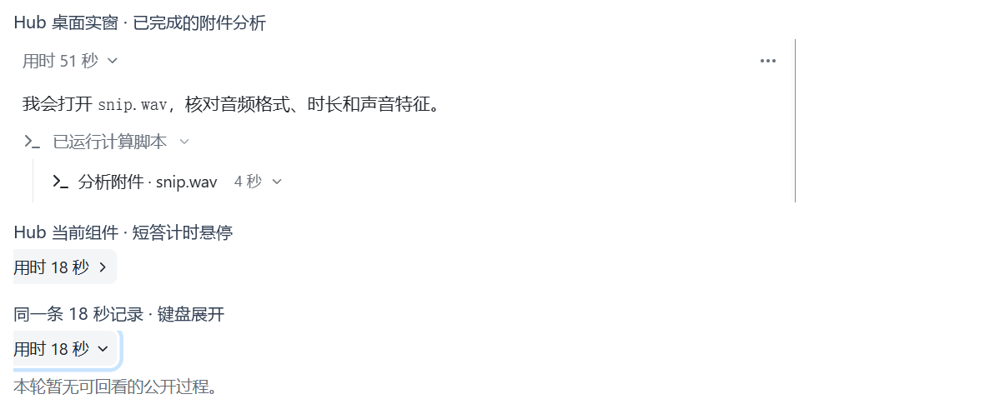

此图来自既有专项的桌面记录，用于说明需要继续保留的过程入口与展开能力，不是本轮视觉改造后的效果。

### 13.2 文字与证据角色

公开进展是模型发给用户的工作说明，提供方公开摘要是另一种事件，工具回执记录实际执行内容与结果。三者可以共同构成工作过程，但不得把模型说“正在测试”当作测试已执行。工具步数只统计实际操作，来源归属按既有明确关联或批次归属展示。

公开进展继续使用符合专项语义的文字颜色；本轮调整可以通过字号、间距和容器关系减少其与最终答案的竞争。不能把整段真实进展全部变成难以阅读的浅灰字。摘要与回执按实际接收顺序呈现，不能先收集所有工具，再把所有摘要移到最后。


### 13.3 运行中、回答中与完成后的视觉

等待时显示简短状态，不凭空生成阶段或百分比。已有工具段仍按专项紧凑分组，展开后可检查完整记录。首段答案出现后，答案与过程拥有清楚的阅读边界；完成或中断状态的文案准确，计时不继续误增长。

过程摘要可展示时长、动作概括和真实状态，但不能汇总成无法核查的“已完成所有工作”。部分失败、来源失效、过程截断等信息在折叠状态下仍有必要提示，具体原因在展开后查看。用户不必逐层展开才发现结果其实未完成。

### 13.4 阅读位置与新增内容

用户上翻时保持阅读锚点，不因新工具、摘要或代码渲染更新强制到底部。跟随状态与手动阅读状态分开记录；返回最新按钮是明确恢复跟随的入口。它的运行中提示、完成后箭头、减少动态效果和键盘焦点沿用专项。

材料弹层、技能弹层或记忆管理打开时，后台对话更新不得抢走焦点。关闭弹层后回到原入口，并保持用户原本的对话阅读位置。组件重新渲染不能把全部展开状态重置。

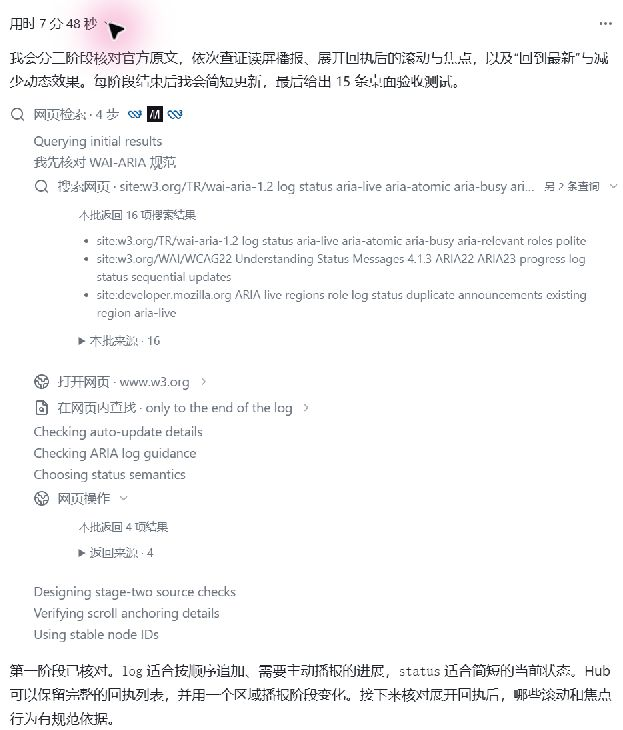

本轮验证时应沿用这些行为作为回归条件。截图是此前真实记录，不能把旧检查数量或通过结论重复计为本轮新增验收。

<a id="composer"></a>

## 14. 顶栏、输入框与模型设置

### 14.1 会话身份与工作模式

会话标题首先帮助用户识别正在处理的事情。宽面板允许标题使用合理空间，窄面板可以截断，但完整标题应通过明确方式查看。标题的点击行为与外观保持一致；如果它打开模式选择，应让“模式”含义可辨认，不把被截断的问题全文当作唯一入口标签。

任务模式、专题与会话身份可以相邻，但状态与动作需要分清。模式改变不自动重命名历史会话，不清空输入，不重置记忆或资料选择。某种模式在运行中不可切换时说明原因，不能点击后静默没有反应。

视图控制、更多和关闭放在稳定位置。浮动、停靠、第二助手面板与侧边聊天继续使用现有能力。每个关闭入口说明关闭的是哪个面板；关闭次面板不影响主面板正在运行的任务或未发送草稿。

### 14.2 输入框内容分组

输入区分为文本、已附带内容和控制行。文本区域默认紧凑，输入多行时增长到合理上限，再在输入区域滚动。附件、材料和技能以紧凑引用形式展示，尽可能避免单个材料卡占去大半输入框；长名称能查看完整内容且移除入口稳定。

控制行左侧主要处理“放入什么内容”，包括添加资料、文件、图片和技能；记忆与保存表达使用和保存规则；模型与思考程度靠近发送相关控制。具体顺序可通过原型检验，但同类操作不在不同聊天中任意换位。

已经选择的材料、技能和模型应有足够状态反馈。简化不能让用户发送前完全看不见本轮使用了什么。若空间不足，保留关键摘要并可展开，而不是用多个无法区分的无标签图标代替所有信息。

v137 的普通新聊天把建议排在输入框上方。无资料时提供通用起点，有随文页面或选中摘录时优先给材料相关建议。点击建议填入草稿并聚焦输入框，保留已输入的文字。历史待确认记忆通过「记忆与保存 → 管理记忆 → 待确认」处理。

待发送的页面保留具体标题，区分「当前页面」和「指定页面」。选文显示可移除的摘录与段数。资料库单列为「可检索资料库」，反映当前生效范围。资料范围按钮保持稳定的入口名称。

### 14.3 模型与思考程度

模型名称与思考程度分别表示执行提供方/型号和当前推理设置。裸露的“中”等短字在上下文不足时容易含混，可在菜单中用“中等思考”等完整名称说明；紧凑栏可以显示简写，但完整名称和当前值应可访问。

模型切换沿用既有能力限制和运行状态保护，不因选择器改版改变工具授权或记忆范围。不可用选项给出具体原因；等待加载时不假装当前列表完整。模型能力变化只更新真实支持的动作，不能将隐藏的操作等价为已执行。

### 14.4 发送、停止与草稿

发送按钮的可用性取决于真实草稿和当前运行规则；空输入、组合输入、排队、正在运行等状态分别定义。停止与发送不能通过只换图标却保留错误可访问名称来实现。快捷键的行为在输入框与菜单中一致，打开选择器时 Enter 不应误发整条消息。

打开或关闭材料、技能、记忆及模型弹层时保留文本草稿和光标位置。切换历史、继续旧工作、选文侧聊等已存在流程继续遵守原有草稿保护。视觉改造不将输入区重新挂载成一个空表单。

<a id="overlays"></a>

## 15. 通用弹层与焦点规范

### 15.1 三类容器

| 类型 | 适用内容 | 推荐结构 | 关闭和焦点 |
| --- | --- | --- | --- |
| 小设置弹层 | 记忆与保存、模型简选、少量开关 | 短标题、分组行、必要说明、管理入口 | Escape/关闭/合理的外部点击；回到触发控件；不无谓锁住全局焦点 |
| 搜索选择面板 | 材料、技能、目标页面 | 标题、固定搜索、结果列表、选择状态、必要底栏 | 取消/返回与确认明确；多选草稿不因关闭而隐式提交 |
| 管理/编辑对话框 | 记忆管理、编辑、成果预览、复杂来源详情 | 标题、对象上下文、内容区、明确主次动作 | 模态语义与焦点范围匹配；编辑草稿关闭前按既有规则处理 |

容器共享标题、关闭、间距、边线、按钮和错误行组件，但不强迫共用同一个高度。小设置弹层不能为了视觉一致而撑到管理器的尺寸；管理器也不能硬塞进只有几行高的菜单。

### 15.2 公共结构

标题区使用稳定的左右内边距和可辨认的标题字重。返回与关闭分别有名称：返回上一层不会退出整条选择流程，关闭退出当前面板。搜索与筛选不随列表滚走；需要完成动作的多选面板将它放在稳定底部。

分组依靠标题、间距和轻量分隔，避免每一个字段套卡片。说明文字紧邻它解释的控件。错误提示说明对象和下一步，不仅显示一段红色系统消息；加载状态与空状态也使用同一布局，防止面板频繁大幅跳高。

### 15.3 焦点与键盘

打开搜索面板时焦点通常进入搜索；打开管理器时进入标题后的第一个合理控件或可聚焦内容区；打开编辑器时进入主要字段。焦点落点由用途确定，不能一律强制跳到第一个关闭按钮。

模态对话框打开时，键盘不能跑到后面的页面；非模态菜单保持合理的导航关系，不用过度焦点陷阱阻断工作区。Escape 只关闭最上层，关闭后返回它的触发入口。如果触发入口已随状态消失，选择附近合理位置，不回到网页顶部。

嵌套编辑关闭后应回到原条目，而不是管理页第一条。候选被忽略后，焦点落到仍存在的反馈或下一项；不能指向已经卸载的按钮。焦点样式在浅色、深色与高对比环境都可辨认。

### 15.4 外部点击与未保存草稿

单纯设置菜单可以按既有规则外部点击关闭。包含未保存编辑内容的对话框，不能用同一种外部点击行为无提示丢弃草稿。保存中禁用重复提交并保持清楚状态；保存失败保留草稿和原错误位置。

这里的取消/丢弃确认属于用户正在操作的产品交互，不代表助手执行本轮开发前需要增加额外审批。实现沿用已有编辑语义，避免为视觉改版新增不必要的确认步骤。

### 15.5 定位和碰撞

弹层优先靠近触发入口，在可用空间不足时向上/向内调整，不能越出助手面板或被窗口边缘裁掉。位置计算考虑输入框高度、浏览器缩放和多个助手面板。弹层与另一个面板重叠时仍有明确归属，不能共用全局定位导致打开在错误窗口。

宽度有合理上限和可缩小范围；长中文、路径、模型名和项目名允许换行或查看全文。内容滚动限制在合适区域，保留标题和必要底部动作。软键盘行为属于移动端实测范围，窄桌面面板不能代替它。

### 15.6 对话历史

v139 恢复 v136 的历史列表和交互。标题与日期同排，沿用原有搜索、置顶、归档、恢复和空态。v137 的双行列表与归档视图焦点调整，以及 v138 的浮层材质试做，保留在各自交付记录。

<a id="panels"></a>

## 16. 详情、技能与记忆的统一方式

### 16.1 对话详情

详情承担检查当前会话、资料/工具和进度/成果的职责。现有分组可以保留，但将管理动作放回对应对象旁。例如来源授权的撤回与核对归属来源管理，不在弹层底部形成一排没有上下文的通用按钮。

详情项采用统一行结构：语义图标、主标签、当前摘要、展开或进入提示。摘要只显示真实状态，没有资料时明确“未选资料”，运行未完成时不显示完成。若这一行只是信息而不能点击，不使用与可操作行相同的交互反馈。

“只看最新回答”属于阅读视图操作，与资料授权和成果保存分组区别开。它不会删除历史，退出后可以继续回看原完整对话。切换视图时维持合理的阅读锚点，不把输入草稿或展开记录清空。

v140 对照用户截图做了实测评审。详情按「资料与工具」「进度与成果」两组组织，在标准浮窗里约 430 × 395 CSS px，五行各高 46px。标题是 15px，标签是 14px，状态是 12px。建议保留两组，优先把标题收至 14px、减小标题和分组之间的空白，右侧状态与箭头按固定列对齐。紧凑度优先从留白调整，行高可按鼠标与触控分别验证。

v141 将「资料范围」整行接入已有选择器，右侧显示当前资料与资料库数量。阅读模式下也可打开选择器，点击完成后回到阅读。「联网与工具」展开后可直接设置联网搜索，外部工具（MCP）、执行与协作、开发者诊断归入「高级设置」。「管理记忆」从详情进入时显示返回按钮，返回后保留各行的展开状态，焦点回到「管理记忆」。在管理页按 Esc 同样可返回，编辑中的返回和关闭受原有编辑保护。

详情标题为 14 CSS px，标准浮窗的五行折叠态从约 395px 收至 347px。主要通过收短标题栏和分组间距实现，每行保留 44px 点击高度。展开空间不足时使用浮层内滚动。

Windows 桌面版承接上述交互与详情样式。已有的图片与文本附件管理可在资料选择器查看，既有授权与用量信息可从「任务状态 → 资料授权与用量」查看。桌面真实资料库的验证见第 24.11 节。

### 16.2 技能选择器

统一为搜索列表：标题、搜索、置顶/其他分组、技能名称、用途描述、选择状态和低频管理入口。每行的标题起点与描述起点固定；文字可换行但避免一行无限增高；长用途可以进入详情。

技能被选择后，输入框显示正式名称和移除入口；当前已选项在列表中有明确状态。自动选用与用户显式指定要能区分，不能把系统自动候选渲染成用户已确认选择。点击置顶、取消置顶或详情不同时触发主选择。

本轮仅统一选择器与引用呈现。#48 中暂停的技能包来源、同步、安装或重新设计不自动恢复开发；不借视觉统一增加新的远端技能授权或执行路径。

### 16.3 记忆与保存

沿用已确定的两组日常设置：“使用已保存记忆”和“保存成果”。记忆读取与新增记忆确认独立，关闭时允许预选范围；右上角管理入口与输入框入口进入同一管理器。

使用范围、管理浏览范围和条目保存范围保持独立。管理页浏览另一个项目不改变当前聊天，新聊天继承最后一次主动设置，回看旧聊天不覆盖默认偏好。“只用所选资料”暂停本轮实际记忆使用，同时保留偏好；实际状态在两个入口中一致。

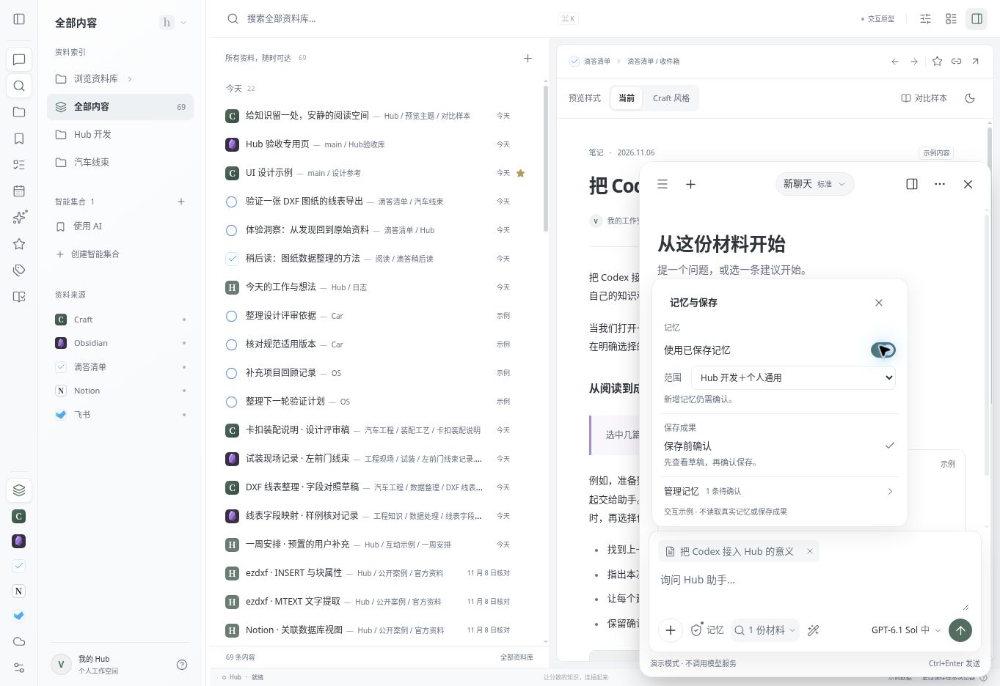

此图记录上一轮原型状态，随后已有真实桌面迁移。本轮将它作为需要保留的结构和语义，不能把这些既有行为重新写成尚未设计。

### 16.4 记忆管理、候选与编辑

统一标题区、范围筛选、已保存/待确认页签、条目行、展开正文、来源与版本记录。复用公共列表和字段样式，不复制一套只有记忆弹层使用的按钮尺寸。待确认建议展示精确内容与固定保存范围，确认前不标为已生效。

编辑、停用、恢复和遗忘沿用现有真实语义。停用保留内容；遗忘的真实清理范围和历史正文处理由后端保证；原型撤销不能被宣传为真实后端支持任意恢复。保存中、冲突、失败、来源不可用等状态保留草稿和可解释反馈。

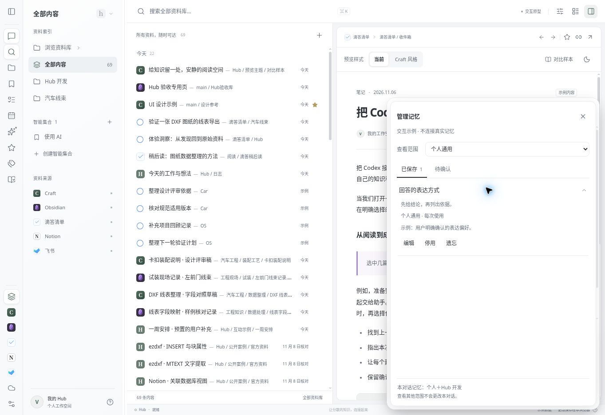

### 16.5 共用与专用的界线

共用的是外壳、标题、搜索、行、字段、按钮、焦点、滚动与状态呈现；专用的是资料授权、技能执行、记忆生命周期和成果保存。组件统一不能把这些不同业务用同一个“确认”回调混起来。

一个可复用控件必须允许正确表达主动作、次动作、风险、加载、错误与不可用原因。若为了复用需要大量布尔开关和特例，应拆成清楚的基础组件与业务组合，避免用一个大弹层组件吞掉所有状态。

<a id="state"></a>

## 17. 状态与事件契约

### 17.1 状态所有权

下表是建议的职责模型，不代表现有桌面 API 已采用这些字段名。实现可沿用现有命名，但行为需要满足同样的隔离关系。

| 状态 | 所有者 | 持久化范围 | 不得被什么顺带改变 |
| --- | --- | --- | --- |
| 当前会话身份与消息 | 会话控制器/既有存储 | 当前 work 与历史记录 | 弹层打开、搜索筛选 |
| 文本草稿 | 当前助手实例与会话 | 沿用既有草稿规则 | 改主题、关闭选择器、收起过程 |
| 已应用材料与技能 | 当前未发送草稿 | 当前会话草稿 | 浏览资料详情、置顶技能、管理其他记忆 |
| 材料选择草稿 | 材料面板实例 | 面板打开期间；按规则提交 | 搜索结果刷新、分页或失败 |
| 过程展开与阅读状态 | 当前会话/轮次 | 沿用 #56 的恢复规则 | 新事件、首段答案、局部组件重渲染 |
| 当前弹层与触发入口 | 当前助手实例 | 瞬时 UI | 另一个助手实例的操作 |
| 记忆使用偏好 | 既有记忆控制器 | 按真实选择与新聊天规则 | 管理范围浏览、旧聊天回看 |
| 管理筛选 | 管理器 | 局部或受支持的浏览偏好 | 当前记忆调用范围 |
| 编辑草稿与保存身份 | 编辑器/业务控制器 | 编辑期间；失败保留 | 管理筛选、来源列表更新 |
| 已保存成果与回执 | 业务保存控制器 | 既有后端记录 | 临时复制反馈、菜单关闭 |

### 17.2 事件表

| 事件 | 允许发生 | 明确不能发生 |
| --- | --- | --- |
| OPEN_MATERIALS | 从当前已应用材料初始化选择草稿，焦点进入搜索 | 自动发送、扩大来源授权、清空输入 |
| MATERIAL_QUERY_CHANGED | 更新查询并标记新请求身份 | 清空已选项、应用过期搜索结果 |
| MATERIAL_TOGGLED | 按稳定身份更新选择草稿 | 按标题错误合并不同来源 |
| MATERIAL_PREVIEWED | 查看对应材料或摘录 | 同时勾选、声明已经发送模型 |
| MATERIALS_CONFIRMED | 将选择草稿应用到当前输入 | 修改已发送的历史消息 |
| MATERIALS_CANCELLED | 丢弃未提交选择并返回入口 | 删除原先已应用材料 |
| SKILL_PIN_CHANGED | 更新置顶偏好 | 同时选择技能、启动技能执行 |
| ANSWER_MORE_OPENED | 打开对应答案的菜单 | 切换当前会话或自动准备保存 |
| SAVE_ACTION_SELECTED | 进入既有目标/草稿/确认流程 | 直接将模型建议当用户确认 |
| PROCESS_USER_EXPANDED | 记录用户主动回看状态 | 被后续答案事件无条件折叠 |
| FIRST_ANSWER_RECEIVED | 按专项判断跟随与手动状态，呈现答案 | 强制上翻用户跳到最新 |
| OVERLAY_CLOSED | 关闭最上层并恢复合理焦点 | 丢失编辑草稿、关闭另一助手面板 |
| MODEL_CHANGED | 依据能力更新后续执行设置 | 重置资料、记忆或既有成果 |
| MEMORY_BROWSE_CHANGED | 只改变管理列表筛选 | 改变当前会话使用范围 |
| THEME_OR_WIDTH_CHANGED | 调整布局，保持对象与状态 | 重置菜单选择、丢失展开记录 |
| INSTANCE_CLOSED | 沿用既有关闭与草稿保护 | 停止另一实例任务或混用其回执 |

### 17.3 异步、失败和并发

所有可能返回较晚的操作都关联请求身份和当前对象身份。快速搜索、切换会话、关闭弹层后，旧响应不能写入新对象。对真正的业务保存沿用幂等身份、版本与确认令牌；UI 精简不绕过它们。

失败反馈放在对应任务附近，保留用户已输入内容，并清楚区分“未提交”“可能已执行，待核对”“已保存但索引未完成”等状态。重试只重试受支持的动作，不把“再次点击”当作天然安全的重复写入。

两个助手面板同时打开时，共享的业务数据通过既有控制器同步，各自的搜索、弹层、焦点和输入草稿独立。一个面板修改记忆后，另一个面板读取新的真实状态，但不会把管理筛选或输入内容复制过去。

<a id="accessibility"></a>

## 18. 响应式、无障碍和跨平台

### 18.1 宽度与高度

至少检查宽助手、常规停靠助手与约 360px 窄助手面板，并记录实际 CSS 宽度。宽度不足时按内容职责重排：标题截断可查看全文，工具栏次要动作进入菜单，列表描述可换行，底部动作保持可达。不能单纯缩小所有字体。

矮窗口与宽窗口同样重要。材料和管理面板应让正文区收缩，标题/搜索/完成保持可操作；输入框增长后，弹层重新计算可用空间。固定高度只用于明确用途的容器，不给关闭的折叠项或空内容区分配无意义高度。

### 18.2 键盘和读屏

使用语义正确的 button、input、select、details、dialog、tab 等控件。图标按钮有明确可访问名称；选中、展开、加载、禁用状态可被识别。列表项中主动作和置顶/更多动作分别可到达，不用一个嵌套点击区域承担互相冲突的动作。

动态状态播报遵循 #56 与既有无障碍实现。不要给整个不断增长的过程区设置过度播报，使每次追加都读出全部历史。重要错误和需要用户处理的状态应及时可感知，但模型每段进展不必变成打断式警告。

### 18.3 触摸与悬停

触屏不具备可靠悬停，必要箭头、更多入口和选择状态保持可见。点击目标可大于视觉图标，避免相邻置顶与选择误触。桌面可以降低次要动作的视觉强调，但键盘焦点到达时必须显示完整反馈。

触摸拖动滚动时不误触选择或发送。面板内滚动达到边界后，不应意外把后面的主对话拖走；具体滚动链需在目标浏览器验证。不能把隐藏滚动条作为解决滚动冲突的方法。

### 18.4 深色、高对比与减少动态

背景、边线、正文、代码、表格、选中和焦点均按语义变量适配。深色模式下不能保留浅色截图式底板或黑色文本；禁用态与次要说明仍有区别。减少动态效果时保留静态状态与定位能力，不能取消完成反馈或返回最新入口。

### 18.5 Windows 缩放与真实字体

正式桌面实施时，至少核对实际常用缩放以及 100%、125%、150% 中受支持的代表设置。检查中文与拉丁字母基线、代码字体回退、控件裁切、1px 边线和弹层位置。不同 DPI 的截图不直接按物理像素比较。

原型的窄面板验证不等价于 Android 真机、软键盘、安全区或手机网页视口验收。未来涉及移动端时，在本方案添加对应平台规则和证据，并在手机任务中单独记录实际结果。

<a id="components"></a>

## 19. 组件与实现边界

### 19.1 推荐分层

| 层级 | 可复用职责 | 例子 | 不承担的工作 |
| --- | --- | --- | --- |
| 语义样式 | 文字、间距、表面、边线、图标、状态与焦点 | typography、control、surface、spacing 角色 | 业务授权与数据写入 |
| 基础控件 | 按钮、图标按钮、字段、行、搜索、选择标记 | ActionButton、SearchField、PickerRow | 判断一条记忆是否有效 |
| 结构容器 | 弹层标题/内容/底栏、列表区域、阅读容器 | PopoverShell、PickerShell、ManagerShell | 混合全部业务 state |
| 业务组合 | 材料、技能、记忆、成果保存的可见交互 | MaterialPicker、SkillPicker、MemoryManager | 绕过既有服务端校验 |
| 控制器 | 会话身份、草稿、请求、保存和生命周期 | 既有 hooks/store/API | 承担与业务无关的所有布局覆盖 |

这些名称用于描述职责，可在实际实现中按现有代码风格命名。优先提取真正重复且稳定的结构，不为一次性小样式增加过度抽象。共用组件应有清楚的输入与回调，避免依赖某个外层 class 才能得到完整样式。

### 19.2 CSS 组织

逐步收敛基础文件与 refinement 中重复覆盖的职责，建立组件范围的规则。对需要伸展的内容区使用明确选择器，不用广泛后代规则影响嵌套 details。相同类型的按钮通过共同基底获得完整样式，而不是只补字号或 padding。

每个新规则都说明作用范围：所有 Agents 实例、单一弹层、单一正文元素或某种状态。不能为修一个材料列表而改变全部 details，也不能为一个全屏场景影响窄助手。重要差异可通过语义变体表达，避免不断叠加更高优先级。

### 19.3 原型与桌面的映射

原型使用示例数据和受支持的本地状态展示交互；正式桌面复用同样的视觉角色与状态契约，但接入既有真实业务。设计文档需要记录原型组件与桌面对应位置，不能把两个项目的路径当成同一套源码。

原型验证的是结构、选择、菜单、焦点和状态反馈，不承担真实查询速度、授权、保存幂等、记忆召回、跨模型和后端失败的正式环境验收。既有专项已经完成的真实样本继续有效，包括共享记忆第 17.4 节的四次模型运行；后续 UI 迁移只对受影响路径做必要回归。原型中显示成功应明确是示例流程，不编造真实服务回执。

<a id="migration"></a>

## 20. 迁移、兼容与回滚

### 20.1 开始前核对

读取当前 GitHub 主线、Sites 最新版本、来源提交和快照。先确认双方是否存在尚未合并的变化，再建立本轮工作基线。v135 的第二助手面板、此前的选文侧聊、旧工作发现与共享记忆都属于需要保留的既有功能。

发现并行更新时审查受影响文件并合并，不强推、不用旧镜像覆盖新 Site。发布前再核对来源是否推进；存在新的相关变化时重新执行必要检查。这里只要求与本轮风险有关的验证，不为纯样式变更无目的地重复全部后端测试。

### 20.2 数据兼容

不清空真实聊天、资料授权、记忆、技能偏好或未发送草稿。原型 localStorage/sessionStorage 的键和数据结构变更要有明确兼容策略；浏览器旧状态损坏时降级到可用界面并说明，不能让普通聊天无法打开。

历史消息展示适配不等于历史数据重写。若需正式迁移，单独定义版本、备份、幂等与失败恢复，并按明确范围实施。用户写入的内容和系统旧封装分开识别，保留无法可靠转换的原文。

### 20.3 分阶段发布

本轮先将方案和新任务写入 GitHub，再修改并发布原 Site。原型通过必要检查后，按实际发布源码完整回导到 sites/hub-workspace，更新来源快照和 GitHub 提交。GitHub push 与 Sites 部署是两个结果，必须分别核对。

正式桌面迁移在后续明确范围内进行。先复用已经确认的公共规则，再逐步替换组件；避免一次更换所有交互、样式和业务协议造成无法定位的回归。已有共享记忆桌面迁移和代码块修复继续保留。

### 20.4 回滚条件

如出现无法发送、草稿丢失、范围串用、保存重复、焦点不可达、过程回看被破坏或窄面板必要动作被遮挡，应优先回退相关组件或本轮发布，而不是以“视觉更好看”为理由保留。回滚保留用户数据和有效业务记录。

回滚后在本页记录影响版本、原因、恢复方式和重新实施条件。历史截图、失败和回执不删除，不把失败步骤改写为未发生。来源快照必须对应实际恢复的源码，不手改哈希伪造一致。

<a id="phases"></a>

## 21. 按阶段实施与依赖

### 阶段 A：主方案与任务建立

当前已确定本页为长期入口，新主任务为 #64。完成条件是详细方案、五张用户原图、可复用的专项证据与维护规则已写入 GitHub；根协作入口指向本页；任务归属、父关系、看板字段与实际状态按工具能力回读核对。缺少工具或权限时明确留下尚未完成项，不把正文里写了“归属 #43”当作原生父关系已经配置。

用户明确要求先记录再继续，因此阶段 A 的远端保存核对完成后，才开始阶段 B 的功能/样式编辑。读取和准备可以并行，不能先改完原型再补一条“已先规划”的历史。

### 阶段 B：原型首批优化

依次处理材料选择器、回答阅读样式、操作工具栏。材料面板的空间分配与选择语义先稳定；回答的标题、正文、代码、表格和引用统一；操作栏减少默认常驻动作，完整能力集中到清楚入口。

完成后用同一批代表内容比较，不以更短的示例替代原来的复杂内容。检查短答、长文、代码、表格、材料引用、错误/空态和窄面板。适合纯状态检查的逻辑使用现有检查入口扩展，视觉与焦点由浏览器实际操作核对。

### 阶段 C：公共弹层与邻接控件

按小设置、搜索选择、管理编辑的职责统一详情、技能、记忆等弹层。补齐按钮、选择行、搜索、标题/底栏、错误态、焦点返回与叠层关系。保留各业务语义、现有真实桌面功能和专项约束。

顶栏与输入框属于相邻区域，按本轮实际风险做必要协调。没有完成的会话模式重构、移动端适配或业务能力不借此扩展实现；记录为后续项，并解释为何不在当前批次。

### 阶段 D：原型交付与证据补充

发布到原工作台，保留项目身份、网址和访问范围。截图至少覆盖新的材料选择、回答/工具栏、更多菜单、技能、记忆与详情中的代表状态，并记录宽度和示例身份。把实际采用的规则、未采用原因、检查结果、发布版本与源码提交补回本页。

同步实际发布源码和快照到 GitHub，验证远端文件与预期范围一致。原型完成可关闭本轮交付清单，但长期主任务保留后续入口。不能把这一步描述成正式桌面、Android 或真实模型已完成。

### 阶段 E：正式桌面迁移与真实验证

首轮桌面迁移沿用当前客户端组件，使用日常资料库和已保存的真实回答核对，结果见第 24.4 节。后续仍按受影响的分支检查，缺少真实样本时明确记下。

需要根据本轮 UI 变更评估的项目包括真实搜索与授权、历史兼容、保存预览及幂等、记忆编辑与范围、模型切换、运行中过程回看、Windows 缩放与实际字体。先核对最新专项回执，再选择受影响分支；已经完成的记忆项目召回、模型切换和隔离样本不能笼统重置为待办。每一类只运行必要检查，材料与状态保护不因界面统一而被削弱。

<a id="acceptance"></a>

## 22. 可执行验收清单

**下列 84 项是规范验收条件，不表示已经全部执行。** 每轮在第 24 节标记实际执行的编号、环境、结果和证据。原型可验证的 UI 与正式客户端/真实服务项分开记录；未执行不写成通过。涉及实际写入或不可逆操作时，使用已明确授权的真实工作范围，不能为了截图随意写入或删除用户资料。

| 编号 | 层级 | 操作或场景 | 预期结果与必要证据 |
| --- | --- | --- | --- |
| UI-A01 | 文档 | 从主任务打开主方案 | 指向固定路径，包含当前有效规则与变更记录 |
| UI-A02 | 文档 | 查询过程/记忆细节 | 找到 #56/#21 专项入口，历史和当前阶段不混淆 |
| UI-A03 | 文档 | 检查图文和来源 | 图片可打开，来源、版本、性质明确，无断链占位图 |
| UI-A04 | 交付 | 对照 Site 与 GitHub 快照 | 版本、源码提交、完整文件清单对应实际发布 |
| UI-A05 | 原型/桌面 | 一句短答 | 答案可清楚阅读，默认操作不超过确定的主入口 |
| UI-A06 | 原型/桌面 | 长中文答案含三级结构 | 标题、正文和元信息有稳定层级，章节易扫描 |
| UI-A07 | 原型/桌面 | 过程和最终答案同时出现 | 正文不被过程字号/控件权重压过，专项颜色语义保持 |
| UI-A08 | 桌面 | 检查中文/英文/数字混排 | 字体回退、基线与字重合理，记录实际平台 |
| UI-A09 | 原型/桌面 | 行内代码与长路径 | 可读、合理换行，不拉宽整个页面 |
| UI-A10 | 原型/桌面 | 完整代码块 | 语言、复制、横滚/换行能力可用，缩进与空行保留 |
| UI-A11 | 原型/桌面 | 流式围栏尚未结束 | 容器稳定，不显示破碎标签或丢失已到达文字 |
| UI-A12 | 原型/桌面 | 复制代码 | 原始字符、引号、数组下标和换行保持 |
| UI-A13 | 原型/桌面 | 宽表格与长中文单元格 | 溢出限制在表格容器，正文与输入框不被拉宽 |
| UI-A14 | 原型/桌面 | 正文来源链接和引用 | 可辨认、可聚焦、对应正确来源 |
| UI-A15 | 原型/桌面 | 列表与嵌套列表 | 项目内/间距清楚，窄面板剩余阅读宽度合理 |
| UI-A16 | 原型/桌面 | 未完成/停止的部分回答 | 内容保留，未完成状态明确，不假报最终交付 |
| UI-A17 | 原型/桌面 | 新格式材料消息 | 用户问题一次显示，材料为结构化引用 |
| UI-A18 | 桌面 | 未标记旧快照历史 | 可靠兼容或可解释回退，不将系统封装默认当主正文 |
| UI-A19 | 桌面 | 用户自写 JSON/美元符号 | 原文不被误删、误转卡或截断 |
| UI-A20 | 原型/桌面 | 多份资料展开/收起 | 全部材料可达，总数准确，原消息身份保持 |
| UI-A21 | 原型/桌面 | 长用户消息展开 | 不改变真实输入，用户主动展开状态保留 |
| UI-A22 | 原型/桌面 | 查看失效来源 | 显示明确原因，不伪造可读取或换成同名对象 |
| UI-A23 | 原型/桌面 | 打开材料选择器 | 搜索与结果在主要区域，关闭折叠项不占大块高度 |
| UI-A24 | 原型/桌面 | 搜索输入与中文 IME | 查询正常，组合确认不误发送/提交 |
| UI-A25 | 原型/桌面 | 快速更换查询 | 旧慢响应不覆盖新结果，已选状态不丢 |
| UI-A26 | 原型/桌面 | 搜索无结果 | 保留查询，明确无匹配，无空白假加载 |
| UI-A27 | 原型/桌面 | 搜索失败后重试 | 查询和选择保留，错误在对应位置反馈 |
| UI-A28 | 原型/桌面 | 跨查询选择多个资料 | 按稳定身份累计，结果更新不取消已有选择 |
| UI-A29 | 原型/桌面 | 同名不同来源 | 标题/路径可区分，不按名字错误合并 |
| UI-A30 | 原型/桌面 | 点击预览 | 只预览，不顺带选中、发送或扩大授权 |
| UI-A31 | 原型/桌面 | 取消材料选择 | 回到原已应用材料，草稿正文与光标保持 |
| UI-A32 | 原型/桌面 | 完成材料选择 | 更新当前草稿引用，不立即发送或改历史 |
| UI-A33 | 原型/桌面 | 当前页面已选后再次点击 | 状态清楚，无重复项 |
| UI-A34 | 原型/桌面 | 大量已选项 | 数量准确、可展开/移除，底部完成入口可达 |
| UI-A35 | 桌面 | 来源撤回/不可用 | 阻止不合法提交，保留可解释状态 |
| UI-A36 | 原型/桌面 | 矮窗口打开材料面板 | 标题、搜索、列表、完成均可操作，无竞争高度空白 |
| UI-A37 | 原型/桌面 | 复制短答案 | 反馈准确，不显示保存业务成功 |
| UI-A38 | 原型/桌面 | 打开更多操作 | 菜单对应正确答案，分组与顺序稳定 |
| UI-A39 | 原型/桌面 | 有/无当前目标页面 | 上下文插入动作显露合理，不产生目标歧义 |
| UI-A40 | 桌面 | 选择保存为笔记 | 进入既有预览与确认，不直接写入 |
| UI-A41 | 桌面 | 选择创建任务 | 使用既有任务草稿/确认，模型建议不代替用户确认 |
| UI-A42 | 桌面 | 保存失败或结果不明 | 保留草稿，核对与重试不重复写入 |
| UI-A43 | 原型/桌面 | 键盘/触摸访问工具栏 | 复制与更多不依赖鼠标悬停 |
| UI-A44 | 原型/桌面 | 菜单关闭/保存取消 | 焦点回到对应答案的入口，不跳到其他面板 |
| UI-A45 | 原型/桌面 | 运行时公开进展与工具交替 | 事件次序与分组按 #56 保留 |
| UI-A46 | 原型/桌面 | 摘要声称操作但无回执 | 不将自述计成工具执行或成功 |
| UI-A47 | 原型/桌面 | 跟随最新时首段答案到达 | 按专项收整过程，答案可直接阅读 |
| UI-A48 | 原型/桌面 | 用户上翻后首段答案到达 | 不抢滚动，不丢阅读锚点 |
| UI-A49 | 原型/桌面 | 手动展开过程后完成 | 保留用户主动展开，不强制收起 |
| UI-A50 | 原型/桌面 | 长组第九项展开后重开 | 已显示行数、回执与来源展开状态恢复 |
| UI-A51 | 原型/桌面 | 工具部分失败/来源失效 | 折叠摘要仍提示必要异常，详情可检查 |
| UI-A52 | 原型/桌面 | 返回最新按钮 | 运行/完成/减少动态与键盘行为沿用专项 |
| UI-A53 | 原型/桌面 | 打开详情弹层 | 字段行、按钮、标题和关闭遵循共同规则 |
| UI-A54 | 原型/桌面 | 来源核对/撤回入口 | 有明确对象与语义，不作为无上下文通用按钮 |
| UI-A55 | 原型/桌面 | 打开技能搜索 | 搜索、分组、名称和用途清楚可扫 |
| UI-A56 | 原型/桌面 | 技能选择与取消置顶 | 两种动作独立，不误选择或误关闭 |
| UI-A57 | 原型/桌面 | 已选技能发送前/后 | 使用正式名称和紧凑引用，内部标记不露出 |
| UI-A58 | 原型/桌面 | 自动选用与显式技能 | 状态可区分，不误报用户已经指定 |
| UI-A59 | 原型/桌面 | 记忆与保存开关 | 读取、新记忆确认、成果保存仍独立 |
| UI-A60 | 原型/桌面 | 关闭记忆后选范围 | 可以预选但不自动开启 |
| UI-A61 | 原型/桌面 | 管理记忆切换查看范围 | 当前聊天使用范围不变 |
| UI-A62 | 原型/桌面 | 新聊天与旧聊天来回查看 | 沿用最后主动偏好，历史浏览不覆盖默认 |
| UI-A63 | 原型/桌面 | 两个管理记忆入口 | 打开同一状态来源，关闭返回对应入口 |
| UI-A64 | 原型/桌面 | 只用所选资料 | 显示本轮暂停记忆，偏好仍保留 |
| UI-A65 | 原型/桌面 | 记忆编辑失败/取消 | 草稿或原内容按语义保留，范围不漂移 |
| UI-A66 | 桌面 | 记忆停用/恢复/遗忘 | 沿用既有生命周期，不由视觉层伪造后端结果 |
| UI-A67 | 原型/桌面 | 小设置弹层打开关闭 | 尺寸与用途匹配，合理外部点击与 Escape |
| UI-A68 | 原型/桌面 | 模态管理/编辑对话框 | 焦点范围和模态语义匹配，背景不可误操作 |
| UI-A69 | 原型/桌面 | 多层弹层按 Escape | 只关闭最上层，返回正确入口 |
| UI-A70 | 原型/桌面 | 编辑时外部点击 | 不静默丢弃未保存草稿 |
| UI-A71 | 原型/桌面 | 控件 hover/focus/selected/disabled | 状态有区别，焦点可见，非颜色唯一表达 |
| UI-A72 | 原型/桌面 | 约 360px 窄助手 | 无页面横向溢出，关键内容与动作可达 |
| UI-A73 | 原型/桌面 | 宽助手或全屏 | 长文行长合理，标题不被不必要的小上限截断 |
| UI-A74 | 桌面 | Windows 常用及代表缩放 | 文字、图标、边线、弹层定位无裁切，记录真实设置 |
| UI-A75 | 原型/桌面 | 深色模式 | 背景、正文、代码、表格与选中态保持语义和可读性 |
| UI-A76 | 桌面/浏览器 | 高对比/强制颜色 | 焦点、边界、状态仍可识别 |
| UI-A77 | 原型/桌面 | 减少动态效果 | 静态状态完整，定位和返回最新仍可用 |
| UI-A78 | 原型/桌面 | 两个助手实例同时打开 | 草稿、弹层、搜索、焦点与消息动作不串用 |
| UI-A79 | 原型/桌面 | 侧边聊天与选文操作 | 既有入口和上下文保留，主会话草稿不丢 |
| UI-A80 | 原型/桌面 | 旧工作发现/引用/续聊 | 与记忆开关独立，引用可移除，续聊保留草稿 |
| UI-A81 | 原型/桌面 | 页面刷新或恢复旧存储 | 兼容现有状态，损坏数据不阻断普通界面 |
| UI-A82 | 交付 | 发布前出现并行更新 | 审查合并并记录，未覆盖较新的 Site/GitHub 变化 |
| UI-A83 | 交付 | 检查构建和浏览器记录 | 实际执行、通过、警告、未测项目分开说明 |
| UI-A84 | 文档/交付 | 本轮完成后回读主任务 | 方案、图片、源码、版本、剩余阶段与真实状态一致 |
| UI-A85 | 原型 | 从空白或材料打开新对话 | 建议靠近输入，点击填入草稿并聚焦，待确认记忆可从管理入口找到 |
| UI-A86 | 原型 | 同时使用当前页面、手选页面、摘录与资料范围 | 清楚区分页面来源、摘录段数和可检索库名，材料操作保持可达 |
| UI-A87 | 原型 | 打开、搜索、置顶、归档和恢复历史 | 对话列表、日期、空态和归档交互与 v136 一致 |
| UI-A88 | 原型 | 复核新聊标题、建议行、输入和历史计算字号 | 新聊标题、建议行、输入均为 14 CSS px，历史标题为 13 CSS px |

<a id="figures"></a>

## 23. 配图与证据索引

### 23.1 首版已引用的证据图

| 图像 | 路径或来源 | 性质 | 支持的判断 |
| --- | --- | --- | --- |
| 两轮短问答 | assets/agents-ui/20261121/before-conversation.png | 用户原图 | 短答案周边动作过重、回合节奏与输入比例 |
| 材料 JSON | assets/agents-ui/20261121/before-material-json.png | 用户原图 | 重复问题与执行封装进入正文 |
| 对话详情 | assets/agents-ui/20261121/before-details.png | 用户原图 | 过程/答案级差、详情分组与默认按钮接缝 |
| 材料选择器 | assets/agents-ui/20261121/before-material-picker.png | 用户原图 | 主任务下移、异常空白、滚动与列表空间 |
| 技能选择器 | assets/agents-ui/20261121/before-skills.png | 用户原图 | 可保留骨架与置顶等辅助动作权重 |
| 过程布局 | process-video-20261120/hub-current-layout.png | 既有专项桌面实截 | 计时、过程和短回答关系 |
| 公开进展顺序 | process-video-20261120/hub-public-progress-order.png | 既有专项桌面实截 | 公开进展、摘要与回执的真实顺序 |
| 展开恢复 | process-video-20261120/hub-live-public-progress-restored.png | 既有专项桌面实截 | 已展开回执和来源状态需继续保留 |
| 记忆与保存 | assets/shared-memory-20261121/prototype-menu-desktop.jpg | 既有 v134 线上原型实截 | 日常设置的双区结构与管理入口 |
| 记忆管理 | assets/shared-memory-20261121/prototype-manager.jpg | 既有 v134 线上原型实截 | 浏览范围与聊天使用范围独立 |

旧专项图片直接引用原目录，不复制出另一个无来源版本。五张用户图保持原始字节；如为展示需要制作局部裁切，应另存并保留原图，注明裁切范围，不能把裁切后的图片当作完整窗口状态。

### 23.2 本轮改后截图清单

本节新增 **14 张实际浏览器截图**，连同首版 10 张证据图，全篇共引用 **24 张图**。图片均于 2026-11-21 拍摄，数据为原型示例。B1、B2 是修改前 v135 的受管预览；A1、A3、A5～A12 是最终应用代码冻结后的 v136 受管预览；A2、A4 是发布成功后在原网址拍摄的 **v136 线上实截**。预览代码与发布源码 `445d91c` 一致，但图说仍区分拍摄环境。

尺寸指助手面板的 CSS 宽高，截图未做视觉重绘。两张修改前图为 480 × 704；改后主要弹层沿用同一尺寸，宽回答使用 660 × 884，窄回答使用 360 × 704。双助手图为完整 1363 × 936 浏览器视口，其中主助手 660 × 884、第二助手 480 × 704。不同内容、滚动位置或条目数量只用于演示相应状态，不用于虚构节省百分比或完成速度。

#### B1、B2：修改前的同一工作台

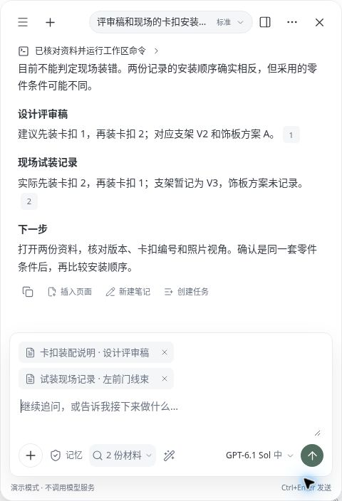

**B1 · v135、受管预览、480 × 704。** 与 A5 使用同一个 `source-demo`，可以比较正文层级、来源呈现和回答动作。原型本来已有材料引用和保存入口，本轮对它们做增量整理；这张图不是用户提供的正式桌面旧版截图。

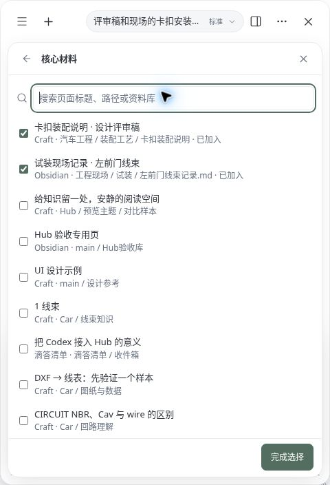

**B2 · v135、受管预览、480 × 704。** 原型已有可用搜索和勾选列表，但缺少明确的全部/已选视图与持续可见的选择数量。用户桌面图中的异常大空白另见第 4 节，不把这两种环境混为一谈。

#### A1、A2：材料选择围绕当前任务组织

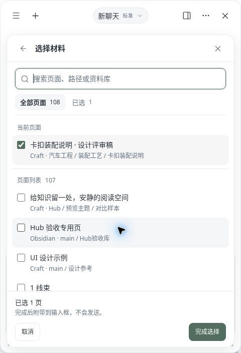

**A1 · v136、受管预览、480 × 704。** 搜索和筛选固定在顶部；当前页面确为正在阅读的“卡扣装配说明 · 设计评审稿”；正文中显示页面列表，底部始终保留数量、取消及完成。当前页由真实页面 ID 取得，不以旧对话材料冒充。

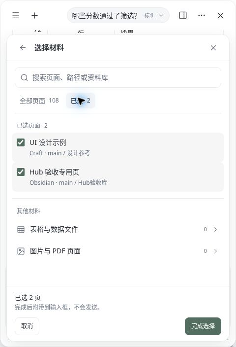

**A2 · v136、线上实截、480 × 704。** 先分别搜索并选择“UI 设计示例”和“Hub 验收专用页”，再切到“已选 2”。选择跨查询保留；表格/数据、图片/PDF 作为二级入口；“完成后附带到输入框，不会发送”说明动作结果。截图后取消，未发送模型请求或写入真实资料。

#### A3、A4：短回答保持轻量，长回答建立阅读层级


**A3 · v136、受管预览、660 × 884。** 一句回答以正文为主，默认只有“复制”“更多”；长答案仍能使用标题。顶部明确标为“排版示例 · 不调用模型”，PowerShell 内容是固定展示样本，不伪装实时模型结果。

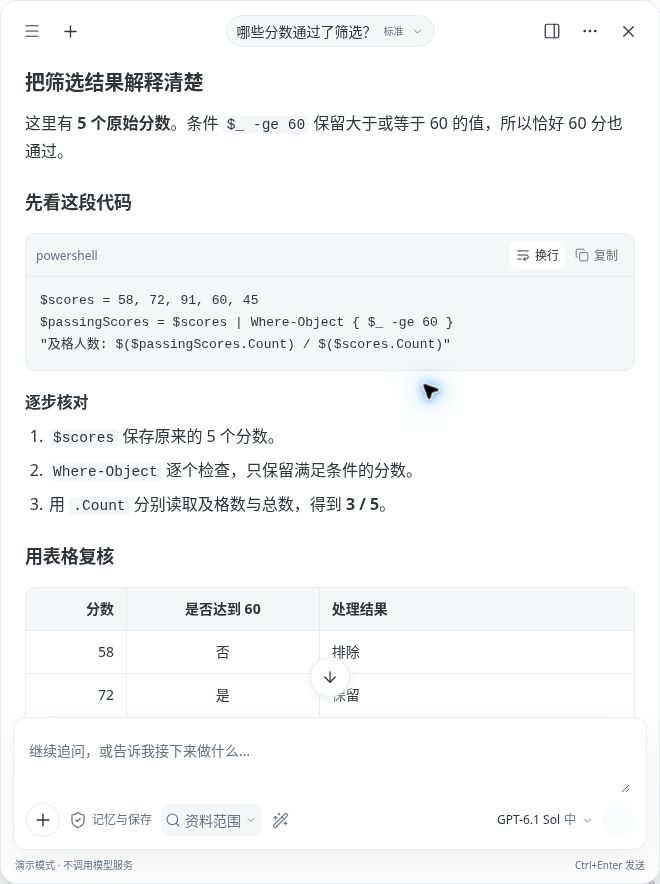

**A4 · v136、线上实截、660 × 884。** 正文 16px / 28px；标题、段落、行内代码、有序列表与表格各有角色。代码块提供语言、换行和复制；它与表格分别管理自身溢出。下方输入框是独立的操作区域，长回答可以继续滚动阅读。

#### A5：保留完整成果动作，减少默认常驻噪声

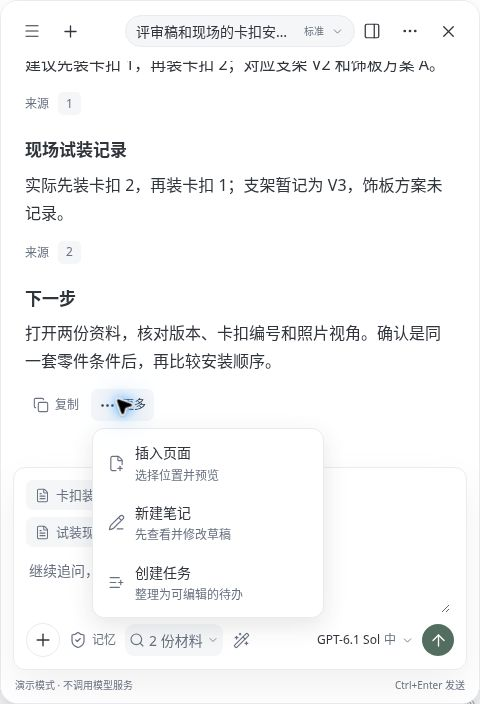

**A5 · v136、受管预览、480 × 704。** 与 B1 同一个来源示例。菜单属于当前回答且限制在所属助手内；三项副说明明确下一步是位置预览、笔记草稿或可编辑待办。已实际打开笔记草稿和页面插入预览并取消，关闭后焦点回到对应“更多”，未执行真实保存。

#### A6、A7：详情和技能共用结构，按用途保留不同密度

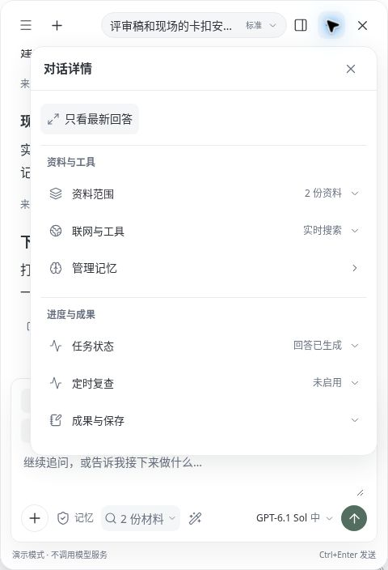

**A6 · v136、受管预览、480 × 704。** 阅读入口、资料与工具、进度与成果分组清楚；记忆管理保留为可发现入口。它不复制输入区日常开关，也不因共用壳层改变任务、联网和成果业务。

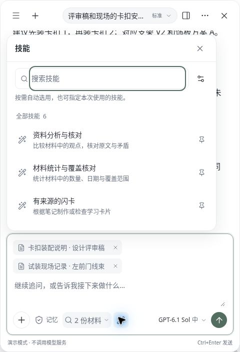

**A7 · v136、受管预览、480 × 704。** 这是动态定位修复后的截图。技能列表可滚动，搜索和管理入口保持可达；置顶与使用分开操作。该场景弹层位于面板顶部以下，输入区含两份材料时也不会向上越出面板。

#### A8、A9：记忆设置靠近输入，管理范围独立

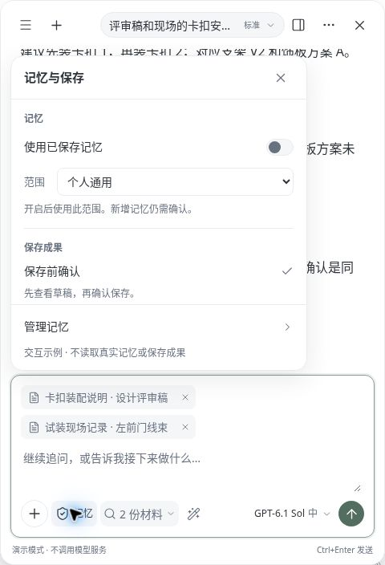

**A8 · v136、受管预览、480 × 704。** 盾牌入口承接本轮使用设置；“记忆”和“保存成果”仍为两个语义分区。当前范围、开关和“保存前确认”可直接看见，管理操作通过统一入口进入。

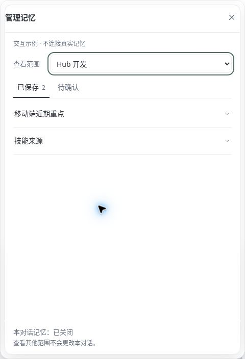

**A9 · v136、受管预览、480 × 704。** 正在查看“Hub 开发”，底部仍显示当前对话记忆关闭。实际关闭管理器再打开设置后，对话范围仍是个人通用。管理器展示少量示例条目时保留正常空余空间；这与材料选择器被折叠块异常撑高是不同问题。该图不代表真实后端记忆读取。

#### A10、A11：窄宽度与深色外观

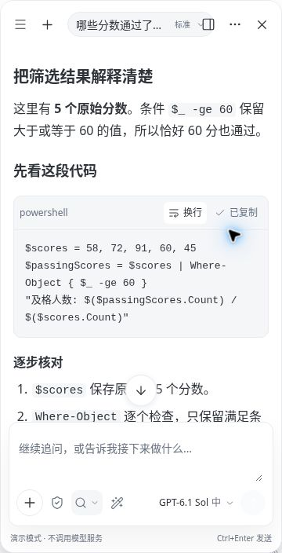

**A10 · v136、受管预览、360 × 704。** 代码开启换行，截图中复制按钮处于已复制状态；剪贴板回读保留原始三行代码和末尾换行。面板测得 `clientWidth = scrollWidth = 358`，没有被内容整体撑宽；同宽度下技能弹层也位于面板内。该检查不等同于手机软键盘或触屏实测。

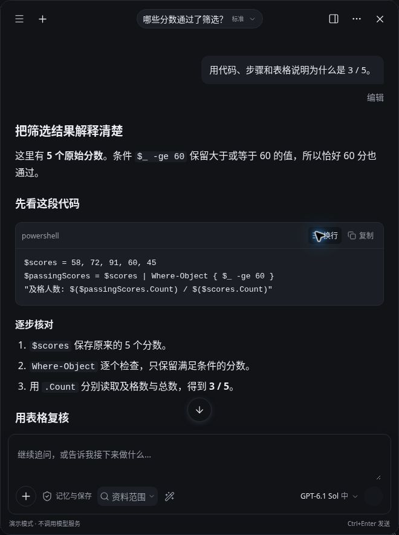

**A11 · v136、受管预览、660 × 884。** 深色沿用同一文字与表面角色；同时抽查材料弹层的主题继承和边界。这里证明所示场景可读，不据此宣称整站所有控件、强制颜色或 WCAG 对比度矩阵已完成。

#### A12：既有双助手与选文侧聊继续保留

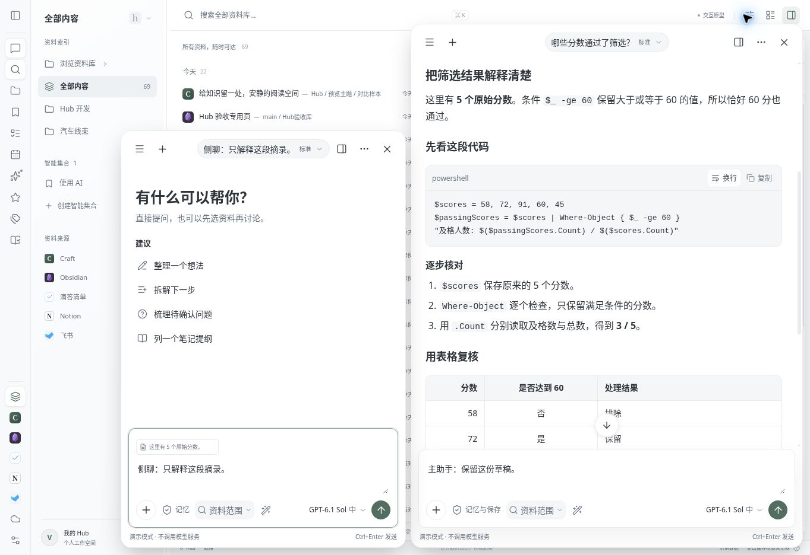

**A12 · v136、受管预览、1363 × 936 视口。** 从主回答真实选中“这里有 5 个原始分数。”后打开第二助手。两侧草稿独立；实际同时打开主助手详情和第二助手技能后，在第二助手按 Esc 只关闭它自己的技能层，主助手详情保持打开。第二助手浮窗/停靠切换后草稿和摘录仍保留。检查结束清空这两份临时草稿，未发送。

### 23.3 图片说明模板

每张新图至少写明：所属版本；原型/桌面/概念示意；来源与日期；当前场景；图中证明了什么；没有证明什么。若图片来自旧版，则明确它是旧证据，不把它列为本次上线效果。

示例图帮助解释规则，但不能代替键盘、异步、授权和持久化检查。无相关真实样本时记录未验证，不用合成资料注入真实客户端。原型可以继续使用明确标注的示例数据。

<a id="delivery"></a>

## 24. 阶段交付记录

### 24.1 初版建立

| 项目 | 本版记录 |
| --- | --- |
| 用户要求 | 2026-11-21：新建长期任务，详细记录上轮分析并尽量配图；先写入 GitHub，再继续原型优化 |
| 主任务 | [#64](https://github.com/VondeSong/hub-search/issues/64)，新建的 Agents UI 与交互持续入口 |
| 文档 | 本页，固定路径；首版记录设计、证据、实施顺序、84 项验收和维护规则 |
| 已有图片 | 5 张用户原图＋5 张既有专项证据图，共 10 张引用 |
| 原型实施起点 | 原工作台 v135；保留最新多面板、选文、旧工作、过程和记忆能力 |
| 本版实施状态 | 首版方案已于 2026-11-21 保存到 GitHub 并回读；在该提交之后启动首轮原型实施，实际结果见后续阶段记录 |
| 桌面已有成果 | 共享记忆已在 4fba6d4 迁移，代码块已修复；随后 bd3157d 补充日常库项目记忆与四次跨模型/隔离实测。本轮保留这些成果，不重复计为新检查 |
| 本轮桌面整体 UI | 当前未实施；后续明确开始时按本页和专项约束接入真实环境 |
| GitHub 方案提交 | [36257f8](https://github.com/VondeSong/hub-search/commit/36257f8219020f61b6e91cc2aa6470e089e25949)，9 个文件；主方案与 5 张新原图、README 和协作规则的远端 blob 均回读匹配 |
| 父关系/看板 | #43 模块目录已加入 #64；原生 Parent/Sub-issues 和 Projects 字段尚未同步：当前连接器无对应写操作，云浏览器未登录私有仓库。正文归属声明不替代原生配置 |

### 24.2 首轮原型交付：v136

本轮完成的是用户指定的第一批原型改动及主要弹层统一。第 22 节仍是长期验收矩阵，不能据本轮发布将 84 项全部勾选。

#### 24.2.1 发布与同步身份

| 项目 | 实际记录 |
| --- | --- |
| 方案先行 | 先提交并回读 [36257f8](https://github.com/VondeSong/hub-search/commit/36257f8219020f61b6e91cc2aa6470e089e25949)，随后才编辑原型功能与样式 |
| 原站点 | [Hub · 工作与生活工作台](https://hub-workspace-von11.song02211368537057.chatgpt.site/)；沿用原项目、网址及原 public 范围 |
| 直接体验 | [排版示例：短答、代码、列表、表格及操作菜单](https://hub-workspace-von11.song02211368537057.chatgpt.site/?assistant=ui-demo)；页面内可进入原有来源示例 |
| 原型起点 | v135，源码 `2d0f0828aea367e127b0ba0cb23b8e526e73845d` |
| 本轮发布 | **v136**；2026-11-21 18:32（中国时间），部署状态 `succeeded` |
| 实际发布源码 | `445d91cfb7ecd6f7b35d711e3bf911a7498c71ac`，中文提交“优化 Agents 材料选择、回答排版与统一弹层” |
| 发布回执 | `appgdep_6b01731c46f4819186bfa19054624558` |
| GitHub 镜像 | `sites/hub-workspace/`；从实际发布提交导入 **276 个受管来源文件**，另有生成的 `.source-snapshot.json`；逐文件校验通过 |
| GitHub 本轮提交 | 本节、14 张新增截图、实际发布源码及快照同次提交；精确 GitHub 提交链接登记在 [#64 的本轮交付记录](https://github.com/VondeSong/hub-search/issues/64)，与 Sites 源码提交分开标识 |
| 并行变化 | 发布前 GitHub 从 36257f8 前进到 bd3157d，仅更新共享记忆专项；本轮保留该文件的新内容，并更新本页引用，未用旧文档覆盖 |
| 实施范围 | 原型应用 12 个文件变化，其中 5 个新增；没有新增依赖，没有修改 `desktop/` 业务代码，没有发布安装包 |
| 截图 | 首版 10 张证据图继续保留，本轮新增 2 张 v135 改前、10 张 v136 受管预览及 2 张 v136 线上图，共 24 张引用 |

源码导入与检查使用仓库既有工具，以真实提交生成清单，不手改快照哈希：

```bash
python scripts/sync-site-sources.py import --site workspace \
  --source <原站点 Git 工作区> \
  --commit 445d91cfb7ecd6f7b35d711e3bf911a7498c71ac \
  --version 136 --deployment-id appgdep_6b01731c46f4819186bfa19054624558
python scripts/sync-site-sources.py verify --site workspace
```

#### 24.2.2 实际采用的规则和组件

| 区域 | 本轮实现 | 具体文件与边界 |
| --- | --- | --- |
| 材料选择 | 固定搜索、全部/已选、真实当前页、分批页面列表、固定数量与完成操作；选项以草稿编辑，完成才应用，取消恢复原材料 | [AssistantMaterialScope.tsx](../../sites/hub-workspace/app/AssistantMaterialScope.tsx)；文件/数据、图片/PDF 移入子视图；检索资料库授权仍独立；未新增材料行预览 |
| 回答内容 | 有界 React Markdown 渲染，标题、段落、列表、行内代码、引用、代码块、表格和 HTTP(S) 链接；未闭合或异常语法保留可读回退 | [AssistantAnswerContent.tsx](../../sites/hub-workspace/app/AssistantAnswerContent.tsx)；不用 raw HTML，不加载图片/嵌入；不宣称完整 CommonMark/GFM 或真实流式整链验收 |
| 回答动作 | 常驻“复制”“更多”；菜单绑定当前回答并 portal 到所属助手；插入、笔记、任务继续调用原确认流程 | [AssistantAnswerActions.tsx](../../sites/hub-workspace/app/AssistantAnswerActions.tsx)；标签助手专用业务动作保持原样 |
| 公共弹层 | 共用标题、工具区、可滚动正文、底栏；实例 ID、局部 Escape/Tab 与焦点恢复；技能/记忆设置根据面板、标题和实际输入区高度定位 | [AssistantOverlay.tsx](../../sites/hub-workspace/app/AssistantOverlay.tsx)；覆盖主要助手弹层，非全站模态框替换；各自业务状态不合并 |
| 视觉角色 | 正文 16px/28px、普通控件 14px、元信息 12～13px；h1/h2/h3 为 20/18/16px；常规回答最大 74ch；局部代码/表格滚动 | [assistant-ui.css](../../sites/hub-workspace/app/assistant-ui.css)；列表标记明确恢复，输入区使用整体焦点边界，保持现有主题变量 |
| 演示与兼容 | 新 `ui-demo` 显示明确的演示标签，使用独立示例会话键；既有 `source-demo`、`activity-demo`、v133 选文、v134 记忆、v135 双助手保留 | [Assistant.tsx](../../sites/hub-workspace/app/Assistant.tsx)、[page.tsx](../../sites/hub-workspace/app/page.tsx)；没有读取真实记忆或调用模型服务 |

以下取舍已明确，不应在下一轮被误读成遗漏的无条件需求：没有可靠时间来源时不显示“最近”；来源示例沿用原有独立演示入口，不把汽车零件来源附给 PowerShell 答案；小设置与完整管理共用结构但使用不同尺寸；正式桌面已有代码块和记忆后端不因原型组件新增而重复重建。

#### 24.2.3 实际浏览器检查

环境为浏览器原型，常规面板 480 × 704，另检查 360 × 704 和 660 × 884；双助手在 1363 × 936 视口内操作。下表的 UI-A 编号表示涉及的规范，**只把“实际观察”列中执行的分支归档为通过**，不表示编号下的所有桌面/失败/边界条件全部覆盖。

| 检查 | 实际操作与观察 | 相关规范和未覆盖边界 |
| --- | --- | --- |
| QA-01 材料选择 | 保留正文草稿；搜索并选择后取消，原材料不变；跨两次搜索累计两页；在已选视图取消一页，数量同步；完成后附带 chip 且不发送；重新检查当前页与实际阅读页一致 | UI-A23、A28、A31～33、A36；未测输入光标精确位置、选择数量上限和附件每个分支；线上再执行两次搜索、多选和取消 |
| QA-02 范围与发送 | 选择一个页面未授权整库；改成只用所选资料，再移除最后材料，发送禁用且正文保留，记忆显示本轮不使用；切回普通提问可继续 | UI-A32、A35、A64 的原型范围；不替代真实来源撤回、服务端授权或模型运行快照验证 |
| QA-03 回答与成果入口 | 正文实测 16px/28px；列表编号恢复；普通复制出现“已复制回答”且剪贴板确为该答案；代码复制保留三行及末尾换行；换行开关可用；更多菜单在面板内；笔记草稿和插入当前页预览均可取消，焦点回到更多；来源 1 打开对应原页面 | UI-A05、A06、A10、A12、A14、A15、A37～39、A44；真实写回、任务创建、失败与幂等未执行；完整流式代码仅有静态边界检查 |
| QA-04 弹层与焦点 | 技能打开聚焦搜索，Tab 到管理、Shift+Tab 返回；Escape 回触发器；材料外部点击输入框后，焦点留在所点输入框；详情、记忆设置与管理关闭后均返回所属入口 | UI-A53、A67～70 的已列分支；未宣称完整读屏模态语义和全控件 Tab 矩阵已验 |
| QA-05 技能 | 搜索闪卡，置顶不添加；详情显式添加后出现技能 chip，可移除；取消置顶还原；动态高度修复后 480 宽与 360 宽均不越所属面板 | UI-A55～57、A67、A72；未调用真实技能服务或重启 #48 已暂停的技能包设计 |
| QA-06 记忆 | 管理器切到 Hub 开发，关闭再开设置仍为个人通用/关闭；编辑临时文字时关闭、范围、页签禁用；按 Esc 只取消编辑、恢复原文并回编辑入口；底部与详情都进入同一个管理器 | UI-A59、A61、A63、A65、A69 的原型分支；没有保存测试记忆或执行遗忘；真实服务证据继续来自 #21 专项 |
| QA-07 双助手 | 真实拖选正文后打开侧聊，摘录准确；主/侧两份草稿独立；两侧同时开弹层时，第二侧 Escape 不关闭主侧详情；第二侧浮窗/停靠切换后草稿与摘录保持 | UI-A78、A79；临时草稿检查结束清除，未发送；不将此次样本扩展为任意多窗口并发保证 |
| QA-08 阅读与外观抽查 | 360 宽面板 `clientWidth=scrollWidth=358`；技能层宽 334 且在面板内；660 宽代码/列表/表格层级正常；深色回答和材料层继承主题；原 `activity-demo` 完成示例可展开公开进展与回执；长答案手动阅读时出现回到最新入口 | UI-A07、A13、A45、A72、A73、A75 的局部检查；未重新执行 #56 全部实时事件/锚点/首答自动收整，也未实测手机、IME、Windows DPI、读屏或减少动态效果 |
| QA-09 发布后 | 在原线上 URL 直接打开 `ui-demo`，确认新正文组件、代码和复制/更多存在；材料跨查询选择两页与已选计数正确；拍摄 A2、A4 并保留线上查看入口 | UI-A04、A83、A84 的线上 UI 分支；源码与 GitHub 镜像另按文件清单核对 |

其中 480 × 704、包含两份材料的输入区场景，技能弹层测得 `x=884, y=289, width=420, height=393`，所属助手为 `x=871, y=220, width=480, height=704`，顶部和底部均在面板内。此几何记录支持定位修复，不能当成所有屏幕组合的完备证明。

#### 24.2.4 静态检查、构建和本轮修正

| 检查 | 结果 | 覆盖范围 |
| --- | --- | --- |
| `node_modules/.bin/tsc --noEmit` | 通过，包括最后动态高度与当前页补丁 | 类型与调用契约 |
| `node scripts/assistant-check.mjs` | 25 项通过 | 既有助手状态及本轮相关回归 |
| `node scripts/assistant-insert-check.mjs` | 7 项通过 | 既有插入行为保护 |
| `node scripts/assistant-answer-check.mjs` | 6 项通过 | 安全链接、HTML/图片不执行、CRLF/空白代码保真、未闭合围栏、列表结构和异常表格回退 |
| `git diff --check` 与暂存差异检查 | 通过 | 本轮源码差异格式 |
| 原站点生产构建 | 通过 | 使用 Sites 构建入口执行 `node scripts/run-framework.mjs build`；归档由同一已推送源码生成 |
| 来源快照校验 | 276 个受管文件通过 | 文件清单、字节内容、执行位和发布来源 |
| 独立只读代码复核 | 无剩余阻断项 | 菜单消息绑定、所属面板定位、范围草稿、焦点、编辑保护、既有选文/双助手契约 |

38 个脚本检查、9 组浏览器场景、84 项长期产品验收是三种不同口径，不相加、不互相代替。

本轮实际发现并修复：列表 reset 使编号消失；输入框出现过重的内部矩形焦点框；禁用控件可能成为初始焦点；子视图返回目标只在正文内查找；外部点击后关闭弹层重新抢走输入焦点；输入区变高后技能/记忆设置向上越界；当前页面捷径误取旧会话上下文；排版示例误带无关来源。修复后对相关路径复验，再冻结源码打包。

构建保留现有的较大分包提示、路由静态分类提示和代理环境提示，构建未失败；本轮没有为清除警告扩大到打包架构重构，也没有因此宣称性能已经量化改善。受管预览阶段曾遇到旧锁和新 CSS 导入缓存，核对进程/文件后使用支持的预览停止和重启流程恢复；它们不被写成发布成功后的应用缺陷。最终线上页面与截图已经实际打开验证。

#### 24.2.5 原型交付时留下的事项

下表保留 v136 发布时的状态。首轮桌面迁移和 GitHub 归属以第 24.4 节为准。

| 事项 | 本轮状态与后续处理 |
| --- | --- |
| 正式桌面 UI 迁移 | 本轮未修改桌面业务实现。后续按用户明确阶段，把本页确认的视觉与交互规则接入当前真实客户端；不要覆盖共享记忆已完成的迁移和四次模型验收 |
| 材料行的独立预览 | UI-A30 尚未实现。当前行是勾选目标；若增加预览，需明确点击目标、键盘和焦点，预览不得隐式选择或授权 |
| 长用户消息与历史材料 | UI-A18～21 中的旧快照兼容、用户自写 JSON 保护、长消息主动展开仍属后续；本轮原型渲染并未修复正式桌面旧材料封装 |
| 真实搜索和保存分支 | 原型 catalog 同步过滤；UI-A24～27 的 IME、异步竞态、失败重试和 UI-A40～42 的真实保存/状态不明/幂等需按客户端样本验证 |
| 材料边界 | 同名不同来源、上限数量、失效权限、附件每个分支和矮窗口极端组合未完整抽查；不因两页多选成功直接勾选全部 UI-A29、A34～36 |
| 顶栏和模式身份 | UI-D11 仍是后续设计方向。本轮没有拆分会话标题与任务模式，也没有宣称所有标题截断问题已经解决 |
| 过程和旧工作发现 | 原实现保留，相关回归继续到 #56/#21 读取最新专项；本轮仅抽查完成示例和选文侧聊，未重记完整运行过程、旧工作续聊或损坏存储恢复为通过 |
| 跨平台和辅助技术 | Windows 字体与 DPI、真实中文 IME、读屏、强制颜色、触屏/手机软键盘、减少动态效果仍按各自环境执行；CSS 有规则不等于实机通过 |
| GitHub 原生元数据 | #43 正文目录已关联 #64；原生 Parent/Sub-issues 和 Projects 字段仍待具备对应写能力时补齐。当前连接器无对应操作，云浏览器未登录私有仓库；没有因此伪报已加入看板 |

**任务状态：#64 继续保持打开，首轮原型完成，后续方案均在本页增删改查。** 第 21 节的阶段 B/C 本轮实现范围与阶段 D 原型交付已完成；阶段 A 的原生父关系/看板元数据留有上述明确缺口；阶段 E 和本节剩余项不能随原型发布一起标为完成。

### 24.3 阶段记录格式

~~~text
日期与阶段：
需求/决策编号：
修改组件：
实际采用的规则：
与上版差异及理由：
原型版本 / Sites 源码提交：
GitHub 提交：
检查编号与环境：
通过的行为：
失败、警告与未验证项：
配图路径和来源：
后续任务与状态：
~~~

### 24.4 Windows 桌面热开发版迁移

2026-11-21，按 v136 的发布源码与截图更新实际 Hub 客户端。Windows 日常开发窗口通过本机 Vite 载入更新。

| 范围 | 桌面采用的规则 |
| --- | --- |
| 材料选择（UI-D03） | 搜索和筛选在上方，材料列表自己滚动，数量和完成按钮固定在底部。可单独选择当前正在看的页面，也可进入资料库文件、图片和 PDF 子页。点「完成选择」才放进待发送区，取消会放弃本次调整。整个资料库的检索范围仍在资料范围中单独选择。 |
| 回答与操作（UI-D04、D05） | 普通回答正文使用 16px / 28px，分开设置标题、引用、列表、代码和表格样式。保留现有 Markdown、引用定位、代码换行及原文复制。下方显示「复制」「更多」，插入页面、新建笔记、创建任务进入原有确认流程。 |
| 助手弹层（UI-D08） | 材料、技能、详情、记忆与保存、记忆管理沿用各自内容和共享标题结构。保存草稿留在对应助手内，长内容可以滚动，确认操作留在底部。多个助手分别处理自己的弹层和 Esc。 |

**日常 Hub 实际检查**

- 用两个不同关键词搜索并各勾选一份已有资料，打开「已选」能同时看到两份。点「取消」后，资料范围仍为空。再选一份并点「完成选择」，材料卡出现在输入框；测试结束已移除该待发材料。
- 打开一条已保存的真实回答，核对正文、列表、行内代码和「复制」「更多」。从「更多」打开笔记草稿，看到目标资料库、标题、正文及预览按钮。按 Esc 返回后焦点回到原回答的「更多」。
- 输入框里有待发材料时打开技能，搜索框和列表仍在助手内，按 Esc 回到技能按钮。也打开了对话详情、记忆与保存及记忆管理，核对分组和当前对话范围。

前端构建和面向变更的 288 项测试通过，覆盖搜索切换、取消、本地待发、旧回答、保存确认、记忆与两个助手间的 Esc。构建仍报告现有的大包体积提示。首轮日常窗口检查停在草稿和浏览阶段，未发送新问题、写入资料或改动记忆。随后补查以下场景。

#### 日常窗口补验

| 场景 | 实际操作和结果 |
| --- | --- |
| 两个助手（UI-A69、A78、A79） | 从已有 PowerShell 回答选中分数结论，点「在侧边聊天中提问」，第二助手只带入选中的文字。两边各写一句不同的草稿。主助手开详情、第二助手开技能，在第二助手按 Esc，只关闭技能菜单，焦点回到技能按钮。把第二助手切到侧栏再切回浮窗，两份草稿和摘录都保留。结束后清空本次草稿和摘录，未发送。 |
| 短窄窗口（UI-A72） | 将浮动助手从 667 × 851 缩到 363 × 539，单位为界面像素。回答自然换行，复制、更多、输入区和发送入口仍可见。「更多」的插入、新建笔记、创建任务三项均完整显示。检查后恢复原尺寸。 |
| 已有任务回执（UI-A41 局部） | 从真实历史对话打开一条已保存到滴答「以后可能」清单的任务。点「查看保存结果」触发远端核对，同一条回执显示「已保存并核验」。核对前后保存记录数量相同。本轮修正了回执窗口误显示「创建任务」的问题，热更新后重开同一回执，标题为「保存结果」，不再重复显示「查看保存结果」按钮。 |
| 旧笔记的来源变更 | 另抽查已有 Obsidian 保存记录。该对话提示证据已改变，旧回答正文及其入口隐藏。回执所记原路径已没有文件，本次无法用该样本重新核验。 |
| 深色与 Windows 缩放（UI-A74、A75） | 日常 Windows 客户端的显示设置没有深色入口，现有深色证据来自原型。此次实际改变的是助手面板尺寸，操作系统显示缩放未调整。 |

回执修正后的 18 项前端测试和前端构建通过。真实新增写入与异常重试仍待单独验证，本轮沿用已有资料和任务，未新建内容。

#### 对照 v136 后补齐的细节

| 场景 | Windows 热开发版的调整与检查 |
| --- | --- |
| 找材料（UI-D03） | 没有输入关键词时，先显示正在看的页面和来源。输入后直接查找，搜索时只显示匹配结果。搜索框和筛选留在顶部，切到「已选」仍保留关键词。用日常库打开一份真实笔记并按标题搜索，在 480 × 704 的助手中看到一条匹配，底部操作始终可见。 |
| 选文件、图片与 PDF（UI-D03） | 两个子页共用底部的数量、「取消」和「完成选择」。文件可连续添加，图片勾选后立即计入待选。用已有缓存 PDF 勾选一页，实际看到附件数量从 0 变为 1。自动检查覆盖返回上一层时保留已选、取消丢弃本次调整及一次选多份文件。 |
| 代码块和弹层（UI-D04、D08） | 代码块直接显示「换行」和「复制」，复制保留代码末尾的换行。打开技能列表后可以直接输入搜索，调整了搜索框、列表、对话详情与记忆弹层的间距和控件尺寸。代码复制和键盘操作通过前端检查，日常客户端本轮重点实看材料选择。 |

前端构建通过。相关前端检查 308 项通过、1 项跳过。日常库实际检查停在浏览和待选阶段。

当时桌面页面搜索匹配标题和路径，按库名搜索在下节补齐。桌面沿用 Hub 的配色，深色目前只有原型证据。

#### 在材料框按资料库名查找

在「资料范围 → 核心材料」的同一个搜索框，可以输入页面标题、路径或资料库的显示名称。输入库名会列出这个库里可选的笔记。勾选哪些，点「完成选择」就只把哪些放进输入框。若要允许助手检索整个库，仍通过「可检索的资料库」明确选择。

- 用日常资料库核对 `Private`。旧版只按标题和路径查找时是 0 篇。新版只输库名，第一页 12 篇，第二页 3 篇，15 篇都来自这个库且没有重复。输入原有笔记的完整标题也能找到那篇笔记。
- 自动检查模拟勾选一篇再点「完成选择」，输入框只出现这一篇。另用自动检查确认库名搜索只列授权范围内的笔记。
- Windows 热开发版已重新编译并启动。真实资料核对走新版的本机查询入口，选材和确认由前端自动检查覆盖，本轮未在窗口中手动点选。前端构建、230 项前端检查及 13 项原生检查通过。

GitHub 已将 #64 加为 #43 的原生子任务，并加入 [Agents 看板](https://github.com/users/VondeSong/projects/2/views/4)，平台为桌面。#64 保持打开，继续维护此主方案。

### 24.5 工作台原型 v137：新聊天、材料与历史

- [打开新聊天](https://hub-workspace-von11.song02211368537057.chatgpt.site/?assistant=1) · [打开有历史的示例](https://hub-workspace-von11.song02211368537057.chatgpt.site/?assistant=ui-demo)。原站点与访问范围沿用 v136。发布源码为 `7e3bedc190bdd27697dbc7461940c199367ea19c`，部署 `appgdep_6b018fa957c08191a53eae83ffd20337`。
- **UI-A85。** 本地验证随文建议填入草稿并聚焦输入框，「记忆与保存」仍可进入待确认入口。线上复核空白新聊，建议到输入框间距实测为 18 CSS px，历史待确认记忆已从聊天首屏移出。
- **UI-A86。** 本地勾选指定页面、允许检索 Craft 与 Obsidian 后查看收起摘要，当前页和指定页并列。选中回答正文后添加摘录，确认段数变化和可单独移除。缩至 360 CSS px 后复核输入区未横向溢出。
- **UI-A87。** 本地验证搜索命中和无结果、置顶、归档、恢复、最近记录及归档空态。归档页面打开时焦点落在标题。线上复核日期、时间、消息数和归档空态。
- TypeScript 检查、25 项助手状态检查、6 项回答内容检查、生产构建、差异和 276 文件源码镜像校验通过。生产构建仍有大体积 chunk 警告。此次使用工作台示例数据，等待用户查看原型。Windows 客户端和真实服务留待后续。

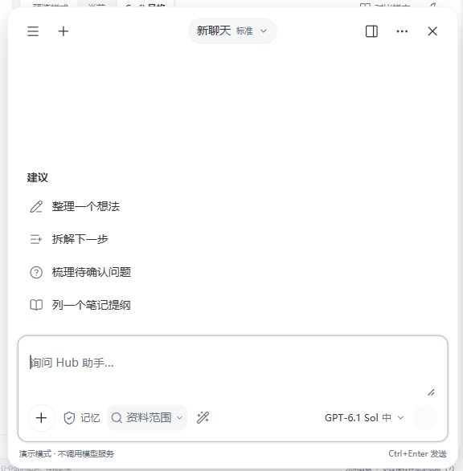

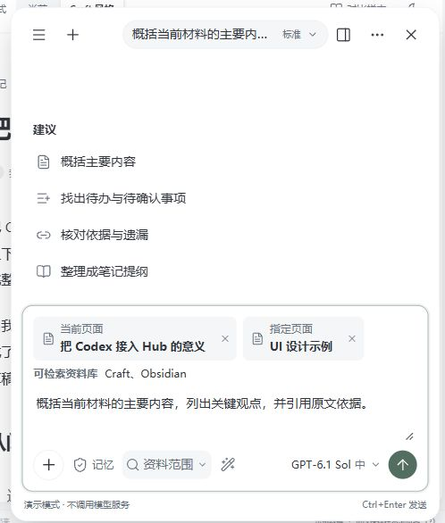


### 24.6 工作台原型 v138：字体、边线、投影与毛玻璃

- 用户明确指出 Craft 参考的主要差距是字体大小、边框、阴影与毛玻璃。此轮在 v137 结构上调整样式，采用第 8.6 节的字体和表面规则。
- 仍使用[新聊天入口](https://hub-workspace-von11.song02211368537057.chatgpt.site/?assistant=1)和[历史示例](https://hub-workspace-von11.song02211368537057.chatgpt.site/?assistant=ui-demo)。发布源码 `5ca722345ced33721c13e56177cad0f8c12c364c`，部署 `appgdep_6b01926518bc8191820b4b4b18bc0446`。
- **UI-A88。** 同一浏览器下，v137 的标题与输入都是 14 CSS px，主浮窗为 18px 圆角，历史层的背景模糊为 none。v138 线上实测标题和输入为 16 CSS px、浮窗 22px、历史模糊 16px。生产产物本地预览核对了浅色与纯黑主题、360px 助手宽度，以及模拟减少透明效果时的实色回退。360px 下输入框无横向溢出，新聊标题与右侧工具留出间隔。
- TypeScript、25 项助手状态检查、6 项回答内容检查、生产构建和差异检查通过。构建有大体积 chunk 警告。浏览器复核范围为工作台原型，等待用户体验。

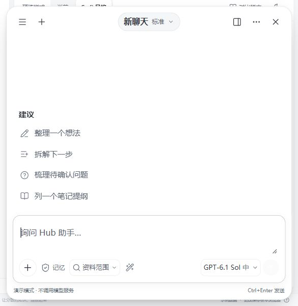


### 24.7 工作台原型 v139：恢复对话历史和字号

按用户反馈恢复 v136 对话历史组件、列表样式与交互。新聊标题、建议行和输入恢复为 14 CSS px，历史标题为 13 CSS px。TypeScript、31 项相关检查、生产构建以及历史组件与 v136 的差异比对通过。本地生产预览核对字号、历史单行布局、归档空态与返回，以及打开一条示例对话。

线上已复核历史单行布局和字号。[直接体验](https://hub-workspace-von11.song02211368537057.chatgpt.site/?assistant=1)。发布源码 `7fb3007384e58da2c2597001b6e5807aa70159d0`，部署 `appgdep_6b01942869608191b60a13defb700b0d`。

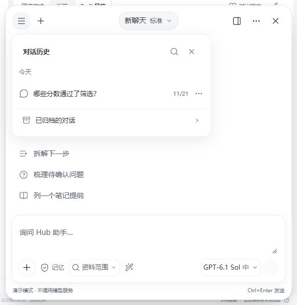

### 24.8 基于 v139 的三个本地评审方向

三稿在同一个工作台会话上切换，分别试验单列轻描边、双列快捷操作和磨砂浮窗。切换时可以保留正在输入的文字或打开的菜单，方便对比同一状态。三稿共用 v139 的历史组件。选定后再更新工作台 Site。


在 1440 × 900 和 375 × 812 视口核对了标题、建议和输入均为 14 CSS px，并验证点击建议后填入草稿、输入框获得焦点、切换方向保留草稿、打开和关闭历史。面板无横向溢出，六次视口与方向组合都通过。[预览文件与复现方法](assets/agents-ui/2026-11-21-huashu/polish-log.md)

### 24.9 工作台原型 v140：单列建议与磨砂浮窗

用户选定「A 的列表，加 C 的磨砂浮窗」。单列建议使用 A 的行距、图标尺寸和悬停反馈。主浮窗、实底输入框和焦点环采用 C 的表现。磨砂由独立背景层承载，浮层仍按各自的布局定位。

生产构建、TypeScript、25 项助手状态检查和 6 项回答边界检查通过。本地验证建议填入、历史开合后保留草稿、详情展开与 Esc 焦点回归、记忆入口、侧边栏实底及 375px 窄窗边界。线上复核四行建议、20px 圆角和 18px 模糊。详情交互评审见第 16.1 节。

[体验 v140](https://hub-workspace-von11.song02211368537057.chatgpt.site/?assistant=1)。发布源码 `56c23acc4ac9665cfc17ff895d3cd1a11c379bcc`，部署 `appgdep_6b019b33c5bc8191b2191b6d4983eaaa`。

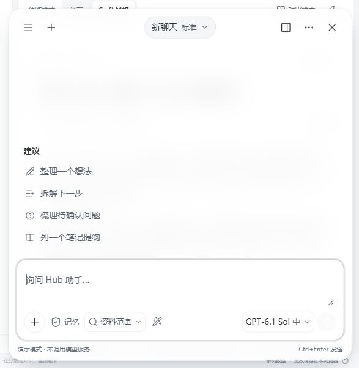


### 24.10 工作台原型 v141：对话详情入口与间距

按评审确认接通资料选择器，将低频设置折叠进「高级设置」，并为记忆管理新增返回详情的路径。收紧标题栏和分组留白，详情标题为 14px。

生产构建、TypeScript、25 项助手状态检查和 6 项回答边界检查通过。本地验证选库后详情显示「1 个库」，阅读模式的选择器开合、375px 窄视口无横向溢出，以及记忆返回时的展开状态、键盘焦点和编辑保护。线上复核三条交互与详情字号。

[体验 v141](https://hub-workspace-von11.song02211368537057.chatgpt.site/?assistant=1)。发布源码 `7a641771059b045e06ca668c49a3c82485829047`，部署 `appgdep_6b019d5f0bd88191ab039407d858be73`。


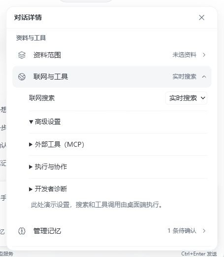

### 24.11 Windows 桌面热开发版：同步 v141 对话详情

用户确认 v141 后，桌面详情采用 14px 标题、44px 主行点击高度和更紧凑的标题栏及分组留白。「资料范围」直达既有选择器，「联网与工具」的外部工具（MCP）、执行与协作和开发者诊断收进「高级设置」。「管理记忆」支持返回详情，保留展开项和原行焦点。对话历史仍按原入口及组件工作。

在日常 Hub 开发窗口打开已关联真实页面的详情，核对「1 份资料」及选择器内的「核心材料」。联网搜索仍直接显示，展开高级设置后看到了三个子项。从真实记忆管理页按左上角返回，原高级设置仍处于展开状态。通过现有开发进程和 WebView 到 `localhost:1420` 的连接核验热更新。界面验证使用已有资料和记忆，停在浏览和选择器开合。

前端构建及 261 项相关测试通过，覆盖详情直达、记忆 Esc 返回与焦点、历史交互及既有设置。构建仍有大包体积提示。

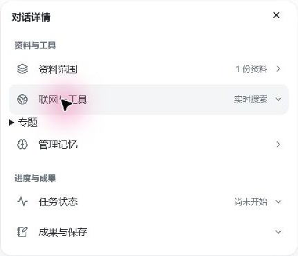

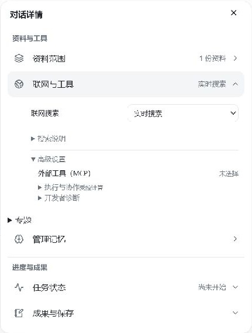

### 24.12 Agents 全套界面与交互的三案评审

桌面详情中的「专题」使用笔记专题组件的原生展开行，未采用详情行的图标、栅格和箭头。任务模式的「全部专题」选择器按左右间距锚定于整块助手，宽窗会把列表拉开，且搜索、主列表与次要动作的视觉层级接近。

上一稿把两个专题的适用范围、确认动作和打开结果画得过于相似。重做评审时从 `AgentInvestigation` 的进入方式与对话状态出发，逐项对照资料、专题、记忆、运行、结果与写入。笔记专题按原笔记和周期定位工作，复用专题从任务模式加载到下一条。改选资料后已经发送的证据仍随原回答。详情继续直接打开资料范围，把低频工具放入高级设置，记忆返回详情并恢复焦点。[源码与设计对应表](assets/agents-ui/2026-11-21-huashu-redesign/source-map.md)

A 为阅读浮窗，B 为原文并排，C 为任务工作台。三种工作方式共用第 7.1.1 节的对象与状态。输入区管理下一条，结果与运行记录按轮归属，C 的右栏只跟踪明确创建的任务。原型的请求模型负责计算有效范围并在发送时复制配置，三个视图只读同一份运行记录。[预览、打磨和验证](assets/agents-ui/2026-11-21-huashu-redesign/polish-log.md)

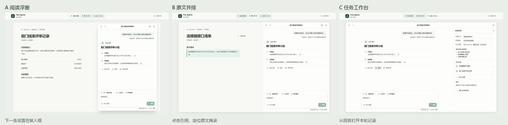

[上一轮三案的回答与专题截图](assets/agents-ui/2026-11-21-huashu-redesign/comparison.jpg)保留为历史证据。

### 24.13 依据最新版 HTML 还原 Agents

按用户发来的 `hub_ui (2).html` 还原原型。在原工作台新增 [Agents 评审页](https://hub-workspace-von11.song02211368537057.chatgpt.site/agents)，原排版示例也可打开它。沿用参考稿的 480 px 侧栏、780 px 专注和全屏，在同一页切换流式复核与中断案例。

- 保留任务模式和专题、核心资料与可检索库、附件和模型技能选择、记忆、历史抽屉与检查器，以及存入笔记、创建任务和来源窗口。参考稿以独立作用域运行，工作台现有助手和它的浏览器记录保持原用法。
- 「中断与规则」可展开上下文和技术记录、核对资料范围，预览未核验草稿后继续。修正参考稿中从暂停案例新建对话仍显示旧消息的问题，两个示例可独立回看。
- 规则路径、工作身份和附件采用可公开的示例标识。模型调用、写入、附件上传及继续执行均为演示。Windows 桌面迁移另行验收。

Sites v142 于 2026-11-22 00:38（中国时间）部署成功。发布源码为 `b1340b3d05229c90b81c1f5f8fca11d9ed5fb96e`，部署为 `appgdep_6b01c8e034948191be895075aa013bde`。对照原 HTML 和工作台在 1440 × 900 的三种宽度，外壳与 48 px 顶栏尺寸一致。Chromium 另核对了 375 × 812 资料选择器、各面板关键路径，并在线复测了两个案例和暂停后的续跑。TypeScript、生产构建、既有 38 项助手检查及 280 个发布源码文件校验通过。

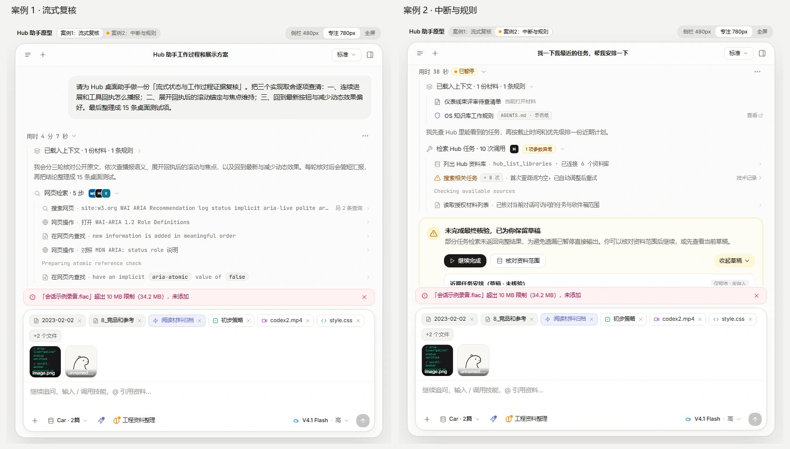

### 24.14 v142 原型与桌面功能差异

比较对象为用户提供的 `hub_ui (2).html`、同源 Sites v142 和迁移前的 Windows 桌面。原型中的示例记忆、技能、任务和写入提示只展示动线。下列能力在桌面已有真实入口。

| 模块 | 原桌面端已有能力 | v142 HTML 的覆盖情况 |
| --- | --- | --- |
| 会话和历史 | 搜索标题与提问、历史分组、置顶、归档、删除撤销、加载更早消息、恢复旧提问为新草稿 | 示例列表支持选择、置顶和移除，缺少真实存储、搜索、归档、撤销和分页 |
| 资料和专题 | 页面与整库分别授权、撤回来源、固定材料清单、按笔记和周期打开原工作、复核专题失效资料 | 演示资料选择、策略和保存为专题，缺少实际授权、撤回、周期工作与失效处理 |
| 文件和原文 | 实际附件准备、图片预览与原文引用定位，历史来源失效时按授权保护 | 预置附件、缩略图和出处列表，主要为界面演示 |
| 执行控制 | 运行中转向或排队、停止及手动恢复、追加和重试、预算和额度检查 | 当前案例设置为固定状态，续跑只改示例消息 |
| 规则和过程 | 每轮实际记录材料读入、规则版本、工具回执、失败、公开过程与可回读诊断 | 两个示例能展示这些状态，记录内容为固定数据 |
| 记忆 | 对话使用、查看范围与保存目标独立；真实待确认建议、版本、撤回及失效保护 | 示例管理界面含切换、编辑和版本展示，缺少真实策略和记录 |
| 成果和写入 | 数据集与图表、引用、报告补交、明确保存目标、预览确认、写后回读、待核验与冲突保护 | 示例笔记和任务表单仅更新界面提示 |
| 工作环境 | 第二助手、停靠或浮动、账号切换、云端移交、模型及工具权限 | 参考展示三种窗口宽度和示例模型、工具开关 |

本轮桌面落地沿用实装组件。顶栏分开显示标题和任务模式。新对话可在发送前命名，已有对话可在顶栏重命名。标题随历史记录保存和搜索，原始提问仍可搜索。视图控制提供 480 px 侧栏、780 px 专注和全屏。右侧检查器继续使用直接选材、工具高级设置和记忆返回详情的路径；原历史入口和操作布局保持原位。

公开工作过程按同轮实际回执汇总资料准备与已载入规则，并保留原有技术记录。暂停卡片贴在对应运行下，提供核对资料和继续完成。仅在对应运行实际保留未核验答复时才出现草稿预览，恢复仍按原生授权、额度和动作状态判定。当前检查状态和桌面验证记录见对应 Issue。

Windows 开发实例连接本项目的 Vite，载入日常真实资料库。实点核验三种视图、原历史入口、行内标题编辑与取消、详情直达选材、联网与高级设置、管理记忆返回详情。暂停草稿、标题持久化与历史兼容使用专项回归验证，实机核验期间未发起模型调用或写回真实资料。

Agents 前端专项 370 项通过，Rust 历史与对话入口专项 21 项通过，另有 2 项真实服务用例按原配置跳过。前端生产构建及 Rust 格式检查通过。全量前端报告 2,377 项通过、43 项失败、11 项跳过，逐条核对后，43 项失败都可在修改前的 `2d44e69` 复现。对应资料集合、应用协作装配、有限复查文案和专题纠正导航的已有用例。

### 24.15 按 v142 HTML 补齐桌面布局与交互

| 对照面 | 桌面实现 | 验收 |
| --- | --- | --- |
| 窗口与顶栏 | 480 px、780 px 和宽屏是原型的响应式验收宽度。桌面根据面板实际宽度调整正文边距和控件密度。顶栏保留标题、任务模式、停靠、详情与关闭。 | 专项验证停靠与缩放控制保留、预览栏移除。改后实机拖动复核待补。 |
| 对话详情 | 332 px 通高右抽屉和遮罩，使用 48 px 标题栏、14 px 内边距与 20 px 毛玻璃。工具、当前上下文、诊断采用参考稿分组。真实 MCP 授权和搜索缓存选项继续沿用现有流程，成果与保存仍可从详情中打开。 | 实点检查浮窗与窄侧栏的抽屉分组、遮罩关闭和 Escape 回退。 |
| 资料范围 | 居中磨砂面板，分核心材料、资料库、使用策略三项。保留固定清单、范围授权、可追踪准备过程及保存为专题入口。 | 专项覆盖三页、完成与取消、真实授权请求参数及空范围恢复。 |
| 输入区 | 材料、图片、技能和输入分层。使用 26 px 材料标签、68 px 原图缩略图、13.5 px 输入文字及 28 px 操作按钮。Enter 发送，Shift+Enter 换行，在词首按 / 或 @ 打开相应选择器。 | 专项覆盖快捷键、草稿保留、附件及送出参数。 |
| 对话历史 | 按用户要求沿用原浮层、分组、搜索、归档及操作。 | 观察确认历史入口保留，历史专项通过。 |

原型的宽度和案例控件只用于评审。首版迁移的宽度切换条已移除，原因是它把验收宽度当成了产品入口。桌面继续使用既有的拖动缩放和停靠。Windows 旧启动实例连到了当前 Vite，最新 Tauri 进程的真实资料、记忆返回与暂停恢复验收另行记录。

Agents 前端专项 396 项通过，生产构建通过，使用实机截图核对三种视图的尺寸和详情层级。全量仓库的基线结果见第 24.14 节。

### 24.16 按 v142 HTML 校准主对话样式

以 `hub_ui (2).html` 的浏览器计算样式为依据。桌面旧样式将普通回答设为 16 px，问题气泡下的隐藏操作占用了一行，输入框还继承了蓝色焦点环。

| 界面 | v142 桌面样式 |
| --- | --- |
| 顶栏与画布 | 暖白画布，22 px 浮窗圆角与轻投影，48 px 磨砂顶栏，12 px 会话标题。 |
| 消息和过程 | 提问 13.5 px / 1.625，气泡最大宽度 88%，内边距 12 × 16 px。轮间 24 px，短回答和表格字号分别为 14.5 px 和 12.5 px。用时使用 11.5 px 等宽数字。用户消息的复制和编辑操作在悬停或键盘聚焦时出现。 |
| 输入框 | 20 px 圆角，单层 1 px 暖灰边线与原稿投影。聚焦时加深边线。输入文字 13.5 px，操作区 28 px，空输入时发送按钮以 25% 不透明度呈现。 |
| 详情与资料范围 | 详情抽屉采用暖白磨砂、细边线和窄箭头。资料范围选择器沿用同一配色。 |
| 响应式 | 以助手面板的实际内容宽度为基准。640 px 以下正文两侧各 16 px，输入框两侧各 12 px。宽面板分别使用 24 px 和 16 px。 |

主对话使用随应用打包的 Inter 和 JetBrains Mono 拉丁字形，中文沿用系统回退。在 Windows 日常开发窗打开截图中的既有对话，热更新后分别查看 480、780、900 px。实际检查工作过程展开与收起，详情进入资料范围、高级设置、记忆管理及返回，以及历史入口。前端专项 403 项和生产构建通过。实机检查使用已连接当前 Vite 的 `77090c9` 原生进程。

<a id="future"></a>

### 24.17 工作台首页默认打开新版 Agents

点击[工作台首页](https://hub-workspace-von11.song02211368537057.chatgpt.site/?view=all)右下角「助手」或左侧助手图标，在当前页面进入同一套 Agents 原型。Ctrl/⌘ + J 和 `?assistant=1` 也使用新版。保留两个案例和 480 px、780 px、全屏预设。点击「返回工作台」或按 Escape 可关闭助手，保留工作台现场与本次页面中的助手草稿。

`/agents` 评审页与首页共用组件。资料页的随文讨论入口随后在 v144 迁移，见第 24.18 节。新版案例里的运行、预览和成果操作使用示例数据。

v143 已部署到原工作台，Sites 源码为 `39f23a90979c1c0ddb97ddde377879b2bfddb484`，部署为 `appgdep_6b02533916608191bf2dbc1ce49bae2b`。线上复测两个首页入口、工作台返回、草稿预览与中断后继续。本地 Chromium 另核对了焦点返回、草稿与宽度保留、快捷键、三种宽度、带资料的讨论入口及独立评审页。TypeScript、生产构建和既有 38 项助手检查通过。


### 24.18 资料页带入当前资料

点击资料页底部「与助手讨论这篇内容」在原位打开新版 Agents，以正在显示的资料命名，并把该页可见正文带入「核心材料」。资料范围标明「当前页」及来源，默认只选这一篇，资料库从空范围开始。移除材料后，后续演示回复不再引用该篇；重新从读页发起讨论会再次带入它。切换到另一篇再发起讨论，打开该篇的独立新对话。回复使用浏览器内的演示回执和正文节选。

工作台 v144 已在原站上线，Sites 源码为 `6972f1f63d853b28825de09e623bff2abdf257f4`，部署为 `appgdep_6b02564925f88191a3f96ccd61c2d283`。UI-A86 局部复核包括两篇不同来源的页面、默认勾选、正文节选、取消选中后的下一条回复、同页重开与草稿保留，以及首页通用助手的案例隔离。线上 Chromium 在 441 CSS px 复核两篇资料的来源、正文回执和返回原页。TypeScript、生产构建、既有 38 项助手检查通过。


### 24.19 任务分析、洞察和标签接入新版 Agents

- **任务分析。** 「查看原分析」与分析面板的「在 Agents 中讨论」带入所选任务或当前分析范围，包括状态、计划日期、说明和可见依据。任务分析面板负责读取与采纳，Escape 从 Agents 返回分析面板。
- **洞察。** 「在原工作中继续」及历史示例讨论沿用发现、原事项、修订和引用。「寻找旧知识」带入填写的问题及可见候选引文，阶段回顾带入已保存的问题、回顾正文及补充材料，决定回顾带入原记录和选中的后续观察。
- **标签。** 「标签助手」和定义、漏标、比较按现有选择打开对应标签与操作，展示已确认的定义版本。用户选定材料范围并发送后，建议进入现有待处理队列，由用户核查和采纳。

v145 已部署到原工作台，Sites 源码为 `ed78f9013c9b7da58c46e8182731977e226085b0`，部署为 `appgdep_6b025b3cb35c819184370a2d00377564`。UI-A86 局部复核覆盖不同业务入口的材料隔离。线上 Chromium 441 CSS px 验证任务分析、洞察引文与标签漏标入口。本地另验证任务状态和日期、原位返回、旧知识问题、阶段回顾问题、标签比较预选以及漏标建议跳回待处理队列。TypeScript、生产构建、38 项助手、10 项任务分析及 31 项洞察检查通过。运行与写入属于浏览器原型演示。


### 24.20 排版、来源和工作过程接入新版 Agents

- 工作台「助手」内的「更多演示」可以切换三类示例。原 `?assistant=ui-demo`、`?assistant=source-demo` 和 `?assistant=activity-demo` 链接继续直达对应示例。
- 排版保留 PowerShell 短答、代码、步骤、表格以及回答操作。来源保留卡扣评审稿与试装记录的对照、资料预览和原文跳转。工作过程保留八种示例和原回放交互，具体规则见[思维链展示方案](AGENTS_PROCESS_VIDEO_REVIEW_20261120.md)。
- 历史试做曾在桌面开发模式左栏提供独立演示。用户要求在日常使用的助手中适配原型，该入口已退役，替代实现见第 24.21 节。

v148 已部署到原工作台，Sites 源码为 `795d9f3a69623dbddc9ab9a633f641da15d51142`，部署为 `appgdep_6b026522b3248191b82a899fa44d479e`。v146 已在浏览器逐个复测三个旧链接。后续构建恢复标签示例资料的插入目标限制，并通过三个入口的线上 HTTP 检查。本地浏览器验证回答菜单与插入预览、资料原文跳转、回放暂停与恢复、重新读取、图片预览和十四批分析成果。工作台 TypeScript、生产构建、38 项助手检查及桌面前端构建通过。已在运行中的桌面 WebView 确认左栏入口，开发服务 `localhost:1420` 上的同一桌面组件已实测排版、来源预览和工作过程图片。桌面窗口内的点击流程未完成复测。


### 24.21 Windows 桌面热开发版：适配真实助手

- **排版与回答操作。** 原助手用新版原型的段落、标题、列表、引用块间距。流式和完成态使用同一套代码块及可用键盘横向滚动的表格。回答下方继续使用真实的复制和成果保存流程。
- **来源。** 回答下方按实际资料列来源，正文中的编号仍定位各自引文。来源预览回读当前获准版本，唯一匹配时高亮，重复或已变化时提供状态，并可返回回答。
- **工作过程。** 展开后的分组、细边线和缩进沿用原型。过程选项可复制已结束轮次的公开摘要。用时、暂停、还原展开状态与权限受真实运行记录管理。详见[工作过程展示方案](AGENTS_PROCESS_VIDEO_REVIEW_20261120.md)。

Windows 日常开发窗口连接同一工作区的 Vite（`localhost:1420`）。从原助手的历史菜单打开已保存对话，实测窄浮窗中的长回答和表格、网页来源展开、过程折叠与摘要入口、点击本地资料来源并定位引文、返回原回答。复核时修复了历史浮层被正文覆盖和窄表格序号换行的问题。实窗验收使用既有记录，未重新发起模型调用或写回资料。

通过桌面 TypeScript、生产构建及 393 项相关前端测试，1 项按既有条件跳过。回归覆盖去重后的来源入口、逐条引用定位、来源失效，以及过程摘要排除未核验草稿和回答正文。

### 24.22 Windows 桌面主助手与原型对照

- 红框内的助手主面板是桌面实现的参考。原型上方的两个案例用于对照公开工作过程的样式，右侧的「侧栏 480px／专注 780px／全屏」用于对照布局。同一套桌面主面板通过已有的停靠和边缘拖动使用不同尺寸。
- 主助手的默认宽度为 480 CSS px，默认浮窗高度为窗口高度减 64 CSS px。分隔线可拖到窗口可用上限，双击或回车恢复默认。从已有尺寸打开时保留用户此前的设定。宽布局保持标题居中、正文与输入区分开。
- 过程按实际回执展示分组和展开状态。有未发布草稿的失败或中断回合把原因、「继续完成」「核对资料范围」「查看草稿预览」汇集到恢复卡，保留原有续跑权限与请求方式。详细状态规则见[工作过程展示方案](AGENTS_PROCESS_VIDEO_REVIEW_20261120.md)。
- 输入区先显示资料、技能和前三个本地文件，剩余附件从「+N 个文件」展开，折叠不影响发送。待发送图片单独以横向缩略图展示，支持放大和移除。附件添加失败时，在输入区上方显示可关闭的提示。

Windows 热开发窗口实测了 480、780 和当前窗口最大 1254 CSS px。在同题的既有 38 秒历史回合，实测工具分组、草稿预览和资料范围打开。附件折叠、失败提示、图像预览入口，以及继续完成调用原有路径由前端回归覆盖。通过桌面 TypeScript、生产构建和 368 项相关前端测试，1 项按既有条件跳过。

### 24.23 按 hub_ui (4) 对齐对话详情、来源与文字层级

| 区域 | 工作台原型与桌面行为 |
| --- | --- |
| 对话详情 | 右侧抽屉排列「视图与工具」「当前上下文」「运行诊断与用量」。只看最新回复时输入区仍可追问。桌面从详情或模型菜单进入现有 Codex 账号管理，启用 MCP 沿用逐项授权。资料范围、版本记忆、技能使用当前会话数据。 |
| 运行诊断与用量 | 摘要显示模型、本轮回传和检索上限。原站明确标示示例数据。桌面回读实际运行回执与材料预算，缺值显示「未返回」或「未报告」。执行控制与已保存成果可从详细诊断进入。 |
| 回答底栏和网页来源 | 复制、存入笔记、创建任务直接展示。网页来源胶囊和弹窗共用列表计数，可按标题及完整网址筛选。桌面保留来源出处与写入前的预览和确认。 |
| 字号和历史 | 段落为 14.5 px，用户消息为 13.5 px，回答主标题改为 17 px，列表为 13.5 px，表格为 12.5 px。桌面对话历史采用 288 px 左侧抽屉，保留置顶、相对时间、搜索和归档。任务模式采用不透明单层浮层，显示三种模式、置顶专题、全部专题与状态入口。 |
| 公开工作过程 | 说明和组头采用 12.5 px，操作图标为 14 px，网页组最多预览三个站标。收起的网页组省去剩余站点数和笼统的失败标记，实际错误留在批次回执。详见[思维链展示方案](AGENTS_PROCESS_VIDEO_REVIEW_20261120.md)。 |

**工作台原站。** v149 已发布，Sites 源码为 `4d77ab5cb85fd3918199e47ba41d12125141c02e`，部署为 `appgdep_6b028dcde30c8191a49ae9463dd42247`。线上从首页助手实测对话详情、诊断、来源数量及网址筛选、笔记目标、任务表单和停靠后操作工作台。TypeScript、生产构建和 38 项助手检查通过。

**Windows 热开发。** 同一日常 WebView 从已有真实回合打开「对话详情」、Codex 账号管理、实际诊断和来源弹窗，确认 6 条来源与真实回答底栏一致。操作仅查看界面。字体层级、历史抽屉和任务模式样式已进入热更新。TypeScript 和生产构建通过，19 个相关测试文件共 455 项通过，1 项沿用既有跳过条件。最后一轮样式的完整实窗复测暂停于用户接管。

## 25. 后续查询、增删改与评审模板

### 25.1 接续工作的最短路径

先读取本页头部的当前基线和第 24 节交付，再查对应组件章节、决策编号和验收编号。涉及公开过程时继续读取 #56 专项，涉及记忆时读取记忆专项和 #21 最新讨论。最后核对当前 GitHub 与 Sites，避免用旧文档中的版本直接覆盖新实现。

查询时优先用用户语言和组件词，例如“材料选择空白”“短回答操作”“记忆范围”“技能置顶”“焦点返回”“代码换行”“首段答案收起”。文档和代码中尽量保持词汇一致，不为同一概念在不同章节发明新名称。

### 25.2 变更提出模板

~~~text
问题：
用户场景：
可观察证据与版本：
涉及的现有决策/验收编号：
建议修改：
保持不变的业务语义：
原型与正式客户端分别需要做什么：
需要的代表样本与配图：
验证方法：
可能影响的相邻组件：
~~~

### 25.3 评审问题

评审先问：用户此刻要做什么，首屏最醒目的内容是否帮助完成它；相同控件是否延续已有规则；重要状态是否真实；完整能力是否仍可发现；键盘和触摸是否仍可达；新事件会不会打断阅读；资料、记忆和保存语义是否保持。

随后检查真实内容边界：长中文、同名来源、代码、表格、空结果、失败、多选择、多助手实例和较小窗口。最后再评审阴影、圆角、颜色细节和动画。不能因为某张展示图好看就忽略这些状态。

### 25.4 替代和废弃

若 UI-D04 等决策被新证据替代，正文展示新的有效规则，决策表标明替代编号或版本，变更记录说明旧规则为什么不再合适。验收项随之修订，原编号可以保留并增加版本说明，不默默改变已完成回执的含义。

已经删除的功能在当前入口中移除，但历史交付仍保留。范围调整只影响本次明确事项，不自动关闭相关模块父任务，不将其他专项退回待办，也不把一轮原型完成当作所有客户端已经迁移。

<a id="history"></a>

## 26. 变更记录与来源

### 26.1 变更记录

| 日期 | 版本/阶段 | 变更 | 证据与状态 |
| --- | --- | --- | --- |
| 2026-11-21 | 主方案初版 | 建立 #64 与固定文档入口；记录五图诊断、官方对照、公共规则、组件状态契约、分阶段实施、84 项验收和后续维护方法 | 先形成方案并保存 GitHub，再实施原型；具体提交回执见 #64 |
| 2026-11-21 | 基线事实校正 | 明确 #21 共享记忆已迁移真实 Windows 桌面；#56 为公开过程唯一专项；#48 暂停的技能包/同步范围不自动重启 | 保留既有成果和历史检查，未将其重复算成本轮验证 |
| 2026-11-21 | 首轮原型 v136 | 材料选择草稿与固定搜索/底栏、有界 Markdown 回答、复制/更多、主要弹层共用骨架；保留选文、侧聊和第二助手布局 | 原站点已发布，源码 445d91c；276 文件镜像校验；38 个脚本检查、浏览器实际场景及未验边界见第 24.2 节 |
| 2026-11-21 | 实际截图归档 | 新增 2 张 v135 改前、10 张 v136 受管预览、2 张 v136 线上实截；全篇共 24 张图 | 第 23.2 节逐图注明环境、尺寸、示例数据和可支持的结论，保留五张用户原图 |
| 2026-11-21 | 并行专项事实同步 | 读取并保留 bd3157d：共享记忆日常库项目规则、Codex/DeepSeek 调用与跨项目隔离的四次真实运行 | 更新第 2、19、21、24 节边界，既有真实验收不重复算成本轮检查，不覆盖原专项文档 |
| 2026-11-21 | Windows 桌面热开发版 | 接入 v136 的材料选择、回答排版、更多操作和弹层布局 | 日常窗口和前端检查见第 24.4 节，#64 长期任务继续保持打开 |
| 2026-11-21 | 桌面与 v136 对照补齐 | 统一选材子页底栏，补上搜索、待选数量、代码按钮与弹层细节 | 日常库检查及仍存在的差别见第 24.4 节 |
| 2026-11-21 | 材料框支持库名 | 在同一个框内按标题、路径或库名查找，逐篇选用 | 日常库找到 15 篇，检查方式与结果见第 24.4 节 |
| 2026-11-21 | Windows 日常窗口补验 | 实测双助手、短窄窗口和滴答回执读回，修正回执标题及重复按钮 | 第 24.4 节记录了实际操作和仍待验证的情况 |
| 2026-11-21 | 工作台原型 v137 | 建议靠近输入区，交代本轮材料，重排历史及空态反馈 | 发布、线上画面、原型检查和预览链接见第 24.5 节，等待用户评审 |
| 2026-11-21 | 工作台原型 v138 | 按 Craft 截图校准字体、边线、投影和毛玻璃 | 第 8.6 节记录规则，第 24.6 节记录线上与本地实图、检查和待体验状态 |
| 2026-11-21 | 工作台原型 v139 | 恢复 v136 对话历史和原字号 | 第 24.7 节记录本轮修正与验证 |
| 2026-11-21 | 本地方向评审 | 比较建议区、输入焦点和浮窗材质 | 第 24.8 节，待选择 |
| 2026-11-21 | 工作台原型 v140 | 发布 A 单列加 C 磨砂，完成详情评审 | 第 24.9 节和第 16.1 节 |
| 2026-11-21 | 工作台原型 v141 | 资料选择器直达、低频工具折叠、记忆返回详情及紧凑样式 | 第 24.10 节，待用户评审 |
| 2026-11-21 | 桌面与 v141 对齐 | 同步对话详情的三条交互及紧凑样式 | 第 24.11 节记录 Windows 日常窗口实测 |
| 2026-11-21 | Agents 三案评审 | 依据源码重做三套界面与交互初稿 | 第 24.12 节，待选择 |
| 2026-11-21 | Agents 工作流重构评审 | 取消通用详情，按请求、运行、任务和写入划分状态与入口 | 第 7.1.1 节、第 24.12 节，待评审 |
| 2026-11-22 | Agents 参考原型 v142 | 还原 `hub_ui (2).html` 的两个案例、交互与视觉 | 第 24.13 节，已上线供评审 |
| 2026-11-22 | v142 桌面差异核对 | 记录原功能覆盖，并迁移顶栏、视图、检查器与中断恢复 | 第 24.14 节 |
| 2026-11-22 | v142 桌面布局对齐 | 按 HTML 重排三种视图、详情、资料范围和输入区 | 第 24.15 节 |
| 2026-11-22 | v142 桌面响应式修正 | 移除原型的宽度切换条，依据面板实宽自动适配 | 第 24.15 节 |
| 2026-11-22 | v142 桌面样式校准 | 根据 HTML 校准主对话、输入区和浮层，复核 480、780、900 px | 第 24.16 节 |
| 2026-11-22 | 工作台原型 v143 | 首页默认入口打开新版 Agents 并支持原地返回 | 第 24.17 节，工作台原站已上线 |
| 2026-11-22 | 工作台原型 v144 | 资料页讨论打开新版 Agents 并自动带入当前资料 | 第 24.18 节，工作台原站已上线 |
| 2026-11-22 | 工作台原型 v145 | 任务分析、洞察和标签入口带各自上下文进入新版 Agents | 第 24.19 节，工作台原站已上线 |
| 2026-11-22 | 工作台原型 v146–v148 | 排版、来源和工作过程使用新版 Agents 演示入口 | 第 24.20 节，工作台原站已上线 |
| 2026-11-22 | Windows 桌面热开发版 | 将排版、来源和工作过程直接适配现有助手，退役独立演示入口 | 第 24.21 节 |
| 2026-11-22 | Windows 桌面热开发版 | 对齐主面板、恢复卡、附件区和布局尺寸 | 第 24.22 节 |
| 2026-11-22 | 工作台 v149、Windows 桌面热开发版 | 对齐对话详情、来源、回答底栏、工作过程和字号，更新历史与任务模式 | 第 24.23 节 |

### 26.2 主要来源

- [Hub 项目协作约定](../../AGENTS.md)、[Sites 协作约定](../../sites/AGENTS.md)。
- [Agents 模块 #43](https://github.com/VondeSong/hub-search/issues/43)、[本主任务 #64](https://github.com/VondeSong/hub-search/issues/64)。
- [公开工作过程方案](AGENTS_PROCESS_VIDEO_REVIEW_20261120.md)、[#56](https://github.com/VondeSong/hub-search/issues/56)。
- [共享记忆交互方案](AGENTS_SHARED_MEMORY_UX_PLAN_20261121.md)、[#21 最新桌面迁移记录](https://github.com/VondeSong/hub-search/issues/21#issuecomment-7060751711)。
- [共享记忆日常库与跨模型实测的固定记录](https://github.com/VondeSong/hub-search/blob/bd3157da07ae4b4e127ea343cffaa1f4c81ac962/desktop/docs/AGENTS_SHARED_MEMORY_UX_PLAN_20261121.md#174-日常库项目记忆与跨模型实测)，该后续记录已读取并作为本轮同步保留的并行证据。
- [本轮实际发布源码快照](../../sites/hub-workspace/.source-snapshot.json)、[原型 UI 样式](../../sites/hub-workspace/app/assistant-ui.css)及第 24.2 节组件映射；当前文件永久链接应以 #64 的本轮 GitHub 提交为准。
- 第 3.3 节的固定源码链接与第 4 节用户提供的五张截图；截图证据不被推断为动态或实机功能验收。
- 第 5 节列出的 Craft、Raycast、OpenAI、Claude、Fluent 与 Apple 官方资料。资料核对日期为 2026-11-21；官网后续变化时应更新具体事实和访问记录，保留影响决策的历史。

本页的长期价值在于把“看起来不够精致”转化为可维护的内容层级、状态语义和组件规则。每轮优化都应留下能接续的当前规范与真实证据，使后续协作者可以在同一基线上继续修改。
