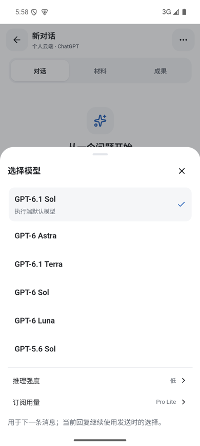
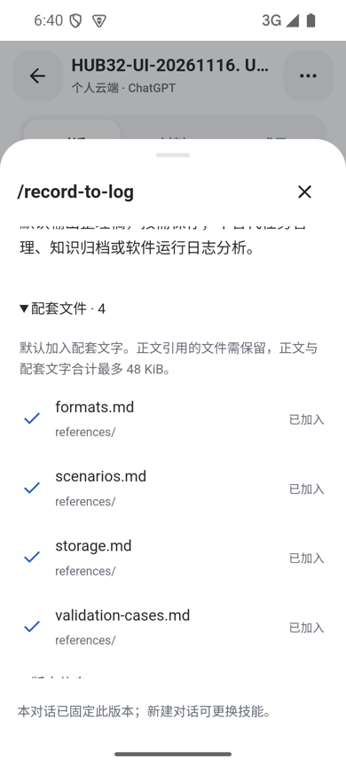
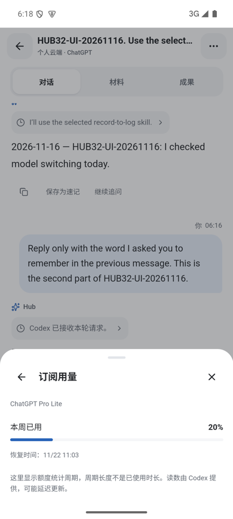

# 手机 Agents：模型、技能与额度交互验收

本轮接续 #32／父 #43／Agents／跨端。依据用户提供的两段视频及“模型与技能”截图，更新手机原型、Android 共用前端和正式 VPS；不改桌面本地助手的 `AgentActivity.tsx`。

## 视频与最终行为

完整解码两段 24 fps 视频，共 817＋417 帧，检查所有联系表及关键帧。时间轴、来源 SHA-256 和原型边界见 [逐帧分析](../../sites/hub-mobile-lab/docs/agents-interactions-2026-11-16.md)。

- **模型**：从正式执行端读取真实 `model/list` 目录，目前返回 8 个可见模型。选择模型与推理强度分开；只显示对应模型支持的强度。模型选择保存到每条消息，并传入官方 `thread/start`／`thread/resume` 与 `turn/start`。
- **技能**：从附件面板进入；名称直接添加到消息，右侧查看完整描述。参考文字和版本信息折叠，标题与底部动作保持可见。技能较少时列表按内容收起。添加不发送消息；首次发送仍固定原版本和文字文件。
- **文件完整性**：新技能默认包含配套文字，添加时先调用已有本机校验。缺失引用或超过上限时留在技能详情说明原因，保留消息。首次实测发现只勾 `formats.md` 会缺少正文引用的 `scenarios.md`，因此补齐默认完整配套和加入前校验，未绕开原校验。
- **已绑定技能**：只读展示实际已发送的参考文件及“已加入”，不使用不可操作的大勾选框或禁用主按钮；原版本、对话和历史不变。需要更换时说明新建对话。
- **用量**：`10080` 是 7 天周期的分钟数，原来把周期误拼成用量时长；改为“本周已用”。5 小时等其他周期单独标识，未知不冒充余额，恢复时间只显示执行端返回值。套餐显示为 `ChatGPT Pro Lite` 等用户可读名称。
- **返回**：对话与连接设置的浏览器历史由当前组件持有，避免其他页面遗留的标记让第一次返回仍停在对话；子页返回先回上一级，再关闭弹层。补充遮罩点击关闭与后台控件隔离。

## 真实模型与同一对话

使用日常 Android 模拟器 `emulator-5564`、现有正式连接和数据目录。用户已授权本轮合成验收内容；只新增带 `HUB32-UI-20261116` 标记的会话，没有上传用户参考视频或照片，也没有保存测试回答到外部资料库。

Hub 会话：`9c51c579-441b-4478-a5d7-85cd380c6859`。Codex 原线程：`01a1e2fd-1435-7630-9cf8-596194bfd989`。

| 轮次 | 客户端选择 | 实际结果 |
| --- | --- | --- |
| `c9909ee6…` | `gpt-6-astra`／`low` | 约 5.5 秒完成测试日志；固定 `record-to-log` 技能正文和 4 份参考 |
| `8e39b8fc…` | `gpt-6.1-sol`／`high` | 约 3.9 秒完成；准确回答上一轮要求记住的 `PINE` |

网关持久记录和官方会话 JSONL 的两条 `turn_context` 都分别确认了以上模型和强度，原线程未更换。没有使用模型自述作为切换证明。两轮公开摘要均为空，继续展示实际执行过程，未补造思维内容。

固定技能版本为 `method-51af262fd460b6650ebe012135d228d0c39290fc780172f15402f2b379ca1a03`；实发 `SKILL.md`、`references/formats.md`、`references/scenarios.md`、`references/storage.md`、`references/validation-cases.md`。

验收会话已归档保留。最终只新增 1 个会话、2 轮消息与 1 份固定技能；没有新增附件或保存笔记。再次按原列比对，升级前全部记录摘要仍存在，活动轮次为 0。

## 数据与兼容

升级前确认无活动轮次，停止服务后备份状态与代码，再作兼容性迁移。旧记录按原列逐行摘要核对保全。

- 备份：`/var/backups/hub-agents/agents-ui-20261116T134944/state-and-code.tar.gz`。
- 已部署 `server.py` SHA-256：`67cb80bea8bf0f1c0808a05f6463cd077a10af506e3a541556642d5ddec472c9`。
- 已部署 `codex.py` SHA-256：`f182ac9c745b339d4369160c526905afaf189d1b8fcbdd9ff7f6a06dfa15fe0b`。
- 原未带模型选择的请求保持原指纹；新请求把模型与强度加入身份。丢失回执后的同编号重试使用原选择，不因后来改选而改写请求。
- 执行前再次校验实时目录；无效或已下线的选择不静默换模型。目录暂不可读时，已选模型的草稿保留。
- 复用现有客户端 `list` 和 `send.message` 通路，未改 Rust／Android 原生协议。发送前核对网关能力，兼容性失配时保留草稿，不把字段悄悄丢掉。

## 实际检查

- 前端四文件 **60 个不同用例通过**；最终只读文件展示和自适应高度调整后，技能组件的 6 项重新通过，不叠加计算为 66 项。
- 网关 `python -m unittest discover -s services/hub-agents -p 'test_*.py'`：**12 项通过**，覆盖原发送、附件、技能、设备鉴权、旧身份及新模型目录／切换／重试。
- `npm run build` 的类型检查与生产构建通过；保留既有大块产物提示。未改 Rust，因此不重复无关 Rust 构建。
- 原型 Agents 检查、脚本语法、`git diff --check` 及实际发布来源的 55 文件镜像核对通过。
- 模拟器实测模型选择、强度子页、技能详情／直接添加／移除、配套校验、系统返回、同一对话续聊与已存选择重开恢复。
- 320 dp 模拟器测试显示尺寸临时设为 `840×1864`，验证 8 个模型、固定技能、全部实际参考文件和纵向滚动后恢复 `1080×2400`；没有修改实体手机显示参数。
- 原型浏览器核对 390 CSS px 浅色、320 CSS px 深色与文件勾选。没有把网页检查算作 Android 实机验收。

第一次窄屏探针把 Android 对禁用复选框报告的 `checked=false` 当作真实状态，探针失败；截图显示有勾选。最终将已发送文件改成正确的只读文字列表，按实际文件和滚动可达性重新验收，没有把失败重标为通过。

| 模型面板 | 已发送参考文件 | 用量说明 |
| --- | --- | --- |
|  |  |  |

## 交付边界

现有 Android 1422 开发实例读取主工作区源码，桌面 1420 开发实例保持运行；本轮未覆盖实体手机 APK、未发布 Release。模拟器原配置、速记、附件和连接保留。正式 VPS 已升级，旧手机客户端继续可用。

手机原型发布为 v20，Site 来源提交 `2e05bffcc9c160b67cacfe38ff0693c3a7b02af7`，发布回执 `appgdep_6afaa83521188191ad7b79ffe611f002`；主仓 55 文件源码镜像与该提交逐字节一致。

本轮交互与模型切换子范围完成。#32 原有的实体 Android／Windows 真关机、真实生成中切网、自然订阅失效或耗尽等边界仍分别跟踪，整个 Issue 保持打开／待验证。
