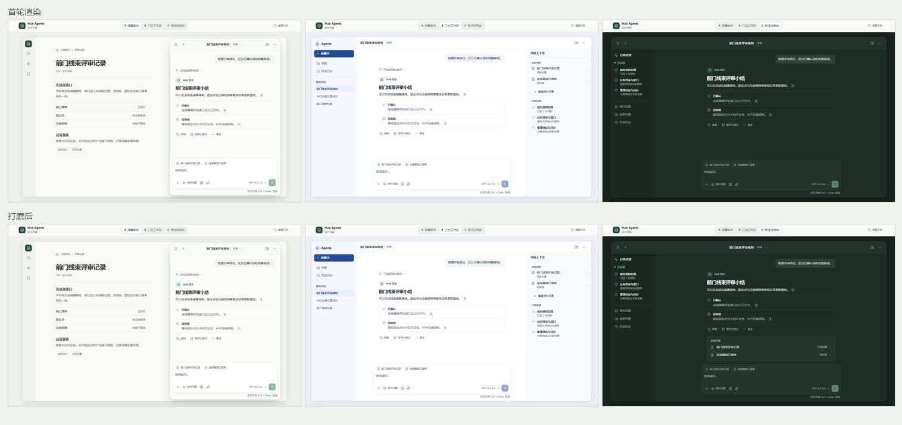

# Hub Agents 三套交互初稿

三套初稿用同一组示例资料和同一个评审任务，覆盖开始对话、选择模式、资料、专题、运行、回答、引用、保存、历史和记忆。此评审使用演示数据，操作只改变当前页面状态。

运行中的本地入口是 [三案对比](http://127.0.0.1:5191/)。也可在浏览器打开 [评审入口](design-demos/index.html)，同目录的脚本和样式随初稿保存。需要从项目根目录重新启动本地服务时，使用 `python -m http.server 5191 --bind 127.0.0.1 --directory desktop/docs/assets/agents-ui/2026-11-21-huashu-redesign/design-demos`。

## 诊断依据

- 详情的「专题」来自笔记关联专题组件，根元素的原生 `summary` 没有用上详情行的图标、网格和展开提示。默认黑三角和文字起点与其余行不对齐。
- 「全部专题」来自任务模式的复用专题选择器。面板左右边距都固定为 12px，面板宽度因此随助手宽度继续增长。列表主按钮、置顶、关闭和返回沿用相近的带底按钮外观，选中项、普通行和次要动作的层级不清晰。
- 交互初稿显式区分「当前笔记的专题」与「全部专题」，保留搜索、置顶、核对资料和应用到对话。笔记专题另有打开关联对话入口。
- 浮窗的间距和材料感参考用户先前提供的 Craft 截图。三栏工作区从 Hub 的资料、对话和原文三个阅读对象出发。专注任务台借鉴 huashu-design 中深色工作区样张的低对比底色和高对比状态点。Craft 设计参考库本轮未能连接，使用当前源码与已提供的截图核对。

## 方向选择

| 方向 | 版式和操作路径 | 完整截图 |
| --- | --- | --- |
| A 浮窗助手 | 保留阅读页面。建议与输入相邻，搜索专题在 380px 内的浮层完成。详情和专题共用细边、14px 标题和图标行。 | [回答](a-answer.webp) · [全部专题](a-topics.webp) |
| B 三栏工作区 | 左栏切换对话和专题，中栏连续阅读，右栏查看范围、原文和专题。核对专题时同屏保留列表与回答。 | [回答](b-answer.webp) · [全部专题](b-topics.webp) |
| C 专注任务台 | 左栏跟踪任务，主区阅读结果和引用。打开专题时主区切换为专题页，进度继续可见。 | [回答](c-answer.webp) · [全部专题](c-topics.webp) |

其他候选包括用统一命令面板选择资料与专题、将资料和专题移入底部抽屉、用两个可切换视图分别承接对话和成果。它们适合单入口或小窗口探索，本轮先对照三种不同的桌面工作方式。

## 打磨与验证

- A 首轮把全部专题当作通用入口。从详情进入后改为「当前笔记的专题」，同屏可进入全部专题。输入框补齐目标的完成条件和标签模式的目标标签。
- B 首轮点开专题会切走列表。打磨后右栏保留搜索和列表，列表下方展示当前专题的资料和应用动作。
- C 首轮的成果只在正文中使用行内引用，打磨后在回答下增加可点的原文区。宽窗使用固定的进度栏，窄窗可以点开对话内的工作过程。
- 在 1440 × 900 和 375 × 812 渲染三套方案。逐套验证模式字段、资料范围修改、专题筛选与应用、历史打开、记忆返回和焦点、草稿保存、开始与停止，复测窄窗专题和详情无横向溢出。

