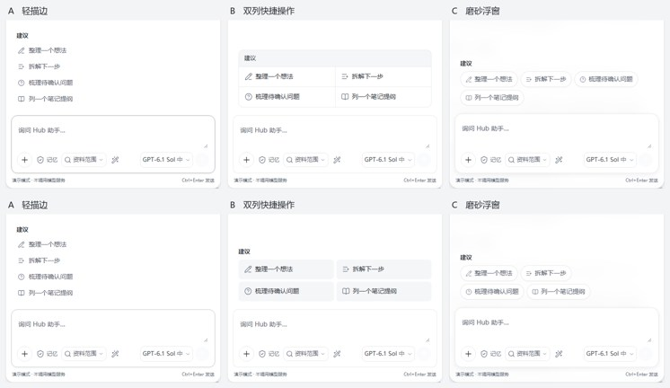

# Agents 新聊方向评审

## 体验与复现

在线基线为工作台 Site v139，源码为 `7fb3007384e58da2c2597001b6e5807aa70159d0`。本地评审页把同源工作台放在框架内，切换方向只替换评审样式，历史、材料和模型菜单运行原有组件。用 HTML 顶部的链接来回切换，可以对比同一份草稿。

在本地工作台的生产构建目录，将本目录下 `design-demos` 的五个文件复制到 `dist/client/agents-design-review/`，再用工作台原有的 `pnpm start --port 5188` 启动预览。在同一个本地服务打开 `/agents-design-review/quiet`。三个入口也支持直接访问。预览使用该来源中的原型演示资料。

## 三个方向

| 方向 | 来源和取舍 | 完整浮窗 |
| --- | --- | --- |
| A 轻描边 | 用户给出的 Craft 助手截图使用白底单列、较轻的图标和独立的输入框。保留这段阅读顺序，使用 Hub 原有文案、字号和操作。 | [浮窗](quiet.webp) |
| B 双列快捷操作 | 四个动作可以直接点选，每个动作占一格。44px 高的点击区便于扫读与键盘定位。 | [浮窗](grid.webp) |
| C 磨砂浮窗 | 借浮动工具面板的透叠关系区分工作台和输入层。短按钮依文字长度排列，输入区为实底。 | [浮窗](glass.webp) |

备选还包括以细线分组的单列表、只在输入区使用磨砂、建议折叠成一行菜单。前两种差异更小，第三种会多一次点击。

## 首轮打磨

按同一窗口与缩放截图。A 的默认输入焦点边线太重，将混色中的文字色占比从 40% 降至 27%。B 的整块灰色标题盖过四项动作，去掉外框和标题底色，给每个动作独立的浅灰底。C 的第四个短按钮独占末行，限制建议区宽度，使当前四项在常用浮窗宽度下分成两行。

1440 × 900 和 375 × 812 均检查实际渲染。点击建议填入输入框且焦点回到输入框，切换方向保留草稿，历史入口正常打开和关闭。标题、建议和输入均为 14 CSS px。六种组合均未出现面板横向溢出或页面脚本异常。当前为本地方向评审，待用户选定。
