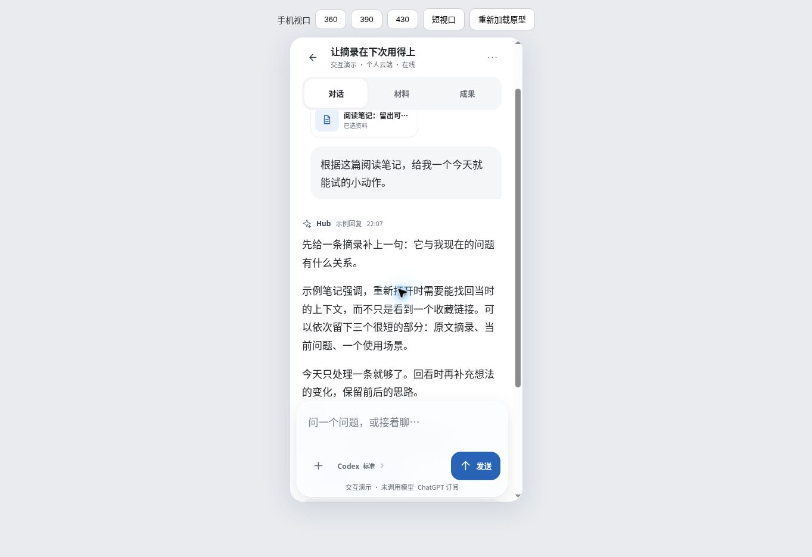

# Issue #32 · 手机 Agents 交互说明

来源：<https://github.com/VondeSong/hub-search/issues/32>，按 2026-11-11 更新后的 VPS 主方案实现。

## 页面与入口

| 页面 | 作用 |
| --- | --- |
| `#agents` | 最近云端会话示例、搜索、新建、简短连接状态 |
| `#agent-chat/:id` | 全屏对话；同一会话的对话、材料、成果；固定输入栏 |
| `#agent-connection` | 手机网络、个人云端、ChatGPT 登录、额度与设备权限的演示状态 |
| 资料详情 / 洞察详情 | 将明确选择的材料带入新对话，不自动发送 |

主导航仍为搜索、浏览、任务、复习、洞察。已有 `#agent` 入口兼容到新会话列表。

## 请求状态

| 状态 | 手机显示与恢复行为 |
| --- | --- |
| `queued` | 仅存本机，未收到云端接收回执；用户明确发送同一请求 |
| `accepted` | 云端已接收，准备回复 |
| `running` | 逐段显示回复，输入和阅读位置保持稳定 |
| `unknown` | 连接中断，保留已收到文字；恢复查询原请求 |
| `stop_pending` | 分别表达停止尚未送达与送达后等待回执 |
| `completed` | 结果可继续追问、查看材料或保存为本地记录 |
| `stopped` | 保留已收到部分；不误标完整成果 |
| `failed` | 显示登录、额度等原因；修复后可重试未开始的原请求 |

每轮持有稳定 `requestId` 和 `runId`，接收时间与手机观察状态分别保存。重复恢复不会增加演示启动次数。离线未发送的请求不自动排队执行；离线后停止已接收任务需要等待回执。实际网络协议、服务端持久化和幂等仍由正式实现验收。

## 数据与边界

- 所有会话、运行、图片和草稿保存在当前浏览器，刷新可恢复；不同浏览器或设备不会实际同步。
- 默认执行模型为议题中已探测的 `gpt-6.1-sol` 示例，未知订阅余额保持“未知”。未添加未经验证的模型列表、配额比例或自动账户切换。
- 仅显式选中的笔记和图片进入材料区。正式 Codex 凭证、登录和运行过程属于 VPS；原型不读取或存放这些凭证。
- 实际用户图片可预览、删除，示例回复明确说明尚未识别。三张带时间点的色块关键帧仅演示实验入口。
- 成果保存为现有 Hub 本地记录，可搜索，重复操作返回同一记录。
- 设备撤销情景遮蔽会话与成果入口，仅提供恢复说明；本地原型不等于真实鉴权或远程擦除。
- 旧洞察的桌面更新流程保留，另有自己的演示控制，不作为 VPS 运行状态来源。

## 验证记录

2026-11-11 完成以下核对：

- JavaScript 语法与 Git 差异检查通过；运行层 10 组隔离场景、UI 层 10 组契约检查通过，覆盖稳定请求、停止竞态、存储失败回滚、权限与安全渲染。
- 浏览器验证了资料带入、分段回复、多轮追问、输入焦点与草稿保持、引用打开、成果保存和搜索。重复保存返回已有笔记。
- 离线发送保留为待发送；恢复网络不自动发送。已接收后断线显示已收片段，重连与刷新保留同一个运行标识和两条消息，没有多建一轮。
- 在线停止显示等待回执；离线停止显示待送达，晚于完成的停止在重连后保留已完成结果。登录失效显示未执行与恢复入口；撤销设备后会话正文与输入区隐藏。
- 关键帧附件的添加、预览、移除、材料视图、草稿恢复和发送通过。移除第三帧后，回复只列出 0 秒、1 秒和实际保留的两帧。
- 检查 360、390、430 CSS 像素宽度；会话、材料和顶部入口未发现页面横向溢出。430×540 短视口中发送按钮可达并可提交。纯白、纯黑主题已目视检查。
- 合并期间保留远端最新的 flomo 风格速记，并回归验证文本保存及资料详情。

图片选择器验证被中断，未完成本轮真实文件选择到预览的浏览器验收；拍照、相册、实际 IME、Android WebView、安全区和 iOS Safari 需在目标手机继续验证。图片校验、读取与失败回滚代码已实现，但不将静态检查写成实机验证。跨设备同步及真实 VPS 端到端不在本次静态原型验收结论内。

