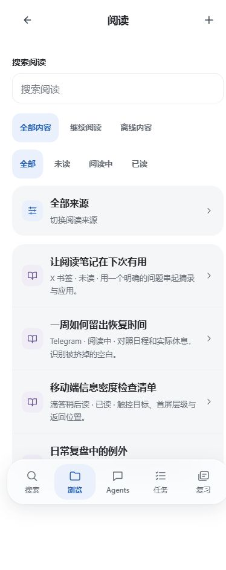
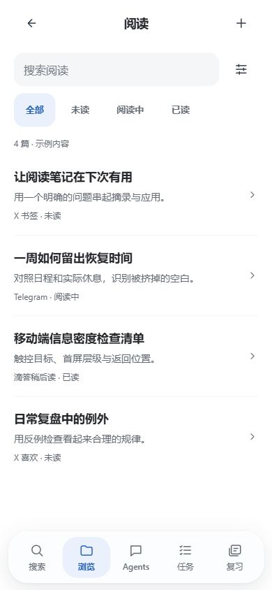
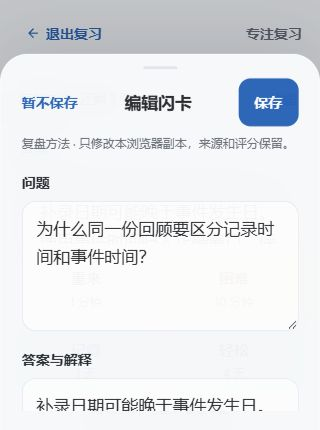
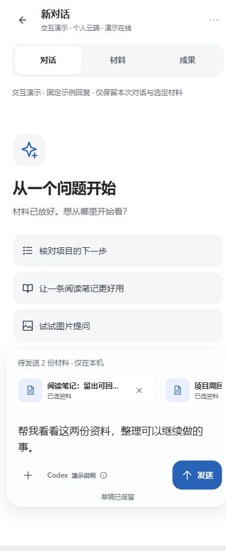
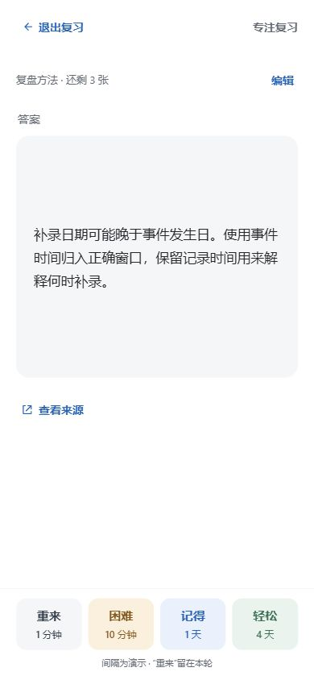

# 手机原型：按 Gemini 建议继续优化

日期：2026-11-15。接续 [#55](https://github.com/VondeSong/hub-search/issues/55)，修改基线为原站 v12（a7c8e91a7b63e3744f8ee0ea65f53fc3dbef945f）。用户提供的《Hub 移动端交互与 UI 深度诊断与重构方案》作为建议来源，采用范围以下述取舍为准。

## 采用的方案

| 页面 | 具体怎么改 | 为什么这样做 |
| --- | --- | --- |
| 阅读 | 保留搜索与“全部／未读／阅读中／已读”；来源、继续阅读及离线条件收进同一个筛选面板 | 先看到文章，条件仍能看清、单独取消；关闭面板不偷偷应用 |
| 阅读列表 | 用标题、两行摘要、来源与状态组成文字条目 | 无图时直接读摘要，避免空图片框；没有替原型虚构附件 |
| 搜索与预览 | 日期标题、同名内容、通用推文标题补正文片段；文档标题自然换行 | 不打开也能区分内容，打开的仍是原来的精确对象 |
| Agents | 沿用“＋”和材料正文确认；输入区说明“待发送几份材料，仅在本机”；减少重复说明 | 看得清材料有没有真正加入，不把预览当发送，不隐藏失败或额度提示 |
| 复习 | 问题、答案占主要区域；显示答案和评分固定在底部；320 宽改两行评分 | 长答案可以滚动，评分始终可达；不只靠颜色区分四档 |
| 闪卡编辑 | 本机副本可编辑问题、答案；顶部固定“暂不保存／保存”，中间独立滚动 | 退出后能继续草稿，保存成功才替换；来源、牌组、评分保留 |

闪卡编辑是本原型本次补齐的本机交互，不能理解为 Android 编辑器已经迁入或修改。已保存修改纳入现有原型 JSON 备份；旧备份仍可合并恢复，当前副本优先，非法修改和未知卡片会被拒绝。

沿用已有五项导航、主题、任务长标题与元数据布局、小组件预览、速记和材料保护。不重新加入大标题，不把所有输入框改成胶囊，不增加新主题、接口、模型或统计看板。未采用报告中的“+35%”“−45%”等无可复核过程的收益数字。

实际客户端的数量加载应区分“尚在读取”“上次数量，正在更新”和“确实为零”；本原型的数据直接来自既有示例，本轮没有新增伪异步加载、缓存旧数量或声称修好 Android 冷启动。

## 实际检查：用普通话说明

以下使用原型现有示例，在本地浏览器完成；没有向日常 Hub 资料库写入测试内容。

| 怎么试 | 实际结果 |
| --- | --- |
| 打开阅读，看看文章从哪里开始 | 同为 390 × 844、纯白、默认文字、全部来源／状态，首篇条目顶部从约 404 px 前移到约 221 px；这是布局位置对照，不是任务效率或手机实测屏占比 |
| 在筛选选 X 书签，先关掉，再重新打开 | 仍是 4 篇；确认应用以后才变为 1 篇，并能直接看到 X 书签条件 |
| 打开这篇文章，再返回 | 回到原来源条件和同一份列表 |
| 选“离线内容”，当前没有离线条目 | 明确显示 0 篇与放宽条件的提示；取消离线条件恢复列表 |
| 编辑一张卡，先退出，再进去 | 未保存文字可继续；保存后刷新，修改仍在，原来源与评分保留 |
| 浏览器拒绝保存时编辑卡片 | 自动检查确认原卡片不变、输入保留，提示重试；备份中的陌生卡片及篡改来源也被拒绝 |
| 聊天写一句话，选两份资料并确认正文，再刷新 | 文字草稿与两份材料都保留；显示待发送数量，没有自动发送 |
| 在资料预览面板刷新，再完成选择并返回会话列表 | 修复了旧弹层历史使第一次返回停在原页的问题；复测一次返回可回列表 |
| 搜索“的”，到 18 条结果末尾打开日志，再返回 | 关键词仍为“的”，滚动位置前后均为 1852 px，焦点回内容区，没有重新聚焦输入框 |
| 把页面变窄、变短，开启深色、较大正文及减少透明效果 | 检查覆盖 390 × 844、360 × 430、320 × 430；无页面横向溢出。320 短屏的编辑保存按钮可见；评分两行可达；聊天发送按钮仍在可视区域 |

自动检查通过：mobile、workspace、search-interactions、agents-enhancements、task-tools、widget 六组；JavaScript 语法与差异检查通过。新增检查覆盖卡片保存失败、来源/评分保护、备份修改合并、阅读条件组合、模糊标题摘要和刷新后返回。

## 对照截图

改前与改后使用相同 390 × 844 视口及阅读示例。

| v12 改前 | 本轮改后 |
| --- | --- |
|  |  |

## 交付与仍待验证

本轮只交付既有 Site 的交互优化和同步源码。真实发布版本、Site 来源提交、部署 ID 和 GitHub 提交以 [#55 最新回执](https://github.com/VondeSong/hub-search/issues/55) 为准；v12 是修改基线，不是本次新版本。

浏览器缩短视口不能代替小米真机的软键盘、系统返回、输入法、安全区和触控。#55 保持打开并继续跟踪这些实机项，不把原型交付当作 APK 升级、真实资料连接、VPS 或跨设备验收。安卓冷启动数量、实际图片缓存和闪卡计划仍沿用各自业务任务的进度。
