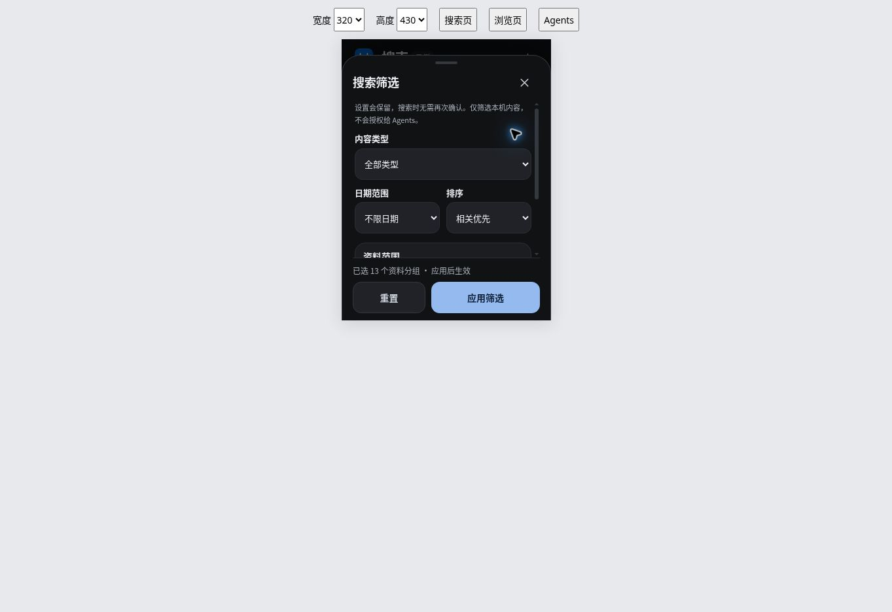

# 移动端紧凑交互：实施与验收记录

日期：2026-11-15。任务：[Issue #55](https://github.com/VondeSong/hub-search/issues/55)。

实施规格见 [交互优化方案](interaction-review-2026-11-15.md)。本记录区分源码自动检查、浏览器交互和真实设备验收。正式发布版本、部署 ID、Site 来源提交与 GitHub 同步提交见 Issue #55 的交付回执；仓库镜像的真实来源清单由 `scripts/sync-site-sources.py` 写入 `.source-snapshot.json`。

## 1. 本轮实际修改

- 五个根页面采用 56 CSS px 顶栏，将页名并入品牌所在位置；保留可访问名称明确的空间菜单、小型示例标记与页面主操作。资料、阅读、任务正文的真实标题不删除；会话详情仍用原来的 66 px 导航高度。
- 搜索页采用输入框、一行范围／类型／更多筛选、内容列表。类型菜单保留全部 11 项聚合及精确类型，切换立即生效；范围面板仍是草稿后应用。
- 未激活且空查询时展示最多 5 条真实最近打开。对象采用带类型的路由身份，兼容旧文档历史，过滤失效记录；没有历史时明确显示“推荐内容 · 示例”。
- 聚焦空查询时展示近期搜索及明确的建议词。提交、采用词条或打开有效结果时才记入近期搜索，去重后最多 8 条；组合输入中间文本不记录。取消恢复进入编辑前的词，清词保留其他条件。
- 浏览页改为轻量目录行，首组直接提供日志、阅读、收藏、最近浏览、标签，之后为资料来源与发现入口。
- Agents 列表用紧凑状态行、搜索、当前／已归档／全部范围和 78 px 会话行；保留长标题省略、草稿、异常状态与完整正文。列表明确显示本机演示；会话详情保留既有演示连接说明。
- 任务页顶栏“新任务”复用完整任务编辑器；Agents 顶栏“新对话”复用原会话创建。空间菜单稳定提供速记与外观，搜索／浏览保留快速速记。
- 保留 v11 小组件、原有记录／附件／草稿／任务／会话／复习状态及既有数据存储键；未重置浏览器数据。

## 2. 布局实测

### 同一外层视口的结构对照

外层浏览器为 1363 × 936 CSS px，Hub 内容容器宽 478 CSS px，测量起点为页面 viewport 顶部，不包括系统或浏览器外部栏。旧值来自方案阶段的线上实测；新值来自本轮本地托管预览的 DOM 边界。

| 元素 | v11 旧值 | 本轮实测 | 变化 |
| --- | ---: | ---: | ---: |
| 根页面顶栏高度 | 66 | 56 | 减少 10 |
| 搜索输入区域顶部 | 约 166.6 | 64 | 前移约 103 |
| 空查询首条内容顶部 | 约 467.2 | 212 | 前移约 255 |
| 浏览首条目录顶部 | 约 209.2 | 64 | 前移约 145 |
| Agents 首条会话顶部 | 约 501.4 | 218 | 前移约 283 |

这组数字比较页面结构，不能解释为真实手机屏占比、加载速度或完成任务效率。旧搜索展示固定推荐，新搜索展示当前浏览器的真实访问历史；Agents 的会话及连接文案也随本轮设计调整，因此不声称两次数据内容完全相同。

### 手机宽度的浏览器检查

通过临时本地 iframe 验收页改变真实 CSS 视口，未修改应用状态来伪造结果。该辅助页面不进入发布包。

- 390 × 844：搜索首条内容顶部 212，满足方案中不超过 220 CSS px 的预算；Agents 首行顶部 218、高 78。截图保留当时浏览器中既有测试历史和示例身份。
- 360 × 667：浏览首行顶部 64、高 56，五项导航及复习入口可用。
- 320 × 430：搜索、速记、范围面板无整页横向溢出；速记保存按钮底部 376，范围应用按钮底部 419，均在 430 高视口内。范围面板可滚动，关闭／重置／应用保持可达。
- 桌面 Chromium 的内嵌视口存在可见滚动条时，会占用约 15 px 内容宽度；检查记录按 iframe 设定宽度命名，不把它当作手机无滚动条布局截图。




## 3. 已实际操作的浏览器路径

| 路径 | 观察结果 |
| --- | --- |
| 搜索输入聚焦 → 空查询 | 显示近期搜索、建议词与取消，不重建输入框。 |
| 输入“线束” → 提交 → 打开会话 → 返回 | 进入精确的已归档示例会话，返回后保留查询与结果，未再次自动聚焦输入框。 |
| 保留“线束” → 类型选 PDF → 清空查询词 | 类型保留为 PDF；先出现可解释的无结果，再显示该类型下的资料。 |
| 打开资料范围 → 全不选 → 关闭 | 未应用草稿，原范围及 PDF 结果保留；关闭后焦点回到范围入口。 |
| 类型菜单 → 全部类型 | 仅解除类型条件，菜单关闭；焦点回到原入口。 |
| 浏览 → 日志／阅读等目录可见 | 平面目录仍使用原有路由；资料库、连接和洞察有明确分组。 |
| Agents → 新对话 | 进入原会话页，保留对话／材料／成果、附件与发送入口，根底栏隐藏。 |
| 任务 → 新任务 → 保留草稿并关闭 | 完整标题、日期、优先级、说明表单可用，关闭返回“新任务”入口。 |
| 空间菜单 → 速记 | 恢复此前已有草稿与日期；未覆盖或提交该草稿。 |
| 空间菜单 → 外观 → 纯黑＋减少透明效果 → 搜索 | 选中状态、输入、文字、底栏和筛选面板可读；检查后恢复此前的纯白与透明偏好。 |
| 复习 → 开始 → 退出 | 专注页隐藏底栏；退出恢复根页、三项复习入口和原待复习计数，未执行评分。 |

本轮浏览器操作在本机预览中新增了一个空示例会话用于验证入口。该状态只在当前浏览器，不包含在源码／发布包中。没有清空既有历史、记录或附件。

## 4. 自动检查

以下命令在最终代码状态执行并通过：

```sh
node checks/mobile-checks.cjs
node checks/workspace-checks.cjs
node checks/task-tools-checks.cjs
node checks/agents-enhancements-checks.cjs
node checks/search-interactions-checks.cjs
node checks/widget-checks.cjs
```

- 搜索交互检查已按一行筛选及类型菜单更新，并保留旧精确类型／来源／范围交集、空范围、草稿取消／应用、失败回滚与类型化 ID 断言。
- 新增近期查询保存时机、去重和上限，真实访问历史、失效记录、失败回滚，输入组合阶段、取消、返回和成功／失败筛选后的编辑状态检查。
- 任务检查确认顶栏新建仍使用原编辑器，并保留日期、来源覆盖、草稿、撤销和存储失败行为。
- 既有 Agents 八组检查、速记／附件／备份检查及小组件范围／路由／会话恢复检查均通过。
- 六个修改的 JavaScript 文件 `app.js`、`workspace-tools.js`、`mobile.js`、`mobile-features.js`、`task-tools.js`、`agents-ui.js` 均通过 `node --check`；`git diff --check` 通过。

## 5. 尚未验收与接续

- Android 真机 IME 中文输入候选、软键盘展开／收起、系统返回、WebView 安全区和系统字体缩放；iOS Safari 的相应行为。本轮 iframe 短屏是布局检查，不是软键盘模拟通过。
- 最终主题逐元素的对比度数值测量、200% 字体与屏幕阅读器全流程；本轮仅做实际主题和布局可读性检查，不宣称 WCAG 全项合规。
- 真实手机相册／相机选择器、真实上传／同步、VPS／模型、断网重连和锁屏恢复；未改变这些既有能力的验证状态。
- 方案中的来源分步加载／真实来源故障是后续接入验收目标，本地索引不引入虚构等待，也不把服务验收列为已通过。
- GitHub 原生 Parent / Sub-issues 与 Projects 字段需分别回读确认。当前连接器可以写任务正文和代码，但未提供这些原生字段的写入操作；备用网页未登录。正文关联不等于原生层级或看板已设置。

Issue #55 在 Web 原型发布和源码同步后仍保持打开，以“待验证”文字状态继续跟踪真实设备验收；不改写 #50 历史完成结论，不把网页交付视为 Android 安装包更新。
