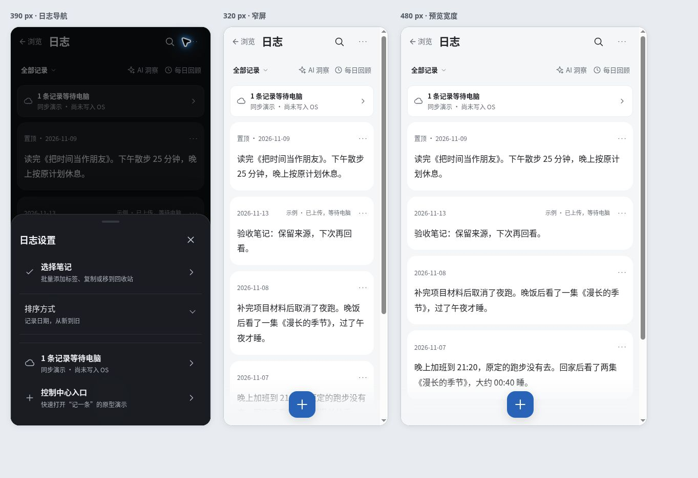

# 日志顶部导航：调研、方案与验证

日期：2026-11-16。范围：现有手机 Site 的 `#logs` 日志页顶部、范围切换、搜索与相关弹层。

沿用 [README](../README.md) 的交付规则：这是独立的浏览器交互原型，记录和演示状态保存在当前浏览器；网页验证、Android 实机验收和真实服务能力分别记录。本轮不把网页演示当作 APK、VPS、OSS 或桌面 OS 的交付证明。此前富文本编辑、附件、录音入口、草稿和记录保护继续保留。

## 1. 旧界面的主要问题

- 左侧列表图标与“日志”标题下拉相邻，但范围切换、选择笔记、排序等职责不容易从外观判断；标题同时承担定位和操作入口，学习成本较高。
- 正常同步也占据主导航位置；云朵图标本身不足以解释离线、暂停、待上传、等待电脑和失败之间的区别。
- “AI 洞察 / 每日回顾”两个白色圆角按钮的视觉重量偏大，与日志正文争夺首屏空间。
- 旧设置弹层使用固定 `left: 42px` 定位，在桌面居中的手机样机中可能脱离样机位置；不同日志工具的弹层表现也不一致。
- 搜索与原列表条件存在耦合风险：搜索词不应修改原日志列表，清空搜索文字也不应顺便丢掉高级筛选条件。

## 2. 调研依据

查阅日期均为 2026-11-16。以下资料用于推导交互原则，不把产品案例当作 Hub 的像素规范。

| 来源 | 可借鉴内容 | 本次取舍 |
| --- | --- | --- |
| [Apple HIG：Toolbars](https://developer.apple.com/design/human-interface-guidelines/toolbars.md) | 优先核心操作，按功能与频率分组，减少多余的背景和着色 | 导航、范围与设置分别承担明确职责；正常同步退出主导航 |
| [Notion：Workspaces on mobile](https://www.notion.com/help/workspaces-on-mobile) 与 [数据库视图、筛选和排序](https://www.notion.com/help/views-filters-and-sorts) | 工作区导航、数据库局部搜索、视图切换具有不同作用范围 | 保留应用主导航；日志内清楚展示当前范围，搜索限定在进入时的日志范围 |
| [Apple HIG：Search fields](https://developer.apple.com/design/human-interface-guidelines/search-fields.md) | 搜索可由工具栏按钮进入，以文案说明范围，提供及时结果 | 顶栏保留搜索按钮；独立搜索页显示“搜索日志、标签或附件”，支持取消返回 |
| [Apple HIG：Sheets](https://developer.apple.com/design/human-interface-guidelines/sheets.md) | 弹层适合当前上下文的短任务，避免多层弹层使人失去位置感 | 范围、设置与同步详情采用统一弹层规则；排序在当前设置面板内展开 |
| [Apple HIG：Buttons](https://developer.apple.com/design/human-interface-guidelines/buttons.md) | 一般建议至少 44×44 pt 点击区域，并提供按压反馈 | Web 原型关键控件至少 44 CSS px 高；这是跨平台设计值，并非将 CSS px 与 iOS pt 视为同一规范 |
| [Craft 3.1.6 官方导航更新](https://www.craft.do/blog/craft-update-3-1-6) | iPhone 顶部小组件可调整或隐藏，设置集中管理 | 借鉴降低常驻工具重量的思路，两个常用快捷入口保留直接访问 |

Craft 案例发布于 **2025-06-30**，不代表已核验其最新客户端的精确布局。Notion 帮助页支撑导航和搜索职责，不作为当前所有客户端版本外观完全一致的证明。同步提示如何安排属于针对 Hub 的设计判断，不归因于未经核实的 Craft 同步界面。

## 3. 备选方案比较

| 方案 | 优点 | 代价与适用性 |
| --- | --- | --- |
| 保留原结构，仅缩字号、间距和按钮背景 | 改动小，保留原操作位置 | 两个相邻入口仍难区分，正常同步继续占位，不能解决搜索状态和弹层定位问题 |
| 固定日志标题，范围放入轻量工具行，低频操作进入更多 | 导航、范围和操作清楚；快捷入口仍可一步到达 | 比完全单行多一条工具行，但触控区域、当前范围和功能可发现性更平衡；本次采用 |
| 单行导航，范围、回顾和洞察全部收入更多 | 常驻高度最小 | 常用入口多一次操作，范围隐藏后难判断列表为何变少；暂不采用 |

## 4. 已采用的交互

### 4.1 顶部与工具行

主导航基础高度 **56 CSS px**，另计安全区；从左到右为“返回浏览”、固定标题“日志”、搜索、更多。标题不再兼做设置菜单，返回按钮明确标识目的地。

下方 **44 CSS px** 高工具行显示当前范围下拉，以及轻量“AI 洞察 / 每日回顾”。保留短文字和直接访问，移除厚重卡片式背景。关键图标按钮与工具行入口至少 44 px 高，提供按压状态与可访问名称。

### 4.2 范围切换

范围面板提供全部记录、今天、置顶、有附件、无标签、待同步、回收站及标签，并显示数量与选中状态。选择即应用；更换范围时清理旧关键词、标签和时间条件，避免旧条件暗中叠加。保存失败则保留此前条件，不出现部分生效。

受限列表展示记录数量，并提供“显示全部”。“全部记录”按既有规则不包含回收站；回收站可以独立查看和搜索。

### 4.3 更多与同步

更多面板包含“选择笔记”、四种排序、同步详情和“控制中心入口”。四种排序为记录日期、编辑时间各自的正序与倒序；置顶优先，缺少编辑时间的旧记录按记录日期排列，不伪造真实创建时间。

没有待处理项时，正常同步不再常驻云朵图标。离线、暂停、待上传、等待电脑和失败时显示有文字的提示，并可进入详情处理；不只靠图标颜色表达状态。“本浏览器”“仅演示”等说明保留，待上传或等待电脑不等于已真实上传或写入。控制中心入口同样只是网页演示，不表示已创建 Android 系统入口。

### 4.4 搜索与返回

搜索使用独立 `journalSearchQuery`，进入时保存日志范围快照；搜索不会把原列表查询改掉，也不会因后续范围变量变化而意外扩大候选记录。点击取消返回原列表并保留原列表位置。

清空搜索词只清文字，日期、标签和附件等高级条件仍生效；完整重置是另一操作。搜索保留结果数量、空状态和范围说明，并处理输入法组合输入事件。代码层面支持组合输入不等于已通过 Android 真机键盘验收。

### 4.5 弹层

范围、设置和同步详情采用统一的日志工具弹层：手机端从底部出现，桌面样机下按样机宽度居中；标题与关闭入口稳定，中间内容可滚动。移除旧的固定左偏移，避免菜单在大视口中跑出手机样机。深色模式沿用主题变量。

## 5. 本轮验证

| 验证项 | 结果 |
| --- | --- |
| 390 / 320 / 480 CSS px 宽度下的顶栏、工具行和弹层布局 | 已检查，无横向溢出。320 px 样机的内容 `clientWidth` 受滚动条影响实际为 305 px |
| 320 px 宽下关键控件 | 已检查，高度至少 44 px；不能据此推定所有页面控件已完成无障碍审计 |
| 深色设置与范围菜单 | 已目视检查 |
| 置顶范围进入搜索、取消返回、切换全部恢复 | 已检查，搜索不污染原列表范围 |
| 新旧记录日期排序 | 已检查，排序实际改变列表顺序 |
| 既有日志检查 | `node checks/journal-studio-checks.cjs`、`node checks/journal-feed-tools-checks.cjs` 通过 |
| 移动端与录音保护 | `node checks/mobile-checks.cjs`、`node checks/voice-checks.cjs` 通过；三个修改脚本语法与 `git diff --check` 通过 |
| 本轮新增状态回归 | 独立搜索词、范围快照、清文字保留高级条件、范围原子切换与失败回滚、回收站搜索边界通过 |

截图为本地浏览器检查，包含既有验收笔记及其同步演示状态，不代表生产数据或真实电脑写入。

上述为本轮代码与浏览器检查。**Android 键盘、系统返回、真实 WebView 安全区及目标手机实际触控尚未验收**；也未因此证明真实云端同步、桌面写入或跨设备数据一致性。发布版本、提交和线上交付结果应另附实际回执，不由本记录推定。
