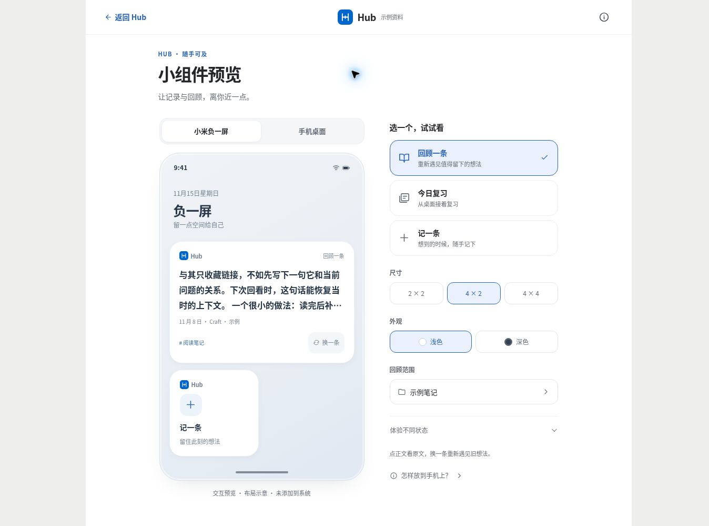

# 小组件网页原型验收记录

日期：2026-11-15。关联：[Issue #53](https://github.com/VondeSong/hub-search/issues/53)。

## 交付范围

在原手机 Site 新增 `#widgets`，保留原项目身份与五个底部主入口。从设置或复习管理进入，比较回顾一条、今日复习、记一条。默认小米负一屏、回顾 4×2、浅色；各组件提供适用尺寸、浅深色、内容范围及状态预演。

## 实际执行

- `node checks/mobile-checks.cjs`：通过。保留速记日期、草稿、附件、保存失败回滚、同步演示与闪卡管理原有行为。
- `node checks/workspace-checks.cjs`：通过。保留跨模块类型化路由、来源、独立草稿与五标签导航。
- `node checks/widget-checks.cjs`：通过。覆盖预览不评分/不改草稿、空范围不扩张、同 ID 的笔记与示例准确定位、继续同一复习保持位置、换牌组失败回滚、存储失败不阻止阅读、选择器失败重绘。
- 新增及修改的 JavaScript 已运行 `node --check`；差异已运行 `git diff --check`。
- 浏览器：冷开 `#widgets`；换一条后打开准确的 `#doc/d5`，返回保留所选内容；进入复习、显示答案、返回小组件再继续，仍在同一答案面，数量仍为 3；没有在此次网页验收中提交评分。
- 浏览器：从快捷卡与独立记一条组件打开既有速记层，已有浏览器草稿保持不变，关闭后继续仍是同一草稿。未覆盖或提交已有草稿；保存成功/失败由现有行为检查验证。
- 浏览器：回顾范围全部取消后正确显示空态；重新选择示例后恢复；大尺寸、桌面、离线缓存、首次使用说明均可切换。预览状态没有修改真实网络或账户。
- 响应式：在同源 iframe 中实际使用 390×844 与 320×640 两种视口检查。因浏览器滚动条占位，文档可用宽度分别为 375 与 305px；文档宽度与滚动宽度一致，相关按钮、输入与卡片无横向溢出。检查浅色回顾卡和窄屏深色 2×2 复习卡；短屏通过滚动访问后续设置。

## 修复的验收问题

1. 保存回顾位置失败时，仍允许阅读已有原文。
2. 牌组偏好保存失败时，回滚状态并重绘选择器，避免界面范围与实际启动范围不同。
3. 极窄屏缩短头部与组件切换布局，消除中文按钮的零碎换行；选项图标与选中勾分列。

## 验证边界

这是浏览器交互原型，使用原站示例和当前浏览器已有记录。未接入个人真实资料库，未生成 APK，未安装 Android AppWidget，也未在小米 14 Pro / HyperOS 的真实负一屏验证。布局比例用于比较设计，不等同于厂商最终网格、圆角或像素规格。离线状态是预演，不宣称已验证真实缓存和后台刷新。当前会话位置沿用原型已有内存状态；没有新增跨重启会话恢复协议。

未发布小米组件的测试入口、测试材料与真机添加流程继续记录于 #53 的 W0；先测试再决定公开分发。此次网页交付不关闭整个原生小组件 Issue。

## 截图

以下为本轮实际浏览器预览截图，保存时使用与发布相同的源码；不是小米手机实拍。

