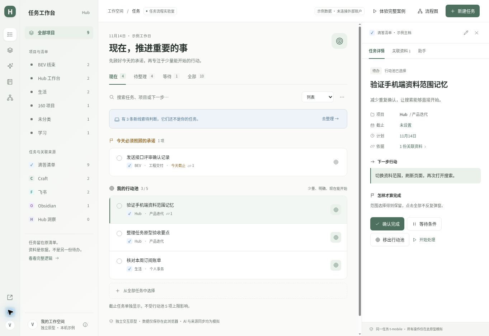

# Hub · 任务流程实验室

这是一个独立的桌面任务工作流交互原型，用于评估「资料与线索 → 判断 → 同一任务 → 安排与执行 → 等待 → 完成确认 → 日志回顾」是否清楚、连贯。

**所有任务、资料、AI 输出、滴答保存和来源同步均为本机模拟。原型不连接真实账户，不调用模型或外部任务 API，不上传资料。** 本次工作没有修改原 Hub 工作台、手机端原型或正式桌面程序。

## 站点与源码定位

**此文档描述源码。实际已发布版本与提交，以 GitHub 目录中的 `.source-snapshot.json` 及本次发布回执为准。** 本地测试和截图不是线上版本证明。

| 项目 | 记录 |
| --- | --- |
| 独立 Site ID | `appgprj_6af7b8ca80448191ac76b1a03eaa73dd` |
| 站点地址 | <https://hub-task-flow-lab-von11.song02211368537057.chatgpt.site> |
| GitHub 同步目标 | `VondeSong/hub-search` → `sites/hub-task-flow-lab/` |
| 版本与交付依据 | 目录内 `.source-snapshot.json` 和本次发布回执；不在 README 手填未经核验的提交号 |

新原型使用自己的站点和浏览器存储命名空间。原 `hub-workspace-von11`、`hub-mobile-lab-von11` 的站点映射不变。页面中“打开原 Hub 工作台”只是新标签页链接，不是向旧站点写入或替换内容。

## 可以体验什么

- **现在 / 待整理 / 等待 / 全部**：业务视图与列表、看板、表格、时间线、项目树、关联图等展示布局分开。
- **候选不等于任务**：关联已有、更新已有、确认新建、仅留资料、稍后处理；重复确认不会生成重复任务。
- **同一任务持续推进**：资料、行动池、助手和日志引用同一 ID；加入行动池不复制任务、不搬动原清单。
- **现在的三种内容**：硬性截止、今日计划、可选行动池分别显示。原型将可选行动池限制为 5 项，硬性截止与今日计划不受该数量限制。
- **等待有下文**：记录等待对象、缺失条件与可选跟进日期；恢复后继续原任务，不自动完成。
- **AI 是演示草稿**：生成的核对清单、下一步或反馈草稿附在当前任务，需要人工核对，不代替执行或验收。
- **完成与同步分开**：可演示成功、失败、待确认；失败重试保留原操作 ID，也可取消这次模拟完成意图再继续编辑。
- **日志保留历史**：模拟确认成功后记录完成日期；重开同一任务时保留旧完成及重开记录。

原型中的“滴答主档”表达未来产品分工，不代表这些示例已经存在于真实滴答账户。任务详情、完成通知和流程图都保留模拟边界说明。

## 本地运行与检查

项目没有第三方运行或构建依赖。**`dist/` 本身就是可阅读、可编辑的静态源码与部署内容，不是需要重新生成的构建产物。** 不需要 `npm install` 或打包步骤。

使用支持 ESM 与 `node:test` 的 Node.js，在本目录运行：

```sh
npm run check
```

该命令检查 JavaScript 语法并运行全部自动检查。也可以只运行测试：

```sh
npm test
```

浏览器预览应通过本地 HTTP 服务打开 `dist/`，不要依赖 `file://` 对 ES Modules 的支持。例如在本目录运行：

```sh
python3 -m http.server 4173 --directory dist
```

然后访问 <http://localhost:4173>。本地服务命令只用于预览，不会发布到线上。

## 文件说明

| 文件 | 用途 |
| --- | --- |
| `dist/index.html` | 页面入口、原生对话框、状态通知 |
| `dist/app.mjs` | 视图、事件、草稿与浏览器存储、模拟交互 |
| `dist/model.mjs` | 纯状态模型、身份与日期校验、候选及完成流程 |
| `dist/styles.css` | 明暗主题、响应式布局与焦点样式 |
| `dist/flow.mjs` | 交互流程说明页面 |
| `dist/task-flow.svg` | 可下载的矢量流程图 |
| `tests/model.test.mjs` | 模型行为与状态恢复测试 |
| `tests/ui-contract.test.mjs` | UI 集成边界的静态契约检查 |
| [docs/task-flow.md](docs/task-flow.md) | 产品逻辑、分支与边界说明 |
| [docs/verification.md](docs/verification.md) | 本轮检查、浏览器验收与未验证范围 |
| [AGENTS.md](AGENTS.md) | 后续修改与交付约束 |

## 验证摘要

`npm run check` 已通过 **38 项检查：24 项模型测试 + 14 项 UI 静态契约**。本地浏览器在 **1363 px 宽度**下已验证候选关联、行动池、AI 草稿、等待与恢复、完成失败与同操作重试、日志、重开、无截止日期的今日安排，以及深色主题与该宽度下无页面横向溢出。还验证了自定义助手草稿切换标签后保留，以及重置双层确认后恢复 10 项初始任务。

这些结果不代表真实滴答 / Craft / 飞书 API 可用，也不是全页面 WCAG 合规证明。尚未验证真实移动设备、Windows 桌面程序或账号 API。完整限定见 [验证记录](docs/verification.md)。

## 本地预览图

下图记录本轮本地原型外观，不证明线上发布成功或线上版本与图片完全一致。


