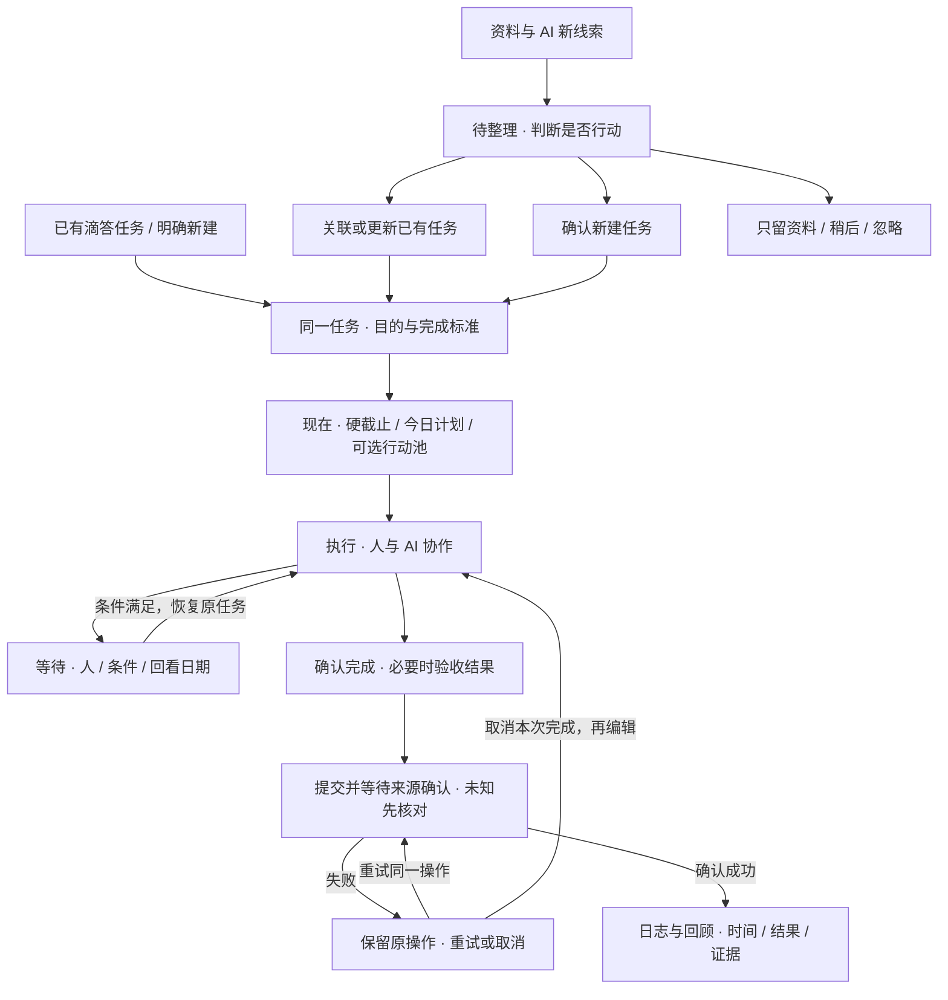

# v2：按问题读取，再选择采用

本次主流程：**安排今天 / 梳理项目 / 推进任务 → 按范围读取示例 → 显示完整性和时间 → 建议与依据 → 逐条采纳 → 查看实际影响与回执。**

- 安排今天：读取全部示例项目未完成任务，截止承诺全部保留，其余按可用时间提供选量参考。没有日历或真实耗时，按每项约 30 分钟仅作演示。
- 梳理项目：选择项目，检查已有任务、等待条件和同项目资料。建议保留在 Hub 助手笔记，不自动新建或完成任务。
- 推进任务：选择原任务，准备具体下一步。预览来源、修改前后内容，确认后模拟更新，保留身份、清单、日期和完成状态。
- 数据情境：完整示例、旧缓存、飞书资料失败。部分结果不引用未取得的资料；旧缓存不能直接修改来源。
- 加入今日计划只保存在本浏览器的 Hub 引用列表，原任务不变。重新分析不重复生成任务。
- 暂不采用不改任务。来源保存失败可重试同一建议；结果未知先核对，示例核对为未写入后结束旧操作，再重新分析。
- 建议依据过期时拒绝覆盖原任务。刷新浏览器保留计划、建议与回执；v1 存档兼容。重置仅重置本原型，取消过期异步回调。
- 所有读取、AI 与写入都是本机模拟，没有账号、真实模型或外部任务 API。

下方与 `dist/task-flow.svg` 保留此前的进阶案例，供需要体验候选、等待、完成和日志时使用；不是每次 AI 分析都要走完的步骤。页面 `dist/flow.mjs` 同时提供 v2 说明和旧案例。

---

# Hub 桌面任务闭环原型说明

本说明对应独立的「Hub · 任务流程实验室」，用于评估交互设计。示例资料、AI 结果、滴答写入和来源确认全部为演示，不会访问真实账户。

## 任务为什么存在

任务服务于一个值得推进的结果或已经做出的承诺。聚合的价值是让依据、下一步、等待条件和结果在同一处可见，不是把其他软件再复制一遍。

- 默认用滴答保留个人任务主档；Hub 可以在具备能力时操作主档，但不要求用户反复切回原软件。
- Craft、飞书和 AI 提供的材料与线索不是天然的任务；确认之前保持候选身份。
- 资料、行动池、助手、日志和洞察关联同一任务 ID。
- 业务视图「现在 / 待整理 / 等待 / 全部」回答要处理什么；列表、看板等布局回答如何查看。
- 「现在」分开显示硬截止承诺、今日计划和可选行动池；只有行动池限制最多 5 项，前两类不受这个数量限制。

## 完整逻辑

## 状态与操作规则

| 场景 | 应有行为 | 不应该发生 |
| --- | --- | --- |
| 已有滴答任务 | 直接使用，保留原 ID、清单、日期 | 每次再次确认是否导入 |
| 用户明确新建 | 显示目标清单，标题必填，日期可空 | 自动套固定日期，强制再过候选阶段 |
| 材料提出新线索 | 先选择关联已有、确认新建、只留资料或忽略 | 自动批量生成任务 |
| 加入行动池 | 引用原任务，保持原清单 | 复制或移动任务 |
| 现在视图 | 硬截止、今日计划和可选行动池分别显示 | 把今日计划误当作硬截止 |
| 行动池已满 | 提示先选择；硬截止承诺和今日计划不受最多 5 项限制 | 隐藏到期或今日计划任务 |
| AI 生成清单或草稿 | 保留在原任务中，用户核对后采用 | 自动完成任务或新建另一套 AI 任务 |
| 等待 | 明确等谁、等什么，回看日期可选 | 只贴「等待」标签而没有后续条件 |
| 等待解除 | 恢复原任务 | 自动完成或另建一条 |
| 完成 | 普通任务一键；交付任务核对结果 | 把「生成了内容」当作交付完成 |
| 同步待确认 / 结果未知 | 显示待确认，先手动核对来源结果 | 盲目重试或显示来源已完成 |
| 同步失败 | 保留同一操作重试；也可先取消本次完成，再继续编辑 | 在旧完成意图仍有效时继续修改，或重复创建 |
| 取消本次完成 | 演示中清除待处理意图，忽略过期模拟确认，原任务保持未完成 | 把本地取消声称为真实远端撤销 |
| 来源确认完成 | 记录实际完成日期，关联日志与任务 | 必须有计划日期才能进入日志 |
| 重新打开 | 恢复原任务并保留历史 | 删除旧记录或生成替代任务 |
| 洞察已处理 | 只处理该条发现 | 修改其关联任务的完成状态 |

## 贯穿案例

「新版图纸通知」是一条虚构的飞书材料。将它关联到已有「核对固定点并反馈」任务，任务数量不增加。把原任务加入行动池，在任务中请 AI 准备核对清单；等待版本确认时记录条件，条件满足后恢复原任务。核对完成后保留结果，演示来源确认成功，再进入日志。

在失败分支中，同一提交操作可以重试，也可以先取消本次完成再继续编辑原任务。待确认或结果未知时先核对来源，不盲目重试；不会因为重试或重复关联而产生第二条任务。原型中的取消仅取消模拟意图，真实接入时不能假定远端已撤销。

## 原型验收重点

- 判断任务和材料是否足够容易。
- 从线索到原任务的关系是否清楚，是否避免重复维护。
- 「现在」是否有助于选择，而不只是另一份总列表。
- 等待是否有明确的下文。
- AI 产出、任务完成与来源确认是否被清楚区分。
- 完成后是否能回到任务、结果与依据。

流程图的可下载矢量版位于 `dist/task-flow.svg`。页面中的移动端文字版采用与矢量图相同的分支逻辑。
