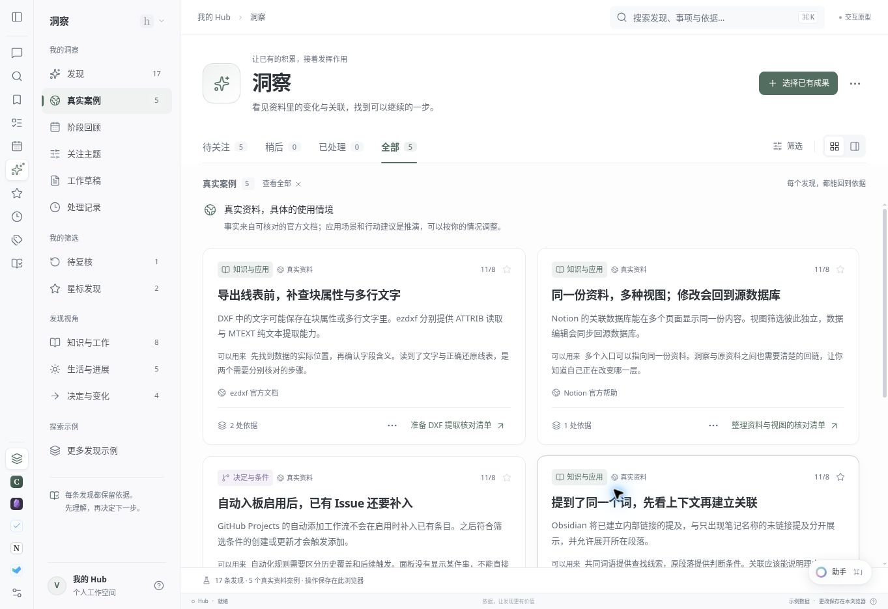
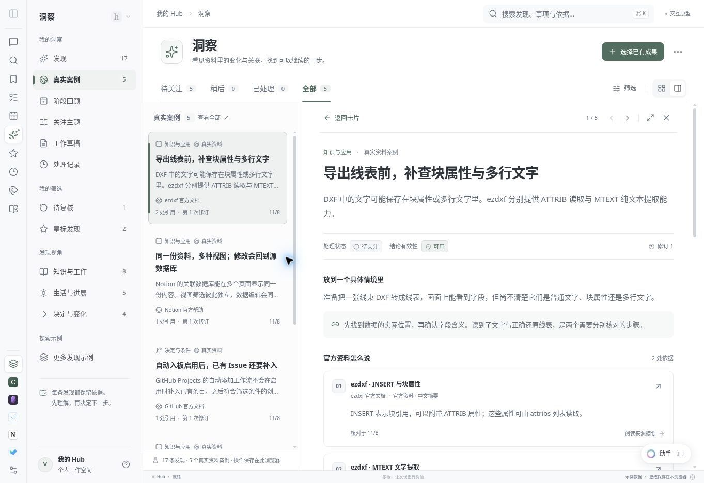

# Hub 浏览器交互原型

根据 `VondeSong/hub-search` 的桌面导航、模块组织、用户提供的截图和 Issue #2 洞察规划制作。本站是独立浏览器演示，未接入桌面 Tauri 后端或用户的真实来源账号。

## 当前版本：简化云同步中心（2026-11-08）

通过 `?view=cloud`、全局云图标、设置或闪卡顶栏进入。概览提供统一同步，偏好、连接与高级恢复按需查看；页面底部可切换首次连接、离线、失败与旧连接等示例。全部为浏览器演示，无真实云服务或本地数据写入。详见 [云同步原型说明](docs/cloud-sync-prototype.md)。

## 助手第二轮核对：补齐资料与对话操作（2026-11-08）

再次按本地源码补齐资料搜索与多选、库范围、图片与公共链接、六个内置技能的详情与选择、具体模型和默认项、五档推理与恢复默认、保存权限确认、历史更多操作与删除撤销、正文与报告阅读、共享记忆和预算演示、回答复制及工作过程。浏览新材料不会替换原对话材料；旧记录完整保留，损坏快照不会被空白数据覆盖。

TypeScript、生产构建、14 项状态检查及 18 项新增组件交互检查通过；已按新菜单入口复核原有交互。仅修改原型、仅用源码和自动化测试验证，未控制电脑或修改本地项目。具体差异、依据和后端边界见 [AI 助手第二轮源码核对](docs/assistant-source-audit.md)。下文分别保留其他模块与首轮助手记录。
## 闪卡交互与排版精修（2026-11-08）

本轮整理“今日 → 牌库预览 → 专注复习”的阅读与操作层级。参考以下官方产品与规范，结合 Hub 工作台选择适合闪卡的留白、导航和反馈方式。

| 官方参考 | 本次设计取舍 |
| --- | --- |
| [Craft](https://www.craft.do/) | 以内容为中心，区分标题、正文与来源信息，控制阅读宽度 |
| [Notion](https://www.notion.com/) | 保留列表上下文的侧边预览，将低频设置收进独立面板 |
| [Things](https://culturedcode.com/things/) | “今日”突出一个主要行动，使用克制的状态色与进度提示 |
| [Bear](https://bear.app/) | 清晰的侧栏与正文分工，统一字体层级和亮暗主题阅读体验 |
| [Mochi](https://mochi.cards/) | 聚焦问答卡、揭示答案与自评节奏，减少复习时的界面干扰 |
| [Apple Human Interface Guidelines](https://developer.apple.com/design/human-interface-guidelines/) | 明确层级、可见焦点、连续操作反馈与适应不同尺寸的布局 |

### 已实现的体验

- **阅读层级与侧预览**：今日计划、待复习牌组和学习进度分别呈现；牌库支持网格／列表、内容搜索与状态筛选。卡片在侧边抽屉中展示问题、答案、出处和属性，可连续预览前后卡片。
- **专注复习**：进入单卡阅读，揭示答案后再评分；支持稍后再看、重来回队、暂停继续与撤销。会话保留原牌组与卡序，切换页面后可以继续，完成后展示本轮结果。
- **键盘与焦点**：`/` 或 `⌘ / Ctrl + K` 搜索，`Space` 揭示答案，`1–4` 评分，`S` 稍后再看，`U` 撤销，`Esc` 暂停或关闭当前弹层。输入文字与组合输入时不触发复习快捷键；弹层提供焦点约束和关闭后的焦点恢复。
- **原子持久化**：沿用 `hub-flashcard-prototype-v1`，把统计、偏好与完整会话作为单份 JSON 快照保存；刷新可恢复答案面与剩余队列。新卡只在首次评分时占用当天额度，调低额度会延后未学新卡；撤销保留最新设置。按北京时间跨日清零当天进度并保留额度偏好。
- **主题与响应式**：沿用工作台主题和强调色，补齐亮暗配色、窄屏布局、触控尺寸与可见键盘焦点，并响应减少动效、减少透明度和增强对比度偏好。

### 验证与范围

- 原有 `scripts/flashcard-check.mjs` 的 **8 项计划检查**与新增 `scripts/flashcard-state-check.mjs` 的 **10 组状态检查**均通过，覆盖额度边界、牌组范围、旧存储迁移、重复新卡、撤销、刷新、跨日及不可变更新。
- 全项目 TypeScript 校验通过：`tsc --noEmit --incremental false`。上述检查验证本地状态规则，不替代真实设备上的交互验收。
- 浏览器验收覆盖桌面亮暗主题、390 px 窄屏、搜索与筛选、侧预览、键盘评分、完成后撤销和刷新续学。[今日概览实图](docs/flashcard-refinement/today.jpg) · [专注复习实图](docs/flashcard-refinement/review.jpg)。
- 当前仍是使用 **4 张示例卡的浏览器本地原型**。评分“重来”将卡片放回本轮队尾，其余评分标记今日已复习；尚未实现正式 SRS 的间隔调度，也不把展示结果视为真实学习记录。

## 助手更新：按本地源码对齐（2026-11-08）

助手已按桌面 0.16.396 的现有源码调整：顶部历史／新对话、任务模式、详情与关闭；输入框的＋资料与技能、保存权限、范围、推理强度和模型菜单；浮窗与侧边栏切换、宽高调整、Ctrl+Enter 发送及运行中追加／排队。旧对话和来源保护继续保留，新对话不会覆盖原工作。

本轮通过 TypeScript、生产构建、9 项助手状态检查、10 项组件交互检查及相关既有回归检查。依据源码与自动化测试验证，未操作电脑界面或做截图验收。模型、工具和资料读取仍属浏览器演示，未接入桌面后端；具体范围见 [助手对齐说明](docs/assistant-local-aligned.md)。下文洞察及其他模块说明继续适用。

后续界面与交互变更先更新本站原型，体验后再按明确指令修改本地。

## 洞察版本：Craft / Notion 阅读体验与公开资料案例（2026-11-08）

本轮根据用户对设计质感和真实案例的要求，参考 Craft、Notion 的阅读与导航方式，优化洞察界面并加入可核对出处的案例。下文旧版本的数量与入口位置保留为历史记录，当前以本节为准。

### 设计评估与决定

交互参考：[Craft 3.4.3](https://www.craft.do/blog/craft-update-3-4-3)、[Notion 视图与侧边阅读](https://www.notion.com/help/views-filters-and-sorts)、[Notion 页面布局](https://www.notion.com/help/layouts)。以下是结合 Hub 工作台的设计判断。

- 保留二级侧边栏与顶部状态 Tab：侧栏切换发现、真实案例、回顾、主题、草稿和记录，Tab 切换待关注、稍后、已处理与全部。两层导航各自负责不同维度。
- 针对原界面小字号、过宽卡片和重复灰色说明块，增加正文与元信息的可读性、限制阅读宽度，桌面采用双列卡片；卡片依次呈现结论、关联、出处和一个主要行动。
- 点击卡片进入保留列表上下文的侧边阅读（side peek），支持前后切换、专注阅读和返回卡片。重开详情从顶部开始，返回保留卡片位置；键盘焦点随打开与关闭移动。
- 将低频操作收进更多菜单、筛选收进统一面板，修订与处理历史默认折叠。依据按序号展示，公开摘要与逐字引文使用不同标识，官方原文与 Hub 内摘要均有入口。
- 延续现有主题与强调色，统一卡片、侧栏和阅读页的间距、边框与状态样式；保留可见键盘焦点，Esc 只关闭当前操作层，不同时清空搜索。

### 五个公开资料案例

案例中的产品机制与技术事实来自下列官方页面；中文内容是整理后的摘要，应用场景、关联解释和行动建议属于推演，不代表用户实际发生的经历，也不表示已经执行了建议。页面保留核对日期与官方链接。

| 案例 | 要理解的发现 | 官方依据 |
| --- | --- | --- |
| DXF 线表提取 | 导出前检查块属性与多行文字，分别核对文字提取和字段映射 | [ezdxf INSERT / ATTRIB](https://ezdxf.readthedocs.io/en/stable/blocks/insert.html)、[ezdxf MTEXT](https://ezdxf.readthedocs.io/en/stable/dxfentities/mtext.html) |
| Notion 资料与视图 | 关联视图的筛选设置与原数据库的数据编辑具有不同作用范围 | [Using linked databases](https://www.notion.com/help/guides/using-linked-databases) |
| GitHub 项目看板 | 开启自动添加后，仍需核对已有 Issue 是否已纳入项目 | [Adding items automatically](https://docs.github.com/en/issues/planning-and-tracking-with-projects/automating-your-project/adding-items-automatically) |
| Obsidian 笔记关联 | 同词提及提供线索，建立关联前先核对完整上下文 | [Backlinks](https://obsidian.md/help/plugins/backlinks) |
| Craft 每周回顾 | 集中查看任务，再回到原笔记核对目标、已有产出与剩余问题 | [Introducing Tasks](https://www.craft.do/blog/introducing-tasks) |

### 初始数据与实践清单

| 内容 | 首次访问时的数量 |
| --- | --- |
| 已保存发现 | 17 条：11 待关注、3 稍后、3 已处理，其中 5 条为本轮公开资料案例 |
| 固定成果 | 21 份 |
| Hub 初始资料 | 56 条，其中 6 份为本轮官方资料的中文摘要 |

公开案例通过 `ensurePublicCaseDemo()` 一次性追加。原有发现身份、修订、反馈、处理状态及来源访问条件继续保留；已有浏览器中的状态数量可能与首次访问不同，刷新不会重复添加案例或重置用户操作。

在案例详情点击“准备实践清单”，可先编辑标题与内容，再保存为 Hub 笔记。保存后的标题、段落、可勾选清单及 HTTPS 来源链接按结构展示，勾选结果会保留；工作草稿页的“已保存到 Hub”提供保存回执。此结构化清单流程限定于 `public-work-*` 公开案例来源，派生内容继续按原发现、修订和全部依赖来源核对可见性。

### 本轮验证与范围

- 5 项新增公开案例检查、原有 18 项 ledger 状态检查及 10 项互动示例检查均通过；实践清单的纯函数专项检查通过。
- 浏览器实际验证：打开来源摘要再返回；编辑、保存、勾选实践清单并刷新保持；稍后与撤销及数量联动；Esc 关闭菜单时保留搜索；前后切换案例与焦点移动；专注阅读；原成果快照的摘要标识；重复打开详情从顶部开始。
- 1363 × 936 桌面下纯白与纯黑主题可读，没有页面横向溢出。本轮未进行手机实机或窄屏浏览器验收。
- 发布以最终 TypeScript 检查与生产构建成功为前提。案例与助手仍为浏览器原型流程，未接入真实用户账号或实时 Agent 分析。
- 下列截图来自本轮实际预览；截图中已操作的状态不写入首次访问的初始数据。

## 上一轮：侧边栏、状态 Tab 与互动示例（2026-11-08）

本轮根据用户对上一版导航和示例数量的反馈，将洞察改为侧边栏与顶部 Tab 的组合，并补齐可以实际操作的测试内容。下文旧版本的数据数量与入口位置是当时记录，当前以本节为准。

### 导航与浏览

- 二级侧边栏直接进入发现、阶段回顾、关注主题、工作草稿和处理记录；待复核、星标、知识与工作、生活与进展、决定与变化作为筛选。桌面进入洞察时显示侧边栏，可以主动收起。
- 发现顶部提供待关注、稍后、已处理、全部四个 Tab，数量跟随当前范围、时间与搜索变化。待复核与星标入口默认跨处理状态查看，处理状态与结论有效性仍独立。
- 默认卡片浏览，保留结论、关系说明与依据入口；卡片上可以直接稍后、处理、恢复与星标。打开卡片进入列表与依据并排的视图，可随时返回卡片。
- 操作后保留撤销与查看入口；从原文返回恢复选中的发现、筛选、搜索和阅读布局。无结果界面可以一次清除搜索与筛选，切换发现会从详情顶部开始。
- 回顾、主题、草稿可直接进入，旧发现仍在“更多发现示例”。这些仍是探索演示，不作为真实客户端接入已经完成的证明。

### 可用的测试数据

| 内容 | 首次访问时的数量与用途 |
| --- | --- |
| 已保存发现 | 12 条：6 待关注、3 稍后、3 已处理；其中 2 待复核、2 星标 |
| 关联事项 | 7 个，覆盖原型验证、DXF、装配、阅读应用、周计划、周末出行和工具选择 |
| 固定 Agent 成果 | 16 份，包含两个新增复核案例的后续成果 |
| Hub 初始资料 | 50 条；本轮新增 9 份可以完整打开的合成原文 |
| 起始工作草稿 | 2 份：DXF 验证清单、左前门卡扣版本核对任务 |
| 关注主题 | 沿用 2 个示例及它们已有的启停、到期、轮次记录 |

新增发现通过 `ensureInteractionDemo()` 一次性追加到已有浏览器快照；只补充本轮缺失示例，原发现、修订、状态、反馈和来源访问条件原样保留。因此老浏览器的状态数量可能与首次访问不同。稍后到期时间在首次添加时设为 24 / 48 / 72 小时后，退出期间不发送通知。

两个待复核案例都能继续：阅读安排确认预置补充后，从固定“每天 30 分钟”更新为“有空时阅读”；集合信息从 09:00 南门更新到 09:30 东门，保留原已处理状态。原始资料、用户补充和更新后结论分别保留。新增数据均为合成情景，不代表用户的真实计划、消费或生活。

工作草稿页展示“待采用草稿”和“已保存到 Hub”。草稿编辑保留原 ID，采用后产生本地笔记或任务；R2 助手的保存回执也在此显示，并按原修订及派生内容的全部来源核对可见性。两份起始草稿只追加一次，不覆盖编辑，也不因刷新恢复已删除的示例。

### 本轮验证

- 新增 10 项示例数据检查及原有 18 项状态检查均通过：引用原文、状态分布、追加幂等、用户改动保持、来源撤回保护、原子保存失败、两个可完成的更新流程等。
- 草稿迁移检查通过：旧数据追加、编辑不重复、删除不复活、状态与到期时间保持、保存回执的当前／历史／额外来源可见性。
- 浏览器实际验证：侧边栏与四个 Tab 联动、稍后恢复与撤销、跨状态待复核、打开原文再返回、阅读安排追加修订 2、直接进入回顾／主题／草稿、编辑后草稿总数不增加、采用任务草稿后转入已保存区、旧 R2 助手回执展示、无搜索结果后清除恢复。
- 1363 × 936 桌面下纯白与纯黑主题可读，没有页面水平溢出。本轮未进行手机实机或窄屏浏览器验收。
- 发布工作流必须通过最终 TypeScript 检查与生产构建。截图 `public/hub-insights-navigation-preview.jpg` 来自本轮实际预览；测试过程中的操作不写入首次访问的初始数据。

## 历史版本：Issue #2 R2 适配（2026-11-08）

本轮依据 [Issue #2](https://github.com/VondeSong/hub-search/issues/2) 当前有效规格 **INS-PLAN-20261108-R2**，将默认洞察面板调整为“已选成果 → 发现 → 依据 → 反馈 → 显式更新”的首批流程原型。阶段回顾、知识关联及专题管理继续保留在“回顾与专题演示 / 后续探索”中；它们不作为当前首批接入已经完成的证明。

### 本轮体验范围

- 首次打开预置 **4 条已选合成发现**，分别来自 3 份示例成果。此后由用户选择已有、已发布且带可读引用的成果候选；打开、切页、筛选和重复保存均不发起模型分析，也不扫描全库。
- 每条发现首次保存时分配随机 UUID。出处绑定到固定的工作、交付和发现位置，并保留内容指纹。同一出处重复保存返回原发现，不新增修订，不清除反馈或处理状态。
- “更新这条发现”只显示同一工作中的成果。用户明确选择对应候选、核对变化并发布新修订；旧内容、原身份、反馈和处理记录继续保留。报告重排不会按数组位置转移状态，另一工作中的同文候选也不会自动合并。更早的交付不能替换更新的修订；后续成果若遗漏已核对的用户纠正，该反馈重新待核对，历史确认记录仍保留。
- **处理状态**“待关注 / 稍后 / 已处理”与 **结论有效性**“可用 / 待复核 / 不可用”分别表达。已处理的发现遇到来源变化仍是已处理，可从“待复核”入口再次查看。
- 稍后保存明确到期时间；下一次读取面板时按到期情况恢复出现，并保留当前有效性。关闭页面期间不发送提醒。撤销产生补偿记录，不把过期证据恢复成可用，也不改动原任务。
- 事实纠正、关联纠正和补充背景先绑定目标修订保存；用户可以沿同一工作继续使用 Hub 助手。保存反馈只表示原话已保存，结论保持待复核；助手回复不会自动发布发现修订。
- 来源控制提供 D1 v1 → v2、撤回访问、恢复访问，以及更新失败 / 停止 / 结果未知的本地演示。版本变化只影响依赖该材料的发现；撤回访问后相关内容与派生草稿不可继续展示或发布。恢复访问需要重新核对，不自动认可旧结论。
- 浏览器重开保留发现身份、出处、修订、反馈、处理状态和操作记录。过时基版会被拒绝并要求重新核对；保存失败不留下半份浏览器快照，损坏记录不会被静默重置为示例。
- 原有资料、任务、阅读、日志、闪卡、主题、栏宽与助手等工作台功能保留。新增 D1、D2 两份合成原文，当前完整工作台初始资料为 41 条；原先 9 条洞察案例与 2 个专题留在后续探索入口。

### 固定成果与来源

成果选择器共提供 **10 份固定合成成果**，按用途分组，均未连接真实 Agent 交付：

| 分组 | 成果 | 用途 |
| --- | --- | --- |
| 已发布成果（3） | R1《验证方法与阶段进展》、DXF 小样例准备、装配版本核对 | 初始 4 条发现的出处；可重复选择，验证幂等保存 |
| 后续核对成果（3） | R2 重排改写、R3 用户纠正、R4 方法 v2 | 同一工作中显式对应、核对反馈和发布新修订 |
| 无发现与异常示例（4） | R-B 另一工作的同文成果、R0 证据不足、普通正文、R-bad 无效引用 | 不跨工作继承身份、不补齐卡片、保留原回答入口、拒绝无效候选 |

D1、D2、U1 采用 Issue 中的 **INS-SAMPLE-v1** 固定材料。D1 v2 只补充“适用版本”，编号“蓝湾-731”保持不变；D2 的原文不会因用户纠正被改写。U1 是单独的用户补充身份，R3 只有在本工作实际保存对应反馈后才能采用，且发布前须明确确认该反馈已在新成果中处理。事件日期、记录 / 补写时间、来源修改时间、观察时间与成果生成时间分别保留；未知时间不补造。

### 建议手动体验路径

1. 在“选择 Agent 成果”中打开《验证方法与阶段进展》，重复保存 R1 候选。列表仍是原来的发现，身份、修订数与处理状态不应增加或重置；也可直接返回已保存发现。
2. 从原发现进入“更新这条发现”，选择“后续核对成果”中的 R2。分别把重排后的方法与进展候选对应回原发现，检查身份不变、状态没有互换，旧修订可回看。
3. 将“本周已完成原型验证”这条进展发现标为已处理，再保存事实纠正。可点击“填入纸面原型的示例补充”，保存 U1：`这里的‘完成’仅指纸面原型，尚未完成实机验证。` 此时应同时显示“已处理”和“待复核”。
4. 选择保存后在原工作继续核对，检查助手收到当前发现、目标修订、引文与用户补充。关闭助手后，发现仍保留旧内容和待复核状态。
5. 再从原进展发现进入更新，选择 R3《验证进展 · 根据用户补充核对》，明确勾选已处理的反馈后发布。新修订只声称纸面原型完成、实机验证待进行；原身份、已处理状态、U1 与旧修订保留。
6. 在“来源与演示控制”中把《验证方法》模拟更新到 v2。只有依赖 D1 的方法发现待复核，进展发现不被无故失效；旧引文仍显示 v1。返回方法发现，选 R4《验证方法 · 适用版本已补充》显式更新后，再查看 v2 原文与变化说明。
7. 模拟撤回《项目复盘》的访问，检查依赖它的发现正文、引文、历史内容与派生成果不可继续读取，而其他可读发现仍可使用。恢复示例访问后先核对来源；恢复访问本身不发布内容修订。
8. 浏览证据不足、普通正文及无效引用成果，确认有明确原因与原回答入口，不生成占位发现。刷新页面，复查身份、处理状态、反馈、修订及稍后时间仍保留。

### 保存、实现与验证边界

首批流程使用独立的浏览器键 `hub-insights-selected-results-v1`，与后续探索的旧洞察状态分开保存。状态服务以一个 localStorage 快照提交，结合操作幂等、基版检查及可用时的浏览器写锁处理本地冲突；这不是 Hub 桌面的 SQLite 事务、来源授权系统或完整备份协议。助手继续复用现有工作会话，其回复仍由演示逻辑生成。

主要新增文件：

- `app/InsightPanel.tsx`、`app/insight-panel.css`：当前首批流程的发现列表、成果选择、证据、反馈与修订界面。
- `app/insight-ledger.ts`：浏览器发现主记录、内容修订、出处、事件、依赖有效性及持久化合同。
- `app/insight-reports.ts`：10 份固定成果、版本化来源、D1 / D2 阅读记录与引用核对。
- `scripts/insight-ledger-check.ts`：18 项确定性的浏览器原型合同检查，覆盖稳定身份、重复请求、显式更新、纠正保留、访问变化、撤销、到期、写入失败与损坏记录保护。

上述 18 项状态合同检查已通过。它们只验证此浏览器原型中的状态规则；发布工作流另外要求 TypeScript 检查及生产构建成功，下方旧版验证不充当本轮证据。

### 本轮浏览器验证

在 1363 × 936 的浏览器预览中实际操作并验证：

- R1 重复保存没有新增发现；打开完整原文后返回，保留发现位置。
- 进展发现标记已处理、保存 U1、沿原工作打开助手，均保留目标修订与用户原话；反馈后同时显示“已处理”和“待复核”。
- 助手草稿保存为 Hub 笔记后产生可打开的回执。验证时修复了非安全预览环境缺少 `crypto.randomUUID()` 导致回执失败的问题，重试成功。
- R3 经用户明确确认反馈后追加修订 2，发现身份及已处理状态不变，U1 与旧修订保留。
- D1 更新到 v2 只使方法发现待复核；单纯核对来源不会把旧引用改成新版本。选择 R4 后显示 v2 引用、变化说明与修订 2。
- D2 撤回访问后隐藏依赖发现的正文、引文、反馈、历史与派生笔记；全局搜索无法找到相关派生笔记。恢复访问并核对后可以继续使用。
- 证据不足成果保留原回答入口且无法保存空卡片；无效引文及不可读来源候选禁用。
- 原来的 9 个洞察案例、阶段回顾及返回当前面板的入口可用；刷新后保留修订、处理状态、反馈与保存回执。
- 纯白与纯黑主题可读，当前桌面视口无页面水平溢出。未进行手机实机或窄屏浏览器验收。

本轮预览截图：`public/hub-insights-r2-preview.jpg`。截图来自上述交互后的浏览器状态；首次访问仍从 4 条初始发现开始，不会继承验证过程中产生的示例笔记与操作。

本轮没有接入真实 Hub 桌面数据库、真实模型、Craft / Obsidian / 滴答等外部来源权限或写入，也没有实现或验收 SQLite 完整备份恢复。本轮检查不等于 Issue 的 S01–S16 正式客户端验收，不宣称首批业务实现完成。只更新此站点原型，未修改 GitHub Issue 正文、状态或开发看板。

## 历史版本：工作台与 Insights Lab v2 迁移（2026-11-08）

以下保留迁移完成时的范围、数据数量与验证记录。当前默认洞察入口以本页上方的 R2 适配为准；这里描述的旧发现、回顾和专题已移入后续探索。

### 体验范围

- 保留窄全局图标栏、随模块切换的二级导航、按时间分组的内容列表和独立阅读面板。
- 资料全文搜索、来源单选与 Ctrl/⌘ 多选、智能集合、收藏、最近浏览、标签、资料链接及专注阅读。
- 任务按项目与清单组织，支持完成与恢复、状态与日期编辑，以及列表、表格和看板。
- 阅读支持待读、进行中、已读、归档、放弃；提供列表、表格、看板和画廊。
- 日志支持日历筛选、新建和编辑；附有四张示例复习卡。
- 洞察嵌入全局导航，提供发现与回顾。发现支持来源跳转、返回原发现、稍后、已了解、撤销、补充纠正和处理历史；处理发现不会自动改变原任务。
- 已将 Hub Insights Lab v2 的 4 条有效发现、9 份完整原文和 2 个关注主题迁入现有洞察模块，保留工作台原有 5 条发现和阶段回顾。
- 分析来源范围按完整依赖筛选；支持最近 7 天、本月与全部时间，稍后时间意向、忽略、恢复及撤销；搜索可找发现、相关原文与工作草稿。
- 来源版本可模拟递增并标记依赖发现待复核；核对时保留原判断、纠正条件和处理记录。模拟版本变化不改写原始工程摘录。
- 工作草稿保留来源、版本、待确认条件与发现归属，可编辑为新版本、保留草稿，或确认保存为工作台中的笔记/任务。关联发现中提供已保存记录的回链。
- 关注主题支持问题、触发条件、来源范围、启用/暂停、7 天内最多 3 轮的手动演示复查；轮次耗尽自动暂停，范围不足不扣轮次。
- 助手浮窗/展开工作台共享对话和草稿。同一 workId 的发现共用会话、输入与设置并合并来源；不同工作分别保留。可演示停止、继续、追加、排队，笔记和任务草稿经用户确认后写入工作台并关联回发现。
- 助手提供 Codex/DeepSeek、标准/扩展模式、思考强度和 Codex 速度预览；附件只记录文件名，不读取或上传内容。
- 八种背景主题、六种独立强调色、列表密度与可拖动栏宽。正文保持实底，深色主题使用适配的强调色明度。

### 数据边界

39 条初始资料与 9 个洞察案例均为示例。最近 7 天默认显示其中 8 条发现，11 月 1 日的阅读复用发现可在“本月”或“全部时间”中查看。任务、阅读、收藏、日志、笔记、集合、洞察状态、草稿、关注主题与记录保存在当前浏览器 localStorage；助手会话和洞察视图位置使用 sessionStorage。

现有工作台浏览器记录按 ID 补齐新增原文，保留用户已有条目和设置。洞察状态兼容工作台 v1，助手兼容旧 general 会话；旧发现别名 review-prep 与 version-followup 分别归入 dxf 与 assembly，不重复生成卡片。

本次迁移覆盖源站的代码、交互和示例资料。旧洞察站与工作台属于不同 origin，不会自动读取用户在旧站浏览器中的个性化草稿、处理状态或输入。旧站的助手会话仅存在于该页面内存中，未声称转移这些会话。旧站保持原状。

助手回复由演示逻辑生成，不调用 GPT、DeepSeek 或 Codex。没有执行 Craft、Obsidian、滴答清单、Notion、飞书同步或外部写入。后台观察与通知未连接真实服务。

### 实现

Vinext + React + TypeScript；沿用 Sites 标准构建。主要文件：

- `app/page.tsx`：工作台、模块导航与浏览器演示数据操作。
- `app/data.ts`：示例资料与来源元数据。
- `app/Insights.tsx`、`app/insights.css`：发现、证据、阶段回顾与反馈。
- `app/insight-migration.ts`：旧站发现、完整原文、关注主题、来源映射与对照摘录。
- `app/insight-workflow.ts`：状态兼容与校验、有限关注期限、助手草稿回执。
- `app/Assistant.tsx`、`app/assistant.css`：上下文助手与草稿确认。
- `app/globals.css`：工作台布局、主题、响应式样式。

### 迁移版本验证

- TypeScript 检查与生产构建。
- 迁移数据引用完整性：4 条有效旧发现、9 份唯一原文、2 个主题；所有引用原句均存在于对应正文。
- 工作流状态检查：范围 AND、8/9 条时间边界、版本依赖、修正/撤销、草稿回链、关注轮次耗尽、过期与自定义主题持久化。
- 浏览器实际操作：范围排除与清空、来源 v2 → 待复核 → 完整原文 → 返回发现、纠正条件带入草稿、草稿保存为 Hub 任务并回链、2 轮关注耗尽后禁用。
- 助手会话：mapping-change 与 dxf 共用讨论、输入和设置，累计 2 条发现/4 份来源；assembly 进入独立工作会话。
- 桌面 1363 × 936：默认四栏布局、无页面水平溢出、纯白与夜读绿。
- 搜索与来源筛选、任务完成与刷新恢复、阅读状态与看板同步。
- 新建日志正文回显、洞察稍后/恢复、打开依据与原发现恢复、阶段回顾。
- 助手引用上下文、展开后保留会话、确认任务草稿并进入任务清单。
- 闪卡翻面和复习计数。

响应式布局已实现；本轮未进行手机实机验收。以上是原型验证，不代表桌面客户端或真实来源端到端验收。

### 2026-11-12 保存前依据确认（源码更新，待发布）

既有成果选择器新增依据确认，切换成果、范围或候选后重新确认，未确认时禁止保存。沿用现有页面与浏览器示例，未引入真实同步。详见 [依据确认记录](docs/insights-dependency-confirmation.md)。TypeScript、生产构建、18 项状态合同检查和本地浏览器流程通过；Sites 编辑连接尚未取得发布权限，线上仍为来源快照记录的 v80。
